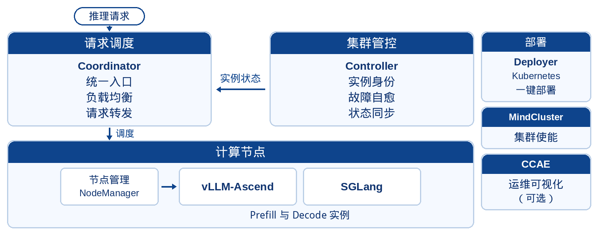

    

## ✨ 最新消息

- [2026.10.28]: 🚀 3.2.0 发布，对接 SGLang 原生引擎，提供 PD 分离推理服务
- [2026.10.28]: 🚀 支持 D2D 权重加载，缩短新实例启动时间
- [2026.10.28]: 🚀 支持 Docker only 一键部署，以及基于 Slurm + Apptainer 的部署
- [2026.10.28]: 🚀 支持跨超节点部署、PD 异构部署，以及推理大 EP 场景下的 DP 域缩容
- [2026.10.28]: 🚀 支持基于 HPA 的自动扩缩容，Prefill 与 Decode 可分别配置调度策略
- [2026.10.28]: 🚀 支持数据混淆推理（PMCC）
- [2026.10.28]: 🚀 长短序列动态分桶调度、KV Cache 亲和性调度增强（POC）
- [2026.08.19]: 🚀 3.1.0 发布，代码仓由 MindIE PyMotor 更名为 MindIE Motor，对接 vLLM-Ascend
- [2026.08.19]: 🚀 支持 PD 混部、部署时配置 CP/PP，以及按业务繁忙程度自动增减推理实例
- [2026.08.19]: 🚀 支持在 Ascend 950 系列产品上部署推理服务
- [2026.08.19]: 🚀 支持 Atlas 800I A3 超节点服务器、IPv6 单栈场景下部署 vLLM 推理服务
- [2026.08.19]: 🚀 支持按请求字段定制流控，链路追踪补充故障请求状态与性能异常记录
- [2026.08.19]: 🚀 KV 亲和性调度可与 Function Call 叠加
- [2026.03]: 🚀 MindIE Motor 正式开源

## ℹ️ 简介

MindIE Motor 是面向大语言模型分布式推理的请求调度框架，提供一键式 PD 分离与 PD 混部部署。它基于云原生插件化架构，对接 [vLLM-Ascend](https://github.com/vllm-project/vllm-ascend) 与 [SGLang](https://github.com/sgl-project/sglang) 原生引擎，结合高性能调度与负载均衡，构建高可用、可扩展的大规模推理服务。组件说明见 [架构](./docs/zh/architecture.md)。

## 🤖 常用模型

vLLM 常用模型的配置示例在 [model_configs/vllm/models](./model_configs/vllm/models)。生成方式见 [配置说明](./model_configs/vllm/models/README.md)。

| 模型 | Atlas 800I A2 | Atlas 800I A3 超节点 | Ascend 950PR |
| --- | --- | --- | --- |
| DeepSeek-V4.1-Flash 🔥🔥🔥 |  |  |  |
| GLM-5.3-Flash 🔥🔥🔥 |  |  |  |
| DeepSeek-V4-Flash-DSpark 🔥🔥🔥 |  |  |  |
| DeepSeek-V4 🔥🔥 |  |  |  |
| DeepSeek-V4.1 🔥🔥 |  |  |  |
| GLM-5.2 🔥🔥 |  |  |  |
| GLM-5.3 🔥🔥 |  |  |  |
| DeepSeek-V4-Flash 🔥 | [A2](./model_configs/vllm/models/deepseek_v4_flash/A2) | [A3](./model_configs/vllm/models/deepseek_v4_flash/A3) | [A5](./model_configs/vllm/models/deepseek_v4_flash/A5) |
| GLM-5.1 🔥 | [A2](./model_configs/vllm/models/glm_5.1/A2) | [A3](./model_configs/vllm/models/glm_5.1/A3) | [A5](./model_configs/vllm/models/glm_5.1/A5) |
| DeepSeek-V3.1 | [A2](./model_configs/vllm/models/deepseek_v3.1/A2) | [A3](./model_configs/vllm/models/deepseek_v3.1/A3) | [A5](./model_configs/vllm/models/deepseek_v3.1/A5) |
| DeepSeek-V4-Pro | [A2](./model_configs/vllm/models/deepseek_v4_pro/A2) | [A3](./model_configs/vllm/models/deepseek_v4_pro/A3) | [A5](./model_configs/vllm/models/deepseek_v4_pro/A5) |
| GLM-5 | [A2](./model_configs/vllm/models/glm_5/A2) | [A3](./model_configs/vllm/models/glm_5/A3) | [A5](./model_configs/vllm/models/glm_5/A5) |
| Qwen3-235B | [A2](./model_configs/vllm/models/qwen_235b/A2) | [A3](./model_configs/vllm/models/qwen_235b/A3) | — |

## ⚙️ 功能介绍

引擎与部署方式的覆盖范围见 [特性支持列表](./docs/zh/user_guide/features/supported_features.md)。下表只列主要能力入口。

<table>
  <tr>
    <th align="center" nowrap>🎯 一键部署</th>
    <th align="center" nowrap>⚡ 极致性能</th>
    <th align="center" nowrap>🛡️ 稳定可靠</th>
  </tr>
  <tr>
    <td valign="top">
      <table width="100%">
        <tr><td align="left" nowrap style="white-space:nowrap">K8s PD 分离（vLLM）</td><td align="right" nowrap width="1%" style="white-space:nowrap"><a href="./docs/zh/user_guide/deployment/k8s/pd_disaggregation_deployment.md">链接</a></td></tr>
        <tr><td align="left" nowrap style="white-space:nowrap">K8s PD 分离（SGLang）</td><td align="right" nowrap width="1%" style="white-space:nowrap"><a href="./docs/zh/user_guide/deployment/k8s/pd_disaggregation_sglang.md">链接</a></td></tr>
        <tr><td align="left" nowrap style="white-space:nowrap">K8s PD 混部</td><td align="right" nowrap width="1%" style="white-space:nowrap"><a href="./docs/zh/user_guide/deployment/k8s/pd_aggregation_deployment.md">链接</a></td></tr>
        <tr><td align="left" nowrap style="white-space:nowrap">Docker 单容器</td><td align="right" nowrap width="1%" style="white-space:nowrap"><a href="./docs/zh/user_guide/deployment/docker/single_container.md">链接</a></td></tr>
        <tr><td align="left" nowrap style="white-space:nowrap">Docker 宿主机 PD 分离</td><td align="right" nowrap width="1%" style="white-space:nowrap"><a href="./docs/zh/user_guide/deployment/docker/host/pd_disaggregation_deployment.md">链接</a></td></tr>
        <tr><td align="left" nowrap style="white-space:nowrap">Docker 宿主机 PD 混部</td><td align="right" nowrap width="1%" style="white-space:nowrap"><a href="./docs/zh/user_guide/deployment/docker/host/pd_aggregation_deployment.md">链接</a></td></tr>
        <tr><td align="left" nowrap style="white-space:nowrap">Docker 容器内（云化平台）PD 分离</td><td align="right" nowrap width="1%" style="white-space:nowrap"><a href="./docs/zh/user_guide/deployment/docker/container/pd_disaggregation_deployment.md">链接</a></td></tr>
        <tr><td align="left" nowrap style="white-space:nowrap">Docker 容器内（云化平台）PD 混部</td><td align="right" nowrap width="1%" style="white-space:nowrap"><a href="./docs/zh/user_guide/deployment/docker/container/pd_aggregation_deployment.md">链接</a></td></tr>
        <tr><td align="left" nowrap style="white-space:nowrap">Slurm</td><td align="right" nowrap width="1%" style="white-space:nowrap"><a href="./docs/zh/user_guide/deployment/slurm/README.md">链接</a></td></tr>
        <tr><td align="left" nowrap style="white-space:nowrap">Coordinator 独立部署</td><td align="right" nowrap width="1%" style="white-space:nowrap"><a href="./docs/zh/user_guide/deployment/standalone.md">链接</a></td></tr>
      </table>
    </td>
    <td valign="top">
      <table width="100%">
        <tr><td align="left" nowrap style="white-space:nowrap">PD 分离</td><td align="right" nowrap width="1%" style="white-space:nowrap"><a href="./docs/zh/user_guide/features/pd_disaggregation.md">链接</a></td></tr>
        <tr><td align="left" nowrap style="white-space:nowrap">EPD 分离</td><td align="right" nowrap width="1%" style="white-space:nowrap"><a href="./docs/zh/user_guide/features/EPD_disaggregation.md">链接</a></td></tr>
        <tr><td align="left" nowrap style="white-space:nowrap">KV Cache 亲和性调度</td><td align="right" nowrap width="1%" style="white-space:nowrap"><a href="./docs/zh/user_guide/features/kvcache_affinity.md">链接</a></td></tr>
        <tr><td align="left" nowrap style="white-space:nowrap">动态分桶调度</td><td align="right" nowrap width="1%" style="white-space:nowrap"><a href="./docs/zh/user_guide/features/dynamic_bucket.md">链接</a></td></tr>
        <tr><td align="left" nowrap style="white-space:nowrap">KV 池化</td><td align="right" nowrap width="1%" style="white-space:nowrap"><a href="./docs/zh/user_guide/features/kv_cache_store/README.md">链接</a></td></tr>
        <tr><td align="left" nowrap style="white-space:nowrap">max_tokens 自适应</td><td align="right" nowrap width="1%" style="white-space:nowrap"><a href="./docs/zh/user_guide/features/max_tokens_adaptation.md">链接</a></td></tr>
        <tr><td align="left" nowrap style="white-space:nowrap">支持的推理引擎</td><td align="right" nowrap width="1%" style="white-space:nowrap"><a href="./docs/zh/user_guide/features/supported_inference_engines.md">链接</a></td></tr>
      </table>
    </td>
    <td valign="top">
      <table width="100%">
        <tr><td align="left" nowrap style="white-space:nowrap">请求重调度</td><td align="right" nowrap width="1%" style="white-space:nowrap"><a href="./docs/zh/user_guide/features/fault_tolerance/rescheduler.md">链接</a></td></tr>
        <tr><td align="left" nowrap style="white-space:nowrap">实例重调度</td><td align="right" nowrap width="1%" style="white-space:nowrap"><a href="./docs/zh/user_guide/features/fault_tolerance/instance_rescheduling.md">链接</a></td></tr>
        <tr><td align="left" nowrap style="white-space:nowrap">ScaleP2D 故障恢复</td><td align="right" nowrap width="1%" style="white-space:nowrap"><a href="./docs/zh/user_guide/features/fault_tolerance/scale_p2d.md">链接</a></td></tr>
        <tr><td align="left" nowrap style="white-space:nowrap">主备倒换</td><td align="right" nowrap width="1%" style="white-space:nowrap"><a href="./docs/zh/user_guide/features/fault_tolerance/standby.md">链接</a></td></tr>
        <tr><td align="left" nowrap style="white-space:nowrap">自动弹性扩缩容</td><td align="right" nowrap width="1%" style="white-space:nowrap"><a href="./docs/zh/user_guide/features/auto_scaling.md">链接</a></td></tr>
        <tr><td align="left" nowrap style="white-space:nowrap">手动扩缩容</td><td align="right" nowrap width="1%" style="white-space:nowrap"><a href="./docs/zh/user_guide/features/manual_scaling.md">链接</a></td></tr>
        <tr><td align="left" nowrap style="white-space:nowrap">容器快照</td><td align="right" nowrap width="1%" style="white-space:nowrap"><a href="./docs/zh/user_guide/features/container_snapshot.md">链接</a></td></tr>
        <tr><td align="left" nowrap style="white-space:nowrap">D2D 权重加载</td><td align="right" nowrap width="1%" style="white-space:nowrap"><a href="./docs/zh/user_guide/features/startup_acceleration.md">链接</a></td></tr>
        <tr><td align="left" nowrap style="white-space:nowrap">数据混淆推理（PMCC）</td><td align="right" nowrap width="1%" style="white-space:nowrap"><a href="./docs/zh/user_guide/features/data_obfuscation.md">链接</a></td></tr>
        <tr><td align="left" nowrap style="white-space:nowrap">精度检测</td><td align="right" nowrap width="1%" style="white-space:nowrap"><a href="./docs/zh/user_guide/features/precision_detection.md">链接</a></td></tr>
      </table>
    </td>
  </tr>
</table>

## 🚀 快速入门

- **环境准备**：安装前的软硬件准备见 [环境准备](./docs/zh/user_guide/environment_preparation.md)。
- **快速部署**：启动服务、接口调用、精度与性能测试、停止服务见 [快速部署](./docs/zh/user_guide/quick_start.md)。

## 📦 安装指南

- **基于 vLLM-Ascend / SGLang 基座镜像安装**：见 [准备 MindIE Motor 镜像](./docs/zh/user_guide/maintenance/build_motor_image_from_vllm_ascend.md)。

## 📘 使用指南

用户指南覆盖环境准备、服务部署、特性配置、API、维护和错误码。完整目录见 [MindIE Motor 用户指南](./docs/zh/user_guide/menu_user_manual.md)。

架构与组件说明见 [MindIE Motor 架构](./docs/zh/architecture.md)。

## 🔀 版本说明

当前发布版本为 3.2.0。组件配套、兼容性和更新说明见 [版本配套说明](./docs/zh/release_note_motor.md)。

## 🛠️ 贡献指南

贡献流程见 [贡献者指南](./contributing.md)。

提交 Pull Request 后，在评论中回复 `compile` 触发门禁流水线。提交前请通过单元测试，入口为 [tests/run_tests.sh](./tests/run_tests.sh)。

## ⚖️ 相关说明

🔹 《[版本配套说明](./docs/zh/release_note_motor.md)》 
🔹 《[许可证声明](./LICENSE.md)》 
🔹 《[安全问题反馈](./security.md)》 

## 🤝 建议与交流

欢迎为社区做贡献。使用中的问题请先查看 [Issues](https://gitcode.com/Ascend/MindIE-Motor/issues)，没有对应项时再 [新建 Issue](https://gitcode.com/Ascend/MindIE-Motor/issues/create/choose)，并补充现象、复现步骤、日志和环境信息。

安全问题请不要写进公开 Issue，按 [security.md](./security.md) 联系维护者。

MindIE 系列 TC/SIG 会议见 [Ascend 会议中心](https://meeting.ascend.osinfra.cn/)。技术交流见 [昇腾论坛](https://www.hiascend.com/forum/)。
