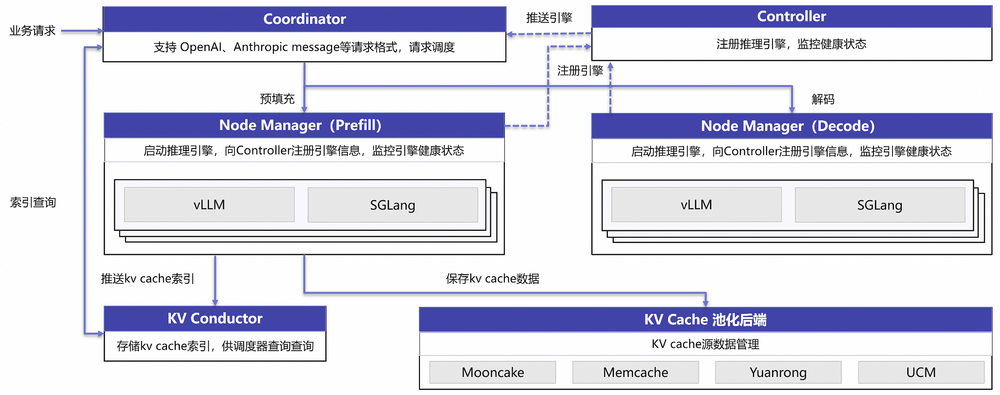

<!-- The complete wordmark below serves as the README title. -->
<!-- markdownlint-disable-file MD041 -->

    

## ✨ 最新消息

- [2026.11.11]: 🚀 3.3.0b1 发布，配套 vLLM-Ascend 0.32 RC 版本
- [2026.10.28]: 🚀 3.2.0 发布
- [2026.10.28]: 🚀 优化 Docker only 部署方案，部署流程大幅简化
- [2026.10.28]: 🚀 支持950系列服务器部署跨超节点的推理服务
- [2026.10.28]: 🚀 支持故障场景下的卡级缩容，故障卡退出服务，其余卡继续推理
- [2026.10.28]: 🚀 支持基于 HPA 的自动扩缩容，按业务流量调整 Prefill 与 Decode 实例配比
- [2026.08.19]: 🚀 3.1.0 发布，代码仓由 MindIE PyMotor 更名为 MindIE Motor
- [2026.08.19]: 🚀 支持 SGLang 推理引擎
- [2026.08.19]: 🚀 支持对接 MemCache 池化后端，提高KV Cache缓存利用率
- [2026.08.19]: 🚀 支持在 Ascend 950 系列产品上部署推理服务
- [2026.08.19]: 🚀 支持 Atlas 800I A3 超节点服务器、IPv6 单栈场景下部署推理服务
- [2026.08.19]: 🚀 支持 D2D 权重直传，重启引擎从内存加载权重，缩短服务启动时间
- [2026.03]: 🚀 MindIE Motor 正式开源

## ℹ️ 简介

MindIE Motor 是面向大语言模型分布式推理的请求调度框架，提供一键式 PD 分离与 PD 混部部署。它基于云原生插件化架构，对接 [vLLM-Ascend](https://github.com/vllm-project/vllm-ascend) 与 [SGLang](https://github.com/sgl-project/sglang) 原生引擎，结合高性能调度与负载均衡，构建高可用、可扩展的大规模推理服务。

## 🖥️ 服务部署

<table>
  <tr>
    <td valign="top">
      <table>
        <tr><th style="font-size:18px" align="center" colspan="2">🎯 部署指导</th></tr>
        <tr><th align="left" colspan="2">K8s 部署</th></tr>
        <tr><td align="left" width="320" style="background:#F0EDFF">【推荐】PD 分离（vLLM）</td><td align="center" width="72" style="background:#F0EDFF"><a href="./docs/zh/user_guide/deployment/README.md#k8s-pd-disaggregation">链接</a></td></tr>
        <tr><td align="left" width="320" style="background:#F0EDFF">【推荐】PD 分离（SGLang）</td><td align="center" width="72" style="background:#F0EDFF"><a href="./docs/zh/user_guide/deployment/README.md#k8s-pd-disaggregation-sglang">链接</a></td></tr>
        <tr><td align="left" width="320">PD 混部</td><td align="center" width="72"><a href="./docs/zh/user_guide/deployment/k8s/pd_aggregation_deployment.md">链接</a></td></tr>
        <tr><th align="left" colspan="2">docker 部署</th></tr>
        <tr><td align="left" width="320" style="background:#F0EDFF">【推荐】PD分离部署</td><td align="center" width="72" style="background:#F0EDFF"><a href="./docs/zh/user_guide/deployment/docker/host/pd_disaggregation_deployment.md">链接</a></td></tr>
        <tr><td align="left" width="320">PD混部部署</td><td align="center" width="72"><a href="./docs/zh/user_guide/deployment/docker/host/pd_aggregation_deployment.md">链接</a></td></tr>
        <tr><td align="left" width="320">云平台（例如：ModelArts）PD分离部署</td><td align="center" width="72"><a href="./docs/zh/user_guide/deployment/docker/container/pd_disaggregation_deployment.md">链接</a></td></tr>
        <tr><td align="left" width="320">云平台（例如：ModelArts）PD混部部署</td><td align="center" width="72"><a href="./docs/zh/user_guide/deployment/docker/container/pd_aggregation_deployment.md">链接</a></td></tr>
        <tr><th align="left" colspan="2">Slurm 部署</th></tr>
        <tr><td align="left" width="320">Slurm</td><td align="center" width="72"><a href="./docs/zh/user_guide/deployment/slurm/README.md">链接</a></td></tr>
        <tr><th align="left" colspan="2">调度器独立部署</th></tr>
        <tr><td align="left" width="320">Coordinator 独立部署</td><td align="center" width="72"><a href="./docs/zh/user_guide/deployment/standalone.md">链接</a></td></tr>
      </table>
    </td>
    <td class="gap" width="24" style="border:none;padding:0;background:transparent"></td>
    <td valign="top">
      <table>
        <tr><th style="font-size:18px" align="center" colspan="4">🤖 常用模型</th></tr>
        <tr>
          <th align="left">模型</th>
          <th align="center">Atlas 800I A2</th>
          <th align="center">Atlas 800I A3 超节点</th>
          <th align="center">Atlas 950系列服务器</th>
        </tr>
        <tr><td>DeepSeek-V4.1-Flash</td><td align="center">A2</td><td align="center">A3</td><td align="center">A5</td></tr>
        <tr><td>GLM-5.3-Flash</td><td align="center">A2</td><td align="center">A3</td><td align="center">A5</td></tr>
        <tr><td>GLM-5.2</td><td align="center">A2</td><td align="center">A3</td><td align="center">A5</td></tr>
        <tr><td>GLM-5.3</td><td align="center">A2</td><td align="center">A3</td><td align="center">A5</td></tr>
        <tr><td>DeepSeek-V4-Flash</td><td align="center"><a href="./model_configs/vllm/models/deepseek_v4_flash/A2">A2</a></td><td align="center"><a href="./model_configs/vllm/models/deepseek_v4_flash/A3">A3</a></td><td align="center"><a href="./model_configs/vllm/models/deepseek_v4_flash/A5">A5</a></td></tr>
        <tr><td>GLM-5.1</td><td align="center"><a href="./model_configs/vllm/models/glm_5.1/A2">A2</a></td><td align="center"><a href="./model_configs/vllm/models/glm_5.1/A3">A3</a></td><td align="center"><a href="./model_configs/vllm/models/glm_5.1/A5">A5</a></td></tr>
        <tr><td>DeepSeek-V3.1</td><td align="center"><a href="./model_configs/vllm/models/deepseek_v3.1/A2">A2</a></td><td align="center"><a href="./model_configs/vllm/models/deepseek_v3.1/A3">A3</a></td><td align="center"><a href="./model_configs/vllm/models/deepseek_v3.1/A5">A5</a></td></tr>
        <tr><td>DeepSeek-V4-Pro</td><td align="center"><a href="./model_configs/vllm/models/deepseek_v4_pro/A2">A2</a></td><td align="center"><a href="./model_configs/vllm/models/deepseek_v4_pro/A3">A3</a></td><td align="center"><a href="./model_configs/vllm/models/deepseek_v4_pro/A5">A5</a></td></tr>
        <tr><td>GLM-5</td><td align="center"><a href="./model_configs/vllm/models/glm_5/A2">A2</a></td><td align="center"><a href="./model_configs/vllm/models/glm_5/A3">A3</a></td><td align="center"><a href="./model_configs/vllm/models/glm_5/A5">A5</a></td></tr>
        <tr><td>Qwen3-235B</td><td align="center"><a href="./model_configs/vllm/models/qwen_235b/A2">A2</a></td><td align="center"><a href="./model_configs/vllm/models/qwen_235b/A3">A3</a></td><td align="center">—</td></tr>
      </table>
    </td>
  </tr>
</table>

## ⚙️ 功能介绍

引擎与部署方式的覆盖范围见 [特性支持列表](./docs/zh/user_guide/features/supported_features.md)。下表只列主要能力入口。

<table>
  <tr>
    <td valign="top">
      <table>
        <tr><th style="font-size:18px" align="center" colspan="2">⚡ 极致性能</th></tr>
        <tr><td align="left" width="320">PD 分离</td><td align="center" width="72"><a href="./docs/zh/user_guide/features/pd_disaggregation.md">链接</a></td></tr>
        <tr><td align="left" width="320">EPD 分离（多模态）</td><td align="center" width="72"><a href="./docs/zh/user_guide/features/EPD_disaggregation.md">链接</a></td></tr>
        <tr><td align="left" width="320">KV Cache 亲和性调度</td><td align="center" width="72"><a href="./docs/zh/user_guide/features/kvcache_affinity.md">链接</a></td></tr>
        <tr><td align="left" width="320">Agent Hint 会话亲和与调度</td><td align="center" width="72"><a href="./docs/zh/user_guide/features/agent_hint.md">链接</a></td></tr>
        <tr><td align="left" width="320">动态分桶调度</td><td align="center" width="72"><a href="./docs/zh/user_guide/features/dynamic_bucket.md">链接</a></td></tr>
        <tr><td align="left" width="320">Mooncake KV Cache 池化后端</td><td align="center" width="72"><a href="./docs/zh/user_guide/features/kv_cache_store/backend/mooncake.md">链接</a></td></tr>
        <tr><td align="left" width="320">MemCache KV Cache 池化后端</td><td align="center" width="72"><a href="./docs/zh/user_guide/features/kv_cache_store/backend/memcache.md">链接</a></td></tr>
        <tr><td align="left" width="320">Yuanrong KV Cache 池化后端</td><td align="center" width="72"><a href="./docs/zh/user_guide/features/kv_cache_store/backend/yuanrong.md">链接</a></td></tr>
        <tr><td align="left" width="320">UCM KV Cache 池化后端</td><td align="center" width="72"><a href="./docs/zh/user_guide/features/kv_cache_store/backend/ucm.md">链接</a></td></tr>
        <tr><td align="left" width="320">max_tokens 自适应</td><td align="center" width="72"><a href="./docs/zh/user_guide/features/max_tokens_adaptation.md">链接</a></td></tr>
      </table>
    </td>
    <td class="gap" width="24" style="border:none;padding:0;background:transparent"></td>
    <td valign="top">
      <table>
        <tr><th style="font-size:18px" align="center" colspan="2">🛡️ 稳定可靠</th></tr>
        <tr><td align="left" width="320">请求重调度</td><td align="center" width="72"><a href="./docs/zh/user_guide/features/fault_tolerance/rescheduler.md">链接</a></td></tr>
        <tr><td align="left" width="320">缩P保D</td><td align="center" width="72"><a href="./docs/zh/user_guide/features/fault_tolerance/scale_p2d.md">链接</a></td></tr>
        <tr><td align="left" width="320">主备倒换</td><td align="center" width="72"><a href="./docs/zh/user_guide/features/fault_tolerance/standby.md">链接</a></td></tr>
        <tr><td align="left" width="320">异常实例重启</td><td align="center" width="72"><a href="./docs/zh/design/fault_tolerance/overview.md">链接</a></td></tr>
        <tr><td align="left" width="320">虚推健康探测</td><td align="center" width="72"><a href="./docs/zh/user_guide/features/sim_inference.md">链接</a></td></tr>
        <tr><td align="left" width="320">服务限流</td><td align="center" width="72"><a href="./docs/zh/user_guide/features/rate_limiting.md">链接</a></td></tr>
        <tr><td align="left" width="320">RAS monitor 服务健康监控</td><td align="center" width="72"><a href="./examples/features/fault_tolerance/ras_monitor/readme.md">链接</a></td></tr>
        <tr><td align="left" width="320">自动弹性扩缩容</td><td align="center" width="72"><a href="./docs/zh/user_guide/features/auto_scaling.md">链接</a></td></tr>
        <tr><td align="left" width="320">手动扩缩容</td><td align="center" width="72"><a href="./docs/zh/user_guide/features/manual_scaling.md">链接</a></td></tr>
        <tr><td align="left" width="320">容器快照</td><td align="center" width="72"><a href="./docs/zh/user_guide/features/container_snapshot.md">链接</a></td></tr>
        <tr><td align="left" width="320">D2D 权重加载</td><td align="center" width="72"><a href="./docs/zh/user_guide/features/startup_acceleration.md">链接</a></td></tr>
        <tr><td align="left" width="320">数据混淆推理（PMCC）</td><td align="center" width="72"><a href="./docs/zh/user_guide/features/data_obfuscation.md">链接</a></td></tr>
        <tr><td align="left" width="320">精度检测</td><td align="center" width="72"><a href="./docs/zh/user_guide/features/precision_detection.md">链接</a></td></tr>
        <tr><td align="left" width="320">请求耗时追踪</td><td align="center" width="72"><a href="./docs/zh/user_guide/features/tracing.md">链接</a></td></tr>
      </table>
    </td>
  </tr>
</table>

## 🚀 快速入门

- **镜像获取**：单击 [链接](https://www.hiascend.com/developer/ascendhub/detail/f1690465f39847a8b0a1f9e5b36a03c4)，切换至“镜像下载”页签，即可获取官方完整的 MindIE Motor 镜像。
- **环境准备**：安装前的软硬件准备见 [环境准备](./docs/zh/user_guide/environment_preparation.md)。
- **快速部署**：启动服务、接口调用、精度与性能测试、停止服务见 [快速部署](./docs/zh/user_guide/quick_start.md)。

## 📦 安装指南

- **基于 vLLM-Ascend / SGLang 基座镜像安装**：见 [准备 MindIE Motor 镜像](./docs/zh/user_guide/maintenance/build_motor_image_from_vllm_ascend.md)。

## 🔀 版本说明

当前稳定版本为 3.2.0。组件配套、兼容性和更新说明见 [版本配套说明](./docs/zh/release_note_motor.md)。

## 🛠️ 贡献指南

贡献流程见 [贡献者指南](./contributing.md)。

安全问题请不要写进公开 Issue，按 [security.md](./security.md) 联系维护者。

## 🤝 联系我们

如有任何社区贡献想法（代码合入、Bug 反馈、issue进展跟踪、议题讨论等），欢迎加入社区交流群，或私聊社区管理员，我们将全程协助您完成贡献。

<table>
  <tr>
    <td align="center" width="33%">
       
      <b>社区代码仓仓主</b>
    </td>
    <td align="center" width="33%">
       
      <b>社区开源交流群</b>
    </td>
    <td align="center" width="33%">
       
      <b>社区管理员</b>
    </td>
  </tr>
</table>

MindIE 系列 TC/SIG 会议见 [Ascend 会议中心](https://meeting.ascend.osinfra.cn/)。技术交流见 [昇腾论坛](https://www.hiascend.com/forum/)。

## ⚖️ 许可说明

🔹 《[许可证声明](./LICENSE.md)》 
🔹 《[安全问题反馈](./security.md)》 
