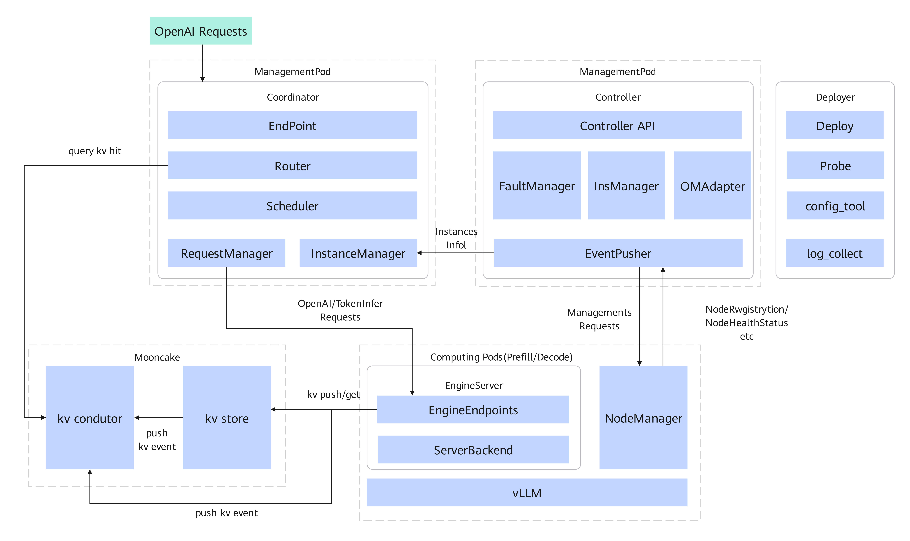

<!-- markdownlint-disable-next-line MD041 -->

    

    
    
    
    
    
    

## 简介

**MindIE Motor** 是昇腾上的大模型推理调度框架。它把外部请求接到 Prefill 与 Decode 上，两者可以分开部署，也可以混部；引擎侧对接 [vLLM-Ascend](https://github.com/vllm-project/vllm-ascend) 和 [SGLang](https://github.com/sgl-project/sglang)。

## 最新动态

- 10/15/2026：3.2.0 发布，对接 SGLang，提供 PD 分离推理 🚀
- 10/15/2026：D2D 权重加载，新实例可从同角色就绪实例拉权重 ⚡
- 10/15/2026：Docker only 一键部署，以及 Slurm + Apptainer 🧩
- 10/15/2026：跨超节点、PD 异构，大 EP 下 DP 域可缩容 ⚙️
- 10/15/2026：基于 HPA 的自动扩缩容，Prefill 与 Decode 可分别配置调度策略 📈
- 10/15/2026：数据混淆推理（PMCC）🔐
- 10/15/2026：长短序列动态分桶，KV Cache 亲和调度增强（POC）🧪
- 03/2026：MindIE Motor 开源 🎉

配套与兼容性见 [版本配套说明](./docs/zh/release_note_motor.md)。

## 架构

请求从 Coordinator 进入，Controller 管理实例和故障动作，NodeManager 在计算节点拉起引擎。组件说明见 [架构](./docs/zh/architecture.md)。

    

图中的 EngineServer 已在 3.2.0 删除，NodeManager 直接拉起 vLLM-Ascend 或 SGLang。

## 功能

引擎与部署方式是否覆盖，见 [特性支持列表](./docs/zh/user_guide/features/supported_features.md)。

**怎么部署**

| 方式 | 场景 | 文档 |
| --- | --- | --- |
| K8s PD 分离 | Prefill 与 Decode 分实例 | [PD 分离服务部署](./docs/zh/user_guide/deployment/k8s/pd_disaggregation_deployment.md) |
| K8s PD 混部 | 同一实例同时做 Prefill 和 Decode | [PD 混部服务部署](./docs/zh/user_guide/deployment/k8s/pd_aggregation_deployment.md) |
| K8s SGLang | 引擎用 SGLang，文档只写相对通用流程的必改项 | [SGLang PD 分离部署](./docs/zh/user_guide/deployment/k8s/pd_disaggregation_sglang.md) |
| Docker | 单容器、宿主机或容器内 | [部署方式](./docs/zh/user_guide/deployment/README.md) |
| Slurm | Apptainer 作业 | [Slurm 部署](./docs/zh/user_guide/deployment/slurm/README.md) |
| 只要调度面 | 引擎已在跑 | [Coordinator 独立部署](./docs/zh/user_guide/deployment/standalone.md) |

**调度**

| 能力 | 文档 |
| --- | --- |
| PD 分离 | [PD 分离](./docs/zh/user_guide/features/pd_disaggregation.md) |
| EPD 分离 | [EPD 分离](./docs/zh/user_guide/features/EPD_disaggregation.md) |
| KV Cache 亲和 | [KV Cache 亲和性调度](./docs/zh/user_guide/features/kvcache_affinity.md) |
| 动态分桶 | [动态分桶调度](./docs/zh/user_guide/features/dynamic_bucket.md) |
| KV 池化 | [KV 池化](./docs/zh/user_guide/features/kv_cache_store/README.md) |
| max_tokens 自适应 | [max_tokens 自适应](./docs/zh/user_guide/features/max_tokens_adaptation.md) |
| 推理引擎参数 | [支持对接的推理引擎](./docs/zh/user_guide/features/supported_inference_engines.md) |

**故障、扩缩容和数据**

| 能力 | 文档 |
| --- | --- |
| 请求重调度 | [请求重调度](./docs/zh/user_guide/features/fault_tolerance/rescheduler.md) |
| 实例重调度 | [实例重调度](./docs/zh/user_guide/features/fault_tolerance/instance_rescheduling.md) |
| ScaleP2D | [ScaleP2D 故障恢复](./docs/zh/user_guide/features/fault_tolerance/scale_p2d.md) |
| 主备倒换 | [主备倒换](./docs/zh/user_guide/features/fault_tolerance/standby.md) |
| 扩缩容 | [自动弹性扩缩容](./docs/zh/user_guide/features/auto_scaling.md)、[手动扩缩容](./docs/zh/user_guide/features/manual_scaling.md) |
| 容器快照 | [容器快照](./docs/zh/user_guide/features/container_snapshot.md) |
| D2D 权重加载 | [D2D 权重加载](./docs/zh/user_guide/features/startup_acceleration.md) |
| 数据混淆 | [数据混淆推理（PMCC）](./docs/zh/user_guide/features/data_obfuscation.md) |
| 精度检测 | [精度检测](./docs/zh/user_guide/features/precision_detection.md) |

## 快速入门

以一次完整调用为目标：准备环境，取镜像，拉起服务，打推理接口，再停掉。

1. [环境准备](./docs/zh/user_guide/environment_preparation.md)
2. 镜像从 [昇腾镜像仓库](https://www.hiascend.com/developer/ascendhub/detail/f1690465f39847a8b0a1f9e5b36a03c4) 的「镜像下载」获取，或按 [准备 MindIE Motor 镜像](./docs/zh/user_guide/maintenance/build_motor_image_from_vllm_ascend.md) 装到 vLLM-Ascend / SGLang 基座上
3. [快速部署](./docs/zh/user_guide/quick_start.md)

在线文档：<https://mindie-motor.readthedocs.io/>

K8s 模式对照见 [部署模式说明](./docs/zh/user_guide/deployment/k8s/README.md)。要在集群里用 Helm 跑部署器，见 [云原生部署与 Helm Chart](./examples/cloud_native_deploy/README.zh.md)。

## 文档

- [用户指南目录](./docs/zh/user_guide/menu_user_manual.md)：部署、特性、API、维护、错误码
- [版本配套说明](./docs/zh/release_note_motor.md)：3.2.0 的组件版本和更新说明
- [贡献者指南](./contributing.md)：提交前运行 [tests/run_tests.sh](./tests/run_tests.sh)，Pull Request 评论里回复 `compile` 触发门禁

## 对接

运行时对接 [vLLM-Ascend](https://github.com/vllm-project/vllm-ascend) 与 [SGLang](https://github.com/sgl-project/sglang)。集群调度的配套版本写在 [版本配套说明](./docs/zh/release_note_motor.md) 里。

## 联系

使用问题先看 [Issues](https://gitcode.com/Ascend/MindIE-Motor/issues)，没有相同的再 [新建](https://gitcode.com/Ascend/MindIE-Motor/issues/create/choose)，写上现象、步骤、日志和环境。安全问题不要发到公开 Issue，按 [security.md](./security.md) 联系维护者。

会议在 [Ascend 会议中心](https://meeting.ascend.osinfra.cn/)，讨论在 [昇腾论坛](https://www.hiascend.com/forum/)。许可证是 [Mulan PSL v2](./LICENSE.md)。
