# ModelArts Deployment Guide for Atlas 800I A2s: 8-Node Large-Scale EP + GLM5.1 Model + Yuanrong Multi-level Cache + MindIE Motor Comprehensive Scheduling

## Overall Solution Introduction

### Yuanrong Data System Introduction

The Yuanrong (YuanRong) data system is a distributed cache system designed to make full use of the HBM, DRAM, and SSD resources in a computing cluster, build a multi-level cache system close to computing, and comprehensively improve data access efficiency in scenarios such as model training and inference, big data analysis, and microservices. In inference scenarios, Yuanrong acts as a high-performance distributed multi-level cache. It builds a cache layer on DRAM and SSD, allows application instances to read DRAM data without copying through shared memory, and significantly reduces data access latency. The system also provides efficient H2D (Host
to Device) and D2H (Device to
Host) data transfer interfaces, which support fast data exchange between HBM and DRAM and further accelerate data flow during inference.

The system architecture is shown in the following figure:

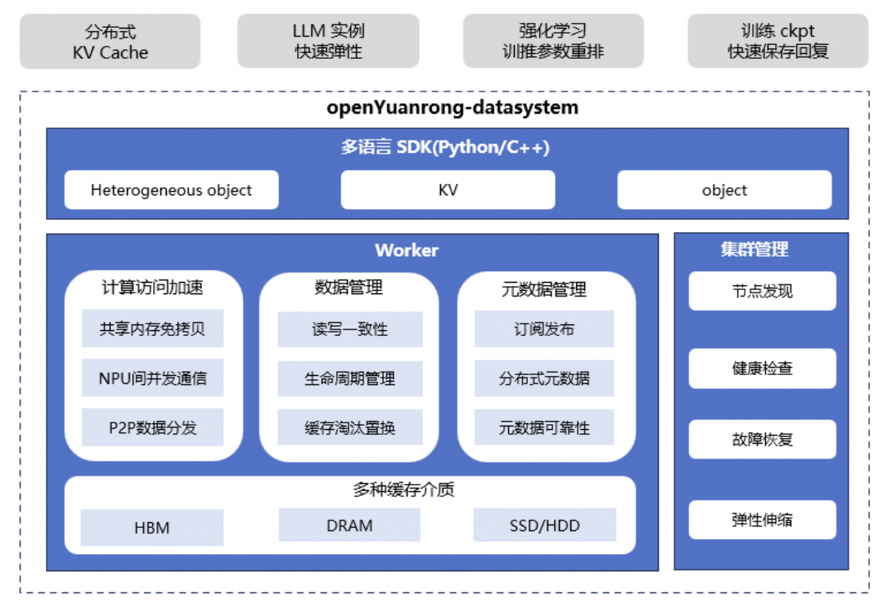

For details, see the open-source link: https://pages.openeuler.openatom.cn/openyuanrong-datasystem/docs/zh-cn/latest/index.html

### MindIE Motor Introduction

MindIE Motor is built on a cloud-native plug-in architecture that flexibly adapts to multiple inference engines. Combined with high-performance scheduling and load balancing capabilities, it provides highly available and scalable large-scale inference services. Its core capabilities are as follows:

- Provides high-performance request forwarding, including load balancing and KV affinity scheduling

- Provides high reliability with support for multiple fault detection and recovery functions

- Provides multi-engine capabilities and supports inference engines such as vLLM and SGLang

The system architecture is shown in the following figure:

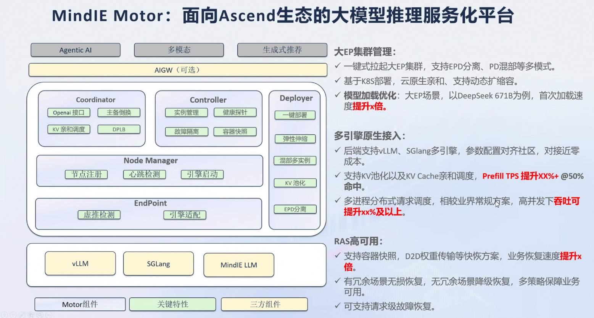

For details, see the open-source link: https://gitcode.com/Ascend/MindIE-Motor

### Overall Architecture

This document describes the large-scale EP deployment of the GLM5.1 model on the HCS ModelArts 8.5.1 platform (hereinafter referred to as MA). It supports inference-service-level KV cache pooling, affinity scheduling within an EP instance (at DP domain granularity), and EP-instance-level fault recovery. The main features are as follows:

- Deployment form: large-scale EP on 8 Atlas 800I A2s;

- Instance gateway: MindIE Motor, which supports node affinity scheduling and load balancing scheduling;

- KV cache multi-level caching: 0.5-1.6 TB of DDR memory allocated per server, with cross-large-scale-EP cache pooling implemented through global ETCD;

- KV affinity: affinity scheduling within a large-scale EP instance, with L1 (HBM) KV hit rate calculation supported;

- Key features: automatic deployment on MA, and large-scale EP instance-level rescheduling to ensure reliability;

The overall architecture is shown in the following figure:

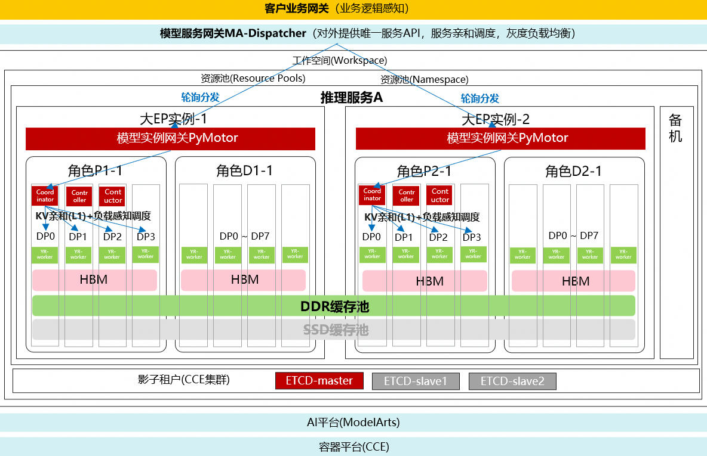

## MA Configuration and Startup Guide

### Hardware Resource Configuration

The following configuration is recommended (8 Atlas 800I A2s):

- CPU: 160 cores (80% of the total specification is recommended)

- Memory: 1,600 GB (80% of the total specification is recommended)

- Ascend NPU cards: 8

- Distributed inference - multi-node multi-card - number of instance groups: 1 - number of instances: 8

- Deployment timeout: 30 minutes

- Request timeout: 540s

- Storage mount: enter the OBS file path used to mount the Yuanrong, MindIE Motor, and model startup configuration files

A typical MA configuration is shown in the following figure (MA console - Development and Production - Model Deployment - Online Service - Deploy):

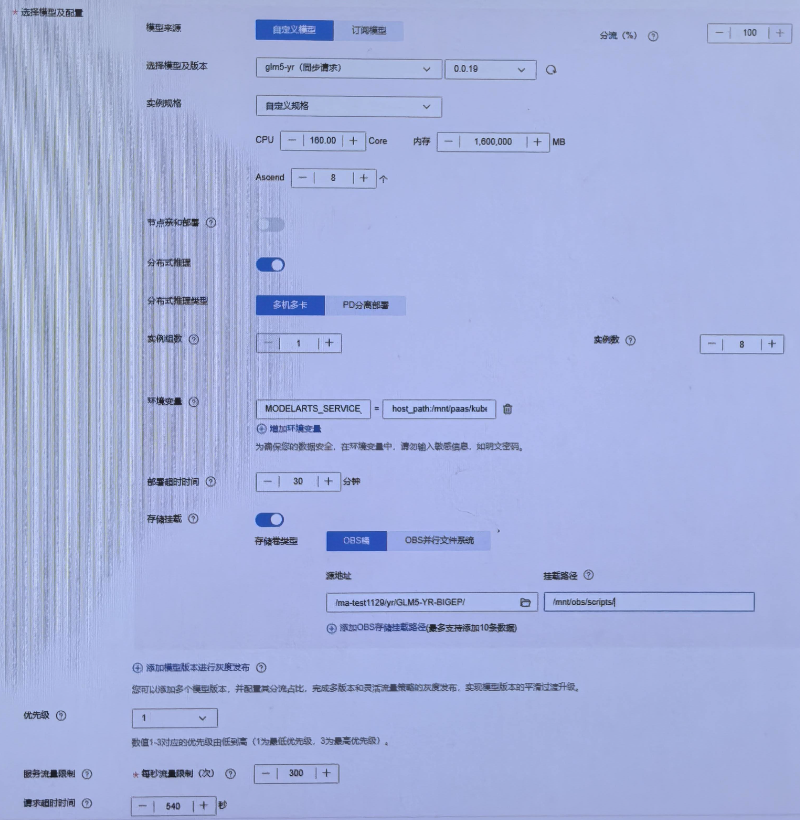

### Model Management Configuration

A complete model management configuration generally contains at least the following three versions:

1. Manually started model service version (empty container without the automatic model startup script or health check script);

2. Automatically started model service version;

3. Model test version (used for AIS_Bench deployment);

Version 1 is used for installation and deployment debugging, version 3 is used for precision and performance testing, and version 2 is used for reliability testing and formal production. The typical configuration of each version is shown below:

The configuration of the manually started version is as follows:

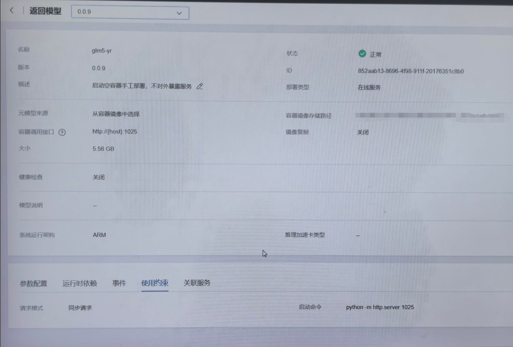

Typical configuration of the manually started version

For the manually started version, it is recommended to use the host IP plus port 1025. The service needs to be mounted in the startup command to occupy the container invocation port (an MA constraint).

The configuration of the automatically started version is as follows:

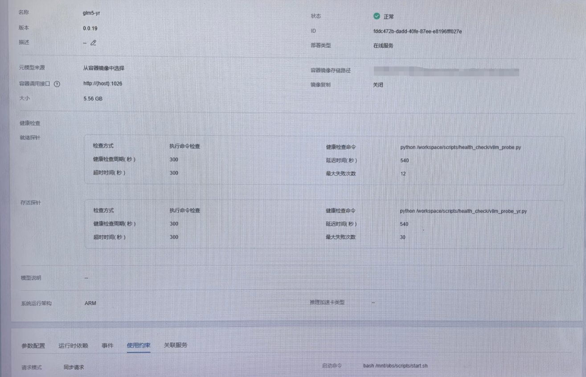

Typical configuration of the automatically started version

Model test version (used for ais_bench deployment):
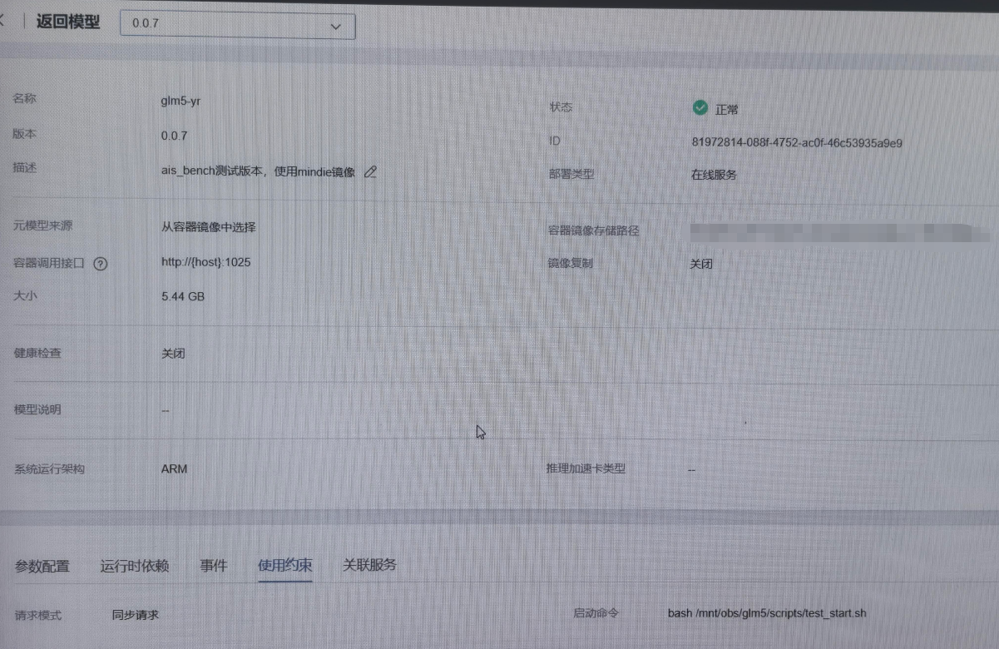

Typical configuration of the model test version

The implementation of test_start.sh is as follows. The MindIE image is recommended because it comes with the ais_bench tool:

```bash
#Keep consistent with the container's external port
python -m http.server 1025
```

### Service Startup Guide

#### ETCD Pooling Startup

Perform the following steps:

1. Log in to the resource tenant. The role of the resource tenant is as follows:

    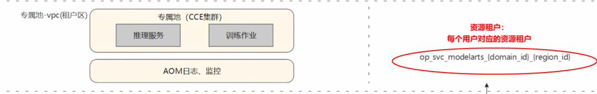

2. Go to the HCS console and choose "Service List \> Application Service \> Container Image Service SWR"

    

3. Click "Organization Management \> Create Organization", set the organization name to "etcd-yuanrong", and confirm the creation

    > 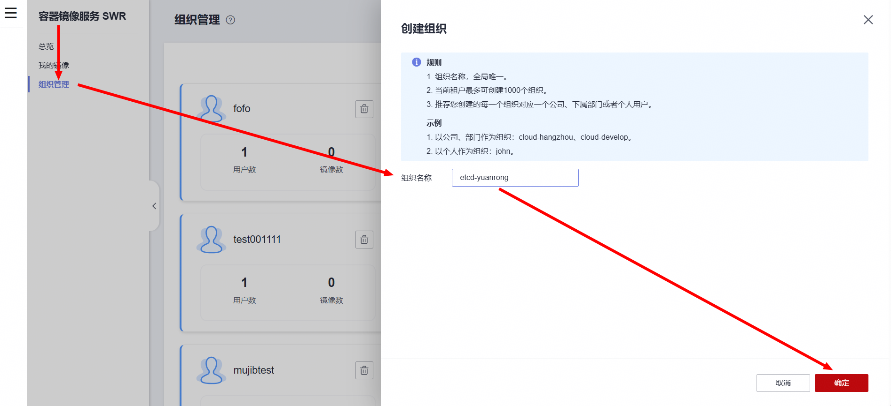

4. Click "My Images \> Upload on Page"

    > 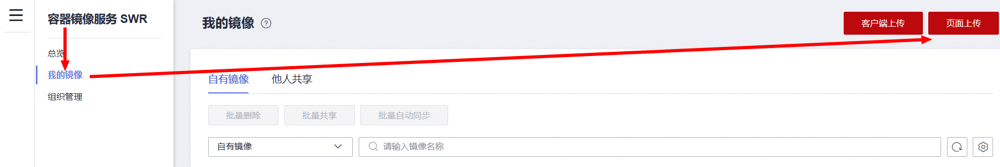

5. Select the "etcd-yuanrong" organization and upload the ETCD image

    > 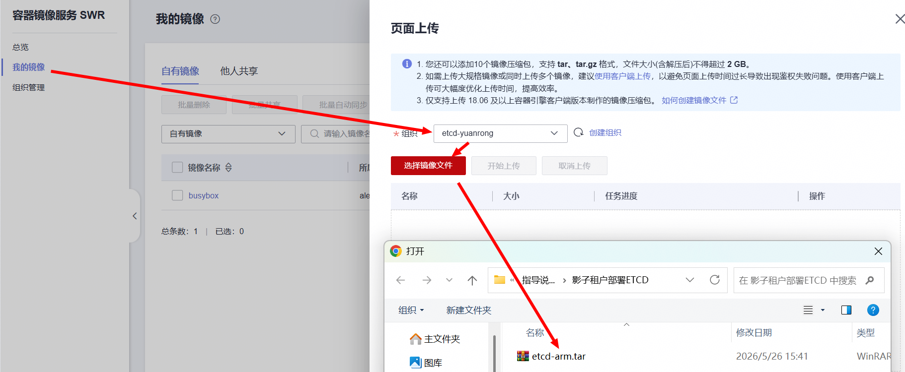
    >
    > ETCD v3.5.10 is used. It is recommended to download the image from quay.io (download command: docker pull
    > quay.io/coreos/etcd:v3.5.10)

6. After the image upload is complete, record the image address (the part after docker pull in the box)

    > 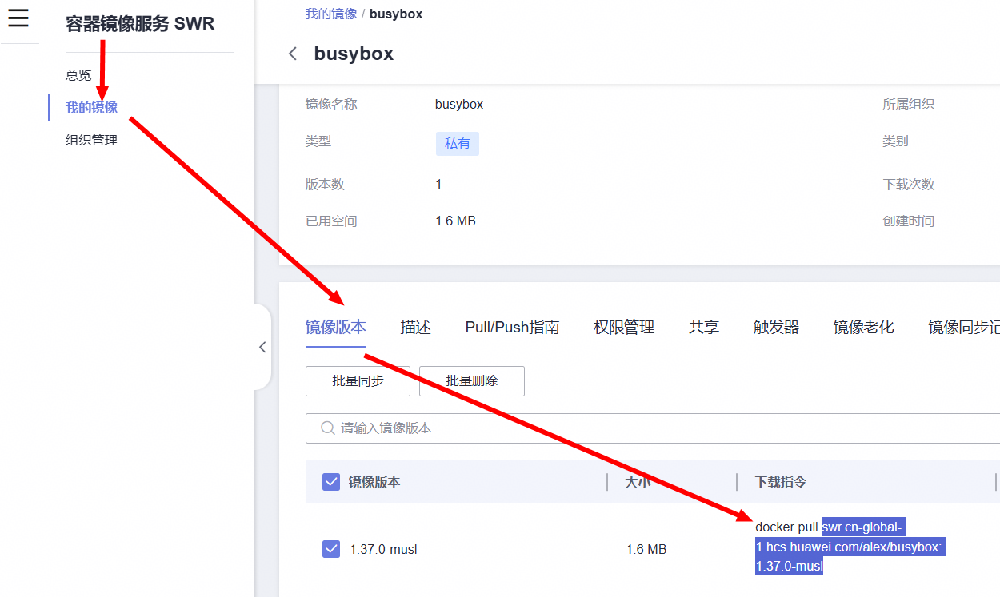

7. Create an "etcd-all-latest.yaml" file locally, open it, and copy the script content under [ETCD Pooling Deployment Solution](#etcd-pooling-deployment-solution)
    \> Deployment Script Implementation into the file, and change the image address to the address obtained in step 6;

8. Go to the HCS console and choose "Service List \> Computing \> Cloud Container Engine CCE"

    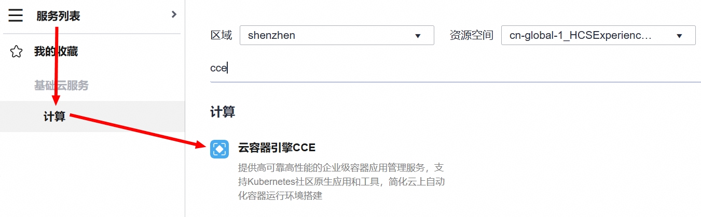

9. In the CCE console, go to "Cluster Management \> Resource Pool" and open the resource pool where the service is to be deployed

    

10. Choose "Workloads \> StatefulSets \> Create from YAML"

    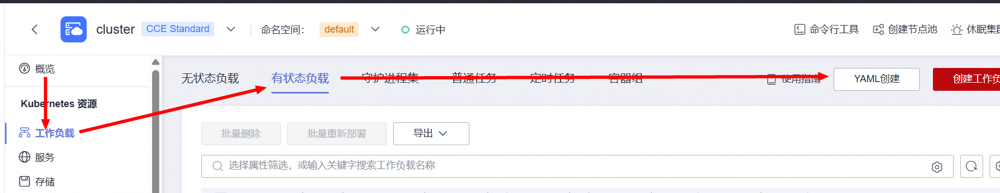

11. Create the ETCD container workload in YAML mode and import etcd-all-latest.yaml

    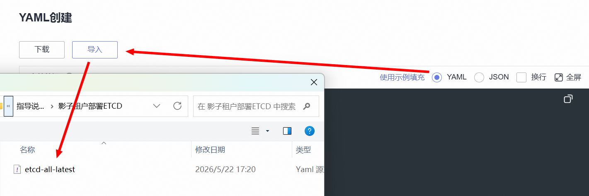

12. Open the created ETCD container workload, confirm that all three instances in the workload list are running properly, and record the IP addresses of their nodes

    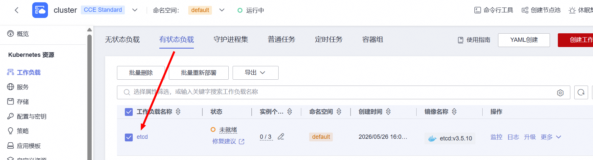

    > 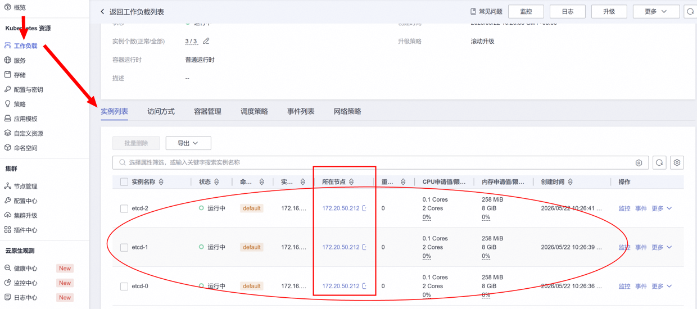

13. Select the "Services" tab and confirm that the two services "etcd-client-service" and "etcd-headless" have been generated

    > 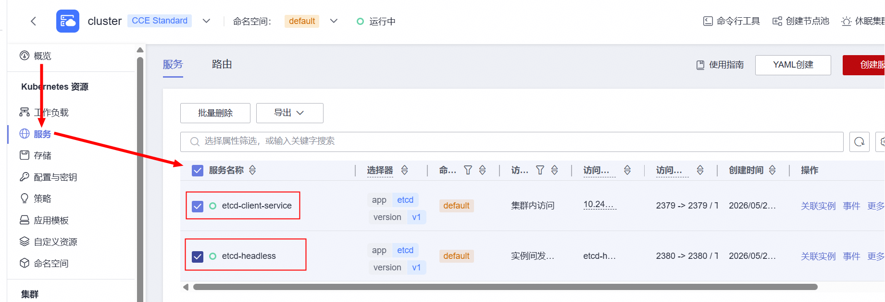

14. Log in to the Linux backend of the IP address corresponding to instance etcd-0 in step 12, run the command "ps -ef \| grep
    etcd-0" to view the process, and confirm that the process exists as follows:

    > 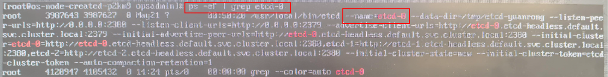

15. Log in to the Linux backend of the IP address corresponding to instance etcd-1 in step 12, run the command "ps -ef \| grep
    etcd-1" to view the process, and confirm that the process exists as follows

    > 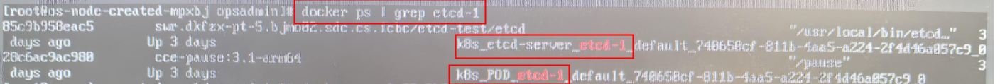

#### ModelArts Model Service Startup

1. Go to the ModelArts console, select a workspace, and click "Model Management \> Create Model";

    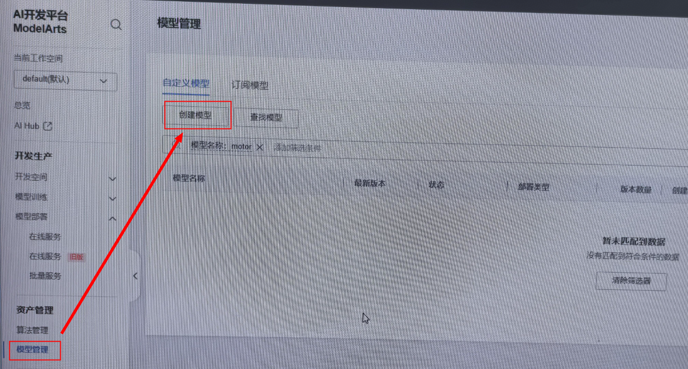

2. Create the configuration by referring to [Model Management Configuration](#model-management-configuration);

    

    Make sure there are no redundant spaces in the "Health Check Command" and "Startup Command" fields

3. Click "Resource Management \> AI Dedicated Resource Pool \> Elastic Cluster", and select the target resource pool

    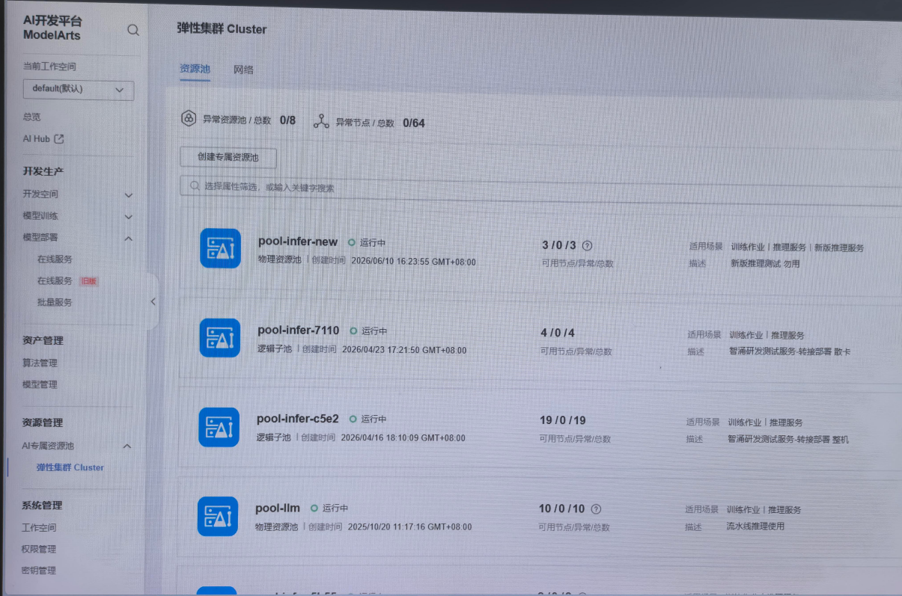

4. As required in section 2.1, check whether the resource pool has sufficient idle resources;

    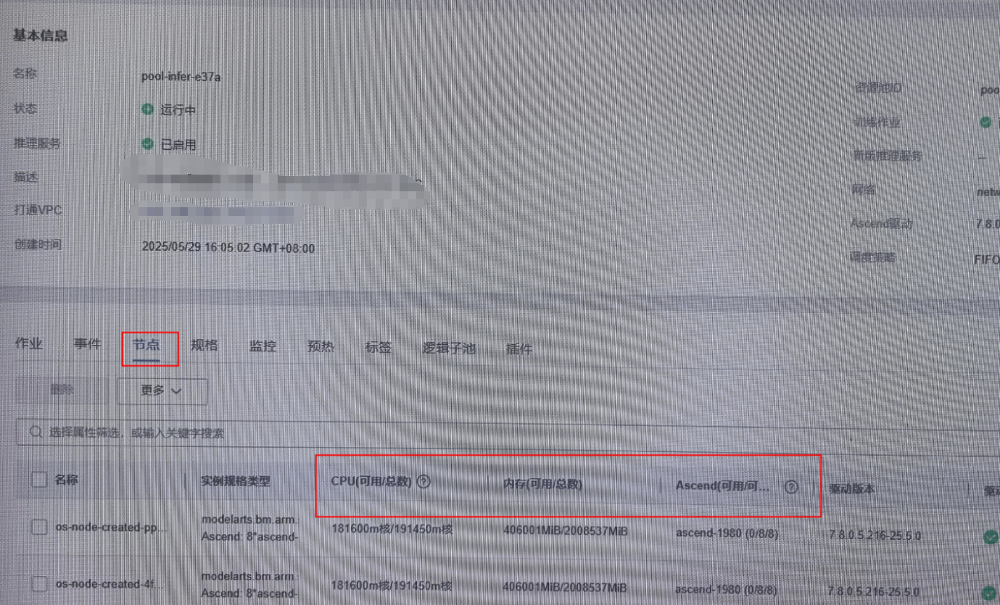

5. Go to "Model Deployment \> Online Service" and click Deploy;

    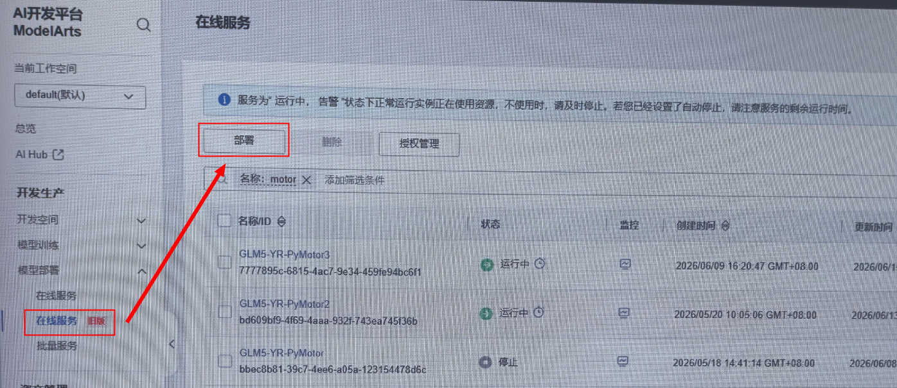

6. For some items, the following configuration is recommended. Configure the other items based on your actual situation;

    - In "Select Model and Version", select the model and version created in step 1

    - In "Instance Specifications", set Ascend to 8, CPU to 160 cores, and memory to 1600 GB;

    - Select "Distributed Inference > Multi-node Multi-card", set "Instance Groups" to the target number of large-scale EP instances, and set "Instances" to 8;

    - Set "Deployment Timeout" to 30 minutes;

    - Set "Request Timeout" to 540s;

    - Configure "Storage Mount" and "Environment Variables" based on your actual situation, and ensure that the files required to start the service already exist in the "/mnt/obs/scripts" path in the container;

    > After the configuration is complete, click "Create Now";

    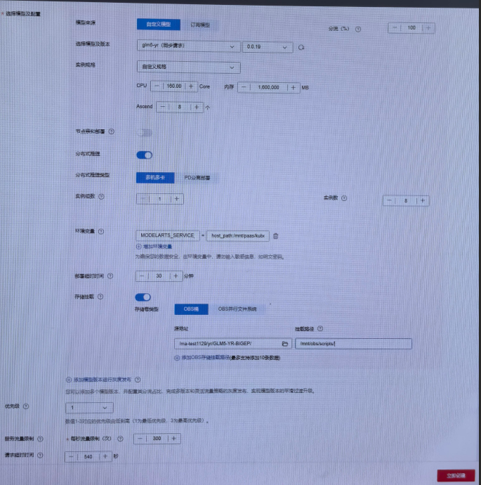

7. Open the created online service page, observe the events and logs, and wait until the service status becomes "Running", which indicates a successful startup;

    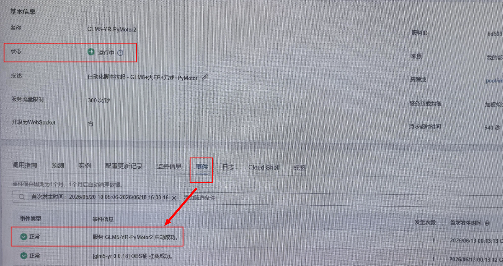

## Automated Deployment Script Resources

### Script Overview and Directory Structure

The content and directory structure of the automated deployment are as follows:

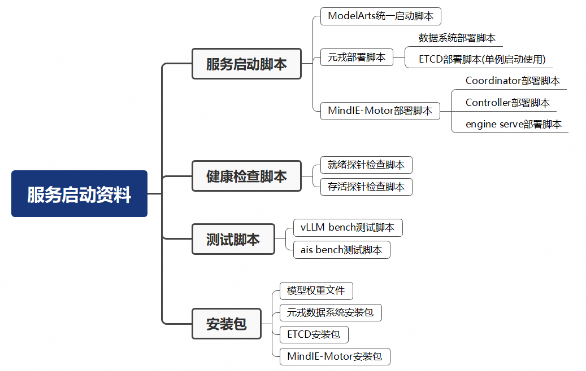

### ModelArts Unified Startup Script

The unified entry script does not distinguish between active and standby nodes. It is named start.sh and provides a unified execution entry for automatic startup by MA (Model Management - Usage Constraints). It performs the following operations:

- Downloading model weights

- Identifying the active and standby nodes (the node with index 0 in the ranktable is the active node) and modifying the node IP configuration in the scripts

- Migrating the script directory (from external storage such as OBS or the host to the container working directory)

- Running the automated deployment scripts per node

The script implementation is as follows:

```bash
set +x
echo "server start!"

## Download the weights
mkdir -p /mnt/cache
mkdir -p /workspace/scripts
SCRIPT_PATH=/workspace/scripts
cp -rf /mnt/obs/scripts/* $SCRIPT_PATH

MOTOR_SCRIPT_PATH="$SCRIPT_PATH/PyMotor"

WEIGHTS_DIR="/mnt/cache/GLM-5.1-W8A8"
if [ ! -d "$WEIGHTS_DIR" ];then
    echo "Downloading weights"
    [Download the model weights to: /mnt/cache/]
    mv /mnt/cache/[weight files] /mnt/cache/GLM-5.1-W8A8/
    du -s /mnt/cache/GLM-5.1-W8A8
    df -h
else
    echo "Weight directory already exists"
fi

## For vllm 0.18.0, patch mooncake_connector.py to fix the GLM5.1 precision issue

## Update and generate ranktable.json
MS_GLOBAL_RANKTABLE_TABLE=/user/global/config/global_rank_table.json

while true; do
    json_string=$(cat $MS_GLOBAL_RANKTABLE_TABLE)
    echo $json_string;
    RESULT=$(jq -r '.status' $MS_GLOBAL_RANKTABLE_TABLE 2>/dev/null)
    echo $RESULT
    if [[ $RESULT = "completed" ]]; then
        echo "MA ranktable is completed";
        break;
    fi
    sleep 1;
done;

host_IP=$(hostname -I | xargs)
echo "host_IP = $host_IP"

### check port
netstat -anop

### Start Yuanrong
mkdir -p /mnt/cache/logs
bash $SCRIPT_PATH/yuanrong/start_base_env.sh

NODE_IPS=$(jq -r '.server_group_list[].server_list[].server_ip' "$MS_GLOBAL_RANKTABLE_TABLE")
echo $NODE_IPS
IFS=$'\n' read -r -d '' -a ip_array <<< "$NODE_IPS"
P0="${ip_array[0]}"
P1="${ip_array[1]}"
P2="${ip_array[2]}"
P3="${ip_array[3]}"
D0="${ip_array[4]}"
D1="${ip_array[5]}"
D2="${ip_array[6]}"
D3="${ip_array[7]}"

echo "P0 = $P0"
echo "P1 = $P1"
echo "P2 = $P2"
echo "P3 = $P3"
echo "D0 = $D0"
echo "D1 = $D1"
echo "D2 = $D2"
echo "D3 = $D3"

## Start the services
source $MOTOR_SCRIPT_PATH/prepare.sh

LOG_DIR=/mnt/cache/logs/motor/$(date +%Y-%m-%d_%H-%M-%S)/
mkdir -p ${LOG_DIR}

echo "LOG_DIR: ${LOG_DIR}"

## Set the inference engine load balancing port to 1028 (that is, do not use Motor affinity scheduling)
if [ "$host_IP" = "$P0" ]; then
    echo "this is p0 and proxy"
    echo "start proxy"
    nohup python $SCRIPT_PATH/load_balance_proxy_server_example.py \
        --port 1028 \
        --host 0.0.0.0 \
        --prefiller-hosts $P0 $P1 $P2 $P3 \
        --prefiller-ports 10000 10000 10000 10000 \
        --decoder-hosts $D0 $D0 $D1 $D1 $D2 $D2 $D3 $D3 \
        --decoder-ports 10000 10002 10000 10002 10000 10002 10000 10002 \
        2>&1 | tee ${LOG_DIR}/proxy.log &
fi

## Start Motor and the inference instances
if [ "$host_IP" = "$P0" ]; then
    echo "p0 & coordinator"
    source $MOTOR_SCRIPT_PATH/start_motor.sh coordinator $P0 $P1 $P0 "coordinator" $P2 $P3 2>&1 | tee ${LOG_DIR}/coordinator.log &
    source $MOTOR_SCRIPT_PATH/start_motor.sh prefill $P0 $P1 $P0 "instance-p0" $P2 $P3 2>&1 | tee ${LOG_DIR}/p0.log
elif [ "$host_IP" = "$P1" ]; then
    echo "p1 & controller"
    source $MOTOR_SCRIPT_PATH/start_motor.sh controller $P0 $P1 $P1 "controller" $P2 $P3 2>&1 | tee ${LOG_DIR}/controller.log &
    source $MOTOR_SCRIPT_PATH/start_motor.sh prefill $P0 $P1 $P1 "instance-p0" $P2 $P3 2>&1 | tee ${LOG_DIR}/p1.log
elif [ "$host_IP" = "$P2" ]; then
    echo "p2 & kv_conductor"
    source $MOTOR_SCRIPT_PATH/start_motor.sh kv_conductor $P0 $P1 $P2 "kv_conductor" $P2 $P3 2>&1 | tee ${LOG_DIR}/kv_conductor.log &
    source $MOTOR_SCRIPT_PATH/start_motor.sh prefill $P0 $P1 $P2 "instance-p0" $P2 $P3 2>&1 | tee ${LOG_DIR}/p2.log
elif [ "$host_IP" = "$P3" ]; then
    echo "p3"
    source $MOTOR_SCRIPT_PATH/start_motor.sh prefill $P0 $P1 $P3 "instance-p0" $P2 $P3 2>&1 | tee ${LOG_DIR}/p3.log
elif [ "$host_IP" = "$D0" ]; then
    echo "d0"
    source $MOTOR_SCRIPT_PATH/start_motor.sh decode $P0 $P1 $D0 "instance-d0" $P2 $P3 2>&1 | tee ${LOG_DIR}/d0.log
elif [ "$host_IP" = "$D1" ]; then
    echo "d1"
    source $MOTOR_SCRIPT_PATH/start_motor.sh decode $P0 $P1 $D1 "instance-d0" $P2 $P3 2>&1 | tee ${LOG_DIR}/d1.log
elif [ "$host_IP" = "$D2" ]; then
    echo "d2"
    source $MOTOR_SCRIPT_PATH/start_motor.sh decode $P0 $P1 $D2 "instance-d0" $P2 $P3 2>&1 | tee ${LOG_DIR}/d2.log
elif [ "$host_IP" = "$D3" ]; then
    echo "d3"
    source $MOTOR_SCRIPT_PATH/start_motor.sh decode $P0 $P1 $D3 "instance-d0" $P2 $P3 2>&1 | tee ${LOG_DIR}/d3.log
fi

echo "server start end!"
sleep 36000000

```

Precautions:

- The content in \[  ] must be supplemented according to the actual environment;

- The sleep field at the end of the script must be retained in the MA inference 1.0 scenario.

### Yuanrong Multi-level Cache Automated Deployment Script

#### Directory Structure Overview

The automated deployment of the Yuanrong multi-level cache provides two modes: the ETCD single-instance mode and the ETCD pooling mode. In the ETCD single-instance mode, the script starts an ETCD instance by itself; in the ETCD pooling mode, an already deployed ETCD cluster is used directly. The deployment solution scripts are shown in the following figure:

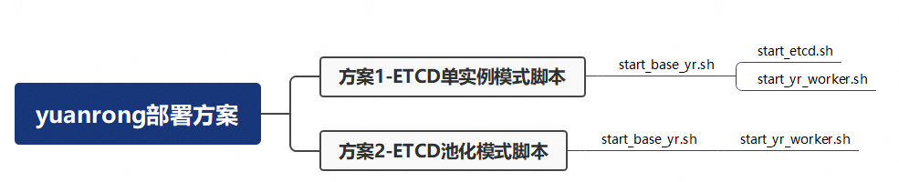

Script structure: the deployment consists of one parent script, start_base_yr.sh, and two child scripts, start_etcd.sh and start_yr_worker.sh. The parent script depends on the child scripts and calls the two child scripts start_etcd.sh and start_yr_worker.sh as needed during its execution flow to complete the ETCD installation and the Yuanrong worker startup. The parent script start_base_yr.sh implements the complete Yuanrong deployment flow, including:

1. Obtaining cluster node information

2. Applying the Yuanrong & vllm-ascend patches

3. Installing and deploying ETCD

4. Starting the ETCD service (solution 1 calls start_etcd.sh to start it,
    solution 2 does not need to start it and uses the deployed etcd cluster directly)

5. Waiting for ETCD to start successfully

6. Starting the Yuanrong worker (calls start_yr_worker.sh)

Usage precautions: before execution, place the three scripts in the same directory, modify the directories of the dependent files in start_base_yr.sh according to the actual situation, and finally run the scripts with bash
start_base_yr.sh.

#### Installation Package Preparation

Download the Yuanrong whl installation package from the following address for offline installation:

```bash
# Check the pagesize of the target environment:
getconf PAGESIZE

# If pagesize is 4kB, download the whl package
wget https://gitcode.com/openeuler/yuanrong-datasystem/releases/download/V0.8.0/openyuanrong_datasystem-0.8.0-cp310-cp310-manylinux_2_34_aarch64.whl

# If pagesize is 64kB, contact Yuanrong support personnel to obtain the software package

```

If the ETCD single-instance mode is used for deployment, download ETCD
v3.5.10 in advance. It is recommended to download the image from quay.io:

```bash
docker pull quay.io/coreos/etcd:v3.5.10
```

#### Deployment Solution 1 (ETCD Single-instance Mode)

The content of the start_base_yr.sh script is as follows:

```bash
#!/bin/bash
# Obtain cluster node information
MS_GLOBAL_RANKTABLE_TABLE=/user/global/config/global_rank_table.json
SCRIPT_PATH=/workspace/scripts

while true; do
    json_string=$(cat $MS_GLOBAL_RANKTABLE_TABLE)
    echo $json_string;
    RESULT=$(jq -r '.status' $MS_GLOBAL_RANKTABLE_TABLE 2>/dev/null)
    echo $RESULT
    if [[ $RESULT = "completed" ]]; then
        echo "MA ranktable is completed";
        break;
    fi
    sleep 1;
done;

host_IP=$(hostname -I | xargs)
echo "host_IP = $host_IP"

NODE_IPS=$(jq -r '.server_group_list[].server_list[].server_ip' "$MS_GLOBAL_RANKTABLE_TABLE")
echo $NODE_IPS
IFS=$'\n' read -r -d '' -a ip_array <<<"$NODE_IPS"
master_ip="${ip_array[0]}"
echo "master_ip = $master_ip"

# Apply the Yuanrong & vllm-ascend patches
git config --global user.email "deploy@example.com"
git config --global user.name "deploy"
cd /vllm-workspace/vllm-ascend && git am $SCRIPT_PATH/yuanrong/install_packages/0001-Implement-yuanrong-backend.patch
cd /vllm-workspace/vllm && git am $SCRIPT_PATH/yuanrong/install_packages/0001-Bugfix-Fix-negative-local_cache_hit-in-P-D-disaggreg.patch
cd /vllm-workspace/vllm && git am $SCRIPT_PATH/yuanrong/install_packages/0001-fix-kv-pool-update-yuanrong-backend-handling.patch

# Install and deploy ETCD
cp $SCRIPT_PATH/yuanrong/install_packages/etcd-v3.5.10-linux-arm64/etcd /usr/local/bin/
cp $SCRIPT_PATH/yuanrong/install_packages/etcd-v3.5.10-linux-arm64/etcdctl /usr/local/bin/

ETCD_K8S_SERVICE=""

# Deploy a single ETCD instance; install it only on the master node
if [ "${master_ip}" == "${host_IP}" ]; then
    ETCD_PORT=12379
    bash start_etcd.sh "${ETCD_PORT}"
    ETCD_K8S_SERVICE="${host_IP}:${ETCD_PORT}"
fi

# Wait for ETCD to start successfully
MAX_WAIT_S="${MAX_WAIT_S:-600}"
CHECK_INTERVAL_S="${CHECK_INTERVAL_S:-10}"
elapsed_s=0
while ((elapsed_s <= MAX_WAIT_S)); do
    if etcdctl --endpoints="${ETCD_K8S_SERVICE}" endpoint health >/dev/null 2>&1; then
    echo "etcd is ready: ${master_ip}"
    break
    fi

    if ((elapsed_s >= MAX_WAIT_S)); then
    echo "etcd not ready after ${MAX_WAIT_S}s: ${ETCD_ADDR}" >&2
    exit 1
    fi

    sleep_s=$(MAX_WAIT_S - elapsed_s)
    if ((sleep_s > CHECK_INTERVAL_S)); then
    sleep_s="${CHECK_INTERVAL_S}"
    fi
    echo "waiting for etcd... elapsed ${elapsed_s}s, max ${MAX_WAIT_S}s, next check in ${sleep_s}s"
    sleep "${sleep_s}"
elapsed_s=$((elapsed_s + sleep_s))
done

# Start the Yuanrong worker
pip install $SCRIPT_PATH/yuanrong/install_packages/openyuanrong_datasystem-0.8.0-cp310-cp310-manylinux_2_34_aarch64.whl
cd $SCRIPT_PATH/yuanrong
bash start_yr_worker.sh ${ETCD_K8S_SERVICE}
```

The content of start_etcd.sh is as follows:

```bash
#!/bin/bash
host_IP=$(hostname -I | xargs)
echo "host_IP = $host_IP"

export ETCD_IP="${host_IP}"
export ETCD_PORT=$1
export ETCD_PEER_PORT=12380
mkdir -p /mnt/cache/logs/etcd

etcd \
  --name etcd-single \
  --data-dir /mnt/cache/logs/etcd/etcd-data \
  --listen-client-urls http://0.0.0.0:${ETCD_PORT} \
  --advertise-client-urls http://${ETCD_IP}:${ETCD_PORT} \
  --listen-peer-urls http://0.0.0.0:${ETCD_PEER_PORT} \
  --initial-advertise-peer-urls http://${ETCD_IP}:${ETCD_PEER_PORT} \
  --initial-cluster etcd-single=http://${ETCD_IP}:${ETCD_PEER_PORT} \
  > /mnt/cache/logs/etcd/etcd.log 2>&1 &

sleep 3

etcdctl --endpoints "${ETCD_IP}:${ETCD_PORT}" put key "value"
etcdctl --endpoints "${ETCD_IP}:${ETCD_PORT}" get key
```

The content of start_yr_worker.sh is as follows:

```bash
# Obtain cluster node information
MS_GLOBAL_RANKTABLE_TABLE=/user/global/config/global_rank_table.json

while true; do
    json_string=$(cat $MS_GLOBAL_RANKTABLE_TABLE)
    echo $json_string;
    RESULT=$(jq -r '.status' $MS_GLOBAL_RANKTABLE_TABLE 2>/dev/null)
    echo $RESULT
    if [[ $RESULT = "completed" ]]; then
    echo "MA ranktable is completed";
    break;
    fi
    sleep 1;
done;

host_IP=$(hostname -I | xargs)
echo "host_IP = $host_IP"

NODE_IPS=$(jq -r '.server_group_list[].server_list[].server_ip' "$MS_GLOBAL_RANKTABLE_TABLE")
echo $NODE_IPS
IFS=$'\n' read -r -d '' -a ip_array <<< "$NODE_IPS"
master_ip="${ip_array[0]}"
echo "master_ip = $master_ip"

# Start the Yuanrong worker
export HOST_IP=${host_IP}
export ETCD_K8S_SERVICE=$1
export WORKER_PORT=18481
export SHM_SIZE=512000
export NODE_TIMEOUT=300
export NODE_DEAD_TIMEOUT=600
export LIVENESS_PATH=/workspace/liveness
export DS_HOME_LOG="/mnt/cache/logs/ds/${HOST_IP}"

dsc1 start -t 600 -w \
    --worker_address "${HOST_IP}:${WORKER_PORT}" \
    --etcd_address "${ETCD_K8S_SERVICE}" \
    --cluster_name "etcd-glm5.1-EP" \
    --shared_memory_size_mb "${SHM_SIZE}" \
    --node_timeout_s "${NODE_TIMEOUT}" \
    --node_dead_timeout_s "${NODE_DEAD_TIMEOUT}" \
    --liveness_check_path "${LIVENESS_PATH}" \
    --log_dir "${DS_HOME_LOG}"

echo "yr worker start finished"

```

#### Deployment Solution 2 (ETCD Pooling Mode)

This solution depends on the ETCD deployment in the resource cluster being completed in advance. For details, see section 3.5, [ETCD Pooling Deployment Solution](#etcd-pooling-deployment-solution). The content of the start_base_yr.sh script is as follows:

```bash
#!/bin/bash
# Obtain cluster node information
MS_GLOBAL_RANKTABLE_TABLE=/user/global/config/global_rank_table.json
SCRIPT_PATH=/workspace/scripts

while true; do
    json_string=$(cat $MS_GLOBAL_RANKTABLE_TABLE)
    echo $json_string;
    RESULT=$(jq -r '.status' $MS_GLOBAL_RANKTABLE_TABLE 2>/dev/null)
    echo $RESULT
    if [[ $RESULT = "completed" ]]; then
        echo "MA ranktable is completed";
        break;
    fi
    sleep 1;
done;

host_IP=$(hostname -I | xargs)
echo "host_IP = $host_IP"

NODE_IPS=$(jq -r '.server_group_list[].server_list[].server_ip' "$MS_GLOBAL_RANKTABLE_TABLE")
echo $NODE_IPS
IFS=$'\n' read -r -d '' -a ip_array <<<"$NODE_IPS"
master_ip="${ip_array[0]}"
echo "master_ip = $master_ip"

# Apply the Yuanrong & vllm-ascend patches
git config --global user.email "deploy@example.com"
git config --global user.name "deploy"
cd /vllm-workspace/vllm-ascend && git am $SCRIPT_PATH/yuanrong/install_packages/0001-Implement-yuanrong-backend.patch
cd /vllm-workspace/vllm && git am $SCRIPT_PATH/yuanrong/install_packages/0001-Bugfix-Fix-negative-local_cache_hit-in-P-D-disaggreg.patch
cd /vllm-workspace/vllm && git am $SCRIPT_PATH/yuanrong/install_packages/0001-fix-kv-pool-update-yuanrong-backend-handling.patch

# Install and deploy ETCD
cp $SCRIPT_PATH/yuanrong/install_packages/etcd-v3.5.10-linux-arm64/etcd /usr/local/bin/
cp $SCRIPT_PATH/yuanrong/install_packages/etcd-v3.5.10-linux-arm64/etcdctl /usr/local/bin/

ETCD_K8S_SERVICE=etcd-client-service.default.svc.cluster.local:2379
# Wait for ETCD to start successfully
MAX_WAIT_S="${MAX_WAIT_S:-600}"
CHECK_INTERVAL_S="${CHECK_INTERVAL_S:-10}"
elapsed_s=0
while ((elapsed_s <= MAX_WAIT_S)); do
    if etcdctl --endpoints="${ETCD_K8S_SERVICE}" endpoint health >/dev/null 2>&1; then
    echo "etcd is ready: ${master_ip}"
    break
    fi

    if ((elapsed_s >= MAX_WAIT_S)); then
    echo "etcd not ready after ${MAX_WAIT_S}s: ${ETCD_ADDR}" >&2
    exit 1
    fi

    sleep_s=$(MAX_WAIT_S - elapsed_s)
    if ((sleep_s > CHECK_INTERVAL_S)); then
    sleep_s="${CHECK_INTERVAL_S}"
    fi
    echo "waiting for etcd... elapsed ${elapsed_s}s, max ${MAX_WAIT_S}s, next check in ${sleep_s}s"
    sleep "${sleep_s}"
    elapsed_s=$(elapsed_s + sleep_s)
done

# Start the Yuanrong worker
pip install $SCRIPT_PATH/yuanrong/install_packages/openyuanrong_datasystem-0.8.0-cp310-cp310-manylinux_2_34_aarch64.whl
cd $SCRIPT_PATH/yuanrong
bash start_yr_worker.sh ${ETCD_K8S_SERVICE}
```

The content of start_yr_worker.sh is as follows:

```bash
# Obtain cluster node information
MS_GLOBAL_RANKTABLE_TABLE=/user/global/config/global_rank_table.json

while true; do
    echo $json_string;
    json_string=$(cat $MS_GLOBAL_RANKTABLE_TABLE)
    RESULT=$(jq -r '.status' $MS_GLOBAL_RANKTABLE_TABLE 2>/dev/null)
    echo $RESULT
    if [[ $RESULT = "completed" ]]; then
    echo "MA ranktable is completed";
    break;
    fi
    sleep 1;
done;

host_IP=$(hostname -I | xargs)
echo "host_IP = $host_IP"

NODE_IPS=$(jq -r '.server_group_list[].server_list[].server_ip' "$MS_GLOBAL_RANKTABLE_TABLE")
echo $NODE_IPS
IFS=$'\n' read -r -d '' -a ip_array <<< "$NODE_IPS"
master_ip="${ip_array[0]}"
echo "master_ip = $master_ip"

# Start the Yuanrong worker
export HOST_IP=${host_IP}
export ETCD_K8S_SERVICE=$1
export WORKER_PORT=18481
export SHM_SIZE=512000
export NODE_TIMEOUT=300
export NODE_DEAD_TIMEOUT=600
export LIVENESS_PATH=/workspace/liveness
export DS_HOME_LOG="/mnt/cache/logs/ds/${HOST_IP}"

dsc1 start -t 600 -w \
    --worker_address "${HOST_IP}:${WORKER_PORT}" \
    --etcd_address "${ETCD_K8S_SERVICE}" \
    --cluster_name "etcd-glm5.1-EP" \
    --shared_memory_size_mb "${SHM_SIZE}" \
    --node_timeout_s "${NODE_TIMEOUT}" \
    --node_dead_timeout_s "${NODE_DEAD_TIMEOUT}" \
    --liveness_check_path "${LIVENESS_PATH}" \
    --log_dir "${DS_HOME_LOG}"

echo "yr worker start finished"
```

### MindIE Motor Automated Deployment Script

#### Directory Structure Overview

This tutorial deploys large-scale EP instance-level scheduling based on ModelArts, and MindIE Motor performs affinity scheduling based on DP domains within a large-scale EP instance. An overview of the cluster deployment and reliability is shown in the following figure:

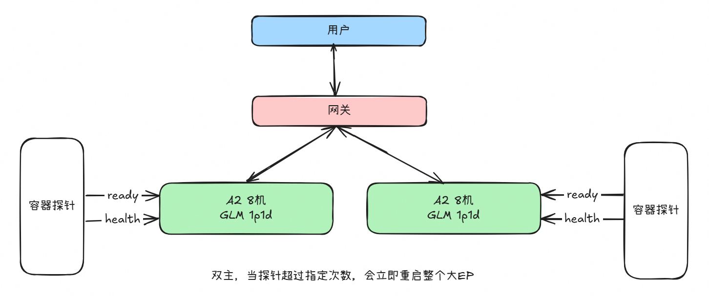

Under the preceding ModelArts cluster deployment form, the MindIE Motor deployment within a single EP instance is shown in the following figure:
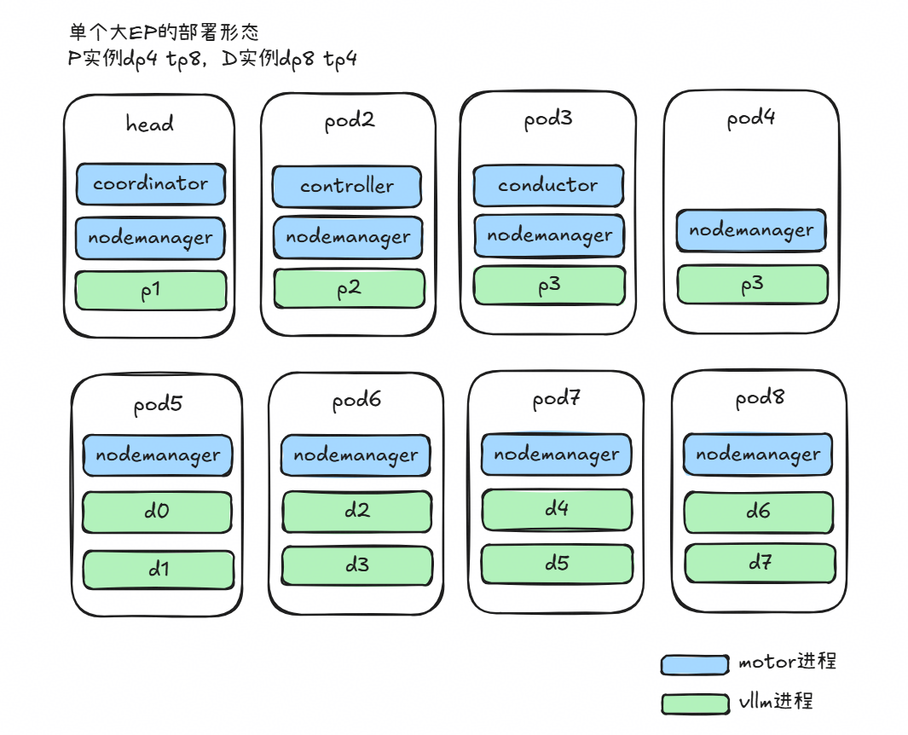

#### Installation Package Preparation Based on the vLLM Image

Download Motor and its dependencies offline. The main parts are as follows:

- Motor whl package

- Dependencies listed in motor requirements.txt

- libzmp

- pciutils

- Motor source code, used to copy the examples directory. Place the examples directory in the
  /mnt/obs/scripts/PyMotor path

#### Installation Package Preparation Based on the Motor Image

Copy the examples directory from the container.

Place the examples directory in the /mnt/obs/scripts/PyMotor path

```bash
IMAGE="<image name or image ID>"
cid=$(docker create "$IMAGE")
docker cp "$cid:/tmp/motor/examples" /mnt/obs/scripts/PyMotor/examples
docker rm "$cid"

```

#### Preparing the Startup Script

Use prepare.sh to generate the startup script. The content of prepare.sh is as follows

```bash
EXAMPLES_PATH="/mnt/obs/scripts/PyMotor/examples" # Deployment script path of the examples on the host
CONFIGMAP_PATH="/mnt/obs/scripts/PyMotor/configmap" # Service startup script path, which must be mounted into the container
USER_CONFIG_PATH="/mnt/obs/scripts/PyMotor/model_configs/vllm/models/GLM/5/user_config.json" # Path of user_config.json
ENV_PATH="/mnt/obs/scripts/PyMotor/model_configs/vllm/models/GLM/5/env.json" # Path of env.json
mkdir -p $CONFIGMAP_PATH
# Container startup script boot.sh, which calls the other scripts in the startup directory at runtime, so all of them must be copied to the $CONFIGMAP_PATH directory.
cp -f $EXAMPLES_PATH/deployer/startup/boot.sh $CONFIGMAP_PATH/boot.sh
cp -f $EXAMPLES_PATH/deployer/startup/common.sh $CONFIGMAP_PATH/common.sh
cp -f $EXAMPLES_PATH/deployer/startup/hccl_tools.py $CONFIGMAP_PATH/hccl_tools.py
cp -f $EXAMPLES_PATH/deployer/startup/mooncake_config.py $CONFIGMAP_PATH/mooncake_config.py
cp -f $EXAMPLES_PATH/deployer/startup/roles/* $CONFIGMAP_PATH/

# Copy the prepared user_config.json and env.json configuration files to the $CONFIGMAP_PATH directory
[ ! -f "$CONFIGMAP_PATH/user_config.json" ] && cp -f $USER_CONFIG_PATH $CONFIGMAP_PATH/user_config.json
[ ! -f "$CONFIGMAP_PATH/env.json" ] && cp -f $ENV_PATH $CONFIGMAP_PATH/env.json
# If the environment variables have been loaded but have changed, clean up the old environment variables first.
sed -i '/^function set_controller_env()/,/^}/d' $CONFIGMAP_PATH/controller.sh
sed -i '/^function set_coordinator_env()/,/^}/d' $CONFIGMAP_PATH/coordinator.sh
sed -i '/^function set_prefill_env()/,/^}/d' $CONFIGMAP_PATH/engine.sh
sed -i '/^function set_decode_env()/,/^}/d' $CONFIGMAP_PATH/engine.sh
sed -i '/^function set_common_env()/,/^}/d' $CONFIGMAP_PATH/common.sh
sed -i '/^function set_kv_pool_env()/,/^}/d' $CONFIGMAP_PATH/kv_pool.sh
sed -i '/^function set_kv_conductor_env()/,/^}/d' $CONFIGMAP_PATH/kv_conductor.sh
sed -i '/^function set_controller_env()/,/^}/d' $CONFIGMAP_PATH/all_combine_in_single_container.sh
sed -i '/^function set_coordinator_env()/,/^}/d' $CONFIGMAP_PATH/all_combine_in_single_container.sh
sed -i '/^function set_prefill_env()/,/^}/d' $CONFIGMAP_PATH/all_combine_in_single_container.sh
sed -i '/^function set_decode_env()/,/^}/d' $CONFIGMAP_PATH/all_combine_in_single_container.sh
sed -i '/^function set_kv_pool_env()/,/^}/d' $CONFIGMAP_PATH/all_combine_in_single_container.sh
sed -i '/^function set_kv_conductor_env()/,/^}/d' $CONFIGMAP_PATH/all_combine_in_single_container.sh
sed -i '/./,$!d' $CONFIGMAP_PATH/common.sh

# Load the environment variables in user_config.json and env.json and apply them to the container startup scripts.
python $EXAMPLES_PATH/deployer/startup/set_env_docker.py --configmap_path $CONFIGMAP_PATH

```

#### Modifying user_config.json and env.json

Model: GLM5.1

Hardware information: 8 Atlas 800I A2s

The content of user_config.json is as follows

```json
{
    "version": "v2.0",
    "motor_deploy_config": {
        "p_instances_num": 1,
        "d_instances_num": 1,
        "single_p_instance_pod_num": 4,
        "single_d_instance_pod_num": 4,
        "p_pod_npu_num": 8,
        "d_pod_npu_num": 8,
        "image_name": "mindie-motor-vllm:r0.17.0rc1-800I-A2-py311-lts-aarch64",
        "job_id": "mindie-motor",
        "hardware_type": "800I_A2",
        "env_path": "./conf/env.json",
        "weight_mount_path": "/mnt/cache/GLM-5.1-W8A8",
        "deploy_mode": "multi_deployment"
    },
    "motor_controller_config": {
        "api_config": {
            "controller_api_port": 2026
        }
    },
    "motor_coordinator_config": {
        "logging_config": {
            "log_level": "INFO"
        },
        "scheduler_config": {
            "deploy_mode": "cpcd_separate",
            "scheduler_type": "kv_cache_affinity"
        },
        "api_config": {
            "coordinator_api_infer_port": 1026,
            "coordinator_api_mgmt_port": 4026
        }
    },
    "motor_nodemanger_config": {},
    "motor_engine_prefill_config": {
        "engine_type": "vllm",
        "motor_nodemanger_config": {
            "api_config": {
                "node_manager_port": 3026
            }
        },
        "model_config": {
            "model_name": "glm51",
            "model_path": "/mnt/cache/GLM-5.1-W8A8",
            "npu_mem_utils": 0.92,
            "parallel_config": {
                "dp_size": 4,
                "tp_size": 8,
                "pp_size": 1,
                "enable_ep": true,
                "dp_rpc_port": 10521
            }
        },
        "engine_config": {
            "kv-events-config": {
                "publisher": "zmq",
                "enable_kv_cache_events": true,
                "endpoint": "tcp://*:5557",
                "topic": "kv-events",
                "replay_endpoint": "tcp://*:6667"
            },
            "enable-log-requests": true,
            "enable-expert-parallel": true,
            "enable-chunked-prefill": true,
            "enable-prefix-caching": true,
            "enable-prompt-tokens-details": true,
            "seed": 1024,
            "max-model-len": 202752,
            "max-num-batched-tokens": 4096,
            "trust-remote-code": true,
            "max-num-seqs": 32,
            "quantization": "ascend",
            "async-scheduling": true,
            "enforce-eager": true,
            "enable-auto-tool-choice": true,
            "tool-call-parser": "glm47",
            "default-chat-template-kwargs": {
                "enable_thinking": false
            },
            "speculative-config": {
                "num_speculative_tokens": 3,
                "method": "deepseek_mtp"
            },
            "additional-config": {
                "recompute_scheduler_enable": true,
                "multistream_overlap_shared_expert": true,
                "fuse_qknorm_rope": false,
                "fuse_muls_add": true,
                "enable_npugraph_ex": true,
                "layer_sharding": [
                    "q_b_proj",
                    "o_proj"
                ]
            },
            "kv_transfer_config": {
                "kv_connector": "MultiConnector",
                "engine_id": "0",
                "kv_role": "kv_producer",
                "kv_connector_extra_config": {
                    "connectors": [
                        {
                            "kv_connector": "MooncakeConnectorV1",
                            "kv_role": "kv_producer",
                            "kv_port": "30100",
                            "kv_connector_module_path": "vllm_ascend.distributed.mooncake_connector",
                            "kv_connector_extra_config": {
                                "use_ascend_direct": true,
                                "prefill": {
                                    "dp_size": 4,
                                    "tp_size": 8
                                },
                                "decode": {
                                    "dp_size": 8,
                                    "tp_size": 4
                                }
                            }
                        },
                        {
                            "kv_connector": "AscendStoreConnector",
                            "kv_role": "kv_producer",
                            "kv_connector_extra_config": {
                                "lookup_rpc_port": "10521",
                                "backend": "yuanrong"
                            }
                        }
                    ]
                }
            },
            "health_check_config": {
                "health_collector_timeout": 5,
                "health_collector_timeout_retry_attempts": 3,
                "startup_timeout": 1800
            }
        }
    },
    "motor_engine_decode_config": {
        "engine_type": "vllm",
        "motor_nodemanger_config": {
            "api_config": {
                "node_manager_port": 3026
            }
        },
        "model_config": {
            "model_name": "glm51",
            "model_path": "/mnt/cache/GLM-5.1-W8A8",
            "npu_mem_utils": 0.92,
            "parallel_config": {
                "dp_size": 8,
                "tp_size": 4,
                "pp_size": 1,
                "enable_ep": true,
                "dp_rpc_port": 10521
            }
        },
        "engine_config": {
            "enable-log-requests": true,
            "enable-expert-parallel": true,
            "enable-chunked-prefill": true,
            "enable-prefix-caching": true,
            "enable-prompt-tokens-details": true,
            "seed": 1024,
            "max-model-len": 202752,
            "max-num-batched-tokens": 128,
            "trust-remote-code": true,
            "max-num-seqs": 48,
            "async-scheduling": true,
            "quantization": "ascend",
            "enable-auto-tool-choice": true,
            "tool-call-parser": "glm47",
            "default-chat-template-kwargs": {
                "enable_thinking": false
            },
            "speculative-config": {
                "num_speculative_tokens": 3,
                "method": "deepseek_mtp"
            },
            "compilation_config": {
                "cudagraph_capture_sizes": [
                    1,
                    4,
                    8,
                    16,
                    32,
                    48,
                    56,
                    64,
                    80,
                    96
                ],
                "cudagraph_mode": "FULL_DECODE_ONLY"
            },
            "additional-config": {
                "recompute_scheduler_enable": true,
                "multistream_overlap_shared_expert": true,
                "fuse_qknorm_rope": false,
                "fuse_muls_add": true,
                "enable_npugraph_ex": true
            },
            "kv_transfer_config": {
                "kv_connector": "MultiConnector",
                "kv_role": "kv_consumer",
                "kv_connector_extra_config": {
                    "connectors": [
                        {
                            "kv_connector": "MooncakeConnectorV1",
                            "kv_role": "kv_consumer",
                            "kv_port": "30100",
                            "kv_connector_module_path": "vllm_ascend.distributed.mooncake_connector",
                            "kv_connector_extra_config": {
                                "use_ascend_direct": true,
                                "prefill": {
                                    "dp_size": 4,
                                    "tp_size": 8
                                },
                                "decode": {
                                    "dp_size": 8,
                                    "tp_size": 4
                                }
                            }
                        },
                        {
                            "kv_connector": "AscendStoreConnector",
                            "kv_role": "kv_consumer",
                            "kv_connector_extra_config": {
                                "lookup_rpc_port": "10521",
                                "backend": "yuanrong"
                            }
                        }
                    ]
                }
            }
        }
    }
}

```

The content of env.json is as follows

```json
{
  "version": "2.0.0",
  "motor_common_env": {
    "CANN_INSTALL_PATH": "/usr/local/Ascend",
    "MOTOR_LOG_ROOT_PATH": "/root/ascend/log"
  },
  "motor_controller_env": {},
  "motor_coordinator_env": {},
  "motor_engine_prefill_env": {
    "VLLM_LOGGING_LEVEL": "INFO",
    "VLLM_ASCEND_ENABLE_MLAPO": 1,
    "VLLM_ASCEND_ENABLE_NZ": 1,
    "HCCL_OP_EXPANSION_MODE": "AIV",
    "OMP_PROC_BIND": "false",
    "OMP_NUM_THREADS": 10,
    "VLLM_USE_V1": 1,
    "HCCL_BUFFSIZE": 256,
    "PYTORCH_NPU_ALLOC_CONF": "expandable_segments:True",
    "VLLM_ASCEND_BALANCE_SCHEDULING": 0,
    "TASK_QUEUE_ENABLE": 1,
    "CPU_AFFINITY_CONF": 1,
    "VLLM_ASCEND_ENABLE_FLASHCOMM1": 1,
    "ASCEND_AGGREGATE_ENABLE": 1,
    "ASCEND_TRANSPORT_PRINT": 1,
    "ACL_OP_INIT_MODE": 1,
    "VLLM_NIXL_ABORT_REQUEST_TIMEOUT": 300,
    "ASCEND_CONNECT_TIMEOUT": 300000,
    "ASCEND_TRANSFER_TIMEOUT": 300000,
    "ASCEND_BUFFER_POOL": "4:8",
    "HCCL_INTRA_ROCE_ENABLE": 1,
    "DS_H2D_MEMCPY_POLICY": "direct",
    "DS_D2H_MEMCPY_POLICY": "direct"
  },
  "motor_engine_decode_env": {
    "VLLM_LOGGING_LEVEL": "INFO",
    "VLLM_ASCEND_ENABLE_MLAPO": 1,
    "VLLM_ASCEND_ENABLE_NZ": 1,
    "HCCL_OP_EXPANSION_MODE": "AIV",
    "OMP_PROC_BIND": "false",
    "OMP_NUM_THREADS": 10,
    "VLLM_USE_V1": 1,
    "HCCL_BUFFSIZE": 512,
    "PYTORCH_NPU_ALLOC_CONF": "expandable_segments:True",
    "VLLM_ASCEND_BALANCE_SCHEDULING": 0,
    "TASK_QUEUE_ENABLE": 1,
    "CPU_AFFINITY_CONF": 1,
    "ASCEND_AGGREGATE_ENABLE": 1,
    "ASCEND_TRANSPORT_PRINT": 1,
    "ACL_OP_INIT_MODE": 1,
    "VLLM_NIXL_ABORT_REQUEST_TIMEOUT": 300,
    "ASCEND_CONNECT_TIMEOUT": 300000,
    "ASCEND_TRANSFER_TIMEOUT": 300000,
    "ASCEND_BUFFER_POOL": "4:8",
    "HCCL_INTRA_ROCE_ENABLE": 1,
    "DS_H2D_MEMCPY_POLICY": "direct",
    "DS_D2H_MEMCPY_POLICY": "direct"
  },
  "motor_kv_cache_store_env": {},
  "motor_kv_conductor_env": {}
}

```

#### Adding the start_motor.sh Script

As the entry point for starting Motor, it mainly performs the following operations:

- Installing Motor dependencies offline

- Setting environment variables

- Starting the Motor process

The content of the start_motor.sh script is as follows:

```bash
# install dependency, $MOTOR_SCRIPT_PATH is passed by the upper-level script start.sh; if the motor image is used, this variable can be omitted
pip install --no-index --find-links=$MOTOR_SCRIPT_PATH/packages -r $MOTOR_SCRIPT_PATH/configmap/requirements.txt
# install pciutils
dpkg -i $MOTOR_SCRIPT_PATH/pciutils-offline/*.deb
# install libzmq
dpkg -i $MOTOR_SCRIPT_PATH/libzmq-offline/*.deb
# install motor
pip install $MOTOR_SCRIPT_PATH/MindIE-Motor/dist/motor-*.whl
echo "motor install succeed"
# copy conductor
cp $MOTOR_SCRIPT_PATH/mooncake_conductor /usr/local/bin/
# export env
export CONFIGMAP_PATH=$MOTOR_SCRIPT_PATH/configmap
export CONFIG_PATH=$MOTOR_SCRIPT_PATH/configmap
export ROLE=$1
export COORDINATOR_SERVICE=$2
export CONTROLLER_SERVICE=$3
export POD_IP=$4
export MOTOR_LOG_ROOT_PATH=/mnt/cache/logs/
export JOB_NAME=$5
export KV_CONDUCTOR_SERVICE=$6
export KVP_MASTER_SERVICE=$7
# yuanrong
export DS_WORKER_ADDR="${POD_IP}:18481"
unset GOOGLE_LOGTOSTDERR GOOGLE_ALSOLOGTOSTDERR
source $CONFIGMAP_PATH/boot.sh
echo "start boot.sh"

```

In the start.sh script, call start_motor.sh

```shell
# Other content omitted...

# ============ Start different roles based on the node IP ============
# p0 node: coordinator + prefill
if [ "$host_IP" = "$P0" ]; then
    echo "p0 & coordinator"
    source $MOTOR_SCRIPT_PATH/start_motor.sh coordinator $P0 $P1 $P0 "coordinator" $P2 $P3 2>&1 | tee ${LOG_DIR}/coordinator.log &
    source $MOTOR_SCRIPT_PATH/start_motor.sh prefill $P0 $P1 $P0 "instance-p0" $P2 $P3 2>&1 | tee ${LOG_DIR}/p0.log
# p1 node: controller + prefill
elif [ "$host_IP" = "$P1" ]; then
    echo "p1 & controller"
    source $MOTOR_SCRIPT_PATH/start_motor.sh controller $P0 $P1 $P1 "controller" $P2 $P3 2>&1 | tee ${LOG_DIR}/controller.log &
    source $MOTOR_SCRIPT_PATH/start_motor.sh prefill $P0 $P1 $P1 "instance-p0" $P2 $P3 2>&1 | tee ${LOG_DIR}/p1.log
# p2 node: kv_conductor + prefill
elif [ "$host_IP" = "$P2" ]; then
    echo "p2 & kv_conductor"
    source $MOTOR_SCRIPT_PATH/start_motor.sh kv_conductor $P0 $P1 $P2 "kv_conductor" $P2 $P3 2>&1 | tee ${LOG_DIR}/kv_conductor.log &
    source $MOTOR_SCRIPT_PATH/start_motor.sh prefill $P0 $P1 $P2 "instance-p0" $P2 $P3 2>&1 | tee ${LOG_DIR}/p2.log
elif [ "$host_IP" = "$P3" ]; then
    echo "p3"
    source $MOTOR_SCRIPT_PATH/start_motor.sh prefill $P0 $P1 $P3 "instance-p0" $P2 $P3 2>&1 | tee ${LOG_DIR}/p3.log
elif [ "$host_IP" = "$D0" ]; then
    echo "d0"
    source $MOTOR_SCRIPT_PATH/start_motor.sh decode $P0 $P1 $D0 "instance-d0" $P2 $P3 2>&1 | tee ${LOG_DIR}/d0.log
elif [ "$host_IP" = "$D1" ]; then
    echo "d1"
    source $MOTOR_SCRIPT_PATH/start_motor.sh decode $P0 $P1 $D1 "instance-d0" $P2 $P3 2>&1 | tee ${LOG_DIR}/d1.log
elif [ "$host_IP" = "$D2" ]; then
    echo "d2"
    source $MOTOR_SCRIPT_PATH/start_motor.sh decode $P0 $P1 $D2 "instance-d0" $P2 $P3 2>&1 | tee ${LOG_DIR}/d2.log
elif [ "$host_IP" = "$D3" ]; then
    echo "d3"
    source $MOTOR_SCRIPT_PATH/start_motor.sh decode $P0 $P1 $D3 "instance-d0" $P2 $P3 2>&1 | tee ${LOG_DIR}/d3.log
fi

# Other content omitted...

```

### ETCD Pooling Deployment Solution

#### Deployment Solution Introduction

In the cross-node KV cache pooling solution of Yuanrong, ETCD is used as the central management node to process and forward compute node information and service data information. The ETCD deployment must meet the following requirements:

- At dedicated resource pool (cluster) granularity, it can manage any compute node in the resource pool;

- It supports automatic ETCD recovery from exceptions (at process level and container level);

- After ETCD automatically recovers from an exception, the external access identifier of the newly started ETCD does not change (IP/DNS/Kubernetes
  Service or other);

Based on the preceding requirements, the deployment solution is defined as follows: in the MA resource tenant, deploy ETCD containers with CCE, let the ETCD instances communicate through a headless
Service, and implement external access through the ClusterIP;

#### Deployment Script Implementation

The implementation of the etcd-all.yaml script is as follows. The image address on line 22 must be modified according to the actual image (field: swr.cn...)

```yaml
apiVersion: apps/v1
kind: StatefulSet
metadata:
  labels:
    appgroup: ''
    version: v1
  name: etcd
  namespace: default
spec:
  selector:
    matchLabels:
      app: etcd
      version: v1
  template:
    metadata:
      labels:
        app: etcd
        version: v1
    spec:
      containers:
        - name: etcd-server
          image: swr.cn-southwest-2.myhuaweicloud.com/private-cs/etcd:v3.5.10
          command:
            - /usr/local/bin/etcd
          args:
            - --name=$(POD_NAME)
            - --data-dir=/tmp/etcd-yuanrong
            - --listen-peer-urls=http://0.0.0.0:2380
            - --listen-client-urls=http://0.0.0.0:2379
            - --advertise-client-urls=http://$(POD_NAME).etcd-headless.default.svc.cluster.local:2379
            - --initial-advertise-peer-urls=http://$(POD_NAME).etcd-headless.default.svc.cluster.local:2380
            - --initial-cluster=etcd-0=http://etcd-0.etcd-headless.default.svc.cluster.local:2380,etcd-1=http://etcd-1.etcd-headless.default.svc.cluster.local:2380,etcd-2=http://etcd-2.etcd-headless.default.svc.cluster.local:2380
            - --initial-cluster-state=new
            - --initial-cluster-token=etcd-cluster-token
            - --auto-compaction-retention=1
          imagePullPolicy: Always
          env:
            - name: PAAS_APP_NAME
              value: etcd
            - name: PAAS_NAMESPACE
              value: default
            - name: POD_NAME
              valueFrom:
                fieldRef:
                  fieldPath: metadata.name
          resources:
            requests:
              cpu: 100m
              memory: 256Mi
            limits:
              cpu: 2000m
              memory: 8192Mi
          livenessProbe:
            tcpSocket:
              port: 2379
            initialDelaySeconds: 10
            periodSeconds: 10
            timeoutSeconds: 5
          readinessProbe:
            tcpSocket:
              port: 2379
            initialDelaySeconds: 5
            periodSeconds: 5
            timeoutSeconds: 5
          volumeMounts:
            - name: etcd-data
              readOnly: false
              mountPath: /tmp/etcd-yuanrong
              subPath:
      imagePullSecrets:
        - name: default-secret
      affinity:
        podAntiAffinity:
          preferredDuringSchedulingIgnoredDuringExecution:
            - weight: 100
              podAffinityTerm:
                labelSelector:
                  matchExpressions:
                    - key: app
                      operator: In
                      values:
                        - etcd
                topologyKey: kubernetes.io/hostname
      terminationGracePeriodSeconds: 30
      dnsPolicy: ClusterFirst
      tolerations:
        - key: node.kubernetes.io/not-ready
          operator: Exists
          effect: NoExecute
          tolerationSeconds: 300
        - key: node.kubernetes.io/unreachable
          operator: Exists
          effect: NoExecute
          tolerationSeconds: 300
      initContainers: []
      volumes:
        - name: etcd-data
          hostPath:
            path: /tmp/etcd-yuanrong
  serviceName: etcd-headless
  replicas: 3
  podManagementPolicy: OrderedReady
  revisionHistoryLimit: 10
  updateStrategy:
    type: RollingUpdate

---
apiVersion: v1
kind: Service
metadata:
  name: etcd-headless
  labels:
    app: etcd
    version: v1
  namespace: default
spec:
  selector:
    app: etcd
    version: v1
  clusterIP: None
  ports:
    - name: peer
      targetPort: 2380
      nodePort: 0
      port: 2380
      protocol: TCP

---
apiVersion: v1
kind: Service
metadata:
  name: etcd-client-service
  labels:
    app: etcd
    version: v1
  namespace: default
  annotations: {}
spec:
  selector:
    app: etcd
    version: v1
  ports:
    - name: cce-service-0
      targetPort: 2379
      nodePort: 0
      port: 2379
      protocol: TCP
  type: ClusterIP

```

## Health Check Configuration

### Overview

In the large-scale EP deployment scenario of this tutorial (ModelArts inference 1.0), the following health check capabilities are provided:

- Readiness probe: periodically checks the readiness of the large model service. After the probe fails more than the maximum number of times, MA restarts the inference service container and performs a complete deployment operation

- Liveness probe: periodically checks the liveness of the large model service and Yuanrong. After the probe fails more than the maximum number of times, MA restarts the inference service container and performs a complete deployment operation;

Precautions:

- The readiness probe checks only the vLLM service status

- The liveness probe checks the vLLM service and Yuanrong status

- If either the readiness probe or the liveness probe fails more than the maximum number of times, an MA service restart is triggered

### Readiness Probe Check Script

The readiness probe script does not distinguish between active and standby nodes. It is named vllm_probe.py and performs the following operations:

- Identifying the active and standby nodes (a node whose hostname contains the head field is the active node);

- Constructing an HTTP request to the model service (v1/chat/completions) on the active node;

- Determining whether the request returns correctly;

The script implementation is as follows:

```python
import sys
import subprocess
import requests
import socket
import logging
import json
logging.basicConfig(format='%(asctime)s [%(levelname)s] [%(filename)s:%(lineno)d] %(message)s',datefmt='%Y-%m-%d %H:%M:%S', level=logging.INFO, filename='/mnt/cache/health_check_probe.log', filemode='a')

if __name__ == "__main__":

    # only master node has this resource. For slave node, do not check vllm process.
    hostname = socket.gethostname()
    if "head" not in hostname:
        logging.debug(f"node {hostname} is not head, do not need probe")
        sys.exit(0)
    logging.info("health check start")

    local_ip = socket.gethostbyname(hostname)
    api_url = f"http://{local_ip}:1025/v1/chat/completions"

    headers = {
        'Content-Type': 'application/json',
    }
    request_data = {
        "model": "glm51",
        "messages": [{"role": "user", "content": "hello"}],
        "stream": False,
        "max_tokens": 2,
        "temperature": 0.6,
        "chat_template_kwargs":{"enable_thinking":False}
    }

    try:
        response = requests.post(
            api_url,
            json=request_data,
            headers=headers,
            stream=False,
            timeout=1200
        )
    except Exception as e:
        logging.error(f"requests post failed, Exception: {e}")
        sys.exit(1)

    if response.status_code != 200:
        logging.error(f"Response error, status code: {response.status_code}, text: {response.text}")
        sys.exit(1)

    try:
        response_info = json.loads(response.text)
        if len(response_info['choices'][0]['message']['content']) == 0:
            logging.error("response content len is 0")
            sys.exit(1)
    except Exception as e:
        logging.error(f"json parse failed, text: {response.text}, Exception: {e}")
        sys.exit(1)

    logging.info(f"health check success, response: {response.text}")

```

### Liveness Probe Check Script

The liveness probe script does not distinguish between active and standby nodes. It is named vllm_probe_yr.py and performs the following operations:

- Performing the Yuanrong health check

- Identifying the active and standby nodes (a node whose hostname contains the head field is the active node);

- Constructing an HTTP request to the model service (v1/chat/completions) on the active node;

- Determining whether the request returns correctly;

Precautions: the file utils.sh that the script depends on must be manually uploaded to the same directory as the script. The implementation of the utils.sh script is as follows:

```bash
#!/bin/bash
set -e

shopt -s expand_aliases

readonly UTILS_WORK_DIR=$(dirname "$(readlink -f "$0")")
readonly UTILS_LOG_FILE=${WORKER_LOG_DIR}/container.log
readonly UTILS_LOCK_FILE=${WORKER_LOG_DIR}/.loglock
readonly UTILS_LOCK_DIR=${WORKER_LOG_DIR}/.loglockdir
readonly UTILS_MAX_LOG_SIZE=10485760 # not 10MB
readonly UTILS_MAX_LOG_COUNT=9 # not include the current log file.
readonly UTILS_POD_NAME=${POD_NAME:-$(hostname)}
readonly UTILS_PREFIX=${UTILS_LOG_FILE%.*}
readonly UTILS_SUFFIX=${UTILS_LOG_FILE#*.}

alias ilog='utils_log I ${BASH_SOURCE##*/}:${LINENO}'
alias wlog='utils_log W ${BASH_SOURCE##*/}:${LINENO}'
alias elog='utils_log E ${BASH_SOURCE##*/}:${LINENO}'

function utils_log_impl() {
    echo -e "$(date -u '+%Y-%m-%dT%H:%M:%S.%6N') $1 | $2 | ${UTILS_POD_NAME} | $$ |   | $3" >> ${UTILS_LOG_FILE}
    if [ "$1" == "E" -o "$1" == "W" ]; then
        echo -e "$3" >&2
    fi
}

function utils_rm_logfile() {
    local files=($(ls ${UTILS_PREFIX}.*.${UTILS_SUFFIX}))
    local to_del_count=$((${#files[@]} - ${UTILS_MAX_LOG_COUNT}))
    for file in "${files[@]}"; do
        if [ ${to_del_count} -lt 1 ]; then
            break
        fi
        to_del_count=$((to_del_count-1))
        utils_log_impl I ${BASH_SOURCE##*/}:${LINENO} "rm log file ${file}"
        rm ${file}
    done
}

# rotate the logs if log file exceeds the max size
function utils_rotate_logfile() {
    local cur_time_str=$(date -u "+%Y%m%d%H%M%S")
    local new_log_file=${UTILS_PREFIX}.${cur_time_str}.${UTILS_SUFFIX}
    local file_size=$((du -b ${UTILS_LOG_FILE} 2>/dev/null || echo 0) | awk '{print $1}')
    if [ ${file_size} -gt ${UTILS_MAX_LOG_SIZE} ]; then
        mv ${UTILS_LOG_FILE} ${new_log_file}
        touch ${UTILS_LOG_FILE}
        touch ${UTILS_LOG_FILE}
        utils_rm_logfile
    fi
}

function utils_trylock_exec() {
    local cmd="$1"
    if command -v flock >/dev/null 2>&1; then
        flock -n ${UTILS_LOCK_FILE} -c "$cmd"
    else
        # using create dir to simulate flock.
        if mkdir "${UTILS_LOCK_DIR}" 2>/dev/null; then
            ${cmd} || true
            rmdir "${UTILS_LOCK_DIR}"
        else
            # remove dir if the lock dir was created 30s ago.
            local current_time=$(date +%s)
            local update_time=$(stat -c %Z ${UTILS_LOCK_DIR} 2>/dev/null || echo ${current_time})
            local timeout=30
            if [ $((current_time - update_time)) -gt ${timeout} ]; then
                utils_log_impl I ${BASH_SOURCE##*/}:${LINENO} "rm timeout lock dir ${UTILS_LOCK_DIR}"
                rmdir "${UTILS_LOCK_DIR}" 2>/dev/null
            fi
        fi
    fi
}

function utils_log() {
    utils_log_impl "$@"
    local file_size=$((du -b ${UTILS_LOG_FILE} 2>/dev/null || echo 0) | awk '{print $1}')
    if [ ${file_size} -gt ${UTILS_MAX_LOG_SIZE} ]; then
        utils_trylock_exec "bash ${UTILS_WORK_DIR}/utils.sh ROTATE_LOG" || true
    fi
    chmod 640 ${UTILS_LOG_FILE} 2>/dev/null || true
}

if [ "${1}" == "ROTATE_LOG" ]; then
    utils_rotate_logfile
fi
```

The implementation of the liveness probe script vllm_probe_yr.py is as follows:

```python

import sys
import subprocess
import requests
import socket
import logging
import json

logging.basicConfig(format='%(asctime)s [%(levelname)s][%(filename)s:%(lineno)d] %(message)s',
                    datefmt='%Y-%m-%d %H:%M:%S', level=logging.INFO, filename='/mnt/cache/health_check_probe.log', filemode='a')

if __name__ == "__main__":
    # check yuanrong
    try:
        ret = subprocess.run(["bash", "/workspace/scripts/health_check/yr_liveness_check.sh"])
        if ret.returncode == 1:
            logging.error(f"yuanrong check fail !")
            sys.exit(1)
    except Exception as e:
        logging.error(f"yuanrong check failed, Exception: {e}")
        sys.exit(1)

    logging.info(f"yuanrong check success !")

    # only master node has response. For slave node, do not check vllm and ETCD process.
    hostname = socket.gethostname()
    if "head" not in hostname:
        logging.debug(f"node {hostname} is not head, do not need probe")
        sys.exit(0)

    logging.info(f"health check start")

    local_ip = socket.gethostbyname(hostname)

    api_url = f"http://{local_ip}:1026/v1/chat/completions"

    headers = {
        'Content-Type': 'application/json',
    }

    request_data = {
        "model": "glm51",
        "messages": [{"role": "user", "content": "hello"}],
        "stream": False,
        "max_tokens": 2,
        "temperature": 0.6,
        "chat_template_kwargs": {"enable_thinking": False}
    }

    try:
        response = requests.post(
            api_url,
            json=request_data,
            headers=headers,
            stream=False,
            timeout=1200
        )
    except Exception as e:
        logging.error(f"requests.post failed, Exception: {e}")
        sys.exit(1)

    if response.status_code != 200:
        logging.error(f"response error, status_code: {response.status_code}, text: {response.text}")
        sys.exit(1)

    try:
        response_info = json.loads(response.text)
        if len(response_info['choices'][0]['message']['content']) == 0:
            logging.error(f"response content len is 0")
            sys.exit(1)
    except Exception as e:
        logging.error(f"json parse failed, text: {response.text}, Exception: {e}")
        sys.exit(1)

    logging.info(f"health check success, response: {response.text}")
```

### Key Precautions

1. The health check script is considered successful only when it returns sys.exit(0). Returning sys.exit(1) or throwing an error indicates that the health check failed. After the check is complete, run the echo \$? command to view the exit value of the script just executed. Only 0 is correct, and the success log should be printed (this log is printed only during manual debugging).

2. How to determine whether the health check is executed: the vLLM background log shows the **200 OK** return message, which indicates that the health check request has been received (this does not mean the check succeeded).

3. If the health check reports that the "\\r" command cannot be recognized: first try dos2unix utils.sh. If the container reports that the dos2unix command does not exist, use the following command: sed -i "s/\\r//" utils.sh. This command replaces all \\r characters in the file with blanks.

## Testing Guide

### Performance Testing with vLLM bench serve

#### Manual Quick Test

Use vllm bench serve to run a quick benchmark on the started OpenAI-compatible service. A script example is as follows:

```bash
BENCH_HOST=127.0.0.1
BENCH_PORT=1026
TOKENIZER_PATH=/mnt/cache/GLM-5.1-W8A8
vllm bench serve \
--backend openai-chat \
--endpoint /v1/chat/completions \
--dataset-name prefix_repetition \
--prefix-repetition-prefix-len 31744 \
--prefix-repetition-suffix-len 1024 \
--prefix-repetition-output-len 2048 \
--num-prompts 100 \
--prefix-repetition-num-prefixes 5 \
--ignore-eos \
--model glm-5 \
--tokenizer $TOKENIZER_PATH \
--seed 1000 \
--host $BENCH_HOST \
--port $BENCH_PORT \
--max-concurrency 10
```

The parameters are described as follows:

| Parameter | Description |
|------|------|
|--backend|Specifies the backend interface type for the test.
|--endpoint|Specifies the specific API path to which benchmark requests are sent.
|--dataset-name|Selects the dataset type used for the benchmark.
|--prefix-repetition-prefix-len|In prefix repetition mode, the token length of the common prefix.
|--prefix-repetition-suffix-len|The token length of the non-repeated suffix that immediately follows the common prefix.
|--prefix-repetition-output-len|Specifies the target token length of the answer generated by the model.
|--num-prompts|The total number of benchmark requests (prompts) sent.
|--prefix-repetition-num-prefixes|The number of different common prefixes.
|--ignore-eos|Forces the model to ignore the end-of-sequence token.
|--model|Specifies the name of the model under test.
|--tokenizer|The tokenizer path used by the benchmark client to count tokens.
|--seed|The random seed.
|--host|Specifies the IP address on which the benchmark service itself runs.
|--port|Specifies the port on which the benchmark service itself runs.
|--max-concurrency|The maximum number of concurrent requests

#### Automated In-depth Test

The prepared shell automation script calls the vllm bench
serve capability to perform in-depth automated benchmarking and performance testing on the model. The automation script can flexibly combine the test concurrency, input length, prefix repetition ratio, output length, test dataset size, and so on. During the test, the script obtains key metrics such as the number of prefix-hit blocks through the vllm
metrics capability, and processes and consolidates them into a CSV file for output.

The implementation of the automated test script vLLM_bench_template.sh is as follows:

```bash
#!/usr/bin/env bash
# Script execution command: nohup bash vLLM_bench_template.sh  </dev/null > /mnt/obs/scripts/test/vllm_bench/output/runtime.log 2>&1 &
set -euo pipefail

# ==========================================
# 1. Configure the test environment and model service information
# ==========================================
BENCH_HOST="${BENCH_HOST:-${BENCH_IP}}"
BENCH_PORT="${BENCH_PORT:-1026}"
METRICS_PORT="${METRICS_PORT:-4026}"
TOKENIZER_PATH="${TOKENIZER_PATH:-/mnt/cache/GLM-5.1-W8A8}"

OUTPUT_DIR="/mnt/obs/scripts/test/vllm_bench/output/vLLM_bench_test_$(date +%Y%m%d_%H%M)"
mkdir -p ${OUTPUT_DIR}

METRIC_DIR="${OUTPUT_DIR}/bench_metrics"
CSV_FILE="${OUTPUT_DIR}/bench_prefix_cache_summary.csv"

mkdir -p "${METRIC_DIR}"
METRICS_URL="http://${BENCH_HOST}:${METRICS_PORT}/metrics"

MODEL_NAME="${MODEL_NAME:-glm51}"

# ==========================================
# 2. Configure the test matrix and fixed control parameters
# ==========================================
# Concurrency combinations
CONCURRENCY_LIST=(8 16 32 48 64)
# Input length combinations
INPUT_LENGTH_LIST=(32768 65536 131072 163840 190000)
# Output length combinations
OUTPUT_LENGTH_LIST=(1024 2048 4096 8192)
# Output length combinations
TOTAL_ROUNDS=$(( ${#CONCURRENCY_LIST[@]} * ${#INPUT_LENGTH_LIST[@]} * ${#OUTPUT_LENGTH_LIST[@]} ))
CURRENT_ROUND=0

# Repeated prefix ratio (integer, range 1-99; the default 90 means 90%)
PREFIX_RATIO="${PREFIX_RATIO:-90}"
# Dynamically calculate the suffix ratio
SUFFIX_RATIO=$(( 100 - PREFIX_RATIO ))
# Test dataset size for each round
NUM_PROMPTS="${NUM_PROMPTS:-200}"
# Number of different repeated prefixes in the dataset
PREFIX_REPETITION_NUM="${PREFIX_REPETITION_NUM:-10}"

echo "=========================================================="
echo " Starting vLLM 90% prefix reuse matrix benchmark | total planned rounds: ${TOTAL_ROUNDS}"
echo " Concurrency dimensions: [${CONCURRENCY_LIST[*]}]"
echo " Input lengths: [${INPUT_LENGTH_LIST[*]}]"
echo " Output lengths: [${OUTPUT_LENGTH_LIST[*]}]"
echo "=========================================================="

# ==========================================
# 3. Execute the test in nested loops
# ==========================================
for CONC in "${CONCURRENCY_LIST[@]}"; do
    for TOTAL_LEN in "${INPUT_LENGTH_LIST[@]}"; do
        for OUT_LEN in "${OUTPUT_LENGTH_LIST[@]}"; do
            CURRENT_ROUND=$((CURRENT_ROUND + 1))

            # Dynamically calculate the prefix length and suffix length based on PREFIX_RATIO
            PREFIX_LEN=$(( TOTAL_LEN * PREFIX_RATIO / 100 ))
            SUFFIX_LEN=$(( TOTAL_LEN - PREFIX_LEN ))

            # Generate a unique SEED isolation identifier for each round
            SEED=$(date +%s)_${CONC}_${TOTAL_LEN}_${OUT_LEN}

            BEFORE_FILE="${METRIC_DIR}/metrics_before_round_${CURRENT_ROUND}.txt"
            AFTER_FILE="${METRIC_DIR}/metrics_after_round_${CURRENT_ROUND}.txt"

            echo ""
            echo ">> [Round ${CURRENT_ROUND}/${TOTAL_ROUNDS}] concurrency=${CONC} | input_len=${TOTAL_LEN} | output_len=${OUT_LEN}"
            echo "   -> [${PREFIX_RATIO}%] shared prefix: ${PREFIX_LEN} | [${SUFFIX_RATIO}%] dynamic suffix: ${SUFFIX_LEN}"
            echo ""

            # Collect metrics before the benchmark
            if ! curl -s --max-time 5 "${METRICS_URL}" > "${BEFORE_FILE}"; then
                echo "❌ Error: cannot connect to the vLLM metrics endpoint, skipping this round..."
                continue
            fi

            TIMESTAMP=$(date +%H%M%S)

            # Run the benchmark for the current dimension
            vllm bench serve \
              --backend openai-chat \
              --endpoint /v1/chat/completions \
              --dataset-name prefix_repetition \
              --prefix-repetition-prefix-len "${PREFIX_LEN}" \
              --prefix-repetition-suffix-len "${SUFFIX_LEN}" \
              --prefix-repetition-output-len "${OUT_LEN}" \
              --num-prompts "${NUM_PROMPTS}" \
              --prefix-repetition-num-prefixes "${PREFIX_REPETITION_NUM}" \
              --ignore-eos \
              --model "${MODEL_NAME}" \
              --tokenizer "${TOKENIZER_PATH}" \
              --seed "$(date +%s)" \
              --host "${BENCH_HOST}" \
              --port "${BENCH_PORT}" \
              --max-concurrency "${CONC}" \
              > ${OUTPUT_DIR}/bench_${TIMESTAMP}_${SEED}.log 2>&1

            echo "⏳ Waiting 5 seconds for Prometheus async counters to be flushed to disk..."
            sleep 5

            # Collect metrics after the benchmark
            curl -s --max-time 5 "${METRICS_URL}" > "${AFTER_FILE}"

# ==========================================
# 4. Parse the metrics and append them to the unified CSV report
# ==========================================
python3 - <<EOF
import re
import csv
from pathlib import Path

before_file = Path("${BEFORE_FILE}")
after_file = Path("${AFTER_FILE}")
csv_file = Path("${CSV_FILE}")

def collect_metric(path):
    values = {
        "local_queries": 0.0, "local_hits": 0.0,
        "ext_queries": 0.0, "ext_hits": 0.0
    }
    if not path.exists(): return values

    text = path.read_text()
    for line in text.splitlines():
        line = line.strip()
        if not line or line.startswith("#"): continue

        # Filter out the special _created timestamp metrics and keep only the data itself
        if "_created" in line:
            continue

        # Extract the floating-point number or integer at the end of the line
        match_val = re.search(r'([0-9.]+(?:[eE][+-]?[0-9]+)?)\s*$', line)
        if not match_val: continue
        val = float(match_val.group(1))

        # Support both colons and underscores to precisely match the core vLLM _total metrics
        if re.search(r'vllm[:_]prefix_cache_queries(_total)?', line):
            values["local_queries"] += val
        elif re.search(r'vllm[:_]prefix_cache_hits(_total)?', line):
            values["local_hits"] += val
        elif re.search(r'vllm[:_]external_prefix_cache_queries(_total)?', line):
            values["ext_queries"] += val
        elif re.search(r'vllm[:_]external_prefix_cache_hits(_total)?', line):
            values["ext_hits"] += val

    return values

before = collect_metric(before_file)
after = collect_metric(after_file)

# Calculate the pure increment (Delta) during the benchmark
prefix_queries = max(0.0, after["local_queries"] - before["local_queries"])
prefix_hits = max(0.0, after["local_hits"] - before["local_hits"])
external_queries = max(0.0, after["ext_queries"] - before["ext_queries"])
external_hits = max(0.0, after["ext_hits"] - before["ext_hits"])

prefix_hit_rate = round(prefix_hits / prefix_queries, 4) if prefix_queries > 0 else "N/A"
external_hit_rate = round(external_hits / external_queries, 4) if external_queries > 0 else "N/A"

row = {
    "test_round": "${CURRENT_ROUND}",
    "concurrency": "${CONC}",
    "max_model_length": "${TOTAL_LEN}",
    "prefix_len": "${PREFIX_LEN}",
    "suffix_len": "${SUFFIX_LEN}",
    "output_len": "${OUT_LEN}",
    "prefix_queries_delta": int(prefix_queries),
    "prefix_hits_delta": int(prefix_hits),
    "prefix_hit_rate": prefix_hit_rate,
    "external_prefix_queries_delta": int(external_queries),
    "external_prefix_hits_delta": int(external_hits),
    "external_prefix_hit_rate": external_hit_rate
}

write_header = not csv_file.exists()
with csv_file.open("a", newline="") as f:
    writer = csv.DictWriter(f, fieldnames=row.keys())
    if write_header: writer.writeheader()
    writer.writerow(row)

print(f"📊 [Round ${CURRENT_ROUND}] local hit rate: {row['prefix_hit_rate']} | external hit rate: {row['external_prefix_hit_rate']}")
print(f"   (DEBUG absolute values -> local Q/H: {int(after['local_queries'])}/{int(after['local_hits'])} | external Q/H: {int(after['ext_queries'])}/{int(after['ext_hits'])})")
EOF

            # Defensive sleep strategy for long texts
            if [ $CURRENT_ROUND -lt $TOTAL_ROUNDS ]; then
                echo "💤 Memory protection: sleeping 10 seconds to avoid OOM from residual memory of very long inputs..."
                sleep 10
            fi

        done
    done
done

echo ""
echo "=========================================================="
echo "  ✅ ${PREFIX_RATIO}% prefix reuse ratio matrix test completed!"
echo "  📁 Summary report saved to: ${CSV_FILE}"
echo "=========================================================="
```

### Precision Testing with AIS_Bench

This guide uses AIS_Bench to perform precision testing on the model service, mainly with test datasets such as gpqa and aime. You can build it by following the usage instructions of the AIS_Bench open-source repository on GitHub or Gitee. For tool usage instructions, see: https://github.com/AISBench/benchmark/blob/master/README.md

## FAQs - Key Issues

1. The MA readiness or liveness probe fails during the benchmark:

   After the service recovers, export the health check logs, confirm whether the probe check has reached the maximum number of failures, and adjust the maximum number of failures and the timeout. A failure of either the readiness probe or the liveness probe triggers the MA rescheduling and recovery mechanism.

2. After replacing the vllm proxy with MindIE Motor scheduling, TTFT degrades significantly:

   Check whether the P instance configuration parameter max_completions_tokens is 1. In the PD disaggregation scenario, a value greater than 1 causes unexpected performance degradation.

3. An ETCD connection failure is reported during startup or running:

   Run the following command in the container to check whether the ETCD status is normal: etcdctl \--endpoints
   \"\${ETCD_IP}:2379\" endpoint health

4. The Yuanrong KV cache hit rate is unexpectedly 0:

   Enter the container and verify that PYTHONHASHSEED is consistent with the startup parameter: echo \$PYTHONHASHSEED

5. The same health check implementation works for the GLM model service, but MA reports a health check failure after switching to DeepSeek or another model service:

   When you judge the service health by sending a POST request to the /v1/chat/completion interface of vLLM and checking for a normal return value, make sure that the request body and response format match the specific model. For example, the thinking mode of DeepSeek uses the "\<think\>xxxx\<\\think\>" format in content, whereas the thinking process of models such as GLM5 is stored in the reasoning_content field. For the health probe request body of GLM series models, it is recommended to add the \"chat_template_kwargs\":{\"enable_thinking\": False} field to disable thinking mode and ensure that the returned content is in the "content" field.

6. After creating a new version of the MA model service and copying the health check command from another page, the service fails to start:

   Note that there must be no redundant space before the health check command (for example, in the python
   xxx command, there is no space before python). Copying the command always causes this problem, so it must be avoided.
