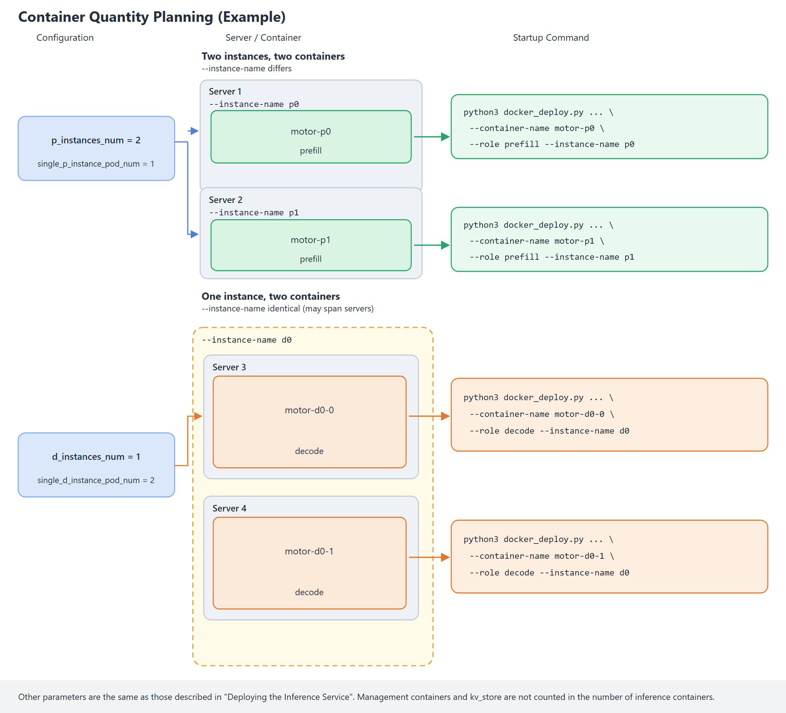

# Docker-based In-Container PD-Disaggregated Deployment

This document guides users in deploying the PD disaggregation service inside an already-created container. The container is created by a cloud platform (for example, ModelArts) or by the user. After entering the container, the user executes a single command to start the service.

## Preparing the Image

Obtain the image in either of the following ways:

- Method 1: Downloading the official complete MindIE Motor image

  Go to the [Ascend official image repository](https://www.hiascend.com/en-sg/developer/ascendhub), enter "motor" in the search box, click the "mindie-motor" card, and on the "Image Version" tab, download the corresponding MindIE Motor image according to the device model.

- Method 2: Installing MindIE Motor in an existing image

  The base image already has components such as CANN, vLLM, and vLLM Ascend installed. Refer to [Installing MindIE Motor Based on an Existing Image](../../../maintenance/build_motor_image_from_vllm_ascend.md) to additionally install MindIE Motor.

After obtaining the image, use the following command to **load the image to each server**:

   ```bash
   docker load -i xxxx.tar
   ```

## Preparing the Service Startup Script

On **any server**, perform the following operations.

1. Obtain the startup script.

   Run the following commands to copy the `examples` directory from inside the image to the host (using the `/home/examples` path as an example):

   ```bash
   # Enter the image name loaded in the previous step
   IMAGE="<image name or image ID>"
   # Create a temporary container and record the container ID
   cid=$(docker create "$IMAGE")
   # Copy the examples folder to the host
   docker cp "$cid:/tmp/motor/examples" /home/examples
   # Delete the temporary container
   docker rm "$cid"
   ```

2. Prepare the configuration file.

     MindIE Motor has provided [PD disaggregation configuration examples](../../../../../../model_configs/vllm/models/README.md) for common models (deepseek_v4_flash, deepseek_v4_pro, GLM 5.1, etc.). Select a configuration example based on the model and server type, and **copy the configuration file to the /home/examples/config directory**.
     >[!NOTE]NOTE
     >The preceding Motor configuration provides only one feasible model splitting example. **Users can adjust the model partitioning strategy based on actual conditions** by focusing on the parameters in the following table, but the following formula must be satisfied:
     >
     > Number of NPU cards occupied by one P instance = single_p_instance_pod_num (number of Pods occupied, across how many machines) × p_pod_npu_num (number of NPUs occupied by each Pod) = data_parallel_size × tensor_parallel_size

      | Configuration Item | Value Type | Value Range | Configuration Description |
      | --- | --- | --- | --- |
      | p_instances_num | int | ≥ 1 | Number of Prefill instances. |
      | d_instances_num | int | ≥ 1 | Number of Decode instances. |
      | single_p_instance_pod_num | int | ≥ 1 | Number of Pods into which one P instance is split. |
      | single_d_instance_pod_num | int | ≥ 1 | Number of Pods into which one D instance is split. |
      | p_pod_npu_num | int | ≥ 1, up to 16 cards per Pod | Number of NPU cards used by each P Pod. |
      | d_pod_npu_num | int | ≥ 1, up to 16 cards per Pod | Number of NPU cards used by each D Pod. |
      | data_parallel_size | int | ≥ 1 | Data parallel (DP) size |
      | tensor_parallel_size | int | ≥ 1 | Tensor parallel (TP) size |

3. <a id="step0003"></a>Synchronize the startup script configuration.

    Copy the entire `/home/examples` directory **to the same path on all servers**.

## Container Count Planning

After completing the `user_config.json` configuration, determine the inference instance names and the container count corresponding to each instance based on `motor_deploy_config`. Multiple containers under the same `--instance-name` can be deployed on different servers. Each container is created separately and `--start` is executed once inside the container. The management containers and kv_store are not counted in the inference container count.



1. Determine the instance names.

   The instance count fields of `motor_deploy_config` in `user_config.json` determine the number of inference instances, based on which `--instance-name` is determined. Instance names are numbered sequentially from 0 by role.

   **Table 1** `motor_deploy_config` field parameter description

   | Configuration Item | Meaning | --role | --instance-name |
   | :--- | :--- | :--- | :--- |
   | p_instances_num | Number of Prefill instances | prefill | p0, p1, ..., p{N-1} |
   | d_instances_num | Number of Decode instances | decode | d0, d1, ..., d{N-1} |
   | hybrid_instances_num | Number of aggregation instances | union | u0, u1, ..., u{N-1} |

   Here `N` is the value of the corresponding configuration item. For example, when `p_instances_num` is `2`, the Prefill instance names are `p0` and `p1`.

   When deploying management service (`--role coordinator,controller`) and kv_store, there is no need to specify `--instance-name`.

2. Determine the container count corresponding to a single instance.

   `single_p_instance_pod_num` and `single_d_instance_pod_num` (`single_hybrid_instance_pod_num` in the aggregation scenario) indicate the container count corresponding to a single instance. In Docker multi-container deployment, one Pod corresponds to one container, and each container must be created separately and run `docker_deploy.py --start` once.

   **Table 2** Container count description

   | Configuration Item | Description |
   | :--- | :--- |
   | single_p_instance_pod_num | Container count corresponding to a single Prefill instance. |
   | single_d_instance_pod_num | Container count corresponding to a single Decode instance. |
   | single_hybrid_instance_pod_num | Container count corresponding to a single aggregation instance. |

   Multiple containers under the same instance use the same `--instance-name`, while `--container-name` must not be duplicated, and they can be deployed on different servers.

   Total number of Prefill inference containers = `p_instances_num` × `single_p_instance_pod_num`. The same applies to Decode and aggregation instances.

3. **Example**.

   ```json
   {
     "motor_deploy_config": {
       "p_instances_num": 2,
       "d_instances_num": 1,
       "single_p_instance_pod_num": 1,
       "single_d_instance_pod_num": 2
     }
   }
   ```

   - Prefill has 2 instances and 2 containers, with `--instance-name` set to `p0` and `p1` respectively.
   - Decode has 1 instance and 2 containers, with `--instance-name` both set to `d0`, which can be deployed on different servers.

   **Table 3** Parameter description

   | --container-name | --role | --instance-name |
   | :--- | :--- | :--- |
   | motor-p0 | prefill | p0 |
   | motor-p1 | prefill | p1 |
   | motor-d0-0 | decode | d0 |
   | motor-d0-1 | decode | d0 |

---

## (Optional) Enabling KV Pooling

If pooling is not enabled, you can skip this section.

After enabling, P/D simultaneously performs Prefill→Decode direct transfer and KV pooling through `MultiConnector`. You also need to separately deploy a **kv_store** container (see [5. (Optional) Deploying KV Cache Store](#step002)). For more details, refer to the [KV Pooling Capability](../../../features/kv_cache_store/README.md) document to modify the `user_config.json` configuration file.

## Creating a Container

Create containers on the servers in the cluster according to the planning. A total of three types of containers need to be created:

| Container Type | Reference Template | Configuration Description |
| --- | --- | --- |
| Management container | [ENTER_DOCKER_RUN_CTRL](https://gitcode.com/Ascend/MindIE-Motor/blob/v3.2.0/examples/deployer/lib/constant.py#L607-L618) | Container name `motor-ctrl`, created on server 1. |
| P/D instance inference container | Atlas 800I A2: [ENTER_DOCKER_RUN_A2](https://gitcode.com/Ascend/MindIE-Motor/blob/v3.2.0/examples/deployer/lib/constant.py#L444-L476)<br>Atlas 800I A3: [ENTER_DOCKER_RUN_A3](https://gitcode.com/Ascend/MindIE-Motor/blob/v3.2.0/examples/deployer/lib/constant.py#L478-L518)<br>Ascend 950 (8 cards): [ENTER_DOCKER_RUN_A5](https://gitcode.com/Ascend/MindIE-Motor/blob/v3.2.0/examples/deployer/lib/constant.py#L520-L557)<br>Ascend 950 (16 cards): [ENTER_DOCKER_RUN_A5_POD16](https://gitcode.com/Ascend/MindIE-Motor/blob/v3.2.0/examples/deployer/lib/constant.py#L559-L605) | When one instance occupies only one container, the container names are `motor-p0` and `motor-d0`. When one instance is split into multiple containers, the container names are `motor-p0-0` and `motor-p0-1`. Only one container is created on each server. |
| kv_store | [ENTER_DOCKER_RUN_KVS](https://gitcode.com/Ascend/MindIE-Motor/blob/v3.2.0/examples/deployer/lib/constant.py#L620-L634) | Created when pooling is enabled, with the container name `motor-kvs`, placed on server 1. |

The following conditions must be met when creating:

- Mount the host `/home/examples` into the container at the same path: `-v /home/examples:/home/examples`. Weights, drivers, and log directories are mounted according to the template, and the host paths must actually exist.

After creation, enter the container:

```bash
docker exec -it <container name> bash
```

## Starting the Service in the Container

By default, one server deploys only one Prefill/Decode inference container. To **deploy multiple P/D inference instances on one server (for small models only)**, see [Deploying Multiple Inference Instances in the Same Container](#deploying-multiple-inference-instances-in-the-same-container).

After entering the container, run the following command in the `examples/deployer` directory to deploy the service.

1. Deploy the Controller (run in any container).

   ```bash
   python3 docker_deploy.py --config_dir ../../model_configs/vllm \
     --start --container-name motor-ctrl --role controller \
     --pod-ip <local IP> --nic-name <NIC name> \
     --coordinator-ip <IP where the Coordinator resides>
   ```

2. Deploy the Coordinator (run in any container).

   ```bash
   python3 docker_deploy.py --config_dir ../../model_configs/vllm \
     --start --container-name motor-coord --role coordinator \
     --pod-ip <local IP> --nic-name <NIC name> \
     --controller-ip <IP where the Controller resides>
   ```

3. Deploy Prefill (run only once in each prefill container).

   ```bash
   python3 docker_deploy.py --config_dir ../../model_configs/vllm \
     --start \
     --container-name motor-p0 \
     --role prefill --instance-name <instance name, must be consistent with the container count planning, for example: p0> \
     --pod-ip <local IP> --nic-name <NIC name> \
     --coordinator-ip <management plane IP> \
     --controller-ip <management plane IP>
   ```

4. Deploy Decode (run only once in each decode container).

   ```bash
   python3 docker_deploy.py --config_dir ../../model_configs/vllm \
     --start \
     --container-name motor-d0-0 \
     --role decode --instance-name <instance name, must be consistent with the container count planning, for example: d0> \
     --pod-ip <local IP> --nic-name <NIC name> \
     --coordinator-ip <management plane IP> \
     --controller-ip <management plane IP>
   ```

5. <a id="step002"></a>(Optional) Deploy the KV Cache Store. This step is required only when pooling is enabled.

   **Skip this step if pooling is not enabled**.

   ```bash
   python3 docker_deploy.py --config_dir ../../model_configs/vllm \
     --start \
     --container-name motor-kvs \
     --role kv_store \
     --pod-ip <local IP> --nic-name <NIC name> \
     --coordinator-ip <management plane IP> \
     --controller-ip <management plane IP>
   ```

   After the preceding command is executed, kv_store is started (the Mooncake backend starts `mooncake_master`, which listens on **50088** by default).

>[!NOTE]NOTE
>
>- When pooling is enabled, you must additionally add `--kv-store-ip <IP address of the server where kv_store resides>` when deploying the management plane (coordinator/controller) and Prefill/Decode. `--role kv_store` can be omitted, and `--pod-ip` is used by default.
>- When deploying multiple inference instances in the same container, use different `--devices` and ports for each `--start`. For details, see [Deploying Multiple Inference Instances in the Same Container](#deploying-multiple-inference-instances-in-the-same-container).
>- For a mixed role, change `--role` to `union`, and set `--instance-name` to be consistent with the container count planning (for example, `u0`).

**Table 5** Parameter description for the in-container deployment command

| Option | Description |
| :--- | :--- |
| --start | Starts the service in the current container without creating a container. |
| --config_dir | Directory where user_config.json and env.json reside. |
| --container-name | Container name, customizable, and must be consistent with the name used when creating the container. |
| --role | Role of the service running in the container.<ul><li>Management service: coordinator, controller;</li><li>Inference service: prefill or decode;</li><li>Pooling: kv_store.</li></ul> |
| --instance-name | Inference instance name, such as p0 and d0.<br>Used to identify which instance the service started in the current container belongs to. Multiple containers of the same instance use the same name. For details, see [Container Count Planning](#container-count-planning). |
| --pod-ip | IP address of the current server.<br>You can run the `ip -4 route get 1.1.1.1` command to view it. The value after the `src` field is the `--pod-ip` value. |
| --nic-name | Name of the NIC corresponding to `--pod-ip` on the current server.<br>You can run the `ip -4 route get 1.1.1.1` command to view it. The value after the `dev` field is the `--nic-name` value. |
| --coordinator-ip/--controller-ip | IP address of the server where Coordinator/Controller resides. Fill in this parameter when deploying the inference service and kv_store. When the management service is deployed in separate containers, fill in `--coordinator-ip` for Controller and `--controller-ip` for Coordinator. |
| --kv-store-ip | IP address of the server where kv_store resides. After pooling is enabled, this parameter is mandatory when deploying the management plane (coordinator/controller) and Prefill/Decode. `--role kv_store` can be omitted, and `--pod-ip` is used by default. |

After the preceding command is executed, the window starts the corresponding service, and you can observe the log output on the screen.

## Inference Verification

Send the following inference request on the **server where the deployment management service is deployed** to perform inference verification:

```bash
curl -X POST http://<IP address of the server where the coordinator management service resides>:1025/v1/chat/completions \
  -H "Content-Type: application/json" \
  -d '{
    "model": "<Model name, which must be consistent with the configuration in the user_config.json file>",
    "messages": [{"role": "user", "content": "who are you?"}],
    "max_tokens": 36,
    "stream": true
  }'
```

If the following content is returned, the service is not ready yet. Retry later.

```Output
{"detail":"Service is not available"}
```

After enabling pooling, send another request with a prompt of no fewer than 128 tokens. After the request succeeds, check `Keys` in the kv_store log. A change from 0 to a value greater than 0 indicates that the blocks have been pooled. Example log path:

```text
/home/examples/motor_workspace/motor-kvs/kvs/log/docker-kv_store-<timestamp>.log
```

## Terminating and Redeploying the Service

Pressing `Ctrl+C` in the terminal terminates the service but does not exit the container. After the service is terminated, the following prompt is displayed to facilitate redeployment.

```text
The service in the container has been terminated. You can run the following command to redeploy the service.
python3 /path/to/examples/deployer/docker_deploy.py --config_dir /path/to/model_configs/vllm --start --container-name motor-ctrl --role coordinator,controller --pod-ip <local IP address> --nic-name <local primary NIC name>
Runtime log: examples/motor_workspace/motor-ctrl/ctrl/log/docker-coordinator-controller-<timestamp>.log
```

## (Optional) Enabling the Render Feature

Add the following configuration to `/home/examples/config/user_config.json`:

```json
{
  ...
  "motor_coordinator_config": {
    "render_config": {
      "enable": true
    }
  },
  ...
}
```

On the server where the management plane is deployed, additionally create a container named `motor-ctrl-vllm-render`. This container does not mount NPUs. For the mount configuration, refer to the management plane template [ENTER_DOCKER_RUN_CTRL](https://gitcode.com/Ascend/MindIE-Motor/blob/v3.2.0/examples/deployer/lib/constant.py#L607-L618). Add `-v /var/run/docker.sock:/var/run/docker.sock` to the management plane container.

After entering the Render container, execute:

```bash
python3 /home/examples/deployer/docker_deploy.py --config_dir /home/examples/config --start --role render
```

When `--start` is executed in the management plane container, the Render container is restarted. When the management plane process exits, the Render container is stopped. After Render exits, the Coordinator continues to run.

## Tuning Guide

### Adjusting Container Mounts

The template for creating a container is for reference only. When adjusting mounts, add or remove `-v` in the `docker run` command. When creating a container on a cloud platform, adjust the mount configuration on the platform. The host path must actually exist.

### Deploying Multiple Inference Instances in the Same Container

You can execute `--start` multiple times in one container to deploy multiple inference instances.

The following uses one container to deploy one Prefill and one Decode as an example, with the container mounting cards `0,1,2,3`. Prefill `p0` uses `0,1`, and Decode `d0` uses `2,3`.

1. Create a container.

   Execute once on the host. This container mounts the cards to be used by the two instances. The management plane still creates a separate container, which is executed according to the output of [Starting the Service in the Container](#starting-the-service-in-the-container).

   ```bash
   python3 /home/examples/deployer/docker_deploy.py \
     --config_dir /home/examples/config \
     --create \
     --container-name motor-pd \
     --devices 0,1,2,3    # This container mounts the cards to be used by the two instances
   ```

2. Enter the container.

   ```bash
   docker exec -it motor-pd bash
   ```

3. Run the Prefill startup command.

   Add the following five parameters.

   ```bash
   python3 /home/examples/deployer/docker_deploy.py \
     --config_dir /home/examples/config \
     --start \
     --container-name motor-pd \
     --role prefill \
     --instance-name p0 \
     --pod-ip "<local IP>" \
     --nic-name "<local NIC>" \
     --coordinator-ip "<server 1 IP>" \
     --controller-ip "<server 1 IP>" \
     --devices 0,1  \                  # Card numbers used by this instance, 2 cards. Other instances in the same container must not overlap
     --node-manager-port 4026  \       # NodeManager port. Stagger within the same container, for example, 4026 and 4226
     --data-parallel-rpc-port 9000  \  # Data parallel RPC port. Stagger within the same container, for example, 9000 and 9200
     --base-port 10000  \              # Engine endpoint start port, which will occupy a subsequent range of ports. Stagger within the same container, for example, 10000 and 12000
     --kv-port 21000                   # KV transfer start port, which will occupy a subsequent range of ports. Stagger within the same container, for example, 21000 and 23000
   ```

4. Run the Decode startup command.

   Open a new window, enter the container, and execute the following command, adding the following five parameters.

   ```bash
   python3 /home/examples/deployer/docker_deploy.py \
     --config_dir /home/examples/config \
     --start \
     --container-name motor-pd \
     --role decode \
     --instance-name d0 \
     --pod-ip "<local IP>" \
     --nic-name "<local NIC>" \
     --coordinator-ip "<server 1 IP>" \
     --controller-ip "<server 1 IP>" \
     --devices 2,3  \                  # Card numbers used by this instance, 2 cards. Other instances in the same container must not overlap
     --node-manager-port 4226  \       # NodeManager port. Stagger within the same container, for example 4026, 4226
     --data-parallel-rpc-port 9200  \  # Data parallel RPC port. Stagger within the same container, for example 9000, 9200
     --base-port 12000  \              # Engine endpoint starting port, which will occupy a subsequent range of ports. Stagger within the same container, for example 10000, 12000
     --kv-port 23000                   # KV transfer starting port, which will occupy a subsequent range of ports. Stagger within the same container, for example 21000, 23000
   ```
