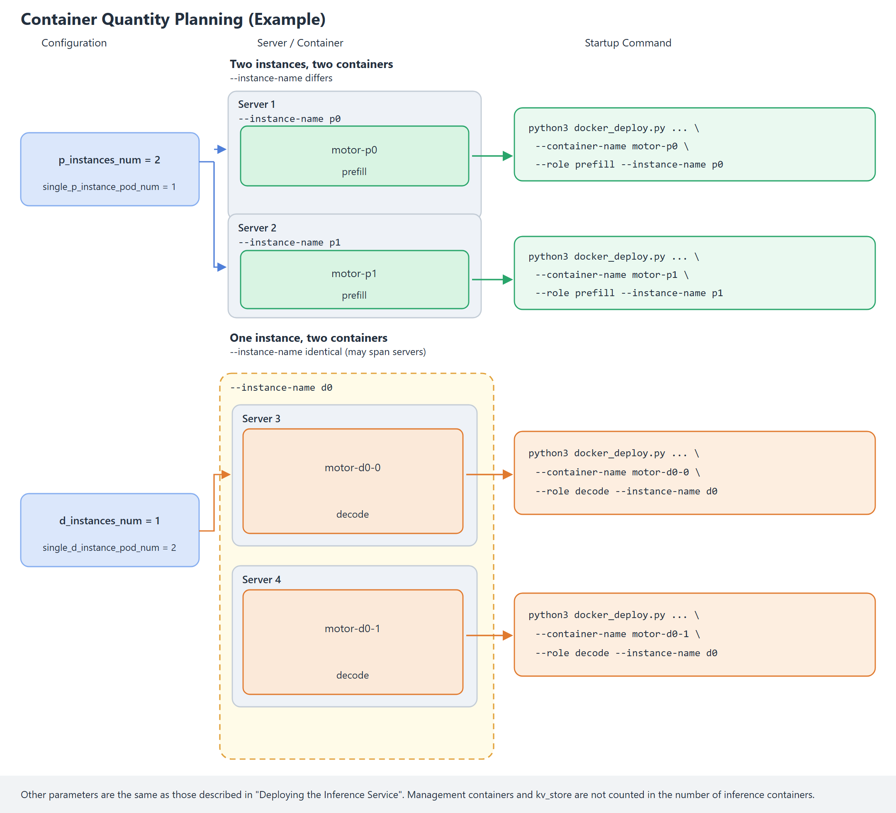

# Docker-Based Multi-Container Service Deployment Guide

This document describes how to **deploy a multi-node inference service based on Docker**, without relying on K8s. To deploy a single-node inference service with a small model, see the [Single-Container Deployment Guide](single_container.md).

## Deployment Flowchart


## Image Preparation

Obtain the image by using either of the following methods, and **load the image to all nodes in the cluster**:

 - **Method 1**: Download the official complete MindIE Motor image.
     Go to the [Ascend Official Image Repository](https://www.hiascend.com/developer/ascendhub), search for `motor`, and select the corresponding MindIE Motor image based on the device model.
 - **Method 2**: Install MindIE Motor in an existing image.
     The base image already has CANN, vLLM, vLLM Ascend, and other components installed. To install MindIE Motor additionally, see [Building a MindIE Motor Image from vLLM Ascend](../../maintenance/build_motor_image_from_vllm_ascend.md#installing-mindie-motor-based-on-the-vllm-ascendsglang-image).

After obtaining the image, run the following command to load the image to the server:

   ```bash
   docker load -i xxxx.tar
   ```

After the image is imported, run the following command to check whether the Docker image exists:

   ```bash
   docker images
   ```

## Preparing the Service Startup Script

   Obtain the `examples` directory of the service deployment script:

   - Method 1 (using the **official complete MindIE Motor image**): The path in the image is `/tmp/motor/examples`. Run the following commands:

     ```bash
     IMAGE="<image name or image ID>"
     cid=$(docker create "$IMAGE")
     docker cp "$cid:/tmp/motor/examples" ./examples
     docker rm "$cid"
     ```

   - Method 2: (using an **image with MindIE Motor manually installed**): After running `git clone` on the code repository, the startup script is located in the `MindIE-Motor/examples` directory.

## Configuring Serving Parameters

1. **Prepare the configuration files**

   - PD disaggregation scenario

     MindIE Motor provides [**PD disaggregation configuration examples**](../../../../../model_configs/vllm/models/README_EN.md) for common models (deepseek_v4_flash, deepseek_v4_pro, GLM 5.1, etc.). **Users can use them directly after modifying a small number of configurations.**

     For models without typical configurations provided, refer to the [MindIE Motor Configuration Auto-Generation Guide](../../../../../model_configs/vllm/models/README_EN.md) to automatically generate the `user_config.json` and `env.json` configuration files.

   - PD aggregation scenario

     Refer to the [**MindIE Motor Configuration Auto-Generation Guide**](../../../../../model_configs/vllm/models/README_EN.md) to **automatically generate** the `user_config.json` and `env.json` configuration files for the PD aggregation scenario.

2. **Configure the ports**

   Modify the following configuration to avoid port conflicts:

   ```json
   {
     ...
     "motor_controller_config": {
       "api_config": {
         "controller_api_port": 2026,
         "observability_api_port": 2027
       }
     },
     ...
     "motor_engine_prefill_config": {
       "motor_nodemanger_config": {
         "api_config": { "node_manager_port": 3026 }
       },
       ...
     },
     "motor_engine_decode_config": {
       "motor_nodemanger_config": {
         "api_config": { "node_manager_port": 4026 }
       },
       ...
     }
   }
   ```

3. **Synchronize the startup script configuration**

     Store the prepared configuration files (user_config.json and env.json) in the `model_configs/vllm` directory of the startup script, and then copy the entire configuration script directory to each server in the cluster, with one server corresponding to one identical copy of the script.

## Enabling KV Pooling (Optional)

Skip this section if pooling is not enabled. After pooling is enabled, P/D uses `MultiConnector` to perform both Prefill→Decode direct transfer and KV pooling. You also need to deploy a separate **kv_store** container (see "Deploying KV Cache Store" below). Refer to [KV Pooling Deployment](../../features/kv_cache_store/README.md) to modify the user_config.json configuration file.

## PR / DT Heterogeneous Deployment (Optional)

Ascend950 machines are classified into two types: PR and DT. PR uses Bailu memory, and DT uses HBM. HBM provides larger bandwidth and better performance, and is more suitable for Decode. Prefill can be deployed on PR. For **PR + DT hybrid networking**, the Prefill containers must be placed on PR machines and the Decode containers on DT machines. For all-PR or all-DT networking, deploy according to the normal process described above; this section is not required.

>[!NOTE]NOTE
> Docker deployment has no scheduler, so heterogeneity is determined entirely by "which command is executed on which machine", which is the same thing as the batch deployment by server in "Container Quantity Planning" above. The K8s-specific `npu_chip_name` field (one in `motor_engine_prefill_config` and one in `motor_engine_decode_config`) **does not take effect in Docker deployment** (it is neither read nor reported as an alarm), so it does not need to be filled in.

1. **Configure the hardware type**

   Set `hardware_type` to `Ascend950` in all cases. PR and DT machines **share the same** `user_config.json`, so the practice of "one server corresponding to one identical copy of the script" in "Synchronize the Startup Script Configuration" above still holds for heterogeneous networking.

   ```json
   {
     "motor_deploy_config": {
       "hardware_type": "Ascend950",
       ...
     }
   }
   ```

2. **Assign roles by machine type**

   After determining the instance names according to "Container Quantity Planning", assign the containers to machines of the corresponding type:

   | Machine Type | `--role` | `--instance-name` | `--container-name` (Example) |
   | :--- | :--- | :--- | :--- |
   | PR | `prefill` | `p0`, `p1`, ... | `motor-p0` |
   | DT | `decode` | `d0`, `d1`, ... | `motor-d0-0` |

   Run the Prefill startup command on the **PR machine**:

   ```bash
   python3 docker_deploy.py --config_dir ../../model_configs/vllm \
     --container-name motor-p0 --devices 0 \
     --role prefill --instance-name p0 \
     --pod-ip <IP address of the local machine> --nic-name <name of the local primary NIC> \
     --coordinator-ip <IP address of the server where the coordinator management service resides> \
     --controller-ip <IP address of the server where the controller management service resides>
   ```

   Run the Decode startup command on the **DT machine**:

   ```bash
   python3 docker_deploy.py --config_dir ../../model_configs/vllm \
     --container-name motor-d0-0 --devices 0 \
     --role decode --instance-name d0 \
     --pod-ip <IP address of the local machine> --nic-name <name of the local primary NIC> \
     --coordinator-ip <IP address of the server where the coordinator management service resides> \
     --controller-ip <IP address of the server where the controller management service resides>
   ```

   The management plane (`coordinator,controller`) and kv_store are not bound to a card type; deploy them normally as described in "Starting Services" below.

3. **Confirm the machine type**

   Before deployment, confirm the type (PR / DT) of each server one by one, and then assign containers according to the type:

   - Use the data center / asset management information as the basis. In K8s scenarios, this corresponds to the node label `huawei.com/npu.chip.name`, whose value is `Ascend950PR` (PR) or `Ascend950DT` (DT).
   - `npu-smi` is mounted in the container. You can run `npu-smi info` to view the NPUs on the local machine.

>[!NOTE]NOTE
>
> - **No model verification**: Docker deployment does not verify whether the role matches the machine type. Placing a Prefill container on a DT machine does not raise an error (only the number of mounted cards is verified before startup), so this must be guaranteed manually.
> - **Heterogeneous deployment is not supported in single-container mode**: In single-container mode, Prefill and Decode run in the same container on the same machine and cannot be placed on PR / DT separately. Use the multi-container deployment described in this document for heterogeneous networking.
> - **The component-level `image_name` does not take effect**: `image_name` in component configurations such as `motor_engine_prefill_config` and `motor_engine_decode_config` takes effect only in K8s deployment. For Docker deployment, the container image is always taken from `motor_deploy_config.image_name`. If PR / DT really require different images, prepare them separately on each machine and point to different `--config_dir` values (keep the remaining configuration consistent).
> - **A5 hardware type values have been consolidated**: Old values such as `850-Atlas-8p-8`, `950-SuperPod-Atlas-8`, and `350-Atlas-16` are no longer supported. Set `hardware_type` to `Ascend950`; otherwise, `Unknown hardware_type` is reported at startup.
> - When containers are recreated, machines are replaced, or instances are manually added or removed, keep the correspondence between roles and machine types (Prefill → PR, Decode → DT).

## Enabling the Render Feature (Optional)

Modify the following configuration to enable the render feature. After the feature is enabled, when the Coordinator management service is deployed, `docker_deploy.py` creates an additional container named `{NAME}-vllm-render` on the host (`{NAME}` is the value of `--container-name`) and runs the vLLM Render service in it. When you terminate the service, reclaim this container. If Render creation fails, the main container is not created; if main container creation fails, the Render started this time is deleted. In the Docker scenario, the Coordinator and Render live and die together: `--start` in the container runs `docker restart` on the Render sibling container; when the Coordinator exits (Ctrl+C / process exit), it runs `docker stop` on Render. After Render becomes ready for the first time, the Coordinator continuously probes its `/health` as a heartbeat; if the probe fails consecutively, the Coordinator exits together with Render. For this purpose, the host's `/var/run/docker.sock` is mounted into the Coordinator / single container. Existing old containers must be recreated to have this mount.

If the container already exists (for example, it was previously created with `--create`), the deployment script does not overwrite it. After entering the container, start it in the same way as other roles:

```bash
python3 /path/to/examples/deployer/docker_deploy.py --config_dir /path/to/model_configs/vllm --start --role render
```

You can also create the Render container separately (no NPU, host network, same template as Controller):

```bash
python3 /path/to/examples/deployer/docker_deploy.py --config_dir /path/to/model_configs/vllm --create --container-name <NAME>-vllm-render --role render
```

```json
{
  "motor_coordinator_config": {
    "render_config": {
      "enable": true
    }
  }
}
```

## Container Quantity Planning

After `user_config.json` is configured, determine the inference instance names and the number of containers for each instance based on `motor_deploy_config`. Multiple containers under the same `--instance-name` can be deployed on different servers, and the startup command must be executed once for each container. Management containers and kv_store are not counted as inference containers.



1. **Determine the instance names**

   The instance quantity fields of `motor_deploy_config` in `user_config.json` determine the number of inference instances, based on which `--instance-name` is determined. Instance names are numbered sequentially by role starting from 0.

   | Configuration Item | Meaning | `--role` | `--instance-name` |
   | :--- | :--- | :--- | :--- |
   | `p_instances_num` | Number of Prefill instances | `prefill` | `p0`, `p1`, ..., `p{N-1}` |
   | `d_instances_num` | Number of Decode instances | `decode` | `d0`, `d1`, ..., `d{N-1}` |
   | `hybrid_instances_num` | Number of aggregation instances | `union` | `u0`, `u1`, ..., `u{N-1}` |

   Here, `N` is the value of the corresponding configuration item. For example, when `p_instances_num` is `2`, the Prefill instance names are `p0` and `p1`.

   When deploying the management service (`--role coordinator,controller`) and kv_store, `--instance-name` does not need to be specified.

2. **Determine the number of containers for a single instance**

   `single_p_instance_pod_num` and `single_d_instance_pod_num` (`single_hybrid_instance_pod_num` for the aggregation scenario) indicate the number of containers for a single instance. In Docker multi-container deployment, one pod corresponds to one container, and `docker_deploy.py` must be executed once for each container.

   | Configuration Item | Description |
   | :--- | :--- |
   | `single_p_instance_pod_num` | Number of containers for a single Prefill instance |
   | `single_d_instance_pod_num` | Number of containers for a single Decode instance |
   | `single_hybrid_instance_pod_num` | Number of containers for a single aggregation instance |

   Multiple containers under the same instance use the same `--instance-name`, and `--container-name` must be unique. They can be deployed on different servers.

   Total number of Prefill inference containers = `p_instances_num` × `single_p_instance_pod_num`. The same applies to Decode and aggregation.

3. **Comprehensive example**

   Take the configuration in the figure above as an example:

   ```json
   {
     "motor_deploy_config": {
       "p_instances_num": 2,
       "d_instances_num": 1,
       "single_p_instance_pod_num": 1,
       "single_d_instance_pod_num": 2
     }
   }
   ```

   - Prefill has two instances and two containers, with `--instance-name` set to `p0` and `p1`, respectively.
   - Decode has one instance and two containers, both with `--instance-name` set to `d0`, and they can be deployed on different servers.

   | `--container-name` | `--role` | `--instance-name` |
   | :--- | :--- | :--- |
   | `motor-p0` | `prefill` | `p0` |
   | `motor-p1` | `prefill` | `p1` |
   | `motor-d0-0` | `decode` | `d0` |
   | `motor-d0-1` | `decode` | `d0` |

   Execute the command in "Deploying the Inference Service" below once on the corresponding server for each container. Take Prefill instance `p0` as an example:

   ```bash
   python3 docker_deploy.py --config_dir ../../model_configs/vllm \
     --container-name motor-p0 --devices 0 \
     --role prefill --instance-name p0 \
     --pod-ip <IP address of the local machine> --nic-name <name of the local primary NIC> \
     --coordinator-ip <IP address of the server where the coordinator management service resides> \
     --controller-ip <IP address of the server where the controller management service resides>
   ```

## Starting Services

A complete inference service requires at least one management plane container and multiple inference containers. When KV pooling is enabled, a **kv_store** container is also required. For the number, names, and servers of the inference containers, see "Container Quantity Planning" above, and execute the commands on the corresponding servers as planned. The service deployment process is as follows:

1. **Deploy the management service**

   In the `examples/deployer` directory, run the following command to deploy the management plane services (coordinator and controller) in the same container:

   ```bash
   python3 docker_deploy.py --config_dir ../../model_configs/vllm \
     --container-name motor-ctrl --role coordinator,controller \
     --pod-ip <IP address of the local machine> --nic-name <name of the local primary NIC>
   ```

   To deploy the Coordinator and Controller in separate containers, run the following commands.

   ```bash
   python3 docker_deploy.py --config_dir ../../model_configs/vllm \
     --container-name motor-ctrl --role controller \
     --pod-ip <IP address of the local machine> --nic-name <name of the local primary NIC> \
     --coordinator-ip <IP address of the server where the coordinator management service resides>
   ```

   ```bash
   python3 docker_deploy.py --config_dir ../../model_configs/vllm \
     --container-name motor-coord --role coordinator \
     --pod-ip <IP address of the local machine> --nic-name <name of the local primary NIC> \
     --controller-ip <IP address of the server where the controller management service resides>
   ```

   After the preceding commands are executed, the window automatically **creates the container**, **enters the container**, and **starts the management service**. You can **observe the log output on the screen**.

   **When pooling is enabled**, the `--kv-store-ip` parameter must be added to the management plane commands above:

   ```text
   --kv-store-ip <IP address of the server where kv_store resides>
   ```

2. **Deploy KV Cache Store (only when pooling is enabled)**

   Skip this step if pooling is not enabled. Select any server and run the following command in the `examples/deployer` directory:

   ```bash
   python3 docker_deploy.py --config_dir ../../model_configs/vllm \
     --container-name motor-kvs --role kv_store \
     --pod-ip <IP address of the local machine> --nic-name <name of the local primary NIC> \
     --coordinator-ip <IP address of the server where the coordinator management service resides> \
     --controller-ip <IP address of the server where the controller management service resides>
   ```

   After the preceding command is executed, the window automatically creates the container, enters the container, and starts kv_store (the Mooncake backend starts `mooncake_master`, which listens on **50088** by default). Because this container does not need to mount NPUs, `--devices` does not need to be passed.

3. **Deploy the inference service**

   Run the following command to deploy one Prefill container:

   ```bash
   python3 docker_deploy.py --config_dir ../../model_configs/vllm \
     --container-name motor-p0 --devices 0 \
     --role prefill --instance-name p0 \
     --pod-ip <IP address of the local machine> --nic-name <name of the local primary NIC> \
     --coordinator-ip <IP address of the server where the coordinator management service resides> \
     --controller-ip <IP address of the server where the controller management service resides>
   ```

   Run the following command to deploy one Decode container:

   ```bash
   python3 docker_deploy.py --config_dir ../../model_configs/vllm \
     --container-name motor-d0-0 --devices 0 \
     --role decode --instance-name d0 \
     --pod-ip <IP address of the local machine> --nic-name <name of the local primary NIC> \
     --coordinator-ip <IP address of the server where the coordinator management service resides> \
     --controller-ip <IP address of the server where the controller management service resides>
   ```

   `--devices` specifies the NPU card IDs mounted to the container in which the service is created (for example, 0, 1, 2, 3). If it is not specified, all cards in the template are mounted according to the hardware type (0–7 for the Atlas 800I A2 / Ascend 950PR products, and 0–15 for the Atlas 800I A3).

   **When pooling is enabled**, the `--kv-store-ip` parameter must also be added to both the Prefill and Decode commands above:

   ```text
   --kv-store-ip <IP address of the server where kv_store resides>
   ```

   After the preceding commands are executed, the window automatically creates the container, enters the container, and starts the inference service. You can observe the log output on the screen.

4. **Startup parameter description**

   | Parameter | Description |
   | :--- | :--- |
   | `--config_dir` | Directory where `user_config.json` and `env.json` reside. |
   | `--container-name` | Container name. It can be customized. |
   | `--role` | Role of the service running in the container. Set it to `coordinator,controller` for the management service, `prefill` or `decode` for the inference service, and `kv_store` for pooling. |
   | `--instance-name` | Inference instance name, such as `p0` and `d0`. It identifies the instance to which the service started in the current container belongs. Multiple containers of the same instance use the same name. For details, see "Container Quantity Planning" above. |
   | `--devices` | NPU card IDs mounted to the container in which the service is created (for example, 0, 1, 2, 3). If it is not specified, all cards in the template are mounted according to the hardware type (0–7 for the Atlas 800I A2 / Ascend 950PR products, and 0–15 for the Atlas 800I A3). Do not pass it for the management plane and kv_store. |
   | `--pod-ip` | IP address of the **current server**. |
   | `--nic-name` | Name of the NIC of the **current server** that corresponds to `--pod-ip`. |
   | `--coordinator-ip` / `--controller-ip` | IP address of the server where the Coordinator / Controller resides. Specify them when deploying the inference service and kv_store. When the management service is deployed in separate containers, set `--coordinator-ip` for the Controller and `--controller-ip` for the Coordinator. |
   | `--kv-store-ip` | IP address of the server where kv_store resides. After pooling is enabled, it is mandatory when deploying the management plane (coordinator / controller) and Prefill / Decode. It can be omitted for `--role kv_store`, in which case `--pod-ip` is used by default. |

   Run the following command to view the NIC name and the local IP address. The value after `dev` is `--nic-name`, and the value after `src` is `--pod-ip`.

   ```bash
   ip -4 route get 1.1.1.1
   ```

## Inference Verification

Send the following inference request **on the machine where the management service is deployed** to perform inference verification:

```bash
curl -X POST http://<IP address of the server where the coordinator management service resides>:1025/v1/chat/completions \
  -H "Content-Type: application/json" \
  -d '{
    "model": "<model name, which must be consistent with the configuration in the user_config.json file>",
    "messages": [{"role": "user", "content": "who are you?"}],
    "max_tokens": 36,
    "stream": true
  }'
```

If the following content is returned, the service is not ready yet. Try again later.

```json
{"detail":"Service is not available"}
```

After pooling is enabled, send another request with a **long prompt** (at least **128 tokens**, 500+ recommended). `AscendStoreConnector` puts data into the pool in blocks of 128 tokens, so short sentences are not put and cannot be used to determine whether pooling takes effect.

After the request succeeds, check `Keys` in the workspace log of the kv_store container: when it changes from `0` to a value greater than 0, the blocks have been put into the pool. Example log path:

```text
examples/motor_workspace/motor-kvs/kvs/log/docker-kv_store-<timestamp>.log
```

## Terminating the Service and Redeploying

Press **Ctrl+C** in the terminal to terminate the service, but the container is not exited. After the service is terminated, the following message is displayed so that you can redeploy the service.

```text
The service in the container has been terminated. Run the following command to redeploy the service.
python3 /path/to/examples/deployer/docker_deploy.py --config_dir /path/to/model_configs/vllm --start --container-name motor-ctrl --role coordinator,controller --pod-ip <IP address of the local machine> --nic-name <name of the local primary NIC>
Run log: examples/motor_workspace/motor-ctrl/ctrl/log/docker-coordinator-controller-<timestamp>.log
```

You can directly copy the preceding command to redeploy the service. When pooling is enabled, stop the kv_store container with Ctrl+C in the same way, and set `--role` to `kv_store` in the restart command.

## Tuning Guide

### How to Adjust Container Mounts

The deployment script automatically creates containers for users, and the containers automatically mount the paths of the service startup script and weight files. To customize the container creation command, manually adjust the docker-run template in the `examples/deployer/lib/constant.py` file.

### Staggering Ports When Deploying Multiple Inference Containers on the Same Server

When multiple inference containers are deployed on the same server, first allocate NPUs to the container through `--devices`, and then plan and stagger the ports of the container.

`--devices` specifies the card IDs used by the container. Multiple inference containers on the same server must use different card IDs, and the number of cards must be consistent with the number of NPUs required by the container.

To stagger the ports, add the following parameters to the startup command:

| Parameter | Description |
| :--- | :--- |
| `--node-manager-port` | NodeManager port at runtime, used for engine node management |
| `--data-parallel-rpc-port` | Data parallel RPC port at runtime |
| `--kv-port` | KV transfer port at runtime |
| `--base-port` | Start port of the engine endpoints at runtime |

Take the case where the two containers of Decode instance `d0` in the comprehensive example above are deployed on the same server. The two containers use card `0` and card `1`, respectively, and the port planning is as follows:

| `--container-name` | `--devices` | `--node-manager-port` | `--data-parallel-rpc-port` | `--base-port` |
| :--- | :--- | :--- | :--- | :--- |
| `motor-d0-0` | `0` | `4026` | `9000` | `10000` |
| `motor-d0-1` | `1` | `4126` | `9100` | `11000` |

Run the following command to deploy container `motor-d0-0`:

```bash
python3 docker_deploy.py --config_dir ../../model_configs/vllm \
  ... \
  --devices 0 \
  ... \
  --node-manager-port 4026 \
  --data-parallel-rpc-port 9000 \
  --base-port 10000
```

Run the following command to deploy container `motor-d0-1`:

```bash
python3 docker_deploy.py --config_dir ../../model_configs/vllm \
  ... \
  --devices 1 \
  ... \
  --node-manager-port 4126 \
  --data-parallel-rpc-port 9100 \
  --base-port 11000
```

When pooling is enabled, add a different `--kv-port` to each of the two commands, for example, `21000` and `22000`. Do not pass `--kv-port` when pooling is not enabled.
