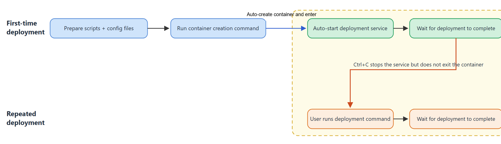

# Docker-based Single-Container Service Deployment

This document guides users to complete the deployment of an inference service on a single machine based on Docker, where the entire PD disaggregation deployment is completed on one server within one container. It applies to small models (weights less than 100 GB) and does not depend on K8s. For large models or multi-node deployment, see [Host Deployment: PD Disaggregation](host/pd_disaggregation_deployment.md). KV pooling requires a separate kv_store container; use host deployment and refer to [(Optional) Enabling KV Pooling](./host/pd_disaggregation_deployment.md#optional-enabling-kv-pooling).

>[!NOTE] Note
> In single-container deployment, Prefill and Decode run in the same container on the same machine, and mixed networking of Ascend 950PR and 950DT is not supported. For mixed networking, use [Host Deployment: PD Disaggregation](./host/pd_disaggregation_deployment.md#starting-service), place the Prefill command on the 950PR, and place the Decode command on the 950DT.

## Deployment Flowchart



**First deployment**:

- Before deployment, prepare the deployment script and configuration files;
- Run the "container creation command". The system automatically creates the container and enters it;
- The system automatically deploys the service inside the container, and then waits for the service deployment to complete;
- If the user terminates the service by pressing Ctrl+C, the container is not exited; instead, the system returns to a state where redeployment is possible.

**Redeployment**:

- On the premise that the container already exists, the user can directly run the deployment command;
- The system waits again for the service deployment to complete, completing a new round of deployment.

## Image Preparation

Obtain the image in the following ways and load it to the deployment server:

- Method 1: Downloading the official complete MindIE Motor image

  Go to the [Ascend official image repository](https://www.hiascend.com/en-sg/developer/ascendhub), enter "motor" in the search box, click the "mindie-motor" card, and on the "Image Version" tab, download the corresponding MindIE Motor image according to the device model.
- Method 2: Installing MindIE Motor in an existing image

  The base image already has CANN, vLLM, vLLM Ascend, and other components installed. Refer to [Installing MindIE Motor Based on the vLLM Ascend/SGLang Image](../../maintenance/build_motor_image_from_vllm_ascend.md#installing-mindie-motor-based-on-the-vllm-ascendsglang-image) to additionally install MindIE Motor.

After obtaining the image, use the following command to load the image to the server:

   ```bash
   docker load -i xxxx.tar
   ```

After the image is imported, use the following command to check whether the Docker image exists:

   ```bash
   docker images
   ```

## Preparing the Service Deployment Script

Obtain the service deployment script `examples` directory:

- Method 1: Downloading the official complete MindIE Motor image

     The path in the image is `/tmp/motor/examples`, and you can run the following commands to obtain it:

     ```bash
     # Define a variable IMAGE to store the image name or image ID
     IMAGE="<image name or image ID>"
     # Create a temporary container that is not started, and record the container ID
     cid=$(docker create "$IMAGE")
     # Copy the /tmp/motor/examples directory in the container to the current directory on the host
     docker cp "$cid:/tmp/motor/examples" ./examples
     # Delete the temporary container $cid created above to clean up resources and avoid leaving useless containers
     docker rm "$cid"
     ```

- Method 2: Installing MindIE Motor in an existing image

     After running `git clone` for the code repository, the deployment script is located in the `MindIE-Motor/examples` directory.

## Configuring Serving Parameters

1. Prepare the configuration file.

    MindIE Motor already provides [PD disaggregation configuration examples](../../../../../model_configs/vllm/models/README.md) for common models (deepseek_v4_flash, deepseek_v4_pro, GLM 5.1, etc.). Users can use them directly after modifying a small number of configurations.

    For models without a typical configuration provided, refer to the [MindIE Motor Configuration Auto-Generation Guide](../../../../../model_configs/vllm/models/README.md) to automatically generate the `user_config.json` and `env.json` configuration files.

2. Configure ports and deployment mode.

   In a single container, the management plane and inference processes share the host network, so the deployment mode must be changed and the ports must be staggered; otherwise, conflicts occur. For detailed parameter descriptions, see [Full Parameter Description of the user_config.json Configuration File](../../configuration/config_reference.md):

   ```json
   {
     "motor_deploy_config": {
       "deploy_mode": "single_container",
       ...
     },
     ...
     "motor_controller_config": {
       "api_config": {
         "controller_api_port": 2026,
         "observability_api_port": 2027
       }
     },
     ...
     "motor_engine_prefill_config": {
       "motor_nodemanger_config": {
         "api_config": { "node_manager_port": 3026 }
       },
       ...
     },
     "motor_engine_decode_config": {
       "motor_nodemanger_config": {
         "api_config": { "node_manager_port": 4026 }
       },
       ...
     }
   }
   ```

   `deploy_mode`: must be `single_container`.

3. Synchronize the deployment script configuration.

    Store the prepared configuration files (`user_config.json` and `env.json`) in the `model_configs/vllm` directory of the deployment script.

## (Optional) Enabling the Render Feature

Modify the following configuration to enable the Render feature. After the feature is enabled, when deploying a single-container service, `docker_deploy.py` creates an additional container named `{NAME}-vllm-render` on the host (`{NAME}` is the value of `--container-name`) and runs the vLLM Render service in it. When you terminate the service, remember to reclaim this container. If Render fails to be created, the main container is no longer created; if the main container fails to be created, the Render started this time is deleted.

In the container, `--start` runs `docker restart` on the sibling Render container; when Coordinator exits, it runs `docker stop` on Render. After Render exits, Coordinator continues to run. For this purpose, the host `/var/run/docker.sock` is mounted into the single container; existing old containers must be recreated to have this mount.

Enable the Render feature in `user_config.json`. The following is an example:

```json
{
  "motor_coordinator_config": {
    "render_config": {
      "enable": true
    }
  }
}
```

If the main container or `{NAME}-vllm-render` already exists, when you run the deployment command in the terminal, you are asked whether to delete it and continue. This step occurs before the port check to avoid treating the ports occupied by the previous container as a new conflict. Answer `y` to delete these existing containers and recreate them; answer `N`, or run in a non-interactive environment, to abort without overwriting. To keep using an existing Render container, enter that container and run:

```bash
python3 /path/to/examples/deployer/docker_deploy.py --config_dir /path/to/model_configs/vllm --start --role render
```

## Starting Service

Run the following command in the `examples/deployer` directory on the deployment server to start the service:

```bash
python3 docker_deploy.py --config_dir ../../model_configs/vllm \
  --container-name motor-single --devices 0,1 \
  --pod-ip <IP address of the local machine> --nic-name <name of the local primary NIC>
```

After the preceding command is executed, the window automatically creates the container, enters the container, and starts the service, and users can observe log output on the screen. `--devices` must cover the cards used by Prefill and Decode.

**Table 1** Startup parameter description

| Option | Description |
| :--- | :--- |
| --config_dir | Directory where the `user_config.json` and `env.json` configuration files are located. |
| --container-name | Container name, which can be customized. |
| --devices | NPU card IDs mounted to this container, such as `0,1`. If this option is not specified, all cards on the server are mounted by default. |
| --pod-ip | IP address of the current server.<br>You can run the `ip -4 route get 1.1.1.1` command to view it. The value after the `src` field is the `--pod-ip` value. |
| --nic-name | Name of the NIC on the current server that corresponds to `--pod-ip`.<br>You can run the `ip -4 route get 1.1.1.1` command to view it. The value after the `dev` field is the `--nic-name` value. |

## Inference Verification

Send the following inference request on the local machine to perform inference verification:

```bash
curl -X POST http://127.0.0.1:1025/v1/chat/completions \
  -H "Content-Type: application/json" \
  -d '{
    "model": "<model name, which must be consistent with the configuration in the user_config.json file>",
    "messages": [{"role": "user", "content": "who are you?"}],
    "max_tokens": 36,
    "stream": true
  }'
```

If the following content is returned, the service is not ready yet. Retry later.

```json
{"detail":"Service is not available"}
```

## Terminating and Redeploying the Service

Pressing **Ctrl+C** in the terminal terminates the service but does not exit the container. After the service is terminated, the following prompt is displayed to facilitate redeployment.

```text
The service in the container has been terminated. Run the following command to redeploy the service.
python3 /path/to/examples/deployer/docker_deploy.py --config_dir /path/to/model_configs/vllm --start --container-name motor-single --pod-ip <IP address of the local machine> --nic-name <name of the local primary NIC>
Run log: examples/motor_workspace/motor-single/single/log/docker-single-<timestamp>.log
```

Users can directly copy the preceding command to redeploy the service.
