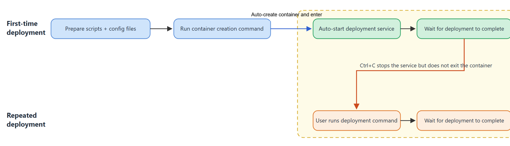

# Docker-Based Single-Container Service Deployment Guide

This document guides users to **complete the deployment of an inference service on a single machine based on Docker**, where the entire PD disaggregation deployment is completed on one server within one container. It applies to small models (weights less than 100 GB) and does not depend on K8s. For large models or multi-node deployment, see [Multi-Container Deployment Guide](multi_container.md). KV pooling requires a separate kv_store container; use multi-container deployment and see [Enabling KV Pooling](multi_container.md#enabling-kv-pooling-optional).

>[!NOTE]NOTE
> In single-container deployment, Prefill and Decode run in the same container on the same machine, and **Ascend950 PR / DT heterogeneous deployment is not supported**. For PR + DT hybrid networking, use the "PR / DT Heterogeneous Deployment" section in the [Multi-Container Deployment Guide](multi_container.md).

## Deployment Flowchart



## Image Preparation

Obtain the image in the following ways and load it to the local machine:

 - **Method 1**: Download the official full MindIE Motor image

     Go to the [Ascend official image repository](https://www.hiascend.com/developer/ascendhub), search for `motor`, and select the corresponding MindIE Motor image based on the device model.
 - **Method 2**: Install MindIE Motor in an existing image

     The base image already has CANN, vLLM, vLLM Ascend, and other components installed. You can refer to [Building MindIE Motor Images from vLLM Ascend](../../maintenance/build_motor_image_from_vllm_ascend.md#installing-mindie-motor-based-on-the-vllm-ascendsglang-image) to additionally install MindIE Motor.

After obtaining the image, use the following command to load the image to the server:

   ```bash
   docker load -i xxxx.tar
   ```

After the image is imported, use the following command to check whether the Docker image exists:

   ```bash
   docker images
   ```

## Preparing the Service Startup Script

   Obtain the service deployment script `examples` directory:

   - Method 1 (using the **official full MindIE Motor image**): the path in the image is `/tmp/motor/examples`, and you can run the following commands:

     ```bash
     IMAGE="<image name or image ID>"
     cid=$(docker create "$IMAGE")
     docker cp "$cid:/tmp/motor/examples" ./examples
     docker rm "$cid"
     ```

   - Method 2: (using an **image with MindIE Motor manually installed**): after running `git clone` for the code repository, the startup script is located in the `MindIE-Motor/examples` directory.

## Configuring Serving Parameters

1. **Prepare configuration files**

   MindIE Motor already provides [**PD disaggregation configuration examples**](../../../../../model_configs/vllm/models/README_EN.md) for common models (deepseek_v4_flash, deepseek_v4_pro, GLM 5.1, etc.). **Users can use them directly after modifying a small number of configurations.**

   For models without a typical configuration provided, refer to the [MindIE Motor Configuration Auto-Generation Guide](../../../../../model_configs/vllm/models/README_EN.md) to automatically generate the `user_config.json` and `env.json` configuration files.

2. **Configure ports and deployment mode**

   In a single container, the management plane and inference processes share the host network, so the deployment mode must be changed and the ports must be staggered; otherwise, conflicts occur:

   ```json
   {
     "motor_deploy_config": {
       "deploy_mode": "single_container",
       ...
     },
     ...
     "motor_controller_config": {
       "api_config": {
         "controller_api_port": 2026,
         "observability_api_port": 2027
       }
     },
     ...
     "motor_engine_prefill_config": {
       "motor_nodemanger_config": {
         "api_config": { "node_manager_port": 3026 }
       },
       ...
     },
     "motor_engine_decode_config": {
       "motor_nodemanger_config": {
         "api_config": { "node_manager_port": 4026 }
       },
       ...
     }
   }
   ```

   `deploy_mode` must be `single_container`.

3. **Synchronize the startup script configuration**

     Store the prepared configuration files (user_config.json and env.json) in the model_configs/vllm directory of the startup script.

## Enabling the Render Feature (Optional)

Modify the following configuration to enable the render feature. After the feature is enabled, when deploying a single-container service, `docker_deploy.py` creates an additional container named `{NAME}-vllm-render` on the host (`{NAME}` is the value of `--container-name`) and runs the vLLM Render service in it. When you terminate the service, reclaim this container. If Render fails to be created, the main container is no longer created; if the main container fails to be created, the Render started this time is deleted. In Docker scenarios, Coordinator and Render live and die together: `--start` in the container runs `docker restart` on the sibling Render container, and `docker stop` is run on Render when Coordinator exits. After Render is ready for the first time, it keeps sending heartbeats; if it fails continuously, Coordinator exits as well. For this purpose, the host `/var/run/docker.sock` is mounted into the single container; existing containers must be recreated to have this mount.

If the container already exists, the deployment script does not overwrite it. After entering the container, run:

```bash
python3 /path/to/examples/deployer/docker_deploy.py --config_dir /path/to/model_configs/vllm --start --role render
```

```json
{
  "motor_coordinator_config": {
    "render_config": {
      "enable": true
    }
  }
}
```

## Starting the Service

Run the following commands in the `examples/deployer` directory on the local machine:

```bash
python3 docker_deploy.py --config_dir ../../model_configs/vllm \
  --container-name motor-single --devices 0,1 \
  --pod-ip <IP address of the local machine> --nic-name <name of the local primary NIC>
```

After the preceding commands are executed, the window automatically **creates the container**, **enters the container**, and **starts the service**, and users can **observe log output on the screen**. `--devices` must cover the cards used by Prefill and Decode.

**Startup parameter description**

| Parameter | Description |
| :--- | :--- |
| `--config_dir` | Directory where `user_config.json` and `env.json` are located. |
| `--container-name` | Container name, which can be customized. |
| `--devices` | NPU card IDs mounted to this container, such as `0,1`. If this parameter is not specified, all cards on the server are mounted by default. |
| `--pod-ip` | IP address of the **current server**. |
| `--nic-name` | NIC name of the **current server** that corresponds to `--pod-ip`. |

Run the following command to view the NIC name and the local IP address. The value after `dev` is `--nic-name`, and the value after `src` is `--pod-ip`.

```bash
ip -4 route get 1.1.1.1
```

## Inference Verification

Send the following inference request on the local machine to perform inference verification:

```bash
curl -X POST http://127.0.0.1:1025/v1/chat/completions \
  -H "Content-Type: application/json" \
  -d '{
    "model": "<model name, which must be consistent with the configuration in the user_config.json file>",
    "messages": [{"role": "user", "content": "who are you?"}],
    "max_tokens": 36,
    "stream": true
  }'
```

If the following content is returned, the service is not ready yet. Try again later.

```json
{"detail":"Service is not available"}
```

## Terminating the Service and Redeploying

Press **Ctrl+C** in the terminal to terminate the service, but the container is not exited. After the service is terminated, the following prompt is displayed to help users redeploy the service.

```text
The service in the container has been terminated. Run the following command to redeploy the service.
python3 /path/to/examples/deployer/docker_deploy.py --config_dir /path/to/model_configs/vllm --start --container-name motor-single --pod-ip <IP address of the local machine> --nic-name <name of the local primary NIC>
Run log: examples/motor_workspace/motor-single/single/log/docker-single-<timestamp>.log
```

Users can directly copy the preceding command to redeploy the service.
