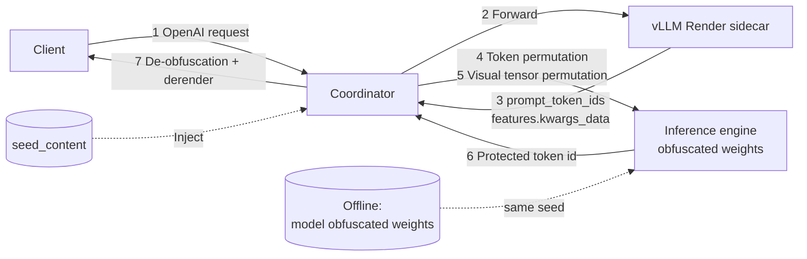

# Data Obfuscation Inference (PMCC)

## Feature Introduction

The PMCC data obfuscation inference feature enables MindIE Motor to directly serve **obfuscated weights**. On the request side, the Coordinator maps prompt token IDs and multimodal (image) tensors into the "protected vocabulary / protected visual space" where the obfuscated weights live; on the response side, it restores the protected token IDs output by the engine back to the original vocabulary, so that plaintext tokens and plaintext image tensors never enter the engine.

Through the "offline weight obfuscation + online bidirectional permutation with the same seed" mechanism, this feature makes obfuscated weights usable **without modifying the inference engine code**:
In tests, the Qwen3-VL-30B-A3B obfuscated weights (58 GiB) on a 4-card (P 2 + D 2, TP=2) PD disaggregation deployment returned correct results for both text and image requests through the full Render → obfuscation → engine → de-obfuscation chain (red image → `"red"`, `2+2` → `"4"`).

### How It Works

Offline and online use **the same data obfuscation factor (seed)**: obfuscated weights are generated offline with `ai-asset-obfuscate`, and the online Coordinator uses
the same seed to map request data into the physical space where the obfuscated weights live, and performs the inverse transformation on the response side.



1. **Prepare obfuscated weights offline**: Use `ModelAssetObfuscation` of `ai-asset-obfuscate` to generate an obfuscated weight directory by model type and `token_white_list` with the specified seed. The vocabulary (embedding / lm_head) and the visual patch order in the weights are permuted, and only the same seed can restore them.

2. **The request enters the Render sidecar**: The Coordinator hands the request to the vLLM Render sidecar for chat template, tokenizer, and multimodal processing, and obtains `prompt_token_ids`, `features.kwargs_data` (`pixel_values` / `image_grid_thw`, etc.), and multimodal placeholder information.

3. **Token obfuscation (request side)**: `TokenObfuscationService.data_1d_obf` maps semantic token IDs to protected vocabulary IDs and writes them into `engine_prompt_token_ids`; tokens in `token_white_list` do not participate in the permutation. What is sent to the engine is the protected ID.

4. **Visual tensor obfuscation (request side, optional)**: `ImageObfuscationService` calls the SDK's `image_render_obf` on the tensor payload of each modality under `features.kwargs_data` to perform patch permutation, and writes the result back to the same field. The image insertion position is carried by the placeholder information returned by Render and is independent of the token ID permutation.

5. **Engine inference**: The engine completes prefill / decode in the protected space. The prefix index of KV Conductor uses the same batch of physical token IDs (`engine_token_ids`), so cache hits are consistent with what the engine actually computes.

6. **Output de-obfuscation**: The protected token IDs output by the engine are restored to original vocabulary IDs through `data_1d_deobf`, and are then handed to the derender interface of the Render sidecar, which converts them into client-visible text (OpenAI response form) using the original tokenizer.

### Core Capabilities

| Feature | Description |
|------|------|
| Bidirectional token permutation | `data_1d_obf` on the request side and `data_1d_deobf` on the response side, with one seed in the same process; the client is unaware. |
| Multimodal tensor obfuscation | After `image_config.enable` is enabled, patch permutation is performed by modality on the `features.kwargs_data` returned by Render; Motor does not need msgpack encoding/decoding or knowledge of the model flatten order. |
| Shared seed for text / vision | `image_config` is nested under `token_obfuscation_config` and shares the same `seed_content` with token obfuscation, avoiding multi-seed management. |
| Fail closed | When the SDK is missing or an interface call fails, the request is rejected directly (HTTP 503) without falling back to the plaintext path; the permutation result and payload format are the responsibility of the SDK, and the Coordinator neither parses nor validates the returned content. |
| Aligned with KV cache affinity scheduling | The prefix hash uses the protected (physical) token IDs, so KV Cache can still be hit in obfuscation scenarios. |
| Orthogonal to thinking sampling | When obfuscation is enabled and thinking takes effect, if the client does not explicitly specify `temperature`, greedy decoding is enforced to avoid drift of the thinking section. |

### Constraints and Limitations

| Dimension | Constraint |
|------|----------|
| Hardware | <ul><li>Atlas 800I A2</li><li>Models based on the vLLM Render chain, such as the Atlas 800I A3, are theoretically compatible but pending verification.</li></ul> |
| Deployment scenario | Requires the **vLLM Render sidecar** (token-only chain) and PD disaggregation deployment, and `render_config.enable=true` must be configured. |
| Inference engine | Only **vLLM** is supported (it depends on the Render token-only interface). |
| Feature mutual exclusion | <ul><li>Can be used together with KV cache affinity scheduling, PD disaggregation, scaling, and fault rescheduling.</li><li>**Streaming requests**: After `render_config.enable_streaming=true` is set, streaming Token In, token-only Generate, and Derender are supported; vLLM >= 0.27.0 is required, and performance as well as advanced scenarios such as reasoning/tool call need to be verified for the specific version.</li><li>**Only `/v1/chat/completions` and `/v1/completions` are supported**: Render has no registered contract for other APIs, so when any obfuscation switch is enabled, paths such as `/v1/responses` and `/v1/messages` directly return HTTP 501 and will not fall back to the local tokenizer (which would send the plaintext prompt to the obfuscated-weight engine).</li><li>**No fallback**: When Render is unavailable, the Coordinator does not fall back to the local tokenizer (otherwise plaintext tokens would enter the engine); the request fails directly (this applies as soon as any obfuscation switch is enabled).</li></ul> |
| Software dependency | <ul><li>ai-asset-obfuscate: The official MindIE Motor image already bundles this dependency (see [Environment Preparation](#environment-preparation)), and its version must be the same as the SDK version used to generate the obfuscated weights offline.</li><li>The obfuscated weights must be generated with **the same SDK version, the same seed, the same `token_white_list`/`vocab_size`**, and the same visual geometry (`patch_size`/`merge_size`/`temporal_patch_size`/`longest_edge`/`shortest_edge`); otherwise the results will be corrupted.</li></ul> |
| Other limitations | <ul><li>All obfuscation-related parameters are model/weight related, and the code provides no built-in default values: `token_white_list` and `seed_content` must be configured explicitly; `vocab_size` and the image geometry (5 items such as `patch_size`) **can be omitted** — when not configured, they are read automatically from the served weight directory, and explicit configuration always takes precedence (see [Parameter Sources](#parameter-sources) for where the values come from).</li><li>`token_white_list` **cannot be derived from the model directory** (it is not recorded in the model metadata) and can only be provided by the offline weight obfuscation party; a missing or extra entry will not raise an error, but will cause token misalignment.</li><li>Automatically read parameters are validated again after parsing: if a whitelist ID exceeds the parsed `vocab_size`, or if the parsed `longest_edge < shortest_edge`, startup is rejected directly instead of running with inconsistent parameters.</li><li>`seed_content` can restore the vocabulary permutation, so it must be kept with the same permissions as the obfuscated weights, injected through controlled configuration, and must never enter the code repository, logs, or screenshots.</li><li>The engine caches multimodal tensors by `mm_hash`: **after changing the SDK version or the obfuscation implementation, the engine must be restarted (or the images must be changed)**, otherwise images with the same hash will hit the old cache.</li><li>Obfuscated token IDs belong to the "physical vocabulary", so any cross-instance token statistics/reconciliation must be interpreted by physical ID.</li><li>When obfuscation is enabled and thinking takes effect, if the client does not explicitly pass `temperature`, the Coordinator enforces greedy decoding (`temperature=0`); pass the parameter explicitly if the sampling behavior needs to be retained.</li></ul> |

## Using the Feature

### Environment Preparation

1. The basic inference service has been deployed with MindIE Motor (PD disaggregation) and is running normally. See [PD disaggregation deployment](pd_disaggregation.md).

2. The vLLM in the image/environment provides the Render token-only interface (the Coordinator accesses it through `render_config.endpoint`),
   and `render_config.enable=true`.

3. When the service is deployed with the official MindIE Motor image, the runtime environment already bundles `ai-asset-obfuscate` (the version matches `requirements.txt` in the repository), and it must be **the same version** as the SDK used to generate the obfuscated weights offline.

4. An obfuscated weight directory with **the same seed** as the weights to be deployed has been prepared. Offline generation example (it can be executed in a CPU environment):

   ```python
   from ai_asset_obfuscate import ErrorCode, ModelAssetObfuscation, ModelType

   WHITE_LIST = [151643, 151644, 151645, 151646, 151647, 151648, 151649, 151650, 151651,
                 151652, 151653, 151654, 151655, 151656, 151657, 151658, 151659, 151660,
                 151661, 151662, 151663, 151664, 151665, 151666, 151667, 151668, 198, 2610,
                 525, 264, 10950, 17847, 13, 872, 77091, 8948, 271]
   SEED = "<your-seed-content>"

   obf = ModelAssetObfuscation.create_model_obfuscation(
       model_path="/mnt/weight/Qwen3-VL-30B-A3B-Instruct",
       model_type=ModelType.QWEN3_VL,
       token_white_list=WHITE_LIST,
   )
   assert obf.set_seed_content(seed_type=2, seed_content=SEED) == ErrorCode.SUCCESS.value
   assert obf.model_weight_obf(obf_type=2, model_save_path="/data/weights/Qwen3-VL-30B-A3B-Instruct-obf-data") \
       == ErrorCode.SUCCESS.value
   ```

   An additional `obf_config.json` is generated in the result directory; **its content is only an obfuscation marker** (for example, `{"flag": "OBF_DATA"}`),
   and it does not contain the seed, the whitelist, or the visual geometry. The parameters above therefore cannot be read from this file (see [Parameter Sources](#parameter-sources) for where the values come from).

   > [!NOTE]NOTE
   >
   >- The values of `ModelType` and `seed_type` / `obf_type` vary by model and SDK version; the example above shows the values that passed verification for Qwen3-VL,
   >- For other models, select the corresponding enum according to the SDK documentation; the key point is that **weight generation and the online Coordinator must use the same `seed_content` and whitelist**.

5. The subsequent operations are all performed on the K8s cluster management node, and the cluster kubeconfig has been sourced.

### Parameter Sources

All data obfuscation parameters are model-related parameters, and the code provides no built-in default values. **The image geometry can be left unconfigured**: when it is not configured, the Coordinator reads it automatically from
the served weight directory, and explicitly configured values always take precedence. The remaining parameters are configured according to the sources in the following table:

(`/data/weights/<model directory>` is used as the served weight directory; the content of the relevant files is the same in the original weights and in the obfuscated weights)

| Parameter | Source | Description |
|------|------|------|
| `patch_size` / `temporal_patch_size` / `merge_size` / `longest_edge` / `shortest_edge` of `image_config` | `<model directory>/preprocessor_config.json` (**read automatically when not configured**) | Correspond to the fields `patch_size` / `temporal_patch_size` / `merge_size` / `size.longest_edge` / `size.shortest_edge` (older processors use `max_pixels` / `min_pixels`). **The values differ between models**: Qwen3-VL uses 16 / 2 / 2 / 16777216 / 65536, while the public Qwen2-VL / Qwen2.5-VL use 14 / 2 / 2 / 12845056 / 3136 |
| `token_obfuscation_config.vocab_size` | `<model directory>/config.json` (**read automatically when not configured**) | For multimodal models it is located at `text_config.vocab_size` (for text-only models it is the top-level `vocab_size`); Qwen3-VL uses 151936 |
| `token_obfuscation_config.token_white_list` | **Provided by the offline weight obfuscation party** | Not recorded in the model metadata, and cannot be derived from the model directory. Its semantics is "the fixed points of `data_1d_obf`": when configured correctly, `data_1d_obf(id) == id` holds |
| `token_obfuscation_config.seed_content` | Injected through controlled configuration | The same seed as the offline weights; must not be committed to the repository or written to logs |

Read example:

```bash
python3 - <<'EOF'
import json

model = "/data/weights/Qwen3-VL-30B-A3B-Instruct-obf-data"
pp = json.load(open(f"{model}/preprocessor_config.json"))
cfg = json.load(open(f"{model}/config.json"))
print("patch/temporal/merge:", pp["patch_size"], pp["temporal_patch_size"], pp["merge_size"])
print("size:", pp["size"])
print("vocab_size:", cfg.get("text_config", {}).get("vocab_size") or cfg.get("vocab_size"))
EOF
```

> [!NOTE]NOTE
>
> - `patch_size` and `temporal_patch_size` together determine the flatten dimension of `pixel_values`
> - `D = 3 × patch_size² × temporal_patch_size` (1536 for Qwen3-VL). When they are inconsistent with the weights,
> - the SDK only logs a warning and returns the payload **as-is** (the request is silently not obfuscated); see [Question 7](#faq-geometry-mismatch).

### Usage Scenarios

- **Scenario 1: Text-only data obfuscation**. Only `token_obfuscation_config.enable` is enabled, which is suitable for text-only requests such as chat/completion.

- **Scenario 2: Multimodal (image) data obfuscation**. On top of Scenario 1, `token_obfuscation_config.image_config.enable` is enabled,
  which is suitable for requests with images (vision-language models such as Qwen3-VL). Text token obfuscation still applies in full, and image tensor obfuscation is an **additional** layer.

### Usage Example

The following steps use Qwen3-VL-30B-A3B on 4 cards (P 2 + D 2, TP=2) as an example.

1. Go to the deployment directory.

   ```bash
   cd examples/deployer
   ```

2. In `user_config.json`, confirm that the engine weights are the obfuscated weights, and enable Render and the data obfuscation configuration.

   ```json
   {
     "motor_deploy_config": {
       "weight_mount_path": "/data/weights/"
     },
     "motor_coordinator_config": {
       "render_config": {
         "enable": true,
         "enable_streaming": true,
         "timeout_ms": 30000,
         "launch_args": {
           "renderer_num_workers": 4
         }
       },
       "token_obfuscation_config": {
         "enable": true,
         "token_white_list": [151643, 151644, 151645, 151646, 151647, 151648, 151649, 151650, 151651,
                           151652, 151653, 151654, 151655, 151656, 151657, 151658, 151659, 151660,
                           151661, 151662, 151663, 151664, 151665, 151666, 151667, 151668, 198, 2610,
                           525, 264, 10950, 17847, 13, 872, 77091, 8948, 271],
         "seed_content": "<seed consistent with the offline weights>",
         "image_config": {
           "enable": true
         }
       }
     }
   }
   ```

   Key parameter description:

   | Parameter | Description |
   |------|------|
   | `render_config.enable` | Must be `true`; both the token permutation and the image permutation of this feature take place on the payload returned by Render |
   | `render_config.enable_streaming` | Must be `true` for streaming obfuscation requests; when it is disabled, streaming requests fail closed and do not fall back to the plaintext native chain |
   | `render_config.launch_args.renderer_num_workers` | Number of Render processing threads; `4` is passed by default when it is not configured |
   | `render_config.timeout_ms` | Render processing timeout. The first image in a multimodal request requires loading the image processor, and the measured cold start is about 22 s, so a value of no less than 30000 is recommended |
   | `token_obfuscation_config.enable` | Enables token permutation; a non-empty `seed_content` must be configured explicitly |
   | `token_obfuscation_config.model_path` | Optional; explicitly specifies the weight directory (used to read `vocab_size`). When left empty, `engine_config.model` in the engine configuration is used; it must be specified explicitly when multiple models coexist |
   | `token_obfuscation_config.vocab_size` | Size of the obfuscated vocabulary. **Can be left unconfigured**: when it is not set, it is read automatically from `config.json` in the served weight directory (for multimodal models, `text_config.vocab_size` is used), and explicit configuration takes precedence. It must be consistent with the offline weight obfuscation parameters (both Qwen3-32B / Qwen3-VL use `151936`) |
   | `token_obfuscation_config.token_white_list` | **No built-in default value; it must be configured explicitly when the feature is enabled**. Token IDs that do not participate in the permutation (special tokens and some frequently used tokens); the list must be exactly the same as the one used during offline weight obfuscation; the Qwen3-32B / Qwen3-VL verified weights use the 37 tokens below. This parameter **cannot be derived from the model directory** and can only be provided by the weight obfuscation party |
   | `token_obfuscation_config.seed_content` | The same seed as the offline weights; it can be injected through an environment variable or controlled configuration, and must not be committed to the repository |
   | `token_obfuscation_config.image_config.enable` | Enables image tensor permutation; requires `render_config.enable=true`, and is independent of `token_obfuscation_config.enable` |
   | `image_config.patch_size` / `merge_size` / `temporal_patch_size` | **Can be left unconfigured**: when not set, they are read automatically from `preprocessor_config.json` in the served weight directory, and explicit configuration takes precedence. They must be consistent with the weight obfuscation and the image processor (16 / 2 / 2 for Qwen3-VL, 14 / 2 / 2 for Qwen2-VL) |
   | `image_config.longest_edge` / `shortest_edge` | **Can be left unconfigured**: same as above; they correspond to `size.longest_edge` / `size.shortest_edge` (older processors use `max_pixels` / `min_pixels`). Qwen3-VL uses 16777216 / 65536 |
   | `image_config.model_path` | Optional; explicitly specifies the weight directory (used to read the geometry). When left empty, `engine_config.model` in the engine configuration is used; it must be specified explicitly when multiple models coexist |

   The model path points to the obfuscated weight directory (`motor_engine_prefill_config` / `motor_engine_decode_config`; in the aggregation scenario,
   `motor_engine_union_config`):

   ```json
   {
     "motor_engine_prefill_config": {
       "engine_type": "vllm",
       "engine_config": {
         "served_model_name": "qwen3-vl-30b",
         "model": "/data/weights/Qwen3-VL-30B-A3B-Instruct-obf-data",
         "tensor_parallel_size": 2
       }
     }
   }
   ```

   The weight directory is mounted into the container by `motor_deploy_config.weight_mount_path`, and `engine_config.model` takes a subdirectory under it.

3. Deploy the service.

   ```bash
   python deploy.py --config_dir <config directory>
   ```

4. Confirm the deployment result.

   ```bash
   kubectl get pod -A -owide
   ```

   Controller / Coordinator / Prefill / Decode are all Running, and the Coordinator side is 2/2 Ready.

   The obfuscation enable flag can be seen in the logs:

   ```bash
   kubectl logs -n <namespace> <coordinator-pod> -c mindie-motor-coordinator | grep "Vision data obfuscation"
   ```

   ```text
   Vision data obfuscation is enabled for Render image items
   ```

### Verifying the Feature

1. Send a request with an image (the image is a pure red PNG, and the question is "answer the color in one word").

   ```bash
   curl -X POST http://<node0_ip>:<nodeport>/v1/chat/completions \
       -H "Content-Type: application/json" \
       -d '{
         "model": "qwen3-vl-30b",
         "max_tokens": 32,
         "messages": [{
           "role": "user",
           "content": [
             {"type": "image_url", "image_url": {"url": "data:image/png;base64,<red_png_base64>"}},
             {"type": "text", "text": "What color is this image? Answer in one word."}
           ]
         }]
       }'
   ```

   HTTP 200 is returned, and `choices[0].message.content` is `"red"` (for a blue image it should be `"blue"`).
   If garbled text or a wrong color is returned, the seed / whitelist / visual geometry is inconsistent with the weights, or a stale mm cache on the engine side was hit (see FAQs).

2. Check the obfuscation count of each request in the Coordinator logs.

   ```bash
   kubectl logs -n <namespace> <coordinator-pod> -c mindie-motor-coordinator | grep "render tokenize success"
   ```

   Expected output (`obfuscated_images=1` for an image request and `obfuscated_images=0` for a text-only request):

   ```text
   render tokenize success request_id=... prompt_length=85 latency_ms=26.10 tokenizer_source=render obfuscated_images=1
   render tokenize success request_id=... prompt_length=20 latency_ms=3.77 tokenizer_source=render obfuscated_images=0
   ```

   `obfuscated_images` only counts the number of modalities for which the image tensor permutation is performed; the token permutation is completed silently in `_obfuscate` and has no separate counter
   (that is, `obfuscated_images=1` does not mean that only the image was obfuscated).

3. Send a text-only request to confirm that the text chain also takes effect (with obfuscated weights, the output would inevitably be corrupted if the tokens were not permuted).

   ```bash
   curl -X POST http://<node0_ip>:<nodeport>/v1/chat/completions \
       -H "Content-Type: application/json" \
       -d '{"model": "qwen3-vl-30b", "max_tokens": 32, "temperature": 0,
            "messages": [{"role": "user", "content": "What is 2+2? Answer with the number only."}]}'
   ```

   Returned: `"4"`.

## FAQs

### Request returns 503 with detail `failed to obfuscate Render image items: AttributeError: ... has no attribute 'image_render_obf'`

**Problem Description**

After `image_config.enable` is enabled, all requests with images return 503, and the above message appears in the Coordinator logs.

**Cause Analysis**

The `ai-asset-obfuscate` version in the environment does not support the Render payload permutation interface (older versions only provide `image_tensor_obf`).

**Solution Steps**

1. Confirm the version in the Coordinator container: `python -c "import ai_asset_obfuscate, importlib.metadata as m; print(m.version('ai-asset-obfuscate'))"`,
   and make sure it is the same as the SDK version used to generate the obfuscated weights offline (aligned with `ai-asset-obfuscate==26.0.22` in the current MindIE Motor image / `requirements.txt`).
2. Redeploy with the official MindIE Motor image that contains this SDK version, or restart the Coordinator container.

### The logs show that obfuscation is enabled, but the answer for the same image never changes (for example, `"gray"` is always returned)

**Problem Description**

After the SDK/obfuscation implementation is changed, the first request returns a wrong color, and afterwards the same image always returns the same wrong result.

**Cause Analysis**

The engine caches multimodal tensors by `mm_hash`. The image hash is computed by Render on the original image; the obfuscated tensor payload changes but the hash does not,
so images with the same hash hit the old cache written earlier.

**Solution Steps**

1. Restart the Prefill / Decode instances (`kubectl delete pod <prefill/decode-pod> -n <namespace>`), or
2. Use another image with different content (a different hash) for verification;
3. When verifying a new chain, prefer rebuilding the entire namespace to ensure that the engine loads everything from scratch.

### Request returns 501 `Token-obfuscated inference currently supports non-streaming requests only`

**Problem Description**

After obfuscation is enabled, requests with `stream=true` fail.

**Cause Analysis**

The obfuscation chain in the current version covers only non-streaming requests (output de-obfuscation is performed on the complete response package).

**Solution Steps**

Remove the `stream` parameter on the client side, or change it to `stream=false`.

### Request returns 503 `ai-asset-obfuscate is unavailable` or `ai-asset-obfuscate vision API is unavailable: ObfException: Failed To Load Library.`

**Problem Description**

The SDK unavailable / native library load failure error is reported when the Coordinator starts successfully or when a request is made.

**Cause Analysis**

The runtime environment does not contain a usable `ai-asset-obfuscate` (for example, the official MindIE Motor image is not used, or the image version is too old).

**Solution Steps**

1. Confirm that the official MindIE Motor image is used and that it can be imported in the container: `python -c "import ai_asset_obfuscate"`;
2. Confirm that `render_config.enable=true` is set when `token_obfuscation_config.image_config.enable=true`, otherwise the configuration validation fails directly:
   `token_obfuscation_config.image_config requires render_config.enable=true`.

### Model output is garbled or off-topic

**Problem Description**

The service is available, but the output is obviously abnormal.

**Cause Analysis**

The online `seed_content`, `token_white_list`, `vocab_size`, or the `image_config` visual geometry is inconsistent with the offline obfuscated weights;
or the weights themselves were not generated with the same SDK version. Specifically:

- An **inconsistent geometry** results in a **silent failure**: the SDK only logs a warning and returns the payload as-is, that is, the request is not actually obfuscated (see [Question 7](#faq-geometry-mismatch));

- An **inconsistent whitelist** (missing or extra entries) likewise raises no error: the tokens in the whitelist are permutation fixed points, and if one is missing, it will be wrongly permuted, causing token misalignment.

**Solution Steps**

1. Compare the parameters with the list used during weight obfuscation: the whitelist is provided by the obfuscation party; for the visual geometry and `vocab_size`, see
   [Parameter Sources](#parameter-sources);
2. To check whether the whitelist takes effect, verify the fixed-point semantics (when correct, the result should be the same as the input):

   ```bash
   python3 - <<'EOF'
   from motor.config.coordinator import TokenObfuscationConfig
   from motor.coordinator.render.token_obfuscation_service import TokenObfuscationService

   cfg = TokenObfuscationConfig(enable=True, seed_content="<seed>", token_white_list=[...])
   service = TokenObfuscationService(cfg)
   print(service.obfuscate(cfg.token_white_list) == cfg.token_white_list)  # should be True
   EOF
   ```

3. Confirm that no regular quantization/conversion is performed again on the obfuscated weights (this would break the permuted tensor layout);
4. After correcting the configuration, redeploy and restart the engine to avoid hitting the old cache.

### Request latency increases after obfuscation is enabled

**Problem Description**

After the image permutation is enabled, the first image request takes noticeably longer.

**Cause Analysis**

Render loads the image processor for the first time (cold start, about 22 s measured) and performs the tensor payload permutation for each request (millisecond level per request measured).

**Solution Steps**

1. Increase `render_config.timeout_ms` (to avoid cold-start timeouts);
2. Warm up the chain with one image request (or introduce a fixed warm-up procedure) before starting the stress test;
3. Disable `image_config.enable` in text-only scenarios.

<a id="faq-geometry-mismatch"></a>

### Logs show `pixel_values D=... != expected ...`, but the request succeeds

**Problem Description**

Requests with images return HTTP 200 normally, but the answer is obviously wrong; warnings such as
`pixel_values D=1536 != expected 768. Returning as-is.` appear in the Coordinator/engine logs.

**Cause Analysis**

`patch_size` / `temporal_patch_size` are inconsistent with those used during weight obfuscation, resulting in
`D != 3 × patch_size² × temporal_patch_size`. In this case the SDK **does not report an error**; it simply returns the payload as-is,
that is, the image tensor is sent to the engine without obfuscation (the obfuscated weights require the obfuscated tensor), so the output is abnormal.

**Solution Steps**

1. According to [Parameter Sources](#parameter-sources), obtain `patch_size` and `temporal_patch_size` again from
   `preprocessor_config.json` in the served weight directory (note that the values differ between models);
2. Confirm that these two values are consistent with those used during offline weight obfuscation (same model, same set of weights);
3. Restart the Coordinator after the correction;
4. Note: this warning means that the request was not obfuscated, which is a security impact rather than merely a result problem; it is recommended to add a log check item to the acceptance tests.
