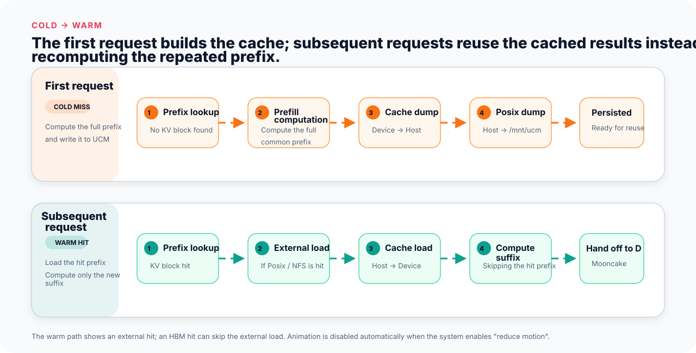

# Deploying UCM in MindIE Motor

[Unified Cache Manager (UCM)](https://github.com/ModelEngine-Group/unified-cache-management) reduces repeated Prefill computation for the same prefix by persisting and reusing KVCache. MindIE Motor currently integrates **UCM Prefix Cache**.

In a distributed PD deployment, Prefill uses `MultiConnector[Mooncake transfer Connector, UCMConnector]`: Mooncake is responsible for real-time KV transfer between P and D, and UCM is responsible for cross-request prefix reuse; Decode uses the Mooncake Connector that matches Prefill.



> [!IMPORTANT]IMPORTANT
>
> UCM is not a backend of `AscendStoreConnector`.
>
> Do not configure `"backend": "ucm"`. The Mooncake Connector used for P/D transfer is located at `connectors[0]`, and `UCMConnector` is located at `connectors[1]`. The specific type of the Mooncake Connector is determined by the PD solution and is not limited to `MooncakeConnectorV1`.

The complete example is located in `model_configs/vllm/ucm_pd/`.

## Preparing UCM

Obtain a UCM wheel that matches the current Python, CANN, hardware, and vLLM-Ascend versions, and place it in a directory accessible to the Engine Pod. The following uses `/mnt/weight/packages/uc_manager-*.whl` in the model mount directory as an example.

In `examples/deployer/startup/boot.sh`, add the following immediately after `source "$SCRIPT_DIR/common.sh"`:

```bash
if [ "$ROLE" = "prefill" ]; then
    python3 -m pip install /mnt/weight/packages/uc_manager-*.whl
fi
```

`boot.sh` is executed when the Engine Pod starts. UCM is installed only for Prefill here, because Decode does not load `UCMConnector`. Ensure that the wildcard matches only one wheel.

## Modifying `user_config.json`

Copy `model_configs/vllm/ucm_pd/user_config.json`, and then modify the following parts according to the actual environment.

### Configuring UCM Storage

Mount the cache directory to the Engine Pod through `motor_deploy_config.storage`, and configure `/dev/shm` for the Cache Store through `dshm_size`:

#### Dynamically Creating a PVC with a StorageClass

```json
"motor_deploy_config": {
  "image_name": "<MindIE Motor vLLM inference image>",
  "weight_mount_path": "/mnt/weight/",
  "storage": [
    {
      "type": "pvc",
      "storage_class_name": "<StorageClass that supports RWX>",
      "access_mode": "ReadWriteMany",
      "size": "512Gi",
      "mount_path": "/mnt/ucm"
    }
  ],
  "dshm_size": "128Gi"
}
```

Alternatively, replace `storage` with any of the following configurations.

#### Mounting an Existing PVC

The PVC must already exist in the namespace corresponding to `job_id`. When `claim_name` is used, do not configure `storage_class_name`, `size`, or `access_mode`:

```json
"storage": [
  {
    "type": "pvc",
    "claim_name": "<name of the existing RWX PVC>",
    "mount_path": "/mnt/ucm"
  }
]
```

#### Mounting NFS Directly

NFS does not depend on a StorageClass or a PVC. All Engine Pods access the shared directory through the same `server` and `path`:

```json
"storage": [
  {
    "type": "nfs",
    "server": "192.168.10.100",
    "path": "/export/ucm",
    "mount_path": "/mnt/ucm",
    "read_only": false
  }
]
```

#### Mounting HostPath

HostPath mounts a directory on the node directly into the Engine Pod:

```json
"storage": [
  {
    "type": "hostpath",
    "path": "/mnt/ucm",
    "mount_path": "/mnt/ucm",
    "host_path_type": "DirectoryOrCreate",
    "read_only": false
  }
]
```

HostPath is visible only on the current node by default. For multi-node deployment, RWX PVCs or NFS are preferred; HostPath can be reused across nodes only when the same shared file system is already mounted at the same path on each node.

`storage_backends` in the UCM configuration must be completely consistent with `mount_path` here; `dshm_size` should be greater than the `cache_buffer_capacity_gb` used by the Cache Store in the Pod, with runtime headroom reserved.

### Configuring the Mooncake Master

The `kv_cache_store_config` of the root node provides supporting services for Mooncake P/D transfer, and is not the persistence Store of UCM:

```json
"kv_cache_store_config": {
  "backend": "mooncake",
  "port": 50088,
  "eviction_high_watermark_ratio": 0.9,
  "eviction_ratio": 0.1
}
```

### Configuring Prefill

The `kv_transfer_config` of Prefill uses `MultiConnector`, and the UCM configuration is inlined into `UCMConnector`. The following follows `MooncakeConnectorV1` in the `ucm_pd` example:

```json
"kv_transfer_config": {
  "kv_connector": "MultiConnector",
  "kv_role": "kv_producer",
  "kv_connector_extra_config": {
    "connectors": [
      {
        "kv_connector": "MooncakeConnectorV1",
        "kv_role": "kv_producer",
        "kv_port": "20001",
        "kv_connector_extra_config": {
          "prefill": { "dp_size": 1, "tp_size": 2 },
          "decode": { "dp_size": 1, "tp_size": 2 }
        }
      },
      {
        "kv_connector": "UCMConnector",
        "kv_role": "kv_both",
        "kv_connector_module_path": "ucm.integration.vllm.ucm_connector",
        "kv_connector_extra_config": {
          "ucm_connectors": [
            {
              "ucm_connector_name": "UcmPipelineStore",
              "ucm_connector_config": {
                "store_pipeline": "Cache|Posix",
                "storage_backends": "/mnt/ucm",
                "cache_buffer_capacity_gb": 64,
                "posix_capacity_gb": 400
              }
            }
          ],
          "enable_event_sync": true,
          "use_layerwise": true
        }
      }
    ]
  }
}
```

Here, `storage_backends: "/mnt/ucm"` corresponds to the preceding `storage[].mount_path`, and `posix_capacity_gb` should be smaller than the actual available capacity of the storage volume.

`connectors[0]` can also use another Mooncake transfer Connector currently recognized by MindIE Motor according to the PD solution, for example `MooncakeHybridConnector` or `MooncakeLayerwiseConnector`. Different Connectors have different execution modes and parameters. And ensure that Prefill and Decode use mutually matching transfer configurations; `UCMConnector` remains in `connectors[1]`.

> Hybrid attention models (V4 series) must use `MooncakeHybridConnector`. For details, see [P/D Transfer Connector Selection](../README.md#table_Connector).

### Configuring Decode

Decode uses the Mooncake Connector that matches Prefill and does not configure UCM. The following is a `MooncakeConnectorV1` example:

```json
"kv_transfer_config": {
  "kv_connector": "MooncakeConnectorV1",
  "kv_role": "kv_consumer",
  "kv_port": "20001",
  "kv_connector_extra_config": {
    "prefill": { "dp_size": 1, "tp_size": 2 },
    "decode": { "dp_size": 1, "tp_size": 2 }
  }
}
```

In this example, the `kv_port`, `dp_size`, and `tp_size` of Prefill and Decode should be consistent with each other. When another Mooncake Connector is used, configure the parameters on both ends according to the requirements of that Connector.

## Deployment and Deletion

Run a single command in the `examples/deployer` directory to complete the deployment:

```bash
python3 deploy.py --config_dir ../../model_configs/vllm/ucm_pd
```

Use the `job_id` in `user_config.json` as the namespace, and delete the deployment with a single command:

```bash
bash delete.sh mindie-motor
```

## Verifying UCM Cache Hits



Send two completely identical long-prefix requests to the Coordinator consecutively. The second request should reuse the KVCache written by the first request:

```bash
curl -sS http://<node IP>:31015/v1/chat/completions \
  -H 'Content-Type: application/json' -d @long-request.json
curl -sS http://<node IP>:31015/v1/chat/completions \
  -H 'Content-Type: application/json' -d @long-request.json
```

Filter out the Prefill Pod and grep the UCM hit logs:

```bash
PREFILL_POD=$(kubectl -n mindie-motor get pods -o name | grep '/vllm-p' | head -n 1)
kubectl -n mindie-motor logs "$PREFILL_POD" --since=10m | \
  grep -E 'hit hbm|hit external'
```

The `hit hbm` or `hit external` field in the log of the second request should be non-zero; if there are multiple Prefill Pods, check the logs of each Pod separately.

## FAQs

| Symptom | Check Item |
| --- | --- |
| Prefill cannot import `ucm` | Check the wheel path in `boot.sh`, and whether the wheel matches the Python/CANN/hardware versions |
| `UCMConnector must be connectors[1]` | Keep the Mooncake transfer Connector as `connectors[0]` and UCM as `connectors[1]` |
| `/mnt/ucm` is not writable | Check `storage[].mount_path`, PVC/NFS permissions, and `storage_backends` |
| The second request still does not hit | Confirm that the prefixes of the two requests are completely identical, and check the logs of all Prefill Pods |

## Related Materials

- [UCM Home Page](https://ucm.readthedocs.io/en/latest/)
- [UCM Quick Start](https://ucm.readthedocs.io/en/latest/user-guide/quick_start)
