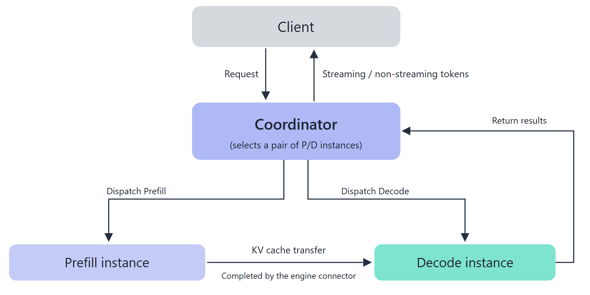

# PD Disaggregation

## Feature Introduction

PD disaggregation (Prefill & Decode disaggregation) deploys the two stages of large language model inference to different instances, so that each stage runs independently according to its own resource characteristics.

- **Prefill (P)**: Performs a complete forward computation on the input prompt and generates the KV Cache of the sequence. This stage is compute-intensive and is executed once for each new request.

- **Decode (D)**: Receives the KV Cache passed from P and generates subsequent tokens step by step. The per-step computation is small, but it must be executed repeatedly until generation ends, and it mainly consumes memory access bandwidth.

With PD aggregation, P and D share one card, and the Prefill of a new request interrupts the ongoing Decode. After disaggregation, P can continuously process new requests and D can continuously output tokens. Compute power and bandwidth are configured separately for each stage, which usually delivers higher throughput at the same latency target.

### How It Works

The PD disaggregation scheduling and instance role capabilities in MindIE Motor are orchestrated by the Coordinator, and are not a proprietary switch of any engine. When healthy Prefill and Decode instances exist in the cluster at the same time, the Coordinator selects a pair of P/D instances along the PD disaggregation path, and then completes a request according to the engine protocol.

The role division for one request is as follows:

1. **Entry**: Client requests are sent only to the Coordinator. The Controller is responsible for instance registration, health detection, and lifecycle management, and does not participate in the forwarding of a single request.

2. **Routing**: The Coordinator selects a pair of Prefill and Decode instances based on the roles of the currently available instances.

3. **Prefill**: The Prefill instance performs a complete forward computation on the prompt and generates the KV Cache of the sequence.

4. **KV transfer**: The KV Cache is transferred from Prefill to Decode by the engine-side Connector. The Coordinator only selects instances and injects handshake metadata, and does not handle KV data transfer.

5. **Decode**: The Decode instance decodes token by token, and the generated result is returned to the client through the Coordinator.

### Benefits

- **Per-stage resource configuration**: Prefill is compute-oriented and Decode is bandwidth-oriented. You can select card types and parallelism by role, for example, deploy Prefill on PR and Decode on DT.

- **Higher throughput**: While Prefill continuously receives new requests, Decode continuously decodes existing requests, and the two no longer contend for the same pipeline.

- **More controllable latency**: In high-concurrency scenarios, the queuing and waiting caused by Prefill interrupting Decode are avoided.

### Constraints and Limitations

| Constraint | Requirement |
|----------|------|
| Hardware | <ul><li>Atlas 800I A2</li><li>Atlas 800I A3</li><li>Ascend 950PR&950DT products</li></ul> |
| Deployment scenario | Supports both K8s and Docker deployment forms. |
| Engine | Supports vLLM and SGLang. |
| Feature mutual exclusion | <ul><li>K8s deployment supports all features of the current code repository.</li><li>Docker-only deployment supports only whole-service-level RAS monitoring, virtual inference health probe, engine restart, PD disaggregation degradation to aggregation, D2D weight direct transfer, faulty request rescheduling, faulty instance circuit breaker, precision anomaly detection, and other RAS features.</li></ul> |
| Software dependency | <ul><li>K8s deployment depends on Ascend HDK, Docker, Kubernetes, and MindCluster.</li><li>Docker deployment depends on Ascend HDK and Docker.</li></ul> |

## Using the Feature

For the deployment of PD disaggregation services and more details, see:

- **K8s**: Heavier dependencies, and all Motor capabilities are available. RAS (high reliability and high availability) capabilities greatly reduce service loss when software or hardware faults occur; the excellent request scheduling capabilities (KV cache affinity scheduling + KV Cache pooling) significantly improve inference performance. See [PD disaggregation service deployment](../deployment/k8s/pd_disaggregation_deployment.md).

- **Docker only**: Lighter dependencies, and Motor's load balancing capabilities (KV cache affinity scheduling and pooling) are available, significantly improving inference performance. See [Docker-based service deployment](../deployment/docker/single_container.md).
