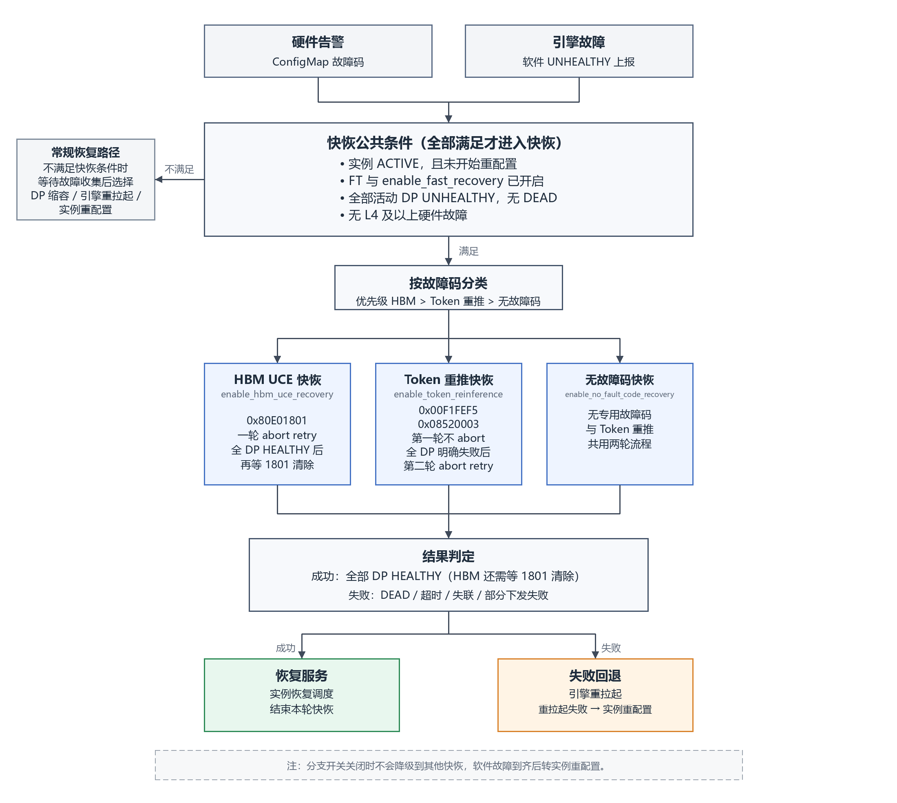

# 引擎快恢执行策略设计

## 概述

引擎快恢（retry）指推理引擎进程不退出，Motor 下发 retry 让引擎自行恢复故障，避免重启 Pod 和重新加载模型。当前支持三种策略：

| 策略 | 典型故障 | 区别 |
|------|----------|------------|
| HBM UCE 快恢 | HBM 多 bit 不可纠正错误 `0x80E01801` | 只发一轮 abort retry，结束后还要等 1801 清除 |
| Token 重推快恢 | 灵衢链路故障 `0x00F1FEF5` / `0x08520003` | 先不 abort、尽量保留请求重推，全 DP 明确失败后才 abort 再试一轮 |
| 无故障码快恢（无专用故障码） | 没有命中专用码的其他软件故障 | 与 Token 重推共用两轮流程 |

三种策略共用同一套编排：暂停新调度、校验全 DP 状态、广播 retry、轮询恢复结果；区别主要在进入条件、retry 轮次和成功判据。HBM 分支的引擎内部清理过程见 [HBM UCE 原地快恢设计](hbm_uce_recover.md)。

## 决策流程

  

<b>图1 快恢决策流程图</b>

图中的“常规恢复路径”指不满足快恢条件时，Motor 继续等待故障收集，再按证据和配置选择 DP 缩容、引擎重拉起或实例重配置。三条快恢分支的处理方式见下文。

## 触发条件

**公共条件**（全部满足才进入快恢）：

- 实例为 ACTIVE，且尚未开始重配置；
- 故障容错开关、`enable_fast_recovery` 总开关和对应分支开关均已开启；
- 全部活动 DP 都是 UNHEALTHY，没有 DEAD；
- 不存在 L4 及以上硬件故障。L4–L6 仍按原有严重故障策略处理。

**证据来源与时机**：

- 硬件告警来自 DevicePlugin 写入的 ConfigMap，软件故障来自引擎经 NodeManager 上报的 UNHEALTHY。两条证据联合参与判定。
- 只有硬件码时不会立即快恢：L1–L3 硬件码先记录，等软件 UNHEALTHY 后联合判定；只有 1801 但引擎仍 HEALTHY 时也不发起，等全部 DP 变为 UNHEALTHY 后再进入 HBM 分支。
- 首个软件 UNHEALTHY 会把实例从调度中摘除并保留在途连接，同时开始 120 秒故障收集窗口。全部活动 DP 状态到齐就立即选择策略，收不齐才等到超时回退重配置。

**不满足公共条件时**走常规恢复路径：继续等待故障收集，再按证据和配置选择 DP 缩容（需开启）、引擎重拉起或实例重配置。

## 分支选择

Motor 按故障码分类，不依赖最高故障等级的单个值猜测原因：

1. 存在 `0x80E01801` → HBM UCE 快恢；
2. 否则存在 `0x00F1FEF5` 或 `0x08520003` → Token 重推快恢；
3. 否则 → 无故障码快恢。

- 1801 与灵衢码同时出现时优先 HBM；其他低等级告警（例如未命中专用码的 `0x80E01809`）不阻断快恢。
- 对应分支开关关闭时**不会降级**到其他快恢，软件故障到齐后转实例重配置。
- 执行期间新增的可恢复故障码不改变本轮分支，留到下一轮重新规划；若出现迟到的 L4 及以上硬件故障，本轮在下发前或宣告成功前会被阻止。

## 三条分支的处理方式

### HBM UCE 快恢

- **进入**：1801 + 软件 UNHEALTHY，且故障范围被引擎判定为可恢复 KV。
- **执行**：一轮 `abort=true` retry。HBM 会污染 KV，abort 终止在途请求是有意设计。
- **成功**：全部 DP HEALTHY，且实例所在节点全部设备的 1801 清除。
- **失败**：清码成功但引擎未恢复 → 引擎重拉起；清码超时或证据缺失 → 实例重配置。
- **说明**：不承诺请求续推；KV 分类与清理细节见 [HBM UCE 原地快恢设计](hbm_uce_recover.md)。

### Token 重推快恢

- **进入**：灵衢码 + 软件 UNHEALTHY。
- **执行**：第一轮 retry 不带 abort，尽量保留请求由引擎做 token 重推；只有当所有 DP 对同一 `request_id` 明确报告失败（`ft_state=failed`）时，才发第二轮 `abort=true`。
- **成功**：全部引擎 HEALTHY，不等待灵衢码清除。
- **失败**：转引擎重拉起；重拉起失败或稳定观察期内再次故障 → 实例重配置。

### 无故障码快恢

- **进入**：没有命中专用码、也没有严重硬件阻断的软件 UNHEALTHY。
- **执行与收尾**：与 Token 重推完全相同（两轮 retry + 引擎重拉起回退），只是入口和开关独立。
- **说明**：无故障码快恢表示“原因未知但可尝试原地恢复”，不能据此断定故障是内存耗尽等具体原因，也不限定具体软件异常。

## 公共执行编排

1. **暂停调度**：首个软件 UNHEALTHY 时摘除实例路由，保留在途连接与 HTTP 流，不提前中断请求。
2. **实时校验**：下发前再确认实例 ACTIVE、全部目标 DP 仍 UNHEALTHY、没有严重硬件阻断；状态变化则放弃本轮。
3. **广播 retry**：每轮生成新的 `request_id`，向实例所有 NodeManager 并发下发，NodeManager 再透传给本地引擎。
4. **轮询结果**：默认每秒查询一次，单轮最多等 60 秒；HEALTHY 若携带轮次标识，必须属于本轮。
5. **判定**：全部 DP HEALTHY 为成功；出现 DEAD、部分下发失败、失联、超时或全 DP 明确失败为失败。Token 重推与无故障码快恢仅在“全 DP 明确失败”时允许发起第二轮 abort retry，其他失败不追加轮次。

## 失败回退

快恢失败后按顺序升级，同一轮内不重复快恢：

1. **引擎重拉起**：原地重启实例全部引擎，实例短暂 INACTIVE 后恢复。所有 rank 一起重启，避免通信组不一致；重拉起失败时改为重启容器，由节点心跳触发 Pod 重启（仅 K8s 部署生效）。
2. **实例重配置**：最终兜底，停止并重新组装实例。
3. **稳定观察**：Token 重推或无故障码快恢回退到引擎重拉起后，引擎全部 NORMAL 并连续健康 `engine_relaunch_stability_sec`（默认 60 秒）才解除保护；观察期内再次故障直接重配置。关闭 `enable_engine_relaunch` 时失败直接重配置。

## 部署场景支持

| 部署方式 | HBM UCE 快恢 | Token 重推快恢 | 无故障码快恢 | 说明 |
|----------|--------------|----------------|--------------|------|
| Kubernetes | 支持 | 支持 | 支持 | 硬件故障码来自 DevicePlugin 写入的 ConfigMap，软件故障来自 NodeManager 上报 |
| Docker（单容器 / 多容器，无 K8s） | 不支持 | 不支持 | 支持 | 没有 DevicePlugin 和 ConfigMap，Motor 拿不到硬件故障码 |

快恢执行本身不依赖 K8s：暂停调度、下发 retry、轮询状态和失败回退都通过 Controller、NodeManager、Coordinator 的 HTTP 接口完成，Docker 部署同样生效。

Docker 部署的两点差异：

- **故障判定**：没有硬件故障码，无法识别 1801 和灵衢码，也无法按 L4 及以上硬件故障阻断；真实硬件故障只能表现为引擎 UNHEALTHY，会进入无故障码快恢。
- **失败回退**：没有 Pod 重建机制，快恢失败后原地重启引擎进程；引擎重拉起失败或关闭 `enable_engine_relaunch` 时转实例重配置，容器需要用户或 Docker 重启策略拉起；非 K8s 环境 NodeManager 不会因引擎持续异常而自杀（`container_restart_managed` 自动检测）。

NodeManager 通过部署模板注入的 `ASCEND_ALLOCATED_DEVICES`（Pod 注解 `huawei.com/Ascend910`）或 `/dev/davinci*` 获取实际分配卡号，保证硬件故障归属和 HBM 清码检查落到正确设备。

## 配置项

快恢开关分两层：`enable_fast_recovery` 是能力总开关，默认关闭，保证未显式启用的环境升级后仍走常规恢复路径；三个分支开关默认开启，只在总开关打开后决定哪类故障允许走快恢。启用时只改总开关，应急停用也只关总开关，分支选择保留。

| 配置 | 默认值 | 说明 |
|------|--------|------|
| `enable_fault_tolerance` | `true` | 故障容错总开关 |
| `enable_fast_recovery` | `false` | 快恢总开关，默认关闭；开启后由分支开关决定策略 |
| `enable_hbm_uce_recovery` | `true` | HBM 分支开关 |
| `enable_token_reinference` | `true` | Token 重推分支开关 |
| `enable_no_fault_code_recovery` | `true` | 无故障码分支开关 |
| `fault_collection_timeout_seconds` | 120 秒 | 软件故障收集窗口 |
| `recovery_round_timeout_sec` | 60 秒 | 单轮等待全部 DP HEALTHY |
| `hbm_uce_clearance_timeout_sec` | 60 秒 | HBM 分支清码等待，引擎恢复失败也等待 |
| `recovery_poll_interval_sec` | 1 秒 | 状态轮询间隔 |
| `engine_relaunch_stability_sec` | 60 秒 | 重拉起后的稳定观察期 |

整体保护预算默认 870 秒（故障收集 120 + 分支最坏 120 + max(实例组装、引擎重拉起) 600 + 30 秒余量），用于在恢复期间抑制健康探测自杀，不是单轮等待超时。

## 相关设计

- [HBM UCE 原地快恢设计](hbm_uce_recover.md)
- [可靠性能力概览](overview.md)
- [FaultManager 设计](fault_manager.md)
- [缩 P 保 D](scale_p2d.md)
