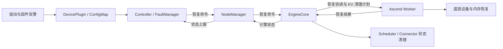
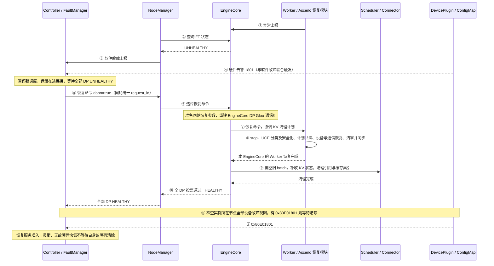

# HBM UCE 原地快恢设计

## 概述

HBM UCE 快恢用于 HBM 多 bit 不可纠正错误（`0x80E01801`）场景：引擎进程不退出，Motor 与引擎故障容错（FT）框架协同，原地恢复设备与通信，并清理被故障污染的 KV block，从而快速恢复推理服务。

三种快恢（HBM UCE、Token 重推、无故障码）的统一决策与分支选择见[引擎快恢执行策略](fast_recovery_strategy.md)，本文只描述 HBM 分支。

## 模块职责

| 模块 | 职责 |
|------|------|
| Motor / Controller | 识别 1801 与软件 UNHEALTHY，暂停调度、下发恢复命令，确认引擎恢复与清码结果，失败时转引擎重拉起或实例重配置 |
| Motor / NodeManager | 汇总各 DP 的引擎状态并上报，向本地引擎广播恢复命令，透传状态与错误 |
| 引擎 FT 框架 | 感知 Worker 异常、暂停调度、保存快照，组织 Worker 恢复和跨 DP 投票 |
| Ascend Worker 恢复模块 | 停止设备、分类 UCE 地址、协商清理计划，恢复设备与通信，清零故障 KV block |
| KV 管理与调度 | 维护 KV 地址归属、block 引用和前缀缓存，保证恢复后不复用脏数据 |
| CANN / 驱动 / 固件 | 提供故障地址查询、设备停止与恢复、底层内存修复，并上报告警 |
| MindCluster / DevicePlugin | 把设备故障码和恢复状态发布到 ConfigMap，1801 参与分支选择 |

## 故障恢复流程

<b>图1 快恢框架图</b>

<b>图2 HBM UCE 快恢时序图</b>

1. **感知故障**：Worker 捕获 HBM UCE 后上报 EngineCore，EngineCore 暂停调度并进入 UNHEALTHY，NodeManager 把各 DP 状态上报 Controller；驱动告警 1801 经 DevicePlugin 写入 ConfigMap。两条证据到齐后进入 HBM 分支。
2. **下发恢复命令**：首个软件故障上报时立即暂停新调度、保留在途连接；全部活动 DP 均为 UNHEALTHY 后，Motor 向实例所有 NodeManager 下发设置 `abort=true` 的恢复命令，本轮共用一个 `request_id`。
3. **Worker 恢复**：Worker 停止设备执行，查询并分类 UCE 地址，确认故障范围都属于已登记的 KV 存储；各 DP 协商出一致的故障 block 清理计划后，恢复设备、通信组与软件状态，并按计划清零故障 block。
4. **清理 KV 状态**：EngineCore 排空旧 batch 输出，补收晚到的 KV 传输结果，清理相关请求、引用与前缀缓存，保留健康缓存。
5. **全 DP 投票**：全部参与 DP 投票通过后，EngineCore 发布 HEALTHY，经 NodeManager 返回 Controller；HEALTHY 若携带轮次标识，必须属于本轮。
6. **判定结束**：恢复结束后单独等待实例所在节点全部设备的 1801 清除。引擎恢复且清码成功 → 结束；引擎失败但清码成功 → 引擎重拉起；清码超时或证据缺失 → 实例重配置。

本轮覆盖实例的全部参与 DP，而不是最先报错的 Worker 或单张故障卡。HBM 终止在途请求并执行单轮恢复，失败不追加第二轮；1801 与其他可恢复故障码共存时优先 HBM（选择规则见策略文档）。

## 引擎内部处理

1. **登记 KV 地址**：引擎启动时把 KV cache 的每块存储登记为地址区间，恢复时用故障地址反查所属的 KV block。
2. **故障暂停**：检测到异常后停止调度，保存故障前在用的 block 快照，并驱逐可疑缓存。
3. **分类与计划**：Worker 停止设备后判断 UCE 地址是否全部落在已登记的 KV 区间内，换算为逻辑 block，并在同一个 DP 内协商一致的清理计划。
4. **恢复与清理**：恢复设备、通信组和软件状态后，按计划把故障 block 对应的存储字节区间清零；同一存储的多个视图和别名一并处理。
5. **收尾与投票**：EngineCore 处理旧 batch、晚到的 KV 传输和请求引用，驱逐相关前缀缓存；全部 DP 投票通过后才上报 HEALTHY。

只有故障范围能完整映射到 KV 存储时才允许原地恢复；地址无法解析、不属于 KV 或布局不支持时拒绝恢复。引擎侧恢复 RPC 返回只代表 Worker 阶段完成，EngineCore 收尾、跨 DP 投票和 Motor 清码检查仍是独立的后续判据。

## 非 KV UCE

若 UCE 地址合法但不属于已登记的 KV 存储，Worker 拒绝原地恢复：在全部参与 Worker 完成分类后尝试一次设备修复，然后仍让引擎以失败退出，由 Motor 按清码结果转入引擎重拉起或实例重配置。该旁支不清理 KV，也不参与原地恢复投票，后续轮次不重复尝试设备修复。

## 恢复原理与成功判据

KV cache 通过虚拟地址访问 HBM。UCE 发生后，引擎停止设备、查询故障地址并判断归属，只有能映射到 KV block 的故障才按 HBM 快恢处理。真正的内存修复由 CANN、驱动和固件完成，Motor 不实现也不验证其内部实现。

引擎 HEALTHY 只代表引擎侧恢复完成。Motor 还必须确认实例所在节点全部设备的 1801 已清除：清码检查覆盖节点上所有设备的告警，不受实例设备归属限制，同节点其他实例的 UCE 也会阻塞成功判定，实例或节点证据缺失视为校验失败。

恢复后的故障 KV 数据不可复用，设备侧的修复与隔离结果仍需单独取证，不能仅凭收到 HEALTHY 推断底层修复细节。

## 设计约束与适用条件

| 约束 | 满足时 | 不满足时 |
|------|--------|----------|
| 功能开关 | FT、`enable_fast_recovery`、`enable_hbm_uce_recovery` 同时开启，且 P/D 引擎开启各自 FT 能力 | 不进入 HBM 快恢；仅开 DP 缩容不能代替 |
| 故障类型 | 存在 1801 且引擎软件 UNHEALTHY，故障范围被判定为 KV 可恢复 | 非 KV、地址未知或严重硬件故障走其他恢复策略 |
| 执行状态 | 全部参与 DP 收敛到 UNHEALTHY，Worker、EngineCore 和控制通道仍存活 | DEAD、失联或成员无法确认时不能原地恢复 |
| 并行与布局 | 实际 DP/TP/PP 拓扑与 KV 布局已验证，所有 Worker 对地址归属和清理计划达成一致 | 未支持的布局直接拒绝，不猜测 block 映射 |
| 物理修复 | 底层能在进程存活期间完成内存修复与故障页隔离 | 引擎按实际结果投票，残留 1801 阻塞成功判定 |
| 集群策略 | 恢复窗口内集群不会抢先驱逐业务 Pod | 先核对故障调度策略，不能靠隐藏故障码规避驱逐 |
| 请求语义 | Motor 保留在途连接，是否终止或续推由引擎决定 | HBM 单轮 abort 会终止请求，不能承诺无损续推 |

部署启用 FT 与快恢时，建议使用 `fault-scheduling: external-force-pod-failed` 协调集群与 Motor 的恢复顺序；测试中人为调整故障频次策略不属于生产能力前提。恢复期间 Motor 只暂停新调度，保留实例成员、工作量和 HTTP 流；是否续推由引擎的 `request_failure_policy="recompute"` 配置决定，检测到 HBM 污染时仍会终止在途请求。

## 超时与恢复边界

| 控制项 | 默认值 | 作用 |
|--------|--------|------|
| `enable_fast_recovery` | `false` | 快恢总开关，默认关闭；HBM 分支还需开启 `enable_hbm_uce_recovery` |
| `enable_hbm_uce_recovery` | `true` | HBM 分支开关 |
| `hbm_uce_clearance_timeout_sec` | 60 秒 | 快恢结束后独立等待 1801 清除，引擎恢复失败也等待 |
| `fault_collection_timeout_seconds` | 120 秒 | 软件故障收集窗口，状态到齐立即选择策略 |
| `recovery_round_timeout_sec` | 每轮 60 秒 | 单轮等待全部 DP HEALTHY，清码单独计时 |
| `recovery_poll_interval_sec` | 1 秒 | 状态轮询间隔 |

FaultManager 从首个 UNHEALTHY 或 DEAD 上报开始统一计时，后续上报不重置窗口。全部活动 DP 为 UNHEALTHY 时选择快恢；存在 DEAD 且其余活动 DP 全部 UNHEALTHY 时选择 DP 缩容（需开启）；120 秒内收不齐则回退重配置。快恢下发前只做一次实时校验，不再额外等待。

HBM 终止在途请求并执行单轮恢复，最多等 60 秒；其后单独等清码，默认 60 秒。失败且清码成功才转引擎重拉起（需开启 `enable_engine_relaunch`），清码失败或重拉起失败则重配置。

Motor 按“收集窗口 + 启用分支最坏耗时 + max(实例组装、relaunch) + 30 秒余量”计算整体保护窗口，默认 870 秒。该窗口用于抑制恢复期间的健康探测自杀，不是单轮等待 HEALTHY 的超时，也不保证请求连接一定存活到窗口结束；部署时引擎的 `engine_recovery_timeout_sec` 会被提高到不低于该预算。

## 可观测性与验收

按实例、进程代际、DP 身份和本轮 `request_id` 关联证据，避免把两轮恢复或旧进程的状态拼成一次成功：

- **故障感知**：Worker 实际异常、引擎 UNHEALTHY、ConfigMap 中的设备身份、故障码与等级。
- **恢复协调**：完整目标 DP 集合、本轮 `request_id`、UCE 分类结果和 DP 内清理计划。
- **引擎恢复**：设备修复、通信恢复、KV 清理、Scheduler/Connector 收尾及全部 DP HEALTHY。
- **硬件观测**：设备侧修复/隔离事件与 ConfigMap 告警变化，实例所在节点全部设备 1801 必须清除。
- **服务恢复**：Worker 与引擎 PID、Pod UID 未变，恢复后连续请求结果正确且无残留传输异常。

验收至少覆盖：KV 可恢复故障、非 KV 拒绝恢复、部分 DP 延迟或失联、清理失败、1801 延迟清除后成功、1801 残留超时失败、1801 与灵衢码共存优先 HBM、普通告警不阻断快恢、HBM 失败清码后重拉起、清码失败重配置、同一进程代际连续多轮 UCE 等场景。单次 API 返回成功、一次 HEALTHY 或重建后推理成功都不足以证明原地快恢通过；手工清码、重启或冷复位属于环境恢复操作，不计入自动快恢结果。

## 代码入口

- `motor/controller/fault_tolerance/engine_recovery/planner.py`：快恢策略选择。
- `motor/controller/fault_tolerance/strategy/engine_ft/fast_recovery.py`：公共下发与状态轮询，以及 HBM / Token 重推 / 无故障码三种策略。
- `motor/controller/fault_tolerance/engine_recovery/serving.py`：暂停调度、保留在途连接。
- `motor/node_manager/core/engine_ft_manager.py`：引擎 FT 状态上报与健康探测保护。
- `motor/config/config_utils.py`：整体恢复保护预算。
- vLLM `vllm/v1/fault_tolerance/engine_core_sentinel.py`：故障上报、恢复主流程、batch 排空与跨 DP 投票。
- vLLM-Ascend `vllm_ascend/worker/sentinel/`：设备停止、UCE 分类、计划共识、KV 地址登记与清理、EngineCore 侧收尾。

## 相关设计

- [Token 重推快恢设计](token_reinference.md)
- [引擎快恢执行策略](fast_recovery_strategy.md)
- [可靠性能力概览](overview.md)
- [FaultManager 设计](fault_manager.md)
- [缩 P 保 D](scale_p2d.md)
