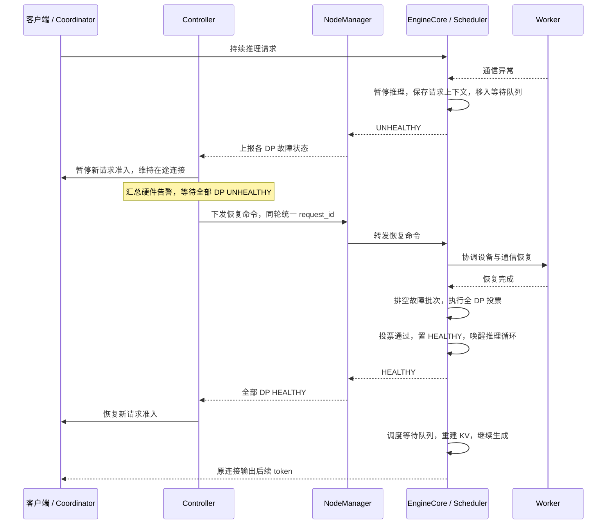

# Token 重推快恢设计

## 概述

Token 重推通过保存请求上下文，在通信故障恢复后继续执行中断的推理请求。故障发生时，引擎暂停推理，将运行中的请求移回等待队列，保留输入和已确认生成的 token；设备与通信恢复后，以这些 token 重建 KV cache，继续生成后续内容。整个过程保持引擎进程和请求连接存活，客户端无需重新提交请求。

Token 重推与 [HBM UCE 快恢](hbm_uce_recover.md)共用故障感知、恢复编排和跨 DP 投票机制。Token 重推通过 `request_failure_policy="recompute"` 恢复在途请求；HBM UCE 快恢因 KV 污染终止在途请求，清理故障数据后恢复服务。策略选择与失败回退见[引擎快恢执行策略](fast_recovery_strategy.md)。

## 模块职责

| 模块 | 职责 |
|------|------|
| Controller / FaultManager | 汇总软硬件故障，暂停实例准入，协调全部 DP 恢复，判定结果并执行失败回退 |
| Coordinator | 暂停向故障实例分配新请求，维持在途请求连接，恢复后开放调度 |
| NodeManager | 上报引擎故障状态，向本地引擎下发恢复命令，跟踪本轮执行结果 |
| EngineCore / Scheduler | 保存请求上下文，重置计算进度，协调恢复与投票，恢复调度后重建 KV 并续推 |
| Worker / Ascend 恢复模块 | 隔离故障执行，恢复设备、通信组及后端运行状态 |

## 故障恢复流程



引擎在跨 DP 投票通过后唤醒推理循环，恢复在途请求；Controller 确认全部 DP 健康后开放新请求准入。两者分别控制请求续推与实例调度。

## 请求恢复原理

### 保存上下文与重置计算进度

故障发生后，`EngineCoreSentinel.on_fault()` 清除 `resumed` 事件，使推理循环进入恢复等待。启用 `recompute` 策略时，Scheduler 抢占运行中的请求，将其状态置为 `PREEMPTED` 并移回 `waiting` 队列。

| 请求状态 | 故障处理 |
|----------|----------|
| 请求 ID、输入、已确认输出 token | 保存在请求对象中，作为恢复后的计算上下文 |
| KV block、encoder cache | 释放请求持有的计算资源；故障步骤可能写入的 KV block 从可复用缓存中驱逐 |
| `num_computed_tokens` | 重置为 0，恢复后重新计算上下文，可按正常规则复用健康前缀缓存 |
| 推测 token、输出占位及失败步骤的在途计数 | 清理未确认的计算状态及失效输出计数 |
| 请求队列 | 运行中请求移回等待队列，等待推理循环恢复 |

已确认 token 指引擎已提交到请求状态的生成结果。恢复过程保留这部分生成进度，重新计算其对应的 KV。

### 恢复执行环境

EngineCore 重建恢复所需的通信组，并协调 Ascend Worker 恢复设备及分布式通信状态。Worker 恢复完成后，EngineCore 排空故障前遗留的计算批次，丢弃失效的 token 输出，同时将可用的 KV 传输状态交给 Scheduler，完成传输引用处理。

各 DP 通过 MIN 投票汇总本地恢复结果。全部参与方成功后，引擎置为 HEALTHY 并设置 `resumed` 事件，唤醒推理循环；任一参与方失败则本轮恢复失败。

### 重建 KV 与续推

推理循环恢复后，Scheduler 从等待队列重新调度请求，以原输入和已确认输出 token 重建所需 KV，随后继续生成。

例如，请求输入为 P，故障前已生成 `[t1, t2, t3]`。恢复时以 `P + [t1, t2, t3]` 为上下文重建 KV，从 `t4` 开始生成并通过原连接输出，已输出内容不会重复发送。

## 触发条件与配置

| 条件 | 要求 |
|------|------|
| Motor 开关 | 开启 `enable_fault_tolerance`、`enable_fast_recovery`，以及对应的 `enable_token_reinference` 或 `enable_no_fault_code_recovery` |
| vLLM 引擎配置 | 在对应角色的 `engine_config` 中设置 `enable_fault_tolerance=true` 和 `fault_tolerance_config.request_failure_policy="recompute"`，完整层级见下例 |
| 执行状态 | 全部活动 DP 为 UNHEALTHY，引擎进程与控制通道可用，且无 L4 及以上硬件故障 |
| 通信环境 | 底层链路及后端通信具备恢复条件 |
| 连接超时 | 客户端、代理及 Coordinator 的超时覆盖故障检测与恢复窗口 |
| 集群调度 | 恢复期间保持业务 Pod 存活，可通过 `fault-scheduling: external-force-pod-failed` 协调恢复顺序 |

在 `user_config.json` 中，将以下配置合并到 Decode 的现有引擎配置中；Prefill 需要请求重推时，在 `motor_engine_prefill_config.engine_config` 下使用相同配置。

```json
{
  "motor_engine_decode_config": {
    "engine_type": "vllm",
    "engine_config": {
      "enable_fault_tolerance": true,
      "fault_tolerance_config": {
        "request_failure_policy": "recompute"
      }
    }
  }
}
```

`engine_config` 映射 vLLM 原生启动参数，上例对应 `--enable-fault-tolerance --fault-tolerance-config '{"request_failure_policy":"recompute"}'`。这里的 `fault_tolerance_config` 属于 vLLM；Controller 的同名配置段控制 Motor 恢复策略，NodeManager 的同名配置段控制引擎状态轮询，两者均不接受请求重算策略配置。配置命名空间见[配置参考](../../user_guide/configuration/config_reference.md)。

Controller 根据灵衢故障码 `0x00F1FEF5` / `0x08520003` 选择 Token 重推策略。A5 Pod 自验环境中，DevicePlugin 无法感知灵衢故障码，因此根据引擎 UNHEALTHY 进入 `GenericFastRecoveryStrategy`，使用相同的请求恢复机制完成重推。

跨机链路故障验证采用一个 Decode 实例跨两机部署：两个 Pod 分别位于不同节点，DP=2、TP=2、PP=1，并开启 EP，使推理通信覆盖待注入故障的链路。

## 恢复轮次与失败处理

第一轮恢复命令省略 `abort`，引擎按 `recompute` 策略恢复在途请求。只有全部 DP 对同一 `request_id` 明确报告 `ft_state=failed`，才发起第二轮恢复并设置 `abort=true`。第二轮终止在途请求，以恢复服务为目标。

出现 DEAD、下发失败、失联或超时时，直接按配置转入引擎重拉起或实例重配置。执行期间若新增 L4 及以上硬件故障，框架在下发命令前及本轮结束时重新校验故障状态，判定快恢失败并转实例重配置。

Token 重推与无故障码快恢以全部 DP HEALTHY 为引擎恢复成功条件，无需等待灵衢故障码清除。软件故障收集窗口默认 120 秒，单轮恢复等待默认 60 秒；连接超时需结合故障检测及恢复总耗时配置。

## 验证方法

向跨机 Decode 实例发送长请求，在持续生成期间注入链路故障：A3 关闭 L1 交换机对应的 400G 端口；A5 Pod 关闭 NPU 对应 1213 设备的一个出框口。

按业务请求 ID 和恢复 `request_id` 检查以下结果：

1. 全部参与 DP 上报 UNHEALTHY，Controller 发起第一轮恢复，命令未设置 `abort`。
2. Worker 恢复完成，全部 DP 投票通过，Controller 确认引擎恢复成功。
3. 引擎进程、请求及连接保持存活，原请求短暂停顿后继续输出并正常完成。
4. 恢复后新请求推理正常，重复故障及部分 DP 恢复失败时按预定策略回退。

## 代码入口

- Motor `motor/controller/fault_tolerance/strategy/engine_ft/fast_recovery.py`：恢复编排、轮次控制与结果判定。
- Motor `motor/controller/fault_tolerance/engine_recovery/serving.py`：实例调度状态与在途连接管理。
- Motor `motor/node_manager/core/engine_ft_manager.py`：引擎状态与恢复命令管理。
- vLLM `vllm/v1/fault_tolerance/engine_core_sentinel.py`：故障暂停、批次排空、投票及推理循环唤醒。
- vLLM `vllm/v1/core/sched/scheduler.py`：请求抢占、资源释放与重新排队。
- vLLM `vllm/v1/request.py`：请求输入与已确认输出 token 的存储。
- vLLM-Ascend `vllm_ascend/worker/sentinel/npu_worker_sentinel.py`：设备与通信恢复。
