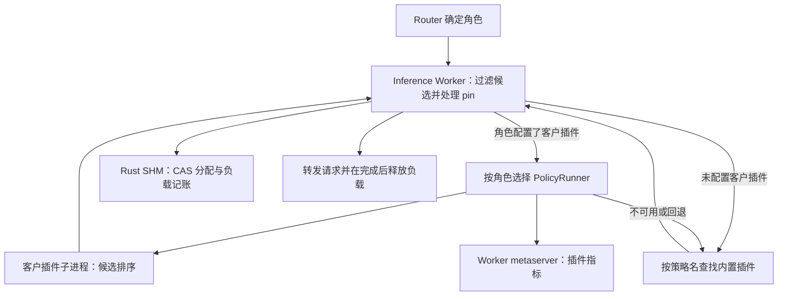
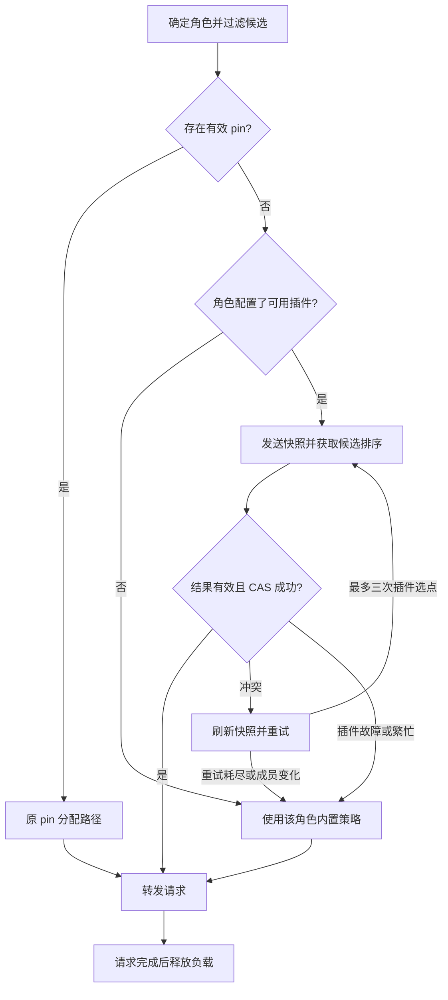

# Coordinator 自定义选点插件设计

## 背景与目标

MindIE Motor 提供轮询、负载均衡、KV 亲和和动态分桶等内置选点策略。用户需要自定义算法时，修改 Motor 核心代码会增加交付和升级成本。

本设计通过独立插件扩展角色内的候选实例和 endpoint 排序，目标如下：

- **独立交付**：将算法打包为 Python wheel，通过配置启用，无需修改 Motor 源码。
- **按角色配置**：Prefill、Decode、Union 和 Encode 可分别使用插件或内置策略。
- **故障回退**：插件异常、超时或繁忙时，当前角色回退到原配置的内置策略。
- **保持核心约束**：Motor 继续负责候选过滤、最终分配、负载记账与释放。
- **便于观测**：通过 Worker 日志和指标查看插件加载、调用与回退情况。

插件仅对 Router 已确定角色的候选池排序，不负责混部与 PD 分离之间的拓扑选择。显式指定实例、精度探针和有效的会话亲和 pin 优先，不调用插件。

## 设计概述

### 架构与职责



| 组件 | 职责 |
|------|------|
| Router | 确定请求的拓扑和角色。 |
| Inference Worker | 过滤候选、处理 pin、调用插件，并执行结果校验、分配和释放。 |
| 内置插件注册表 | 按角色配置的策略名解析进程内插件。 |
| PolicyRunner | 管理对应角色的客户插件进程、调用、超时、冷却和指标。 |
| 客户插件子进程 | 接收请求和候选快照，返回候选排序。 |
| Rust SHM | 保存负载与成员状态，通过 CAS 完成原子分配。 |
| Worker metaserver | 暴露该 Worker 的插件指标。 |

每个 Worker 按配置了客户插件的角色分别创建 Runner 和子进程，最多四个。即使多个角色使用同一个插件名，也不共享进程、锁、冷却状态或插件对象。Mgmt 和 Obs 不加载客户插件。

子进程与 Worker 使用相同的 Python 环境和系统权限。进程隔离用于回收故障插件，不是安全沙箱；当前进程回收依赖 POSIX。

### 内置选点插件

Worker 内置注册表按策略名提供 `round_robin`、`load_balance`、`kv_cache_affinity` 和 `dynamic_bucket` 四个进程内插件。`prefill_scheduler_type` 和 `decode_scheduler_type` 选择对应角色的默认插件，使用原配置即可。客户插件可通过 Entry Point 独立安装，在 Worker 的子进程中运行。客户插件不可用时，Worker 调用相应角色的内置插件。

内置插件实现 `BuiltinEndpointPolicy`。Worker 调用 `rank()` 获取建议候选和实际执行排序的策略名，再由该策略的 `prepare_candidates()` 组装 CAS 候选。负载需求按该角色**配置的**内置策略计算，因而内置策略之间的降级也保留原有记账语义。候选过滤、pin、CAS 提交和释放由核心执行。内置插件随 Motor 交付，无需额外安装 wheel。

| 内置插件 | 候选与回退 |
|----------|-----------|
| `round_robin` | 使用 Worker 的角色轮询计数和起始偏移选择实例，再选择 endpoint。 |
| `load_balance` | 复用现有负载打分与 Decode KV 用量惩罚，缺少候选时回退轮询。 |
| `kv_cache_affinity` | 保留 Conductor 查询、命中率门槛及 CAS 所需的命中信息。无法按亲和选点时回退负载均衡。 |
| `dynamic_bucket` | 按请求长度选择桶，将桶内候选交给核心按实时负载重选，无法分桶时回退负载均衡。 |

### 客户插件接口

插件继承抽象基类 `EndpointSelectionPolicy`，声明 `api_version = 2`，并实现同步方法 `rank(selection)`。基类定义候选排序契约，具体算法由插件提供。构造参数 `options` 来自配置。
API v2 草案中的 `LoadBalancingPolicy` 仍可作为兼容别名导入。

| 输入或输出 | 主要内容 |
|------------|----------|
| `SelectionInput.request` | 请求 ID、角色、模型、token 数及可选 user/session 元数据。 |
| `SelectionInput.candidates` | 候选 ID、endpoint 和实例负载、地址、引擎类型及可用的 KV 缓存使用率。 |
| `SelectionInput.excluded` / `attempt` | 已排除的候选 ID，以及从 0 开始的本次选点次数。 |
| `RankedCandidate` | 候选 ID 和用于日志观测的有限数值 `score`；列表顺序表达优先级。 |

插件可返回 `None` 主动放弃本次请求，Worker 使用内置策略，插件进程继续服务。返回列表时须非空，ID 必须来自本次候选，不能重复或属于排除集合。Motor 尝试列表首项，CAS 冲突时刷新快照并重新评分，以免使用基于旧负载或旧成员状态的后续候选。非法列表或分数按插件错误处理。

候选数据是快照，不提供可写 SHM 句柄；`node_address` 是 endpoint IP，不一定代表物理宿主机。user/session 是请求元数据，不是认证身份。插件私有状态不会跨 Worker、角色或进程重启共享。

内置和客户策略共用角色候选池上的引擎类型、dispatch 能力及优先级准入过滤。IPC 快照还会排除熔断实例、被阻塞或已失效的共享内存槽位和本轮排除项，核心在提交前再次验证候选。

### 通信协议

Worker 与客户插件子进程通过 stdin/stdout 传输 JSON 行协议（JSON Lines，每条消息为单行 JSON 对象），单条消息上限为 1 MiB（1048576 字节），且禁用 `NaN`/`Infinity` 等非标准 JSON 常量。

为防止插件代码或第三方库打印内容污染协议流，启动子进程时会先保留协议管道句柄，再将插件进程 Python 的 `sys.stdout` 重定向至 `sys.stderr`。输入消息超限或无法序列化为合法 JSON 时在父进程侧直接回退（`invalid_input`），不中断插件进程；响应超限、格式非法或读取到不完整行时按插件故障处理并回收进程。

### 配置与加载

在 `motor_coordinator_config.scheduler_config` 下使用 `policy_plugin` 列表配置插件。每项通过 Entry Point 名称匹配已安装的插件，并指定一个或多个角色。

| 字段 | 默认值 | 说明 |
|------|--------|------|
| `role` | 必填 | 非空数组，可选 `prefill`、`decode`、`union`、`encode`。每个角色只能出现一次。 |
| `name` | 必填 | 非空 Entry Point 名称，最多 128 个字符，必须精确匹配。 |
| `options` | `{}` | 可 JSON 序列化的插件参数，不允许 NaN 或 Infinity。 |
| `timeout_ms` | `50` | 单次排序消息交换的等待预算，范围 1–60000 毫秒。 |
| `startup_timeout_ms` | `5000` | 启动握手的等待预算，范围 1–60000 毫秒。 |
| `cooldown_seconds` | `30` | 插件故障后的恢复冷却时间，至少 1 秒。 |

未配置 `policy_plugin` 或设置为 `[]` 时，不加载客户插件、不创建客户插件子进程，仍通过注册表执行内置策略。`null`、未知字段、重复角色或非法预算会导致配置校验报错。修改插件包或配置后，需重启相关 Worker。

排序预算不包含所有进程创建、编解码和回收开销，也不是请求端到端耗时的硬时限。Union 和 Encode 必须显式配置，不继承 Prefill 插件。

## 关键流程

### 1. 插件加载

1. 用户将插件 wheel 安装到 Inference Worker 使用的 Python 环境，并配置插件名称和角色。
2. Worker 启动时，按角色创建 Runner，并并发启动各插件子进程。
3. 子进程按名称查找唯一 Entry Point，校验接口版本与同步 `rank()`，然后构造插件。
4. 加载成功后等待选点调用；加载失败的角色使用内置策略，并在冷却后尝试恢复。

### 2. 请求选点与分配

1. Router 确定请求角色；Worker 过滤不符合角色、引擎能力和熔断条件的候选。
2. 存在有效 pin 时，直接走原有分配路径；否则查找当前角色配置的插件。
3. Worker 将请求与候选负载快照发送给插件，校验返回的候选和排序。
4. Worker 复核候选与成员 generation，使用快照中的负载作为 CAS 预期值，提交核心计算的负载。
5. 分配成功后转发请求；请求完成时，核心按已提交的负载释放资源。



CAS 使用插件决策时的负载快照，避免等待插件期间负载变化导致旧排序被误提交。冲突时刷新快照并重调同一角色插件；成员 generation 变化或三次选点仍未成功时，重新走内置策略。其他 CAS 错误沿用核心调度失败路径。

客户插件提供排序，负载增量由核心计算并提交。内置插件沿用各自的负载计算规则，核心负责提交。

### 3. 故障回退与恢复

| 场景 | 处理方式 |
|------|----------|
| 角色未配置插件 | 直接使用该角色的内置策略。 |
| 加载失败、排序异常、输出非法或超时 | 回收插件进程，记录故障并进入冷却；当前角色使用内置策略。 |
| 当前角色插件繁忙或处于冷却期 | 本次请求立即回退，不等待插件；其他角色不受影响。每个 Worker 的每个角色只有一个在途排序。 |
| 插件返回 `None` 或父进程在发送前拒绝输入 | 本次回退，保留进程且不进入冷却。 |
| 冷却到期 | 后续请求触发后台恢复，重新加载该角色插件。 |
| 请求取消 | 取消继续向上传播。在途协议交换仍持有执行槽，读完后丢弃结果。交换超时按故障处理。 |
| Worker 关闭 | 回收在途插件进程和恢复任务；关闭打断在途调用时按 `unavailable` 记录回退，不计作插件错误或超时；关闭引起的加载中断不计入加载失败。 |
| 内置策略也无可用后端 | 沿用原调度失败路径。 |

Prefill、Union 和 Encode 使用 `prefill_scheduler_type` 作为默认和回退策略；Decode 使用 `decode_scheduler_type`。删除插件配置并重启 Worker 可恢复内置路径。

客户插件成功选点时接管该角色的候选排序，内置 KV 亲和和动态分桶仅在回退时执行。客户插件路径不发出内置 Conductor 亲和查询，`scheduled` 的 `matched` 和 `hit_rate` 为 `None`。

### 4. 日志与指标

Worker 日志记录插件加载、故障、回退和选点结果。插件选点成功时，`scheduled` 日志中的策略名为 `plugin:<name>`。
客户插件请求的 `plugin_attempt` 表示成功分配前的排序轮次，从 1 开始。`proposed` 保留首次选点，用于比较最终选点是否改变；`fast_path` 仍是是否跳过内置实时负载重扫的布尔值。

Worker metaserver 的 `GET /metrics` 按 `{policy,role}` 暴露指标：

| 指标 | 含义 |
|------|------|
| `motor_policy_loads_total` / `motor_policy_load_errors_total` | 加载成功 / 失败次数。 |
| `motor_policy_calls_total` | 插件排序调用次数，包含 CAS 重选。 |
| `motor_policy_errors_total` / `motor_policy_timeouts_total` | 排序错误 / 超时次数。 |
| `motor_policy_fallbacks_total` | 插件路径回退次数，不等同于请求失败次数。 |
| `motor_policy_fallbacks_by_reason_total` | 按 `reason` 标签细分回退：预定义原因（如 `busy`、`unavailable`、`cooldown`、`declined`、`cas_retry_limit` 等）正常导出；未知原因也会导出，并记录 `Unknown scheduling plugin fallback reason` WARNING 日志。 |
| `motor_policy_selection_seconds_sum/count` | 插件排序调用的累计耗时和次数。 |

指标属于各 Worker，Obs 不自动汇总。默认抓取端口为 `worker_metaserver_base_port + worker_index`；设置基准端口为 `0` 时关闭该抓取口。调用次数可能包含重选，不能直接作为请求数。

## 场景介绍

### 示例插件

[快速接入指南](../user_guide/features/inference_scheduling/scheduler_policy_plugin.md)中的示例注册了 `mycompany.least_load`，按以下公式从小到大排列候选：

```text
endpoint 负载 + instance_weight × 实例负载
```

同分时按实例 ID 和 endpoint ID 排序。

### 配置示例

将插件安装到所有相关 Worker 的 Python 环境后，在已有 `user_config.json` 的 `motor_coordinator_config.scheduler_config` 中加入：

```json
{
  "policy_plugin": [
    {
      "role": ["prefill", "decode"],
      "name": "mycompany.least_load",
      "options": {"instance_weight": 0.05},
      "timeout_ms": 50
    }
  ]
}
```

此配置让 Prefill 和 Decode 复用配置，但两者分别运行独立插件进程。如需不同参数，可拆成两个配置项；混部场景需显式添加 `union`。配置并重启后，查看 Worker 的 `Scheduling plugin loaded` 日志，再发送请求检查 `scheduled` 日志和插件指标。

从编写、打包到部署验证的完整步骤见[自定义选点插件快速接入](../user_guide/features/inference_scheduling/scheduler_policy_plugin.md)。

### 旧单对象配置迁移

旧草案使用单对象和 `roles` 字段，需要改为列表和 `role` 数组：

```json
{
  "policy_plugin": [
    {"role": ["prefill", "union"], "name": "mycompany.least_load", "options": {"instance_weight": 0.05}}
  ]
}
```

禁用某角色时，从 `role` 数组移除该角色；数组为空时删除整个配置项。旧单对象格式会报迁移错误，不会自动转换。

### 常见使用场景

| 场景 | 配置或操作 | 预期 |
|------|------------|------|
| 不使用插件 | 省略 `policy_plugin` 或设为 `[]`。 | 不创建插件进程，使用现有内置策略。 |
| P/D 共用算法 | 在一项中设置 `role: ["prefill", "decode"]`。 | 两个角色使用相同配置，各自独立运行。 |
| P/D 使用不同参数 | 为 P、D 分别添加配置项，设置各自的 `name` 或 `options`。 | 各角色调用对应插件和参数。 |
| 某角色插件失败 | 检查该角色的日志与 `fallbacks` 指标。 | 故障角色回退，其他角色继续独立运行。 |
| 停用插件 | 删除相应角色配置并重启 Worker。 | 该角色恢复使用内置策略。 |

## 相关代码与验证

| 路径 | 作用 |
|------|------|
| `motor/config/coordinator.py` | 插件配置及角色校验。 |
| `motor/coordinator/scheduler/policy/api.py` | 插件接口和数据结构。 |
| `motor/coordinator/scheduler/runtime/builtin_endpoint_policy.py` | Worker 内置选点插件及注册表。 |
| `motor/coordinator/scheduler/policy/plugin_runner.py`、`plugin_worker.py` | 插件进程管理、加载、调用和结果校验。 |
| `motor/coordinator/scheduler/runtime/scheduler_client.py` | 角色路由、候选快照、CAS 分配和回退。 |
| `tests/coordinator/scheduler/test_policy_plugin.py` | 插件契约、故障隔离、分配和指标测试。 |

运行专项测试及调度、配置回归：

```bash
bash tests/run_tests.sh --serial tests/coordinator/scheduler/test_policy_plugin.py
bash tests/run_tests.sh --serial tests/coordinator/scheduler/ tests/coordinator/core/test_config.py tests/config/
```

上述单测与集成用例用于功能验证（插件契约、故障隔离、分配释放及指标计数）；原生用例需要可加载的 Rust SHM 库，使用 `/dev/shm` 的用例需要 Linux。

针对内置策略重构的兼容性验证，设计上保留原有配置与算法语义，但当前插件化版本与插件化前基线的行为一致性需通过专门的基线对照验证确认；早于内置策略插件化提交的历史旧实现之间的 A/B 对比，不能替代本次插件化后的兼容性验证。集群验收应覆盖 P/D 独立配置、角色故障隔离、显式 Union、指标以及进程回收。

相关设计：[Coordinator 调度热路径 Rust 重构](coordinator_scheduler_rust.md)、[KV Conductor](kv_conductor.md)、[熔断设计](circuit_breaker_design.md)。需求见 [Issue #844](https://gitcode.com/Ascend/MindIE-Motor/issues/844)。
