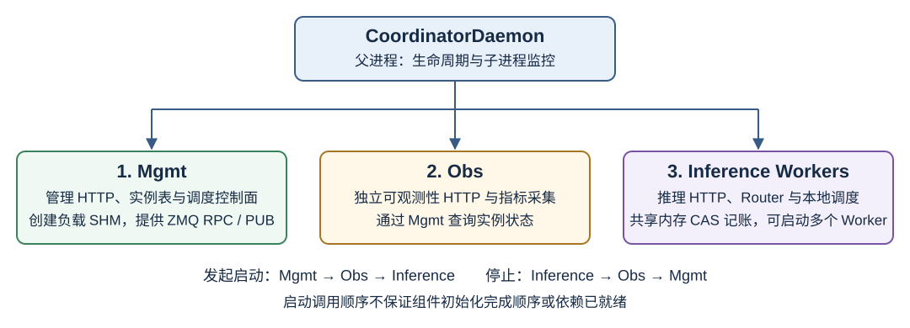

# Coordinator（协调器）

## 功能介绍

Coordinator 进程入口为 `motor/coordinator/main.py`：异步 `main()` 中构造 `CoordinatorConfig.from_json()`，按需 `reconfigure_logging`，再创建并运行 **`CoordinatorDaemon`**（`motor/coordinator/daemon/coordinator_daemon.py`）。

### 进程模型与职责

历史版本将 Scheduler、Mgmt、Inference、Obs 拆成四类子进程；当前版本已把调度控制面合入 Mgmt，
调度热路径移到 Inference Worker 的本地策略计算与 Rust 共享内存记账。
因此，排查当前版本时应按 **Daemon 父进程 + Mgmt / Obs / Inference 三类子进程** 理解，
不要再寻找独立的 Scheduler PID。Inference 可以有多个 Worker，总进程数为 `3 + num_workers`
（不计 Render Sidecar 等外部服务）；`num_workers=1` 时为四个进程。

`CoordinatorDaemon` 负责统一管理三类子进程（键名见 `motor/coordinator/process/constants.py`）：

| 进程字典键（常量名 / 值） | 管理类 | 说明 |
|--------|--------|------|
| `PROCESS_KEY_MGMT`（`"MgmtProcess"`） | `MgmtProcessManager` | 管理 HTTP + 控制面（实例成员表、熔断、精度全局门闩、schema-4 负载 SHM、ZMQ ROUTER/PUB） |
| `PROCESS_KEY_OBS`（`"ObsProcess"`） | `ObsProcessManager` | 独立采集、聚合并暴露指标，通过 Mgmt 控制面查询实例状态 |
| `PROCESS_KEY_INFERENCE`（`"InferenceWorkers"`） | `InferenceProcessManager` | 推理 Worker：OpenAI/Anthropic HTTP；调度热路径在本地打分后对 Rust POSIX SHM 做 CAS 记账 |

没有独立 Scheduler 子进程。IPC 路径名仍为 `scheduler_frontend` / `scheduler_instance_pub`（由 Mgmt bind，历史命名未改）。



图中的 Router 运行在 Inference Worker 内，不是单独的子进程。`scheduler_frontend` / `scheduler_instance_pub`
是历史沿用的 IPC 名称，不能据此判断还有独立 Scheduler。Controller 更新实例表的路径为
管理接口 → Mgmt 更新实例及共享内存 → PUB 通知 Worker 刷新本地视图。

### 启动与停止顺序

启停常量来自 `motor/coordinator/process/constants.py`：

- `START_ORDER = [MgmtProcess, ObsProcess, InferenceWorkers]`
- `STOP_ORDER = [InferenceWorkers, ObsProcess, MgmtProcess]`

`CoordinatorDaemon.run()` 先创建进程管理器，再由 `_start_processes()` 依次调用
Mgmt → Obs → Inference 各 manager 的 `start()`，发起子进程启动。
`BaseProcessManager.start()` 启动子进程后仅检查进程是否存活，
不等待 Mgmt 的 ZMQ socket 绑定、负载共享内存创建或 readiness 成功。
因此，**启动调用顺序不保证依赖已就绪，也不保证组件初始化完成的先后顺序**：
子进程初始化可以与后续进程启动并发；某个 manager 启动失败或抛出异常时，
`_start_processes()` 记录错误后仍继续尝试后续 manager。

各子进程在自己的初始化流程中完成以下工作：

- Mgmt 绑定 ZMQ ROUTER/PUB 并创建负载共享内存，供其他进程连接。
- Obs 连接控制面并启动指标采集。
- Inference Workers 连接控制面和共享内存，监听共享推理端口；多个 Worker 使用 `SO_REUSEPORT`。

实际连接、等待、重试及失败行为应以相应组件代码和进程日志为准，
结合管理端口 `/readiness` 判断服务是否就绪；不能仅凭启动调用顺序或进程存活推断依赖已可用。

正常退出按 `STOP_ORDER` 依次停止 Inference → Obs → Mgmt，避免先销毁控制面和共享内存。
`BaseProcessManager` 对子进程执行 `terminate()` → `join(timeout)`，仍存活时再 `kill()`；
这里是进程终止顺序，不表示所有在途请求都一定完成。

子进程由 `SubprocessSupervisor` 监控；Daemon 主循环中处理信号与退出（见 `CoordinatorDaemon.run` 后半部分）。

### 主备模式下的进程行为

启用 `standby_config.enable_master_standby` 后，主备节点各有自己的 Daemon、Mgmt、Obs 和 Worker。
当前实现**在选主前就启动三类子进程**，包括备用节点上的 Inference Workers；
初始角色共享内存写为 standby，只有取得主角色的节点才应对服务报告就绪。
因此，“Worker PID 存在”不等于“该节点已成为主节点”。

| 阶段 / 回调 | Mgmt / Obs | Inference Workers | 角色与服务行为 |
|---|---|---|---|
| 初始启动、尚未取得主锁 | 两侧均启动 | 两侧均预启动 | 初始角色为 standby，备用节点不因预启动而就绪 |
| `_on_become_master()` | 保持运行 | 调用 `start()`，已运行则保持 | 先写 master 角色，再确保推理进程已启动 |
| `_on_become_standby()` | 保持运行 | 按停止顺序停止，排除 Mgmt / Obs | 先写 standby 角色，撤销主节点服务资格 |
| `_on_master_lock_unhealthy()` | 保持运行 | 不在该回调中停止 | 写 isolated 角色，使 readiness 先失败 |
| `_on_master_lock_healthy()` | 保持运行 | 不在该回调中重建 | 写回 master 角色 |
| Daemon 退出 | 依次停止 Obs、Mgmt | 最先停止 | 停止 StandbyManager，最后清理角色共享内存 |

`_get_supervised_keys()` 在主备两侧都包含三类进程；进程监控与主角色 readiness 是不同机制。
应结合管理端口的 `/readiness`、角色状态和进程日志判断流量归属，不能只检查 Obs `/health`。

推理面 OpenAI 兼容路径见 [服务接口](../../user_guide/api/service_interfaces.md)。vLLM layerwise metaserver 行为见 [PD 分离](../../design/pd_disaggregation.md)。
调度热路径（Rust SHM CAS、删除 Scheduler 进程）见 [Coordinator 调度热路径 Rust 重构](../../design/coordinator_scheduler_rust.md)。

### 路由前 Token 处理

设置 `render_config.enable=true` 后，Coordinator 在路由前优先使用本 Pod 的 vLLM Render Sidecar 处理 Chat Completions 和 Completions，并将 token ID 复用于 context budget、KV Cache 亲和调度和 P/D 路由。启用 `kv_cache_affinity` 调度时建议同时开启 Render。仅启用 Render 和 context budget 时，本地 tokenizer 延迟到 Render fallback 时加载；若同时启用 KV 亲和、动态分桶或配置了 Conductor 服务，则仍在初始化阶段加载本地 tokenizer。Render 不可用或响应无效时自动回退，不影响 Coordinator 启动。

普通文本请求在流式和非流式场景下均复用 Render token ID。`enable_token_only_decode=false` 时，
Handoff 的 Prefill 使用 token-only 接口，Decode 使用 vLLM 原生 OpenAI 响应；
Trigger 的 P/D 两端都使用原生 OpenAI API，Prefill 在请求中注入 Render token ID，
避免两端请求 ID 前缀不同而无法匹配完成通知。Union 也将 token ID 注入原生 OpenAI 请求。
设置为 `true` 后，流式与非流式 Decode 均切换为 token-only + Derender。
数据混淆要求开启 token-only Decode。流式 Derender 要求 vLLM >= 0.27.0。

`context_budget_mode=on` 时，最终输出预算会同步到 Render 参数。配置与边界说明见
[user_config.json配置文件全量参数说明](../../user_guide/configuration/config_reference.md)、
[max_tokens 自适应](../../user_guide/features/max_tokens_adaptation.md) 与
[KV Cache 亲和调度](../../user_guide/features/kvcache_affinity.md)。

### Responses 的 PD 请求参数

vLLM 原生 PD handoff 路径中，Coordinator 将发给 P 实例的 Responses 请求设置为
`max_output_tokens=1`、`min_tokens=1`、`stream=false`、`background=false`。
其中 `min_tokens=1` 与 Chat/Completion 的 Prefill 行为对齐，目标是避免 P 首 token 直接输出 EOS。
发给 D 实例的请求仍保留客户端的输出预算、`min_tokens` 和流式、后台执行配置，P 的改写不会修改原请求。
Motor 负责上述参数的构造与转发；目标引擎需支持 Responses 的 `min_tokens` 并将其用于采样。

## Obs 进程

`ObsProcessManager` 启动独立的 `ObservabilityServer`，避免指标采集与推理请求共用同一 HTTP 事件循环。
Obs 通过 `SchedulerConnectionManager` 连接 Mgmt，订阅实例变更；`MetricsCollector` 基于该实例视图采集、
聚合指标。负载共享内存由 Mgmt 创建，Obs 不是调度控制面的所有者。

三类 HTTP 端口由 `api_config` 配置，默认值如下；部署时以实际配置和 Service 映射为准。

| 所属进程 | 配置字段 | 默认端口 | 主要用途 |
|---|---|---|---|
| Inference | `coordinator_api_infer_port` | `1025` | `/v1/chat/completions` 等推理接口 |
| Mgmt | `coordinator_api_mgmt_port` | `1026` | `/startup`、`/liveness`、`/readiness`、实例刷新等控制接口 |
| Obs | `coordinator_obs_port` | `1027` | `/metrics`、`/instances`、`/health` |

Obs 端点与检查范围：

| 请求 | 含义与注意事项 |
|---|---|
| `GET /metrics` | 默认返回完整 Prometheus 指标；查询参数 `type`、`role`、`format` 由采集器校验 |
| `GET /metrics?type=instance` | 获取实例指标，替代旧 `/instance/metrics` |
| `GET /instances` | 通过控制面向 Mgmt 查询权威实例状态；控制面不可用时返回 503；启用管理 API Key 时需携带 `X-Motor-Management-Key` |
| `GET /health` | 返回 Obs HTTP 服务健康信息，不代表主角色就绪或推理端到端可用 |
| `GET /instance/metrics` | 已弃用，返回 410 和替代接口提示 |

Obs 生命周期启动时连接控制面并启动 `MetricsCollector`；退出时停止采集、分离调度指标共享内存 Reader，
再断开控制面连接。若推理正常而指标异常，先检查 Obs 进程、实际 Obs 端口、到 Mgmt 的 IPC 连接和引擎指标采集日志，
不要仅重启 Inference Worker。

## Router 策略选型

Router 决定请求走“P/D 分离协作”还是“单实例完成推理”；调度策略决定在候选实例中选哪一个。
两者不应混淆：`select_router_class()` 根据实时角色、兼容性和熔断状态选择 Router，
并非通过配置固定选择一个 Python 类。精度探测与用户流量复用同一入口。

### 根据在线拓扑选择 Router

| 实时可用拓扑 / 条件 | 选择结果 | 使用场景 |
|---|---|---|
| 存在协议兼容且未熔断的 P/D 对 | `UnifiedPDRouter` | 分离部署，按引擎原生协议协调 Prefill、KV 传输和 Decode |
| 无可用 P/D 对，允许降级且存在未熔断 U/P 候选 | `PDHybridRouter` | 混部或分离服务降级，由一个实例完成 prefill+decode |
| 无可用 P/D 对，允许降级且仅有受支持的 vLLM D 候选 | `PDHybridRouter` | D 必须上报连接器推导出的 `decode_colocation`，在本地完成完整推理 |
| 所有候选都不可用 / 熔断，或降级条件不满足 | HTTP 503 | 检查实例注册、熔断、引擎及 capability 兼容性 |

判断顺序是先找兼容 P/D 对，再判断降级门控。降级候选优先级为 **U → P → D**。
`scheduler_config.enable_pd_separation_fallback_to_hybrid` 默认 `true`；关闭后，分离部署在没有可用 P/D 对时返回 503。
混部部署由 `deploy_config.hybrid_instances_num` 的存在与否识别，可走 U/P 混部路径；
Decode 共部署仍要求降级开关开启，并通过引擎类型和 `decode_colocation` 校验。
不要把“只有 Decode 角色”直接等同于“可以降级”。

### 根据引擎能力选择 P/D 协调方式

| 引擎与实例能力 | 协调方式 | 请求顺序 |
|---|---|---|
| vLLM，两端兼容 `prefill_handoff_decode` | Handoff | 先分配 P 并执行 Prefill，再分配 D 进行 Decode |
| vLLM，两端兼容 `concurrent_engine_sync`，如 layerwise / trigger | Trigger | 先分配 D；D 回调所属 Worker 的 metaserver，Worker 再分配 P |
| SGLang，兼容的 bootstrap 能力 | Bootstrap | 使用 SGLang 原生 bootstrap 协议协调 P/D |

这些是 `UnifiedPDRouter` 内的协议与执行计划，不是三个独立 Router 子进程。
`dispatch_capabilities` 来自实例上报；NodeManager 根据连接器或显式 `dispatch_profile` 推导能力，
不能在用户配置中随意填写 capability 以绕过兼容性检查。
连接器白名单、混合能力限制及部署配置见 [PD 分离：Connector 驱动执行计划](../../design/pd_disaggregation.md#connector-驱动执行计划)。

Trigger 回调使用每 Worker 独立的 metaserver 端口：默认 `12000 + worker_index`。
它与多个 Worker 共享的推理端口不同，不能把回调发到普通推理端口。
`worker_metaserver_base_port=0` 会关闭 metaserver；绑定失败或回调地址不可用时，Trigger 请求返回 503，
普通推理端口仍可保持运行。配置方法见 [PD 分离](../../design/pd_disaggregation.md)。

### 在候选实例中选择调度策略

`scheduler_config.prefill_scheduler_type` 用于 Prefill / Encode / Union，
`decode_scheduler_type` 用于 Decode；默认均为 `load_balance`。
例如，调整负载均衡策略不会把 `PDHybridRouter` 强制改为 `UnifiedPDRouter`。
旧 `scheduler_type` 为兼容字段，新配置应分别使用 P/D 字段；KV 亲和与 Decode 动态分桶的限制见
[配置参考](../../user_guide/configuration/config_reference.md)。

排查“选错 Router”时，依次核对 `GET /instances` 返回的角色与健康状态、实例 capability、
熔断状态和降级开关，再核对 P/D 各自的调度策略。不要通过旧 `deploy_mode` 字段尝试固定 Router。

## 环境准备

- 配置来源：`CoordinatorConfig.from_json()`，通常来自挂载的 `user_config.json` 中 **`motor_coordinator_config`** 等合并结果，字段定义见 `motor/config/coordinator.py`。独立部署时入口只读环境变量 `USER_CONFIG_PATH`。
- 部署与端口约定见 [user_config.json配置文件全量参数说明](../../user_guide/configuration/config_reference.md) 与 [接口说明](../../user_guide/api/README.md)。
- 负载 SHM 需要 `libmindie_workload_shm.so`。`bash build.sh` 默认已有 `lib/*.so` 则跳过 cargo，缺了才编并**打进 wheel**（缺库禁止出包）。改 `.rs` 后设 `SKIP_WORKLOAD_SHM_BUILD=0`。有 cargo + libzmq 且缺 `bin/kv-conductor` 时同时打包 kv-conductor；缺 libzmq 时自动跳过（也可 `SKIP_KV_CONDUCTOR_BUILD=1 bash build.sh`）。缺失 `.so` 时启动响亮失败，不会回退到 Python 账本。
- 不依赖 Controller / Node Manager 的拉起步骤见 [Coordinator 独立部署](../../user_guide/deployment/standalone.md)。

## 配置说明

请以 [user_config.json配置文件全量参数说明](../../user_guide/configuration/config_reference.md) 中 **`motor_coordinator_config`** 章节为权威字段说明。代码中与 Daemon 强相关的包括：

- `standby_config.enable_master_standby`：是否走主备与 Infer 启停分支。
- `scheduler_config`：`prefill_scheduler_type`、`decode_scheduler_type` 及降级开关等。推理 Router 由当前实例角色与 `dispatch_capabilities` 动态选择，不再读取 `deploy_mode`（见 [Router 策略选型](#router-策略选型)）。
- `inference_workers_config.worker_metaserver_base_port`：vLLM layerwise/trigger 时每 Worker 独立 metaserver 端口；默认 `12000`，设为 `0` 关闭。监听地址优先 `POD_IP`，否则用 `coordinator_api_host`。端口冲突时推理口继续，Trigger 返回 503。
- `api_config`：推理端口、管理端口等（与 `interface_description.md` 一致处为准）。

## 使用样例

```bash
python -m motor.coordinator.main
```

入口无额外 argparse；配置路径由 `CoordinatorConfig` 内部解析逻辑决定（若存在 `config_path` 会在日志中打印）。

## 报错与日志

- `main.py` 在启动失败时记录 `Server startup failed` 及 traceback，并以退出码 `1` 结束。
- 子进程崩溃、重启等行为由 `SubprocessSupervisor` 与各类 `ProcessManager` 记录日志，需结合 Pod 内日志排查。
- Worker 日志出现 native workload SHM 无法 attach 时，检查 Mgmt 是否已创建 SHM、以及镜像是否带上 `libmindie_workload_shm.so`。

## 相关设计

调度热路径实现说明见 [Coordinator 调度热路径 Rust 重构](../../design/coordinator_scheduler_rust.md)。
