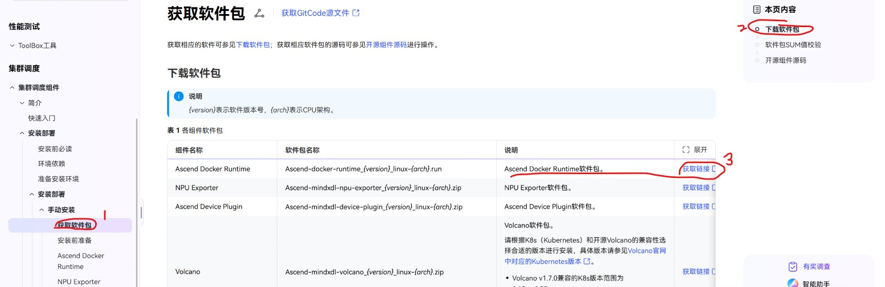
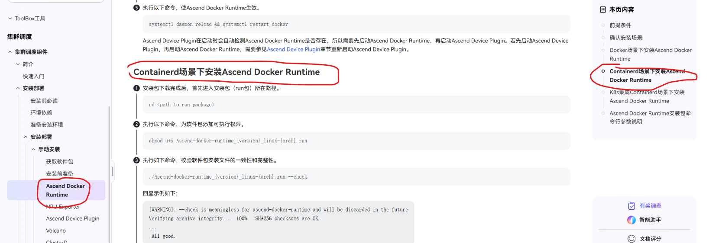
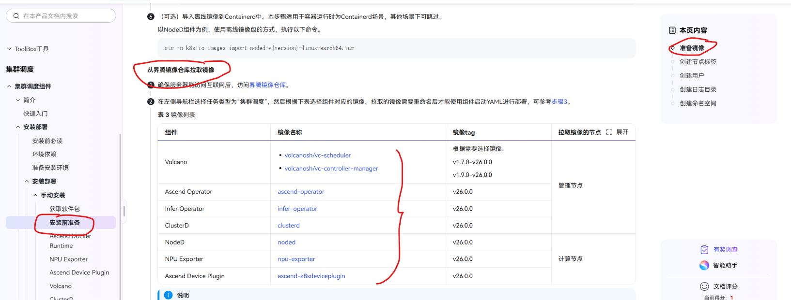
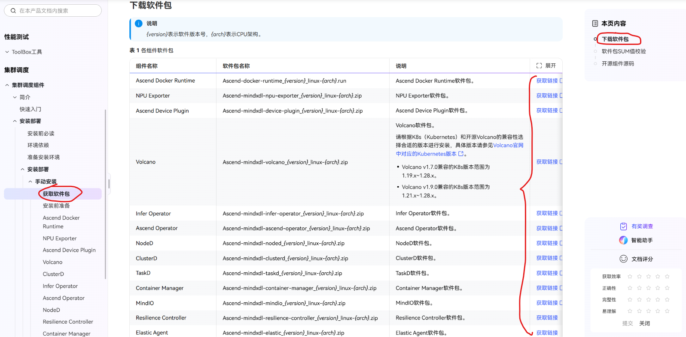
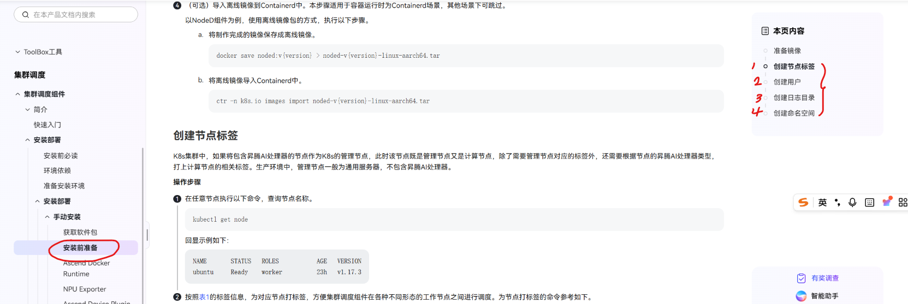
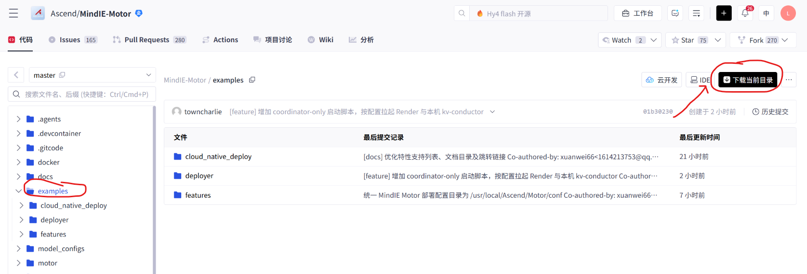
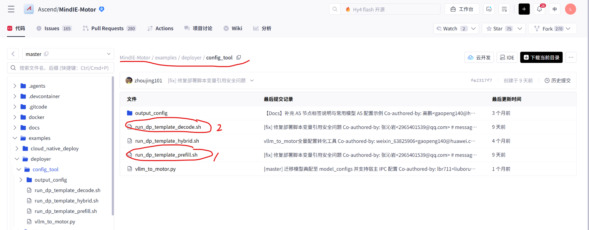
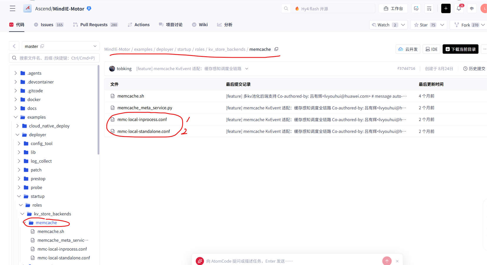
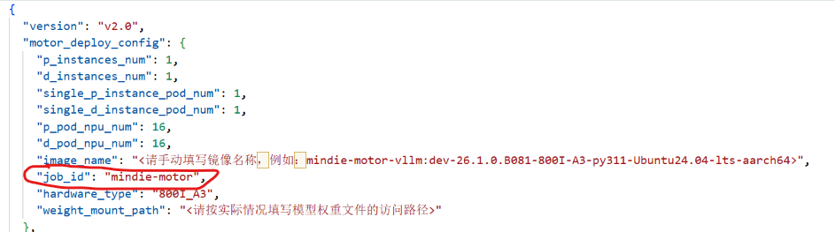

# MindIE-Motor + MemCache + K8s 全流程部署指导

> **关键词**：【场景-推理】【模型-DeepSeek-V4-Flash】【框架-VLLM_ASCEND】

## 目录

- [1. 背景描述](#1-背景描述)
  - [1.1 硬件环境](#11-硬件环境)
  - [1.2 软件版本](#12-软件版本)
  - [1.3 模型规格](#13-模型规格)
  - [1.4 业务背景](#14-业务背景)
  - [1.5 部署痛点](#15-部署痛点)
- [2. 组件介绍](#2-组件介绍)
  - [2.1 MindIE-Motor 介绍](#21-mindie-motor-介绍)
  - [2.2 MemCache 介绍](#22-memcache-介绍)
- [3. 版本要求](#3-版本要求)
  - [3.1 MindIE-Motor+MemCache](#31-mindie-motormemcache)
  - [3.2 MindCluster 版本](#32-mindcluster-版本)
  - [3.3 K8s 版本](#33-k8s-版本)
- [4. 手把手部署教学](#4-手把手部署教学)
  - [4.1 前置环境-K8s 安装](#41-前置环境-k8s-安装)
  - [4.2 前置环境-MindCluster 安装](#42-前置环境-mindcluster-安装)
  - [4.3 Motor+MemCache 方案部署](#43-motormemcache-方案部署)

---

## 1. 背景描述

### 1.1 硬件环境

| 项目 | 配置 |
| --- | --- |
| 服务器型号 | Atlas 800I A3 超节点（910C） |
| 服务器数量 | 2 台 |
| 单台 NPU 卡数 | 8 卡 |
| 总 NPU 卡数 | 16 卡 |

### 1.2 软件版本

| 软件名 | 版本 |
| --- | --- |
| vllm_ascend | v0.30.0RC2 |
| HDK | Ascend HDK 25.5.3 |
| CANN | 9.1.0 |

### 1.3 模型规格

| 模型系列 | 详细模型 | 下载地址 |
| --- | --- | --- |
| DeepSeek | DeepSeek-V4-Flash-0731 | [DeepSeek-V4-Flash-0731](https://www.modelscope.cn/models/deepseek-ai/DeepSeek-V4-Flash-0731) |

### 1.4 业务背景

客户基于 DeepSeek-V4-Flash 模型构建推理业务，采用 A3 双机部署架构，当前服务运行存在两大核心痛点：一是模型服务进程频繁异常 shutdown，且故障后无法自动恢复拉起，直接中断线上业务，严重影响业务连续性；二是模型推理性能偏弱、响应速度慢，无法满足业务侧的时延与吞吐要求。

为解决上述稳定性与性能瓶颈，计划引入 MindIE-Motor 推理框架，搭配 MemCache 多级缓存方案对原有推理链路进行改造优化。一方面依托框架能力实现服务异常后的快速自动拉起，保障故障自愈；另一方面借助多级缓存机制复用推理 KV 缓存，降低算力重复开销，整体提升模型推理吞吐、降低响应时延，改善服务性能，支撑业务稳定高效运行。

### 1.5 部署痛点

当前 MindIE-Motor 整套方案的部署文档碎片化：Motor、K8s、MindCluster、MemCache 多级 KV 缓存部署指导相互独立分散，缺少端到端串联的统一落地手册。用户需要自行拼接多份文档、对齐版本依赖、梳理组件启动顺序，上手门槛高、落地周期长。

## 2. 组件介绍

### 2.1 MindIE-Motor 介绍

MindIE-Motor 是昇腾面向大模型推理的高性能调度框架，支持故障自愈、弹性调度，可结合 KV 多级缓存降低推理时延、提升服务稳定性与吞吐能力。

| 组件 / 模块 | 定位与核心功能 | 关键特性 |
| :--- | :--- | :--- |
| **Coordinator（调度器）** | 请求统一入口与数据流枢纽，负责高并发请求的接收、调度与转发 | OpenAI 兼容接口、请求路由、负载均衡调度（分发至负载最低的 Prefill/Decode 实例）、全局请求管理、故障实例隔离 |
| **Controller（控制器）** | 集群状态管控与 RAS 决策中心 | 故障隔离/重启/自愈、PD 实例身份分配与动态调整、状态与 Metrics 上报、实例状态推送 |
| **NodeManager（节点管理器）** | 节点级服务管理 | 拉起本节点原生推理引擎进程（vLLM/SGLang）并向 Controller 注册、监控子进程健康并上报心跳 |
| **Deployer（部署器）** | 支持 Kubernetes/Docker/Slurm 场景的服务部署参考脚本 | 一键启停、健康探针配置、日志收集、容器启动与环境变量自动配置 |

```text
                 ┌──────────────┐
  用户请求 ───▶  │  Coordinator │  (Endpoint / Router / Scheduler / RequestManager / InstanceManager)
                 └──────┬───────┘
                        │ 转发
        ┌───────────────┼───────────────┐
        ▼               ▼               ▼
   Prefill 实例     Decode 实例     ...（多实例）
   (NodeManager + 原生推理引擎 vLLM/SGLang)
        ▲               ▲
        └───────┬───────┘
                │ 状态管控
         ┌──────┴───────┐
         │  Controller  │  (FaultManager / InsManager / EventPusher)
         └──────────────┘
                │
         Deployer / MindCluster
```

官方链接：<https://gitcode.com/Ascend/MindIE-Motor>

### 2.2 MemCache 介绍

MemCache 是昇腾面向大模型推理打造的分布式 KV Cache 多级缓存引擎，底层依托 MemFabric 高速传输底座，支持 HBM、DDR、SSD 构建分层存储池，实现跨节点 KV 缓存共享、冷热数据自动调度、缓存淘汰与预取。MemCache 由 MetaService 和 LocalService 两大核心组件组成：

- **MetaService**：缓存集群元数据管理服务，负责缓存分片分配、节点上下线感知、缓存条目路由映射；
- **LocalService**：缓存数据承载节点，提供本地介质读写能力，存放真实 KV 缓存数据。

官方链接：<https://gitcode.com/Ascend/memcache>

## 3. 版本要求

### 3.1 MindIE-Motor+MemCache

使用 MindIE-Motor 官方发布镜像即可，镜像中已集成 Motor + VLLM-Ascend + MemCache 组件。

镜像链接：<https://quay.io/repository/ascend/mindie-motor?tab=tags>（选择需要的版本即可）

### 3.2 MindCluster 版本

选择 26.0.0 版本。

### 3.3 K8s 版本

26.0.0 版本的 MindCluster 支持 Kubernetes 1.17.x ~ 1.34.x 版本（推荐使用 1.19.x 及以上版本）。

版本匹配关系可以在 MindCluster 官网查看：[环境准备](https://www.hiascend.com/document/detail/zh/mindcluster/2600/clustersched/dlug/docs/zh/scheduling/installation_guide/02_environment_setup.md)

## 4. 手把手部署教学

MindIE-Motor 的部署依赖 Kubernetes 与 MindCluster 作为前置底座环境：

- **Kubernetes**：提供容器编排、资源调度、服务生命周期管理与故障自愈能力，支撑推理实例、缓存组件的容器化部署与弹性管控；
- **MindCluster**：为昇腾集群提供 NPU 资源纳管、设备拓扑感知、通信链路管理、集群状态监控等硬件层能力。

### 4.1 前置环境-K8s 安装

RKE2 是 Rancher 推出的企业级 Kubernetes 发行版（RKE Government 的社区版），提供一键脚本快速部署 K8s 集群，兼顾安全合规、部署简单，支持 Linux 服务端、Linux 工作节点，基于 systemd 托管服务，内置 containerd 容器运行时，不需要依赖 Docker。

官方链接：<https://docs.rancher.cn/docs/rke2/install/quickstart>

**0）关闭防火墙**

```bash
systemctl stop firewalld && systemctl disable firewalld
```

**1）确认节点 hostname 设置正确，名称没有重复**

查看当前主机名：

```bash
hostname
```

修改当前主机名：

```bash
hostnamectl set-hostname <xxx>
```

**2）确认各个节点之间时区设置一致**

查看当前时间：

```bash
date
```

**3）设置节点间免密**

Node1 上生成密钥对，并将自身公钥追加至 `authorized_keys`：

```bash
# 生成密钥对，-N "" 表示空密码，无需交互
ssh-keygen -t ed25519 -f ~/.ssh/id_ed25519 -N ""

# 将本机公钥追加至 authorized_keys
cat ~/.ssh/id_ed25519.pub >> ~/.ssh/authorized_keys
```

Node2、Node3……Noden 各自生成密钥对：

```bash
ssh-keygen -t ed25519 -f ~/.ssh/id_ed25519 -N ""
```

在 Node1 上汇总各节点的公钥，并分发合并后的 `authorized_keys` 到所有节点（执行前确保 Node1 可免密登录各节点）：

> **注**：首次执行时 Node1 尚无法免密登录其他节点，汇总命令会提示输入各节点的 root 密码；也可先用 `ssh-copy-id` 分批完成首次公钥分发，之后重复执行上述命令即可免密。

```bash
ssh root@xx.xx.xx.02 "cat ~/.ssh/id_ed25519.pub" >> ~/.ssh/authorized_keys
ssh root@xx.xx.xx.03 "cat ~/.ssh/id_ed25519.pub" >> ~/.ssh/authorized_keys
...
ssh root@xx.xx.xx.0n "cat ~/.ssh/id_ed25519.pub" >> ~/.ssh/authorized_keys

# 将合并好的 authorized_keys 拷贝到所有节点
scp ~/.ssh/authorized_keys root@xx.xx.xx.02:~/.ssh/
scp ~/.ssh/authorized_keys root@xx.xx.xx.03:~/.ssh/
...
scp ~/.ssh/authorized_keys root@xx.xx.xx.0n:~/.ssh/
```

> **注**：`scp` 对同名文件为覆盖语义，会将目标节点原有的 `authorized_keys` 整体替换。若节点上已存在运维团队或云初始化注入的密钥，建议先在目标节点备份原文件（如 `cp ~/.ssh/authorized_keys ~/.ssh/authorized_keys.bak`）再执行分发。

所有节点上执行以下命令设置 `.ssh` 目录权限：

```bash
chmod 700 ~/.ssh
chmod 600 ~/.ssh/authorized_keys
```

**4）划分 K8s 的 Master 节点和 Node 节点**

> **注**：
>
> 1. 如果没有额外的通算资源作为 Master 节点，则可以使用智算节点部署，建议 1~3 个节点作为 Master。例如总计 4 台智算资源，其中 3 台做 Master 节点（同时兼做 Node 节点），1 台仅做 Node 节点。
> 2. rke2.zip 请通过可信渠道从部署实施方获取，建议先确认包内 `deploy-rke2.sh` 脚本内容后再以 root 执行；如条件允许，也可参考 [RKE2 Quickstart](https://docs.rancher.cn/docs/rke2/install/quickstart) 使用 RKE2 官方安装方式，安装版本与校验值以官方发布为准。

Node1（首个 Master 节点）上执行如下命令：

```bash
cd /xx/rke2
./deploy-rke2.sh \
--node-ip xx.xx.xx.01 \
--data-dir /data-rke2

# --data-dir 为 rke2 的数据目录，可自定义，确保目录存在即可
```

Node2 上执行如下命令：

```bash
cd /xx/rke2
./deploy-rke2.sh \
--server xx.xx.xx.01 \
--node-ip xx.xx.xx.02 \
--data-dir /data-rke2

# --server 填写 Node1 的 IP 地址，作为 Master 节点的主节点
# --data-dir 为 rke2 的数据目录，可自定义，确保目录存在即可
```

其余节点均按上述方式安装 K8s；如果某个节点仅为 Node 节点，不做 Master 节点，则执行以下命令：

```bash
cd /xx/rke2
./deploy-rke2.sh \
--server xx.xx.xx.01 \
--node-ip xx.xx.xx.04 \
--agent \
--data-dir /data-rke2

# 增加 --agent，表明此节点仅为 Node 节点
```

安装成功后，会显示如下日志：

```bash
level=info msg="Running kube-apiserver --advertise-port=6443 ..."
```

**环境变量设置**

执行以下命令，设置环境变量以使用 kubectl 命令：

```bash
source ~/.bashrc
```

> **注**：`source ~/.bashrc` 仅加载当前用户已有的环境变量配置，需提前在 `~/.bashrc` 中写入 kubectl 相关配置（如 `export KUBECONFIG=<kubeconfig路径>`、`export PATH=$PATH:<kubectl所在目录>`）后才会生效，路径以实际安装输出为准（通常为 `/etc/rancher/rke2/rke2.yaml` 与 `/var/lib/rancher/rke2/bin`）。

**检测 K8s 是否安装成功**

```bash
kubectl get nodes

#返回结果
NAME            STATUS   ROLES                       AGE     VERSION
rke2-server-1   Ready    control-plane,etcd,master   5h39m   v1.26.4+rke2r1
```

所有节点都是 Ready 状态，则表明安装成功。

**5）K8s 安装失败时的环境清理**

```bash
# 卸载
/usr/local/bin/rke2-uninstall.sh

# 清理数据（自行替换为部署时设置的 --data-dir 目录）
rm -rf /data-rke2/*

# 清理容器残余
pkill -f '/var/lib/rancher/rke2/bin/containerd'
```

### 4.2 前置环境-MindCluster 安装

以下是需要安装的组件列表：

| 组件 | 镜像名称 | 镜像 tag | 拉取镜像的节点 |
| --- | --- | --- | --- |
| Volcano | `volcanosh/vc-scheduler`<br>`volcanosh/vc-controller-manager` | 根据需要选择镜像：<br>v1.7.0-v26.0.0<br>v1.9.0-v26.0.0 | 管理节点 |
| Ascend Operator | `ascend-operator` | v26.0.0 | 管理节点 |
| Infer Operator | `infer-operator` | v26.0.0 | 管理节点 |
| ClusterD | `clusterd` | v26.0.0 | 管理节点 |
| NodeD | `noded` | v26.0.0 | 计算节点 |
| NPU Exporter | `npu-exporter` | v26.0.0 | 计算节点 |
| Ascend Device Plugin | `ascend-k8sdeviceplugin` | v26.0.0 | 计算节点 |

> **注**：管理节点即 K8s 的 Master 节点，计算节点即 K8s 的 Node 节点。

**0）安装 Ascend Docker Runtime**

安装以上组件之前，需要在**所有计算节点**优先安装 Ascend Docker Runtime 组件。

Docker Runtime 组件包下载：[获取软件包](https://www.hiascend.com/document/detail/zh/mindcluster/2600/clustersched/dlug/docs/zh/scheduling/installation_guide/03_installation/manual_installation/00_obtaining_software_packages.md)



安装部署按照 **Containerd 场景下安装 Ascend Docker Runtime** 章节进行：

链接：[安装 Ascend Docker Runtime](https://www.hiascend.com/document/detail/zh/mindcluster/2600/clustersched/dlug/docs/zh/scheduling/installation_guide/03_installation/manual_installation/02_ascend_docker_runtime.md)



**1）下载 MindCluster 组件镜像文件（以容器方式拉起组件服务）**

下载链接：[安装前准备 >> 准备镜像](https://www.hiascend.com/document/detail/zh/mindcluster/2600/clustersched/dlug/docs/zh/scheduling/installation_guide/03_installation/manual_installation/01_preparing_for_installation.md)



**2）下载组件镜像的 deploy yaml 文件**

在「获取软件包 >> 下载软件包」页面下载：

链接：[下载软件包](https://www.hiascend.com/document/detail/zh/mindcluster/2600/clustersched/dlug/docs/zh/scheduling/installation_guide/03_installation/manual_installation/00_obtaining_software_packages.md#%E4%B8%8B%E8%BD%BD%E8%BD%AF%E4%BB%B6%E5%8C%85)



**3）把下载的组件包文件放在对应的管理节点（K8s 的 Master 节点）和计算节点（K8s 的 Node 节点）**

镜像导入命令如下（tar 包名以实际下载的文件名为准）：

```bash
# 管理节点
ctr -n k8s.io images import scheduler.tar --all-platforms
ctr -n k8s.io images import manager.tar --all-platforms
ctr -n k8s.io images import operator.tar --all-platforms
ctr -n k8s.io images import infer_operator.tar --all-platforms
ctr -n k8s.io images import clusterd.tar --all-platforms

# 计算节点
ctr -n k8s.io images import noded.tar --all-platforms
ctr -n k8s.io images import npu_exporter.tar --all-platforms
ctr -n k8s.io images import k8sdeviceplugin.tar --all-platforms
```

**4）根据官方指导按步骤执行**

创建节点标签 >> 创建用户 >> 创建日志目录 >> 创建命名空间

链接：[创建节点标签](https://www.hiascend.com/document/detail/zh/mindcluster/2600/clustersched/dlug/docs/zh/scheduling/installation_guide/03_installation/manual_installation/01_preparing_for_installation.md#%E5%88%9B%E5%BB%BA%E8%8A%82%E7%82%B9%E6%A0%87%E7%AD%BE)



**5）运行 MindCluster 组件**

查询已加载的镜像列表：

```bash
crictl images
```

例如：

```text
swr.cn-south-1.myhuaweicloud.com/ascendhub/ascend-operator:v26.0.0
swr.cn-south-1.myhuaweicloud.com/ascendhub/infer-operator:v26.0.0
swr.cn-south-1.myhuaweicloud.com/ascendhub/clusterd:v26.0.0
```

使用正确的 `镜像名称:版本` 替换 K8s 部署 yaml 中的 image url：

`vi xxx.yaml` 后输入 `/url`，回车 > 找到对应的 url 进行替换即可，然后执行以下命令来运行组件容器。以 operator 为例，其余组件安装方式相同：

```bash
# 安装
kubectl apply -f ascend-operator-v26.0.0.yaml

# 查询组件状态，Running 则表示安装成功
kubectl -n mindx-dl get pods
```

**6）常用 K8s 命令**

```bash
kubectl -n xxx get pods                        # 查询 pod 列表
kubectl -n mindx-dl logs xxx-5d98d5f45d-nplnr  # 查询 pod 日志
kubectl delete -f xxx-v1.9.0.yaml              # 完全删除 pod + yaml 配置
kubectl delete pod xxx -n xxx                  # 仅删除 pod，删除后 pod 会自动拉起
kubectl create ns xxx                          # 创建命名空间
```

### 4.3 Motor+MemCache 方案部署

**1）下载 Motor 部署脚本 + 所需镜像文件至服务器目录**

- 部署脚本链接：<https://gitcode.com/Ascend/MindIE-Motor>
- 进入 `examples` 文件夹，下载当前目录。



- 镜像下载链接：<https://quay.io/repository/ascend/mindie-motor?tab=tags>（选择需要的版本即可）

**2）使用 deployer 文件夹下的 deploy.py 生成 user_config.json 和 env.json**

在 `examples/deployer/config_tool` 目录下：

- `run_dp_template_prefill.sh`：prefill 节点启动脚本模板；
- `run_dp_template_decode.sh`：decode 节点启动脚本模板。

用你实际使用的 Prefill/Decode 启动脚本内容（含 memcache 配置）替换上述两个模板文件的内容。



然后回到 `examples/deployer` 目录，执行以下脚本自动生成 `user_config.json` 和 `env.json`：

```bash
python3 deploy.py --mode general_config --deploy-scenario separate --hardware-type A3
```

生成目录为 `config_tool >> output_config`，自动生成后手动修改 `user_config.json` 中的模型权重和镜像 image url。

**3）MemCache 配置**

修改 `examples/deployer/startup/roles/kv_store_backends/memcache` 目录下的 `mmc-local-standalone.conf` 和 `mmc-local-inprocess.conf`。



> **注**：Atlas 800I A3 超节点使用 `standalone` 模式，两份 conf 分工不同：`mmc-local-inprocess.conf` 为 vLLM worker 的客户端配置，A3 standalone 下保持 `dram.size = 0GB`、`storage.enabled = false`、`ubsio.disk.path` 为空；`mmc-local-standalone.conf` 为独立 LocalService 的配置，由它打开 DRAM 池和 SSD，其中 `ubsio.standalone.device_count` 填 `1`。协议按硬件填写：A2 为 `device_rdma`，A3 为 `device_sdma`，A5 为 `device_urma`。

MemCache 详细配置参考：[KV池化能力](https://gitcode.com/Ascend/MindIE-Motor/blob/master/docs/zh/user_guide/features/inference_scheduling/kv_cache_store/memcache.md)

**4）拉起模型**

创建 Motor 命名空间：

```bash
kubectl create ns mindie-motor
```

修改 `user_config.json` 文件中的 `job_id` 为 motor 部署的命名空间名称：



```json
"job_id": "mindie-motor",
```

在 `examples/deployer` 目录下，集群 Master 主节点执行以下命令一键拉起模型服务：

```bash
python3 deploy.py --config_dir <user_config.json和env.json的文件放置目录>
```

若启动时遇到安全预检提示，请参考[部署前安全预检](../../k8s/README.md#deployment-security-precheck)，了解如何完成安全配置，或在隔离测试环境中使用 `--skip-check`。

**5）验证服务**

查看服务状态：

```bash
kubectl get pods -n mindie-motor -o wide
```

各 Pod 均为 Running（或 Completed）状态后，可验证推理服务。启用推理 TLS 时，请按[HTTPS 验证方式](../../k8s/README.md#verify-inference-tls)使用 HTTPS 地址和 `curl --cacert`。以下 HTTP 示例适用于推理 TLS 关闭的隔离测试环境。

```bash
curl -X POST http://<master_node_ip>:31015/v1/chat/completions \
  -H "Content-Type: application/json" \
  -d '{
    "model": "<served_model_name>",
    "messages": [{"role": "user", "content": "who are you?"}],
    "max_tokens": 36,
    "stream": true
  }'
```

- 返回 `{"detail":"Service is not available"}`：表示服务尚未就绪，多为 P/D 或 Coordinator 尚未完全就绪，等待后重试，并查看各 Pod 日志。
- 返回流式 JSON：推理正常。

**6）清理环境**

如果模型服务部署失败，需要清理 motor 环境重新进行部署，则在 `examples/deployer` 目录下执行以下命令：

```bash
bash delete.sh xxx   # xxx 为部署模型服务的 namespace 名称
```
