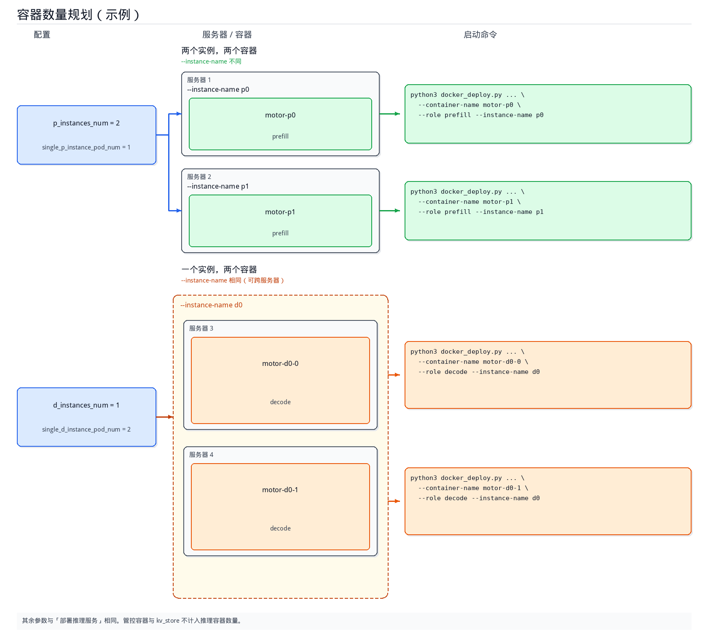

# 基于Docker的容器内PD分离服务部署

本文档指导用户在已创建的容器内部署PD分离服务。容器由云化平台（例如 ModelArts）或用户创建，用户进入容器后执行一条指令拉起服务。

## 准备镜像

通过以下方式获取镜像：

- 方式一：下载官方完整的MindIE Motor镜像

  进入[昇腾官方镜像仓库](https://www.hiascend.com/developer/ascendhub)，在搜索框输入`motor`，单击“mindie-motor”卡片，在“镜像下载”页签根据设备型号下载对应的MindIE Motor镜像。

- 方式二：在已有镜像中安装MindIE Motor

  基础镜像已安装CANN、vLLM、vLLM Ascend等组件，请参考[基于已有镜像安装MindIE Motor](../../../maintenance/build_motor_image_from_vllm_ascend.md) 额外安装MindIE Motor。

获取镜像后，请使用以下命令**将镜像加载至每一台服务器**：

   ```bash
   docker load -i xxxx.tar
   ```

## 准备服务启动脚本

在**任意一台服务器**，执行以下操作

1. 获取启动脚本。

   执行以下命令，从镜像内部拷贝`examples`目录至宿主机（以/home/examples路径为例）：

   ```bash
   # 填写上一步加载的镜像名称
   IMAGE="<镜像名或镜像ID>"
   # 创建一个临时容器并记录容器ID
   cid=$(docker create "$IMAGE")
   # 拷贝examples文件夹至宿主机
   docker cp "$cid:/tmp/motor/examples" /home/examples
   # 删除临时容器
   docker rm "$cid"
   ```

2. 准备配置文件。

     MindIE Motor已提供常用模型（deepseek_v4_flash、deepseek_v4_pro、GLM 5.1等）的[PD分离配置示例](../../../../../../model_configs/vllm/models/README.md)，基于模型和服务器类型选择配置示例，并**将配置文件拷贝至/home/examples/config目录**下。
     >[!NOTE]说明
     >上述Motor配置仅给出一种可行的模型切分示例，**用户可根据实际情况调整模型划分策略**，关注以下表中参数即可，但必须满足以下公式的限制：
     >
     > 1个P实例占用的NPU卡数 = single_p_instance_pod_num（占用几个pod，跨几机） × p_pod_npu_num （每个pod占用的NPU数）= data_parallel_size × tensor_parallel_size

      | 配置项 | 取值类型 | 取值范围 | 配置说明 |
      | --- | --- | --- | --- |
      | p_instances_num | int | ≥1 | Prefill 实例数量。 |
      | d_instances_num | int | ≥1| Decode 实例数量。 |
      | single_p_instance_pod_num | int | ≥1 | 1 个 P 实例拆成几个 Pod。|
      | single_d_instance_pod_num | int | ≥1 | 1 个 D 实例拆成几个 Pod。 |
      | p_pod_npu_num | int | ≥1，单 Pod 最大 16 卡 | 每个 P Pod 使用的 NPU 卡数。 |
      | d_pod_npu_num | int | ≥1，单 Pod 最大 16 卡 | 每个 D Pod 使用的 NPU 卡数。 |
      | data_parallel_size | int | ≥1 | 数据并行（DP）数 |
      | tensor_parallel_size | int | ≥1 | 张量并行（TP）数 |

3. <a id="step0003"></a>同步启动脚本配置。

    将整个/home/examples目录，**拷贝至所有服务器的相同路径**下。

## 容器数量规划

完成user_config.json配置后，需根据`motor_deploy_config`确定推理实例名称及各实例对应的容器数量。同一`--instance-name`下的多个容器可部署在不同服务器，每个容器单独创建并在容器内执行一次`--start`。管控容器与kv_store不计入推理容器数量。



1. 确定实例名称。

   `user_config.json`中`motor_deploy_config`的实例数量字段决定推理实例个数，并据此确定`--instance-name`。实例名称按角色从0起依次编号。

   **表 1** motor_deploy_config字段参数解释

   | 配置项 | 含义 | --role | --instance-name |
   | :--- | :--- | :--- | :--- |
   | p_instances_num | Prefill实例个数 | prefill | p0、p1、…、p{N-1} |
   | d_instances_num | Decode实例个数 | decode | d0、d1、…、d{N-1} |
   | hybrid_instances_num | 混部实例个数 | union | u0、u1、…、u{N-1} |

   其中`N`为对应配置项的取值。例如`p_instances_num`为`2`时，Prefill实例名称为`p0`、`p1`。

   部署管理服务（`--role coordinator,controller`）及kv_store时，无需指定 `--instance-name`。

2. 确定单个实例对应的容器数量。

   `single_p_instance_pod_num`、`single_d_instance_pod_num`（混部场景为 `single_hybrid_instance_pod_num`）表示单个实例对应的容器数量。Docker多容器部署中，1个Pod对应1个容器，每个容器需单独创建并执行一次`docker_deploy.py --start`。

   **表 2** 容器数量说明

   | 配置项 | 说明 |
   | :--- | :--- |
   | single_p_instance_pod_num | 单个Prefill实例对应的容器数量。 |
   | single_d_instance_pod_num | 单个Decode实例对应的容器数量。 |
   | single_hybrid_instance_pod_num | 单个混部实例对应的容器数量。 |

   同一实例下的多个容器使用相同的`--instance-name`，`--container-name`不可重复，且可部署在不同服务器。

   Prefill推理容器总数 = `p_instances_num` × `single_p_instance_pod_num`。Decode、混部同理。

3. **示例**。

   ```json
   {
     "motor_deploy_config": {
       "p_instances_num": 2,
       "d_instances_num": 1,
       "single_p_instance_pod_num": 1,
       "single_d_instance_pod_num": 2
     }
   }
   ```

   - Prefill为2个实例、2个容器，`--instance-name`分别为`p0`、`p1`。
   - Decode为1个实例、2个容器，`--instance-name`均为`d0`，可分别部署在不同服务器。

   **表 3** 参数解释

   | --container-name | --role | --instance-name |
   | :--- | :--- | :--- |
   | motor-p0 | prefill | p0 |
   | motor-p1 | prefill | p1 |
   | motor-d0-0 | decode | d0 |
   | motor-d0-1 | decode | d0 |

---

## 开启KV池化（可选）

不开启池化可跳过本节。

开启后，P/D通过`MultiConnector`同时做Prefill→Decode直传和KV入池；还需要单独部署一个**kv_store**容器（请参考[5.（可选）部署KV Cache Store](#step002)），更多详细内容请参考[KV池化能力](../../../features/kv_cache_store/README.md)文档来修改user_config.json配置文件。

## 创建容器

按照规划在集群内的服务器上创建容器，一共需要创建三类容器：

| 容器类型 | 参考模板 | 配置说明 |
| --- | --- | --- |
| 管理容器 | [ENTER_DOCKER_RUN_CTRL](https://gitcode.com/Ascend/MindIE-Motor/blob/v3.2.0/examples/deployer/lib/constant.py#L607-L618) | 容器名`motor-ctrl`，创建在服务器 1。 |
| P/D实例推理容器 | Atlas 800I A2：[ENTER_DOCKER_RUN_A2](https://gitcode.com/Ascend/MindIE-Motor/blob/v3.2.0/examples/deployer/lib/constant.py#L444-L476)<br>Atlas 800I A3：[ENTER_DOCKER_RUN_A3](https://gitcode.com/Ascend/MindIE-Motor/blob/v3.2.0/examples/deployer/lib/constant.py#L478-L518)<br>Ascend 950（8卡）：[ENTER_DOCKER_RUN_A5](https://gitcode.com/Ascend/MindIE-Motor/blob/v3.2.0/examples/deployer/lib/constant.py#L520-L557)<br>Ascend 950（16卡）：[ENTER_DOCKER_RUN_A5_POD16](https://gitcode.com/Ascend/MindIE-Motor/blob/v3.2.0/examples/deployer/lib/constant.py#L559-L605) | 1 个实例只占 1 个 容器时，容器名为`motor-p0`、`motor-d0`。1 个实例拆成多个容器时，容器名为`motor-p0-0`、`motor-p0-1`。每台服务器仅创建一个容器。 |
| kv_store | [ENTER_DOCKER_RUN_KVS](https://gitcode.com/Ascend/MindIE-Motor/blob/v3.2.0/examples/deployer/lib/constant.py#L620-L634) | 开启池化时创建，容器名`motor-kvs`，放在服务器 1。 |

创建时请满足以下条件：

- 将宿主机`/home/examples`按相同路径挂载进容器：`-v /home/examples:/home/examples`。权重、驱动、日志目录按模板挂载，宿主机路径须真实存在。

创建完成后进入容器：

```bash
docker exec -it <容器名> bash
```

## 容器内启动服务

默认情况下，一台服务器仅部署一个Prefill/Decode推理容器，如需**一台服务器部署多个P/D推理实例（仅用于小模型）**，请参考[同一容器部署多个推理实例](#同一容器部署多个推理实例)。

进入容器后，在`examples/deployer`目录下执行以下命令部署服务。

1. 部署Controller（任意容器执行）。

   ```bash
   python3 docker_deploy.py --config_dir ../../model_configs/vllm \
     --start --container-name motor-ctrl --role controller \
     --pod-ip <本机IP> --nic-name <网卡名> \
     --coordinator-ip <Coordinator所在IP>
   ```

2. 部署Coordinator（任意容器执行）。

   ```bash
   python3 docker_deploy.py --config_dir ../../model_configs/vllm \
     --start --container-name motor-coord --role coordinator \
     --pod-ip <本机IP> --nic-name <网卡名> \
     --controller-ip <Controller所在IP>
   ```

3. 部署Prefill（每个prefill容器仅执行一次）。

   ```bash
   python3 docker_deploy.py --config_dir ../../model_configs/vllm \
     --start \
     --container-name motor-p0 \
     --role prefill --instance-name <实例名称，需与容器数量规划一致，例如：p0> \
     --pod-ip <本机IP> --nic-name <网卡名> \
     --coordinator-ip <管理面IP> \
     --controller-ip <管理面IP>
   ```

4. 部署Decode（每个decode容器仅执行一次）。

   ```bash
   python3 docker_deploy.py --config_dir ../../model_configs/vllm \
     --start \
     --container-name motor-d0-0 \
     --role decode --instance-name <实例名称，需与容器数量规划一致，例如：d0> \
     --pod-ip <本机IP> --nic-name <网卡名> \
     --coordinator-ip <管理面IP> \
     --controller-ip <管理面IP>
   ```

5. <a id="step002"></a>（可选）部署KV Cache Store，仅开启池化时需要执行该步骤。

   **未开启池化时请跳过此步骤**。

   ```bash
   python3 docker_deploy.py --config_dir ../../model_configs/vllm \
     --start \
     --container-name motor-kvs \
     --role kv_store \
     --pod-ip <本机IP> --nic-name <网卡名> \
     --coordinator-ip <管理面IP> \
     --controller-ip <管理面IP>
   ```

   上述命令执行后，将启动kv_store（Mooncake后端会启动`mooncake_master`，默认监听**50088**）。

>[!NOTE] 说明
>
>- 开启池化时，部署管理面（coordinator/controller）和Prefill/Decode时需额外增加`--kv-store-ip <kv_store所在服务器的IP地址>`。`--role kv_store`可省略，默认使用`--pod-ip`。
>- 同一容器部署多个推理实例时，每条`--start`使用不同的`--devices`和端口，请参考[同一容器部署多个推理实例](#同一容器部署多个推理实例)。
>- 混部角色将`--role`改为`union`，`--instance-name`与容器数量规划一致（例如`u0`）。

**表 5** 容器内部署命令参数解释

| 参数 | 说明 |
| :--- | :--- |
| --start | 在当前容器内启动服务，不创建容器。 |
| --config_dir | user_config.json和env.json所在目录。 |
| --container-name | 容器名，可自定义，须与创建容器时的名称一致。 |
| --role | 容器中运行服务的角色。<ul><li>管理服务：coordinator,controller；</li><li>推理服务：prefill或decode；</li><li>池化：kv_store。</li></ul> |
| --instance-name | 推理实例名，如：p0、d0。<br>用于标识当前容器启动的服务归属于哪一个实例。同一实例的多个容器使用相同名称，详情请参考[容器数量规划](#容器数量规划)。 |
| --pod-ip | 当前服务器的IP地址。<br>可执行`ip -4 route get 1.1.1.1`命令查看，`src`字段后面是`--pod-ip`值。 |
| --nic-name | 当前服务器对应`--pod-ip`的网卡名。<br>可执行`ip -4 route get 1.1.1.1`命令查看，`dev`字段后面是`--nic-name`值。 |
| --coordinator-ip/--controller-ip | Coordinator/Controller所在服务器的IP。部署推理服务、kv_store时填写。分容器部署管理服务时，Controller填写`--coordinator-ip`，Coordinator填写`--controller-ip`。 |
| --kv-store-ip | kv_store所在服务器的IP地址。开启池化后，部署管理面（coordinator/controller）和Prefill/Decode时必填。`--role kv_store`可省略，默认使用`--pod-ip`。 |

上述命令执行后，窗口将启动对应服务，用户在屏幕上可观察到日志打印。

## 推理验证

在**部署管理服务的服务器上**发送如下推理请求，即可进行推理验证：

```bash
curl -X POST http://<coordinator管理服务所在服务器的IP地址>:1025/v1/chat/completions \
  -H "Content-Type: application/json" \
  -d '{
    "model": "<模型名称，必须和user_config.json文件中的配置一致>",
    "messages": [{"role": "user", "content": "who are you?"}],
    "max_tokens": 36,
    "stream": true
  }'
```

若返回以下内容，表示服务尚未就绪，可稍后重试。

```Output
{"detail":"Service is not available"}
```

开启池化后，再用不少于 128 token 的 prompt 发一次请求。请求成功后，在 kv_store 日志中查看`Keys`，由 0 变为大于 0 即表示 block 已入池。日志路径示例：

```text
/home/examples/motor_workspace/motor-kvs/kvs/log/docker-kv_store-<时间戳>.log
```

## 终止服务与重复部署

在终端执行`Ctrl+C`可终止服务，但不会退出容器。服务终止后会出现如下提示，便于用户重新部署。

```text
容器内服务已终止，可执行以下命令重新部署服务。
python3 /path/to/examples/deployer/docker_deploy.py --config_dir /path/to/model_configs/vllm --start --container-name motor-ctrl --role coordinator,controller --pod-ip <本机IP地址> --nic-name <本机主网卡名称>
运行日志：examples/motor_workspace/motor-ctrl/ctrl/log/docker-coordinator-controller-<时间戳>.log
```

## 启用Render特性（可选）

在 `/home/examples/config/user_config.json` 中增加以下配置：

```json
{
  ...
  "motor_coordinator_config": {
    "render_config": {
      "enable": true
    }
  },
  ...
}
```

在部署管理面的服务器上额外创建名为`motor-ctrl-vllm-render`的容器。该容器不挂载 NPU，挂载可参考管理面模板 [ENTER_DOCKER_RUN_CTRL](https://gitcode.com/Ascend/MindIE-Motor/blob/v3.2.0/examples/deployer/lib/constant.py#L607-L618)。管理面容器增加`-v /var/run/docker.sock:/var/run/docker.sock`。

进入 Render 容器后执行：

```bash
python3 /home/examples/deployer/docker_deploy.py --config_dir /home/examples/config --start --role render
```

在管理面容器内执行`--start`时，会重启该 Render 容器。管理面进程退出时，会停止该 Render 容器。Render 退出后，Coordinator 继续运行。

## 调优指导

### 如何调整容器挂载

创建容器的模板仅供参考。调整挂载时，在`docker run`命令中增删`-v`。云化平台创建容器时，在平台的挂载配置中调整。宿主机路径须真实存在。

### 同一容器部署多个推理实例

一个容器里可以执行多次执行`--start`，以此部署多个推理实例。

下面以 1 个容器部署 1 个 Prefill 和 1 个 Decode 为例，容器挂载卡`0,1,2,3`。Prefill `p0`使用`0,1`，Decode `d0`使用`2,3`。

1. 创建容器

   在宿主机执行一次。这个容器挂上两个实例要用的卡。管理面仍单独创建一个容器，按[容器内启动服务](#容器内启动服务)的回显执行。

   ```bash
   python3 /home/examples/deployer/docker_deploy.py \
     --config_dir /home/examples/config \
     --create \
     --container-name motor-pd \
     --devices 0,1,2,3    # 这个容器挂载两个实例要用的卡
   ```

2. 进入容器

   ```bash
   docker exec -it motor-pd bash
   ```

3. 执行Prefill 启动命令

   额外添加以下五个参数。

   ```bash
   python3 /home/examples/deployer/docker_deploy.py \
     --config_dir /home/examples/config \
     --start \
     --container-name motor-pd \
     --role prefill \
     --instance-name p0 \
     --pod-ip "<本机IP>" \
     --nic-name "<本机网卡>" \
     --coordinator-ip "<服务器1 IP>" \
     --controller-ip "<服务器1 IP>" \
     --devices 0,1  \                  # 本实例使用的卡号，2 张卡。同一容器里的其他实例不能重叠
     --node-manager-port 4026  \       # NodeManager 端口。同一容器里错开，例如 4026、4226
     --data-parallel-rpc-port 9000  \  # 数据并行 RPC 端口。同一容器里错开，例如 9000、9200
     --base-port 10000  \              # 引擎端点起始端口，会再占用后续一段端口。同一容器里错开，例如 10000、12000
     --kv-port 21000                   # KV 传输起始端口，会再占用后续一段端口。同一容器里错开，例如 21000、23000
   ```

4. 执行Decode 启动命令

   开一个新的窗口，进入容器后，执行以下命令，额外添加以下五个参数。

   ```bash
   python3 /home/examples/deployer/docker_deploy.py \
     --config_dir /home/examples/config \
     --start \
     --container-name motor-pd \
     --role decode \
     --instance-name d0 \
     --pod-ip "<本机IP>" \
     --nic-name "<本机网卡>" \
     --coordinator-ip "<服务器1 IP>" \
     --controller-ip "<服务器1 IP>" \
     --devices 2,3  \                  # 本实例使用的卡号，2 张卡。同一容器里的其他实例不能重叠
     --node-manager-port 4226  \       # NodeManager 端口。同一容器里错开，例如 4026、4226
     --data-parallel-rpc-port 9200  \  # 数据并行 RPC 端口。同一容器里错开，例如 9000、9200
     --base-port 12000  \              # 引擎端点起始端口，会再占用后续一段端口。同一容器里错开，例如 10000、12000
     --kv-port 23000                   # KV 传输起始端口，会再占用后续一段端口。同一容器里错开，例如 21000、23000
   ```
