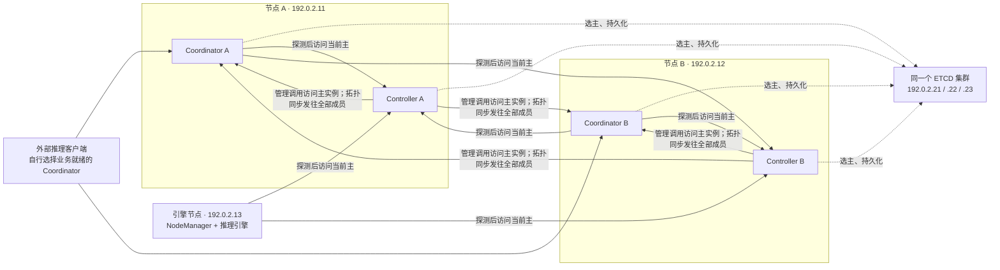

# Docker-only 主备部署

本文说明如何在 Docker-only 环境中，将 Controller、Coordinator 的主备实例部署到不同物理节点，并使 Motor 内部调用在倒换后找到新主。适用于宿主机创建多容器和已有容器内启动两种入口，推理引擎仍按原 PD 分离或 PD 混部方式部署。

主备实例通过 ETCD 租约锁选主。主实例故障、租约到期后，备用实例竞争锁并接管。调用方后台周期探测配置中的候选实例，后续注册、心跳和管理请求改用可用目标。Controller 和 Coordinator 独立选主，因此两者的主实例可能位于不同节点。

本文以两节点控制面为例。部署脚本不根据主备开关自动创建第二个副本，需要在两台机器分别执行启动命令。外部推理客户端也需要自行切换 Coordinator 地址；Motor 不为此提供一个固定推理入口。

## 1. 规划拓扑和地址



图中的连线表示候选关系，不表示两个副本同时提供主实例服务。示例 IP 属于文档地址段，部署时替换为实际地址。

| 对象 | 示例地址 | 示例端口 | 准备要求 |
| --- | --- | --- | --- |
| Controller 副本 | `192.0.2.11`、`192.0.2.12` | API `2026`，观测 `2027` | 两个副本使用相同端口；API 端口供注册、心跳和 `/readiness` 使用 |
| Coordinator 副本 | `192.0.2.11`、`192.0.2.12` | 推理 `1025`，管理 `1026`，观测 `1027` | 两个副本使用相同端口；内部探测使用管理端口 |
| ETCD 成员 | `192.0.2.21`、`192.0.2.22`、`192.0.2.23` | 客户端 `32379` | 已组成同一个健康集群；各成员客户端端口相同，提供双向 TLS；服务器证书满足下文共同 SAN 要求 |
| 引擎节点 | `192.0.2.13` | 沿用引擎典配 | 能访问所有控制面候选，控制面也能访问其 NodeManager 和引擎 |

多容器部署使用 host 网络，候选填写调用方可达的宿主机 IP。Controller 与 Coordinator 同机时必须错开端口，上表已错开；不要依赖自动端口避让来修复候选地址与实际监听端口不一致的问题。

部署前按 [PD 分离](host/pd_disaggregation_deployment.md)或 [PD 混部](host/pd_aggregation_deployment.md)准备镜像、完整模型配置、权重及网络。ETCD 由环境提供，Docker 部署器不负责创建 ETCD 集群。主备能力不自动复制模型权重或接管故障节点上的引擎。

## 2. 准备配置

### 2.1 合并主备功能配置

在每个相关节点准备本机的 `user_config.json`、`env.json`，以下以 `/home/examples/config` 为目录。将下面的功能片段**按字段合并**到已选定的完整模型配置，保留原有镜像、模型、实例数量、引擎参数和环境变量；该片段不能单独用于启动推理服务。

基础配置若仍含 `motor_controller_config.etcd_config.etcd_host` 或 `motor_coordinator_config.etcd_config.etcd_host`，先删除这两个旧单地址字段，再填写下面的多地址 `etcd_hosts`，避免两种输入冲突。

```json
{
  "motor_deploy_config": {
    "service_discovery_config": {
      "probe_ips": {
        "controller": ["192.0.2.11", "192.0.2.12"],
        "coordinator": ["192.0.2.11", "192.0.2.12"]
      }
    },
    "tls_config": {
      "etcd_tls_config": {
        "enable_tls": true,
        "ca_file": "/run/motor-etcd-tls/ca.crt",
        "cert_file": "/run/motor-etcd-tls/client.crt",
        "key_file": "/run/motor-etcd-tls/client.key"
      }
    }
  },
  "motor_controller_config": {
    "api_config": {
      "controller_api_port": 2026,
      "observability_api_port": 2027
    },
    "port_allocator_config": {"enable": false},
    "standby_config": {"enable_master_standby": true},
    "etcd_config": {
      "etcd_hosts": ["192.0.2.21", "192.0.2.22", "192.0.2.23"],
      "etcd_port": 32379,
      "etcd_tls_server_name": "motor-etcd.internal",
      "enable_etcd_persistence": true
    }
  },
  "motor_coordinator_config": {
    "api_config": {
      "coordinator_api_infer_port": 1025,
      "coordinator_api_mgmt_port": 1026,
      "coordinator_obs_port": 1027
    },
    "port_allocator_config": {"enable": false},
    "standby_config": {"enable_master_standby": true},
    "etcd_config": {
      "etcd_hosts": ["192.0.2.21", "192.0.2.22", "192.0.2.23"],
      "etcd_port": 32379,
      "etcd_tls_server_name": "motor-etcd.internal",
      "enable_etcd_persistence": true
    }
  }
}
```

各项配置的职责不同：

- `standby_config.enable_master_standby` 控制该组件是否参与选主；开启主备会启用其 ETCD 持久化。
- `etcd_config.etcd_hosts` 指定选主及持久化使用的 ETCD 集群。多地址使用同一地址族的静态 IP，每个成员使用相同客户端端口。
- `tls_config.etcd_tls_config.enable_tls` 控制 Motor 到 ETCD 的 TLS 连接；多 IP 开启 TLS 时，`etcd_tls_server_name` 必须填写所有成员服务器证书共有的 DNS SAN 名称。该开关不改变管理 API 的 TLS、主备或探针配置。
- `service_discovery_config.probe_ips` 指定调用目标。配置某个目标的非空列表即启用后台探测，只有一个 IP 也会启用；不使用探测时删除该目标字段，不要填空列表。

每个调用方读取自己的配置文件。需要一致的是同一套服务的候选清单、目标端口，以及双方已有的管理 API TLS／鉴权约定；引擎参数、设备和本机网络信息按各节点规划，不要求整份 JSON 完全相同。端口取自本机 JSON 中对应的 `motor_controller_config.api_config`、`motor_coordinator_config.api_config`，不会去远端读取被调用组件的文件。

同一组件的主备副本还须使用相同的 ETCD 集群、`standby_config.master_lock_key` 和选主键的环境前缀。采用下文标准管理角色入口时，不传 `--instance-name`；不要为区分副本而改写 `JOB_NAME` 或 `POD_NAMESPACE`。容器名称用于区分运行实例，不是选主组标识。

启用探测时，Controller API 端口、Coordinator 管理端口必须显式填写。启用 Controller 的 Coordinator 指标代理时，还需显式填写 Coordinator 观测端口。Coordinator 的 `port_allocator_config.enable` 必须为 `false`。探测参数默认即可；完整字段说明见[配置参考](../../configuration/config_reference.md)。

若基础配置显式设置了 `controller_api_host` 或 `coordinator_api_host`，应按该实例所在节点配置，或删除以使用启动参数 `--pod-ip` 对应的默认监听地址。不要将另一节点的监听 IP 原样复制过来。修改静态候选、端口或 ETCD 地址后需重启相应进程。

### 2.2 选择 JSON 或命令行候选输入

推荐使用上述 JSON 配置，方便复核各调用方的候选成员。也可以在启动时分别使用：

```text
--controller-probe-ips 192.0.2.11,192.0.2.12
--coordinator-probe-ips 192.0.2.11,192.0.2.12
```

| 输入组合 | 规则 |
| --- | --- |
| JSON 候选与同目标 CLI 候选 | 不能同时提供，即使内容相同也报错；使用 CLI 时删除 JSON 中该目标列表 |
| `--controller-ip` 与任一来源的 Controller 候选 | 不能同时提供 |
| `--coordinator-ip` 与任一来源的 Coordinator 候选 | 不能同时提供 |
| 一个目标固定 IP，另一个目标候选列表 | 可以分别配置 |
| `--pod-ip` 与候选列表 | 仍需同时提供；前者是自身运行身份，后者是对端访问目标 |
| `--show-commands` 与 CLI 候选参数 | 明确报错；需要预览命令时将候选写入 JSON |

CLI 候选写入此次启动生成的配置副本，不修改输入 JSON；端口始终取自 JSON。`--show-commands` 只按 JSON 生成命令，不会根据主备开关展开两套控制面副本，实际部署需按下一节安排两台机器。

### 2.3 准备 ETCD 双向 TLS<a id="etcd-mtls"></a>

本指南使用双向 TLS。Motor 验证 ETCD 服务器证书，ETCD 验证 Motor 的客户端证书；仅开启 Motor 配置不能改变 ETCD 服务端的监听协议。

**共同 SAN 是多 IP TLS 的接入前提。** 请 ETCD 提供方为各成员分别签发服务器证书和私钥，并在每张服务器证书的 DNS SAN 中加入 `motor-etcd.internal`（可换成双方约定的名称）。Motor 在两个组件的 `etcd_config.etcd_tls_server_name` 中填写同一名称，使用它校验服务器身份；仍直接连接 `etcd_hosts` 中的 IP，不解析这个名称，不需要额外 DNS 服务，也不需要修改 ETCD 成员的 `--name`。证书链仍须通过 CA 校验。

ETCD 客户端接口须使用 HTTPS 的 `--listen-client-urls`、`--advertise-client-urls`，配置各成员的 `--cert-file`、`--key-file`，并启用 `--client-cert-auth`、`--trusted-ca-file`。这些配置由 ETCD 提供方完成；peer 链路使用独立的 `--peer-*` 配置，本次不调整。参见 [ETCD 传输安全说明](https://etcd.io/docs/v3.5/op-guide/security/)。

向 Motor 部署方提供以下三个文件，不提供 CA 私钥或 ETCD 服务器私钥：

| 文件 | Motor 配置字段 | 用途 |
| --- | --- | --- |
| `ca.crt` | `ca_file` | 验证所有 ETCD 成员服务器证书的可信 CA |
| `client.crt` | `cert_file` | ETCD 信任的客户端证书（含所需证书链） |
| `client.key` | `key_file` | 与客户端证书匹配的无密码 PEM 私钥；ETCD 客户端不使用 `passwd_file` 解密 |

在每个连接 ETCD 的 Motor 容器创建前，准备本机证书目录，例如 `/home/motor/etcd-tls`，限制私钥访问权限。配置中的路径均为**容器内路径**，不是宿主机路径。

使用宿主机 `docker_deploy.py` 创建容器时，在部署使用的个人 `examples` 副本中，为 `deployer/lib/constant.py` 的 `ENTER_DOCKER_RUN_CTRL` 模板增加下面一行绑定，再按第 3.1 节运行原部署命令；该模板同时适用于独立或合并的 Controller、Coordinator 管理容器：

```text
  -v /home/motor/etcd-tls:/run/motor-etcd-tls:ro \
```

使用第 3.2 节已有容器入口时，在创建该容器的 `docker run` 命令中添加相同绑定，再通过 `docker_deploy.py --start` 启动。已有容器不能直接新增绑定，须在创建阶段准备。部署器没有证书挂载参数，也不会根据 `ca_file` 等配置自动挂载或签发证书。

如果环境使用明文 ETCD，将 `enable_tls` 设为 `false`，无需上述证书挂载；此时不读取证书文件，也不使用 `etcd_tls_server_name`。既有单地址 TLS 未填写 `etcd_tls_server_name` 时保留原证书校验行为，K8s 旧配置无需修改。

## 3. 启动实例

以下命令使用 JSON 候选，因此不再传 `--controller-ip`、`--coordinator-ip`。在每台服务器替换本机网卡名，保证它与 `--pod-ip` 对应。命令在前台运行，各容器使用独立终端或已有进程托管方式。

### 3.1 在宿主机创建并启动容器

在节点 A（`192.0.2.11`）分别执行：

```bash
python3 /home/examples/deployer/docker_deploy.py \
  --config_dir /home/examples/config \
  --container-name motor-controller-a --role controller \
  --pod-ip 192.0.2.11 --nic-name "<节点A网卡>"
```

```bash
python3 /home/examples/deployer/docker_deploy.py \
  --config_dir /home/examples/config \
  --container-name motor-coordinator-a --role coordinator \
  --pod-ip 192.0.2.11 --nic-name "<节点A网卡>"
```

在节点 B（`192.0.2.12`）分别执行：

```bash
python3 /home/examples/deployer/docker_deploy.py \
  --config_dir /home/examples/config \
  --container-name motor-controller-b --role controller \
  --pod-ip 192.0.2.12 --nic-name "<节点B网卡>"
```

```bash
python3 /home/examples/deployer/docker_deploy.py \
  --config_dir /home/examples/config \
  --container-name motor-coordinator-b --role coordinator \
  --pod-ip 192.0.2.12 --nic-name "<节点B网卡>"
```

不要预先指定哪台为主，角色由选主结果决定。

也可在每个节点只创建一个管理容器，使用 `--role coordinator,controller` 同时启动两个组件；这不合并两者的选主状态。两种方式选择一种，不要重复启动。

随后按模型典配启动引擎。以下仅展示一个单容器混部实例 `u0` 的命令结构，其卡数、实例数量必须与已准备的混部配置一致：

```bash
# 在引擎节点 192.0.2.13 的宿主机执行
python3 /home/examples/deployer/docker_deploy.py \
  --config_dir /home/examples/config \
  --container-name motor-u0 --role union --instance-name u0 \
  --pod-ip 192.0.2.13 --nic-name "<引擎节点网卡>"
```

PD 分离使用原 `prefill`、`decode` 角色及对应实例名、模型配置，见 [PD 分离部署](host/pd_disaggregation_deployment.md)。若模型配置启用了 KV 池化、Render 等配套能力，仍按其原部署要求准备相关服务；本指南中的控制面主备不代表这些配套服务也具备主备。

### 3.2 在已有容器内启动

按照[容器内 PD 分离](container/pd_disaggregation_deployment.md)或[容器内 PD 混部](container/pd_aggregation_deployment.md)要求创建容器、使用 host 网络并挂载 `examples` 与配置目录。进入相应容器后，给上述启动命令增加 `--start`；`--container-name` 使用该容器的名称，配置路径使用容器内可见路径。例如在节点 A 的 Controller 容器内：

```bash
python3 /home/examples/deployer/docker_deploy.py \
  --start --config_dir /home/examples/config \
  --container-name motor-controller-a --role controller \
  --pod-ip 192.0.2.11 --nic-name "<节点A网卡>"
```

管理容器不需要挂载 NPU，推理容器按模型典配准备设备。不要在同一容器内分别执行两条管理角色启动命令；合容器时使用一条 `--role coordinator,controller`。

原 `single_container` 入口是一台机器上的完整推理部署。本指南不将“两台机器各启动一个完整单容器”作为一套主备服务的部署方式。

## 4. 检查服务与访问方式

先检查所有实例的探针，再验证内部调用和实际推理。下面使用 HTTP 展示命令；管理或推理 API 开启 TLS／鉴权时，按实际配置使用 HTTPS、证书及请求头，不能直接照用明文命令。

```bash
curl -i http://192.0.2.11:2026/readiness
curl -i http://192.0.2.12:2026/readiness
curl -i http://192.0.2.11:1026/readiness
curl -i http://192.0.2.12:1026/readiness
```

| 检查 | 期望与含义 |
| --- | --- |
| Controller API `/readiness` | 稳定后主实例返回 HTTP 200，备实例不返回 200；调用方据此选择管理目标 |
| Coordinator 管理 `/readiness` | 主实例可返回 HTTP 200，备实例返回非 200；内部管理选址按 HTTP 状态判断 |
| Coordinator 正文 `ready` | HTTP 200 且 `ready=true` 才表示当前业务就绪；`ready=false` 可能处于拓扑恢复阶段，不能仅凭 HTTP 200 宣称推理可用 |
| NodeManager 日志 | 能向当前主 Controller 注册并持续发送心跳；故障恢复后应能连到新主 |
| Coordinator 拓扑与推理 | 拓扑恢复后，向业务就绪的 Coordinator 推理端口发送请求，确认实际响应 |

对当前业务就绪的 Coordinator 发送请求，`ACTIVE_COORDINATOR_IP` 由上述结果确定，模型名使用配置中的服务模型名：

```bash
ACTIVE_COORDINATOR_IP="<当前业务就绪的Coordinator_IP>"
curl "http://${ACTIVE_COORDINATOR_IP}:1025/v1/chat/completions" \
  -H 'Content-Type: application/json' \
  -d '{"model":"<服务模型名>","messages":[{"role":"user","content":"你好"}],"max_tokens":32}'
```

外部客户端需要在倒换后重新选择可用 Coordinator 并更新请求地址。已有请求不会迁移到新主；请求失败后的处理由客户端及原业务机制负责。

Motor 内部探测是后台周期任务，首次探测完成前可能暂时没有可用目标。倒换也包含租约失效、升主、探测和原业务恢复时间，不能把探测周期当作完整恢复时间。Controller 的拓扑同步面向全部 Coordinator 候选，包括备用实例，与只访问当前主的管理调用不同。

## 5. 常见问题与边界

| 现象 | 检查方法 |
| --- | --- |
| 配置候选后启动报互斥错误 | 去掉同目标固定 IP 参数；JSON 与 CLI 候选只保留一种来源 |
| 报候选端口缺失或端口分配冲突 | 在本机 JSON 显式配置目标端口，关闭 Coordinator 自动端口分配，确认监听端口与各调用方配置一致 |
| 一直没有可用目标 | 从调用方逐一访问候选 `/readiness`，检查网络、TLS／鉴权、选主状态及本机实际生效配置 |
| ETCD TLS 握手失败或证书文件无法读取 | 核对容器内路径、只读绑定、CA、客户端证书与私钥；逐一确认成员服务器证书含配置的共同 DNS SAN，服务端开启 HTTPS 和客户端证书认证 |
| Coordinator 返回 200 但推理未就绪 | 检查正文 `ready`、引擎注册和拓扑恢复情况，再验证实际推理 |
| 手工 `python -m ... --config` 启动后配置不一致 | 优先使用本指南的 Docker 部署入口；直接启动组件时，须在进程启动前使 `USER_CONFIG_PATH` 与 `--config` 指向同一文件，避免模块提前加载其他配置 |
| 停止进程耗时超出单次探针超时 | HTTP 读取超时不是完整响应总时限；持续缓慢发送响应的目标可能使正在执行的探针延迟结束，部署方应保留停止宽限期后的强制终止机制 |

静态成员变更需更新所有相关调用方并重启；当前没有动态成员管理或负载均衡能力。主备选举与数据键沿用原实现，不应仅靠不同容器名认定多套服务已隔离。
