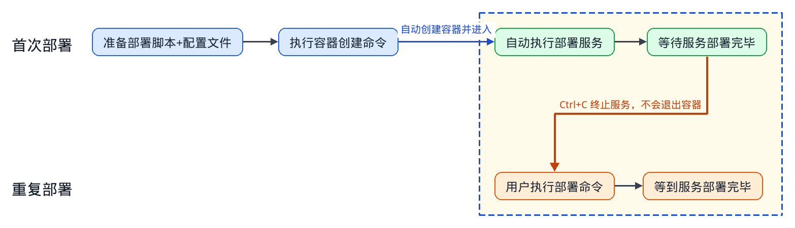

# 基于Docker的多容器服务部署

本文档指导用户基于Docker完成多容器推理服务的部署，不依赖K8s组件。如果使用小模型部署单容器推理服务，请参考[基于Docker的单容器服务部署指导](single_container.md)。

## 部署流程示意图

部署流程如下图所示：



**首次部署**：

- 部署前需要准备部署脚本和配置文件；
- 执行“容器创建命令”，系统会自动创建容器并进入容器内部；
- 系统在容器内自动执行部署服务，随后等待服务部署完毕；
- 若用户通过Ctrl+C终止服务，不会退出容器，而是回到可重新部署的状态。

**重复部署**：

- 在容器已存在的前提下，用户可直接执行部署命令；
- 系统再次等待服务部署完毕，完成新一轮部署。

## 准备镜像

通过以下方式获取镜像，并将镜像加载至集群的所有节点：

- 方式一：下载官方完整的MindIE Motor镜像

  进入[昇腾官方镜像仓库](https://www.hiascend.com/developer/ascendhub)，在搜索框输入`motor`，单击“mindie-motor”卡片，在“镜像下载”页签根据设备型号下载对应的MindIE Motor镜像。
- 方式二：在已有镜像中安装MindIE Motor

  基础镜像已安装CANN、vLLM、vLLM Ascend等组件，请参考[基于vllm-ascend/sglang镜像安装MindIE Motor](../../maintenance/build_motor_image_from_vllm_ascend.md#基于vllm-ascendsglang镜像安装mindie-motor) 额外安装MindIE Motor。

获取镜像后，请使用以下命令将镜像加载至服务器：

   ```bash
   docker load -i xxxx.tar
   ```

待镜像导入后，请使用以下命令查看Docker镜像是否存在：

   ```bash
   docker images
   ```

## 准备服务启动脚本

获取服务部署脚本`examples`目录：

- 方式一：下载官方完整的MindIE Motor镜像

  镜像内路径为`/tmp/motor/examples`，可执行以下命令获取：

     ```bash
     # 自定义一个存镜像名或镜像ID的变量IMAGE
     IMAGE="<镜像名或镜像ID>"
     # 创建一个未启动的临时容器，并记录容器ID
     cid=$(docker create "$IMAGE")
     # 把容器中/tmp/motor/examples目录复制到宿主机的当前目录
     docker cp "$cid:/tmp/motor/examples" ./examples
     # 删除以上创建的临时容器$cid，清理资源，避免残留无用容器
     docker rm "$cid"
     ```

- 方式二：在已有镜像中安装MindIE Motor

  git clone代码仓后，启动脚本位于`MindIE-Motor/examples`目录。

## 配置服务化参数

1. 准备配置文件。

   - PD分离场景

     MindIE Motor已提供常用模型（deepseek_v4_flash、deepseek_v4_pro、GLM 5.1等）的[PD分离配置示例](../../../../../model_configs/vllm/models/README.md)，用户修改少量配置后可直接使用。

     对于未提供典型配置的模型，请参考[MindIE Motor配置自动生成指导](../../../../../model_configs/vllm/models/README.md)，自动生成user_config.json与env.json配置文件。

   - PD混部场景

     请参考[MindIE Motor配置自动生成指导](../../../../../model_configs/vllm/models/README.md)，自动生成PD混部场景下的user_config.json与env.json配置文件。

2. 配置端口。

   修改以下配置，避免端口冲突，参数详细说明请参考[user_config.json配置文件全量参数说明](../../configuration/config_reference.md)：

   ```json
   {
     ...
     "motor_controller_config": {
       "api_config": {
         "controller_api_port": 2026,
         "observability_api_port": 2027
       }
     },
     ...
     "motor_engine_prefill_config": {
       "motor_nodemanger_config": {
         "api_config": { "node_manager_port": 3026 }
       },
       ...
     },
     "motor_engine_decode_config": {
       "motor_nodemanger_config": {
         "api_config": { "node_manager_port": 4026 }
       },
       ...
     }
   }
   ```

3. <a id="step0003"></a>同步启动脚本配置。

    将准备好的配置文件（user_config.json、env.json）存放于启动脚本的`model_configs/vllm`目录下，然后将整个配置脚本目录拷贝至集群中的每台服务器，1台服务器对应1份相同的脚本。

## 容器数量规划

完成user_config.json配置后，需根据`motor_deploy_config`确定推理实例名称及各实例对应的容器数量。同一`--instance-name`下的多个容器可部署在不同服务器，每个容器单独执行一次启动命令。管控容器与kv_store不计入推理容器数量。


1. 确定实例名称。

   `user_config.json`中`motor_deploy_config`的实例数量字段决定推理实例个数，并据此确定`--instance-name`。实例名称按角色从0起依次编号。

   **表 1** motor_deploy_config字段参数解释

   | 配置项 | 含义 | --role | --instance-name |
   | :--- | :--- | :--- | :--- |
   | p_instances_num | Prefill实例个数 | prefill | p0、p1、…、p{N-1} |
   | d_instances_num | Decode实例个数 | decode | d0、d1、…、d{N-1}` |
   | hybrid_instances_num | 混部实例个数 | union | u0、u1、…、u{N-1} |

   其中`N`为对应配置项的取值。例如`p_instances_num`为`2`时，Prefill实例名称为`p0`、`p1`。

   部署管理服务（`--role coordinator,controller`）及kv_store时，无需指定 `--instance-name`。

2. 确定单个实例对应的容器数量。

   `single_p_instance_pod_num`、`single_d_instance_pod_num`（混部场景为 `single_hybrid_instance_pod_num`）表示单个实例对应的容器数量。Docker多容器部署中，1个Pod对应1个容器，每个容器需单独执行一次 `docker_deploy.py`。

   **表 2** 容器数量说明

   | 配置项 | 说明 |
   | :--- | :--- |
   | single_p_instance_pod_num | 单个Prefill实例对应的容器数量。 |
   | single_d_instance_pod_num | 单个Decode实例对应的容器数量。 |
   | single_hybrid_instance_pod_num | 单个混部实例对应的容器数量。 |

   同一实例下的多个容器使用相同的`--instance-name`，`--container-name`不可重复，且可部署在不同服务器。

   Prefill推理容器总数 = `p_instances_num` × `single_p_instance_pod_num`。Decode、混部同理。

3. 配置示例。

   ```json
   {
     "motor_deploy_config": {
       "p_instances_num": 2,
       "d_instances_num": 1,
       "single_p_instance_pod_num": 1,
       "single_d_instance_pod_num": 2
     }
   }
   ```

   - Prefill为2个实例、2个容器，`--instance-name`分别为`p0`、`p1`。
   - Decode为1个实例、2个容器，`--instance-name`均为`d0`，可分别部署在不同服务器。

   **表 3** 参数解释

   | --container-name | --role | --instance-name |
   | :--- | :--- | :--- |
   | motor-p0 | prefill | p0 |
   | motor-p1 | prefill | p1 |
   | motor-d0-0 | decode | d0 |
   | motor-d0-1 | decode | d0 |

   每个容器在对应服务器上执行一次部署管理服务的命令。以Prefill实例`p0`为例：

   ```bash
   python3 docker_deploy.py --config_dir ../../model_configs/vllm \
     --container-name motor-p0 --devices 0 \
     --role prefill --instance-name p0 \
     --pod-ip <本机 IP地址> --nic-name <本机主网卡名称> \
     --coordinator-ip <coordinator管理服务所在服务器的 IP地址> \
     --controller-ip <controller管理服务所在服务器的 IP地址>
   ```

## 开启KV池化（可选）

不开启池化可跳过本节。

开启后，P/D通过`MultiConnector`同时做Prefill→Decode直传和KV入池；还需要单独部署一个**kv_store**容器（请参考[2.部署 KV Cache Store（仅开启池化时）](#step002)），更多详细内容请参考[KV池化能力](../../features/kv_cache_store/README.md)文档来修改user_config.json配置文件。

## PR/DT异构部署（可选）

全PR或全DT组网按普通流程部署即可，无需参考本节。

Ascend 950PR&DT系列产品分为PR、DT两类，两者的内存存在差异，DT的内存宽带更大、性能更好，更适合部署Decode；Prefill可部署在PR上。因此**PR+DT混合组网**时，需要把Prefill容器放到PR节点，Decode容器放到DT节点。

>[!NOTE] 说明
>
>- Docker部署没有调度器，异构完全由在哪台服务器上执行哪条命令决定，即与[容器数量规划](#容器数量规划)中按服务器分批部署是同一件事。
>- K8s专用的`npu_chip_name`字段（`motor_engine_prefill_config`/`motor_engine_decode_config`各一份）在当前部署方式中不生效（不会被读取，也不会告警），无需填写。
>- Docker部署不会校验角色与服务器形态是否匹配，把Prefill容器放到Ascend 950DT系列产品上不会报错（启动前只校验挂载的卡数），需人工保证。
>- 单容器模式下Prefill与Decode在同一个容器、同一台服务器上，无法分别落到PR和DT，所以单容器部署不支持异构组网。
>- `motor_engine_prefill_config`、`motor_engine_decode_config`等组件配置中的`image_name`仅在K8s部署中生效，Docker部署的容器镜像统一取`motor_deploy_config.image_name`。PR/DT需使用不同镜像时，须在各服务器上分别准备并指向不同的`--config_dir`（配置其余部分保持一致）。

1. 配置硬件类型。

   `hardware_type`字段统一填写`Ascend950`，Ascend 950PR系列产品和Ascend 950DT系列产品共用一份的`user_config.json`配置文件，因此[3.同步启动脚本配置](#step0003)中“1台服务器对应1份相同脚本”的方式在异构组网下依然成立。

   ```json
   {
     "motor_deploy_config": {
       "hardware_type": "Ascend950",
       ...
     }
   }
   ```

    >[!NOTE] 说明
    >Ascend 950PR&DT系列产品的`hardware_type`字段取值已收敛：850-Atlas-8p-8、950-SuperPod-Atlas-8、350-Atlas-16等旧取值不再支持，最新取值为`Ascend950`，否则启动时将报错：`Unknown hardware_type`。

2. 确认服务器形态。

   部署前须逐台确认服务器的形态（PR/DT），再按形态分配容器。

   - K8s场景下对应节点标签`huawei.com/npu.chip.name`，取值为`Ascend950PR`（PR）或 `Ascend950DT`（DT）。
   - 容器内已挂载`npu-smi`，可用`npu-smi info`命令查看本机NPU情况。

    >[!NOTE] 说明
    >容器重建、换机或手工增减实例时，请保持角色与服务器的对应关系如下：
    >- Prefill：PR
    >- Decode：DT

3. 按服务器形态分配角色。

   按[容器数量规划](#容器数量规划)确定实例名称后，再将容器分配到对应形态的服务器上。

   **表 4** 服务器形态说明

   | 服务器形态 | --role | --instance-name | --container-name（示例） |
   | :--- | :--- | :--- | :--- |
   | Ascend 950PR系列产品 | prefill | p0、p1、… | motor-p0 |
   | Ascend 950DT系列产品 | decode | d0、d1、… | motor-d0-0 |

   - 在Ascend 950PR系列产品上执行Prefill的启动命令：

      ```bash
      python3 docker_deploy.py --config_dir ../../model_configs/vllm \
        --container-name motor-p0 --devices 0 \
        --role prefill --instance-name p0 \
        --pod-ip <本机 IP地址> --nic-name <本机主网卡名称> \
        --coordinator-ip <coordinator管理服务所在服务器的 IP地址> \
        --controller-ip <controller管理服务所在服务器的 IP地址>
      ```

   - 在Ascend 950DT系列产品上执行Decode的启动命令：

      ```bash
      python3 docker_deploy.py --config_dir ../../model_configs/vllm \
        --container-name motor-d0-0 --devices 0 \
        --role decode --instance-name d0 \
        --pod-ip <本机 IP地址> --nic-name <本机主网卡名称> \
        --coordinator-ip <coordinator管理服务所在服务器的 IP地址> \
        --controller-ip <controller管理服务所在服务器的 IP地址>
      ```

   管理面（coordinator、controller）与kv_store不与卡类型绑定，按[启动服务](#启动服务)正常部署即可。

## 启用Render特性（可选）

修改以下配置可以开启Render特性。特性开启后，部署Coordinator管理面服务时，`docker_deploy.py`会在宿主机额外创建名为`{NAME}-vllm-render`的新容器（`{NAME}`即`--container-name`），并在其中运行vLLM Render服务。当用户终止服务时，请注意回收该容器。Render创建失败则不再创建主容器；主容器创建失败会删除本次启动的Render。

Docker场景下Coordinator与Render同生共死，容器内`--start`会`docker restart` Render兄弟容器；Coordinator退出（Ctrl+C/进程退出）时`docker stop`Render。Render首次就绪后，Coordinator持续对其`/health`心跳探测；连续失败则 Coordinator随Render一起退出。为此会把宿主机`/var/run/docker.sock`挂进Coordinator/单容器；已创建的旧容器需重建后才具备该挂载。

若该容器已经存在（例如先前已经`--create`），部署脚本不会覆盖它。进入容器后按其它角色同样的方式启动：

```bash
python3 /path/to/examples/deployer/docker_deploy.py --config_dir /path/to/model_configs/vllm --start --role render
```

也可单独创建Render容器（无NPU，host网络，与Controller相同模板）：

```bash
python3 /path/to/examples/deployer/docker_deploy.py --config_dir /path/to/model_configs/vllm --create --container-name <NAME>-vllm-render --role render
```

```json
{
  "motor_coordinator_config": {
    "render_config": {
      "enable": true
    }
  }
}
```

## 启动服务

1个完整的推理服务需要至少1个管理面容器以及多个推理容器。开启KV池化时，还需要1个`kv_store`容器。推理容器的数量、名称及所在服务器请参见[容器数量规划](#容器数量规划)，请按规划在对应服务器上分别执行。

1. 部署管理服务。

   在`examples/deployer`目录下，执行如下命令将管理面服务（coordinator、controller）部署在同一容器。

   ```bash
   python3 docker_deploy.py --config_dir ../../model_configs/vllm \
     --container-name motor-ctrl --role coordinator,controller \
     --pod-ip <本机 IP地址> --nic-name <本机主网卡名称>
   ```

   若需将Coordinator与Controller分容器部署，可执行以下命令。

   ```bash
   python3 docker_deploy.py --config_dir ../../model_configs/vllm \
     --container-name motor-ctrl --role controller \
     --pod-ip <本机 IP地址> --nic-name <本机主网卡名称> \
     --coordinator-ip <coordinator管理服务所在服务器的 IP地址>
   ```

   ```bash
   python3 docker_deploy.py --config_dir ../../model_configs/vllm \
     --container-name motor-coord --role coordinator \
     --pod-ip <本机 IP地址> --nic-name <本机主网卡名称> \
     --controller-ip <controller管理服务所在服务器的IP地址>
   ```

   上述命令执行后，窗口将自动创建容器、进入容器以及启动管理服务，用户在屏幕上可观察到日志打印。

   >[!NOTE] 说明
   >开启池化时，以上管理面命令需要额外增加`--kv-store-ip`参数，示例如下：
   >
   >```text
   >--kv-store-ip <kv_store所在服务器的IP地址>
   >```

2. <a id="step002"></a>（可选）部署KV Cache Store，仅开启池化时需要执行该步骤。

   **未开启池化时请跳过此步骤**。

   选择任意一台服务器，在`examples/deployer`目录下执行以下命令：

   ```bash
   python3 docker_deploy.py --config_dir ../../model_configs/vllm \
     --container-name motor-kvs --role kv_store \
     --pod-ip <本机 IP地址> --nic-name <本机主网卡名称> \
     --coordinator-ip <coordinator管理服务所在服务器的IP地址> \
     --controller-ip <controller管理服务所在服务器的IP地址>
   ```

   上述命令执行后，窗口将自动创建容器、进入容器以及启动kv_store（Mooncake后端会启动`mooncake_master`，默认监听**50088**）。由于该容器不需要挂载NPU，所以不需要传`--devices`。

3. 部署推理服务。

   执行以下命令可完成1个Prefill容器的部署：

   ```bash
   python3 docker_deploy.py --config_dir ../../model_configs/vllm \
     --container-name motor-p0 --devices 0 \
     --role prefill --instance-name p0 \
     --pod-ip <本机 IP地址> --nic-name <本机主网卡名称> \
     --coordinator-ip <coordinator管理服务所在服务器的IP地址> \
     --controller-ip <controller管理服务所在服务器的IP地址>
   ```

   执行以下命令可完成1个Decode容器的部署：

   ```bash
   python3 docker_deploy.py --config_dir ../../model_configs/vllm \
     --container-name motor-d0-0 --devices 0 \
     --role decode --instance-name d0 \
     --pod-ip <本机 IP地址> --nic-name <本机主网卡名称> \
     --coordinator-ip <coordinator管理服务所在服务器的IP地址> \
     --controller-ip <controller管理服务所在服务器的IP地址>
   ```

   >[!NOTE] 说明
   >开启池化时，以上Prefill/Decode两条命令同样需要加上`--kv-store-ip`参数：
   >
   >```text
   >--kv-store-ip <kv_store 所在服务器的 IP地址>
   >```

   **表 5** Prefill/Decode容器的部署命令参数解释

   | 参数 | 说明 |
   | :--- | :--- |
   | --config_dir | user_config.json和env.json所在目录。 |
   | --container-name | 容器名，可自定义。 |
   | --role | 容器中运行服务的角色。<ul><li>管理服务：coordinator,controller；</li><li>推理服务：prefill或decode；</li><li>池化：kv_store。</li></ul> |
   | --instance-name | 推理实例名，如：p0、d0。<br>用于标识当前容器启动的服务归属于哪一个实例。同一实例的多个容器使用相同名称，详情请参考[容器数量规划](#容器数量规划)。 |
   | --devices | 创建服务的容器挂载的NPU卡号（例如：0，1，2，3）。不填写时，按硬件类型挂载模板中的全部卡：<ul><li>Atlas 800I A2推理服务器/Ascend 950PR系列产品：0–7；</li><li>Atlas 800I A3超节点服务器：0–15。</li></ul>管理面和kv_store不传该参数。 |
   | --pod-ip | 当前服务器的IP地址。<br>可执行`ip -4 route get 1.1.1.1`命令查看，`src`字段后面是`--pod-ip`值。 |
   | --nic-name | 当前服务器对应`--pod-ip`的网卡名。<br>可执行`ip -4 route get 1.1.1.1`命令查看，`dev`字段后面是`--nic-name`值。 |
   | --coordinator-ip/--controller-ip | Coordinator/Controller所在服务器的IP。部署推理服务、kv_store时填写。分容器部署管理服务时，Controller填写`--coordinator-ip`，Coordinator填写`--controller-ip`。 |
   | --kv-store-ip | kv_store所在服务器的IP地址。开启池化后，部署管理面（coordinator/controller）和Prefill/Decode时必填。`--role kv_store`可省略，默认使用`--pod-ip`。 |

   上述命令执行后，窗口将自动创建容器、进入容器以及启动推理服务，用户在屏幕上可观察到日志打印。

## 推理验证

在**部署管理服务的服务器上**发送如下推理请求，即可进行推理验证：

```bash
curl -X POST http://<coordinator管理服务所在服务器的IP地址>:1025/v1/chat/completions \
  -H "Content-Type: application/json" \
  -d '{
    "model": "<模型名称，必须和user_config.json文件中的配置一致>",
    "messages": [{"role": "user", "content": "who are you?"}],
    "max_tokens": 36,
    "stream": true
  }'
```

若返回以下内容，表示服务尚未就绪，可稍后重试。

```Output
{"detail":"Service is not available"}
```

开启池化后，请再用长prompt（不少于128 token，建议500+）发一次请求。`AscendStoreConnector`按128 token一块入池，短句不会put，不能用来判断池化是否生效。

请求成功后，在kv_store容器对应的workspace日志中查看`Keys`：由0变为大于0即表示block已入池。日志路径示例：

```text
examples/motor_workspace/motor-kvs/kvs/log/docker-kv_store-<时间戳>.log
```

## 终止服务与重复部署

在终端执行`Ctrl+C`可终止服务，但不会退出容器。服务终止后会出现如下提示，便于用户重新部署。

```text
容器内服务已终止，可执行以下命令重新部署服务。
python3 /path/to/examples/deployer/docker_deploy.py --config_dir /path/to/model_configs/vllm --start --container-name motor-ctrl --role coordinator,controller --pod-ip <本机IP地址> --nic-name <本机主网卡名称>
运行日志：examples/motor_workspace/motor-ctrl/ctrl/log/docker-coordinator-controller-<时间戳>.log
```

用户可直接复制上述指令重新部署服务。开启池化时，kv_store容器同样使用`Ctrl+C`停止，重启命令中的`--role`为`kv_store`。

## 调优指导

### 如何调整容器挂载

部署脚本会为用户自动创建容器，容器将自动挂载用户的服务启动脚本以及权重文件的路径。如需自定义容器的创建指令，可以手动调整 `examples/deployer/lib/constant.py` 文件中的 docker-run 模板。

### 同一服务器部署多个推理容器时错开端口

同一服务器上部署多个推理容器时，须先通过`--devices`为本容器分配NPU，再规划并错开本容器端口。

`--devices`填写本容器使用的卡号。同一服务器上的多个推理容器须使用不同卡号，卡数须与该容器所需NPU数量一致。

错开端口时，在启动命令中增加下列参数：

| 参数 | 说明 |
| :--- | :--- |
| --node-manager-port | 实际运行时的NodeManager端口，用于引擎节点管理。 |
| --data-parallel-rpc-port | 实际运行时的数据并行RPC端口。 |
| --kv-port | 实际运行时的KV传输端口。 |
| --base-port | 实际运行时的引擎端点起始端口。 |

以Decode实例d0的2个容器部署在同一服务器为例。2个容器分别使用卡0与卡1，端口规划如下：

| --container-name | --devices | --node-manager-port | --data-parallel-rpc-port | --base-port |
| :--- | :--- | :--- | :--- | :--- |
| motor-d0-0 | 0 | 4026 | 9000 | 10000 |
| motor-d0-1 | 1 | 4126 | 9100 | 11000 |

执行以下命令部署容器`motor-d0-0`：

```bash
python3 docker_deploy.py --config_dir ../../model_configs/vllm \
  ... \
  --devices 0 \
  ... \
  --node-manager-port 4026 \
  --data-parallel-rpc-port 9000 \
  --base-port 10000
```

执行以下命令部署容器`motor-d0-1`：

```bash
python3 docker_deploy.py --config_dir ../../model_configs/vllm \
  ... \
  --devices 1 \
  ... \
  --node-manager-port 4126 \
  --data-parallel-rpc-port 9100 \
  --base-port 11000
```

>[!NOTE] 说明
>开启池化时，以上命令分别增加不同的`--kv-port`，例如`21000`与`22000`。未开启池化不要传`--kv-port`。
