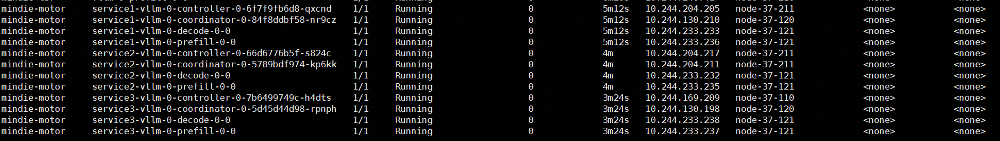
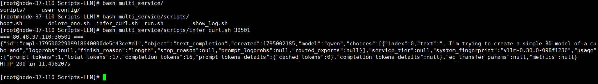
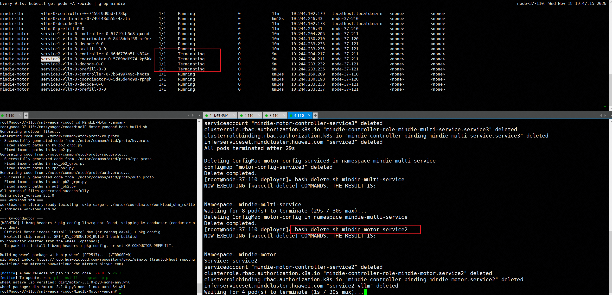

# 同一 namespace 部署多套服务

本文说明如何在同一个 Kubernetes namespace 里部署多套互相独立的 Motor 服务。只适用于默认部署方式 `infer_service_set`。单套的拉起步骤仍按 [PD 分离服务部署](../README.md#k8s-pd-disaggregation) 或 [PD 混部服务部署](./pd_aggregation_deployment.md) 执行，本文只说明第二套怎么配、怎么访问、怎么卸载。

`multi_deployment`、`single_container`、Docker 和 Slurm 不分配服务序号，资源名与原来一致。

## 服务如何区分

不需要新增配置字段。`job_id` 仍然是 namespace。每次执行 `deploy.py`，部署器读取该 namespace 里已经存在的序号，分配「最大号 + 1」。空 namespace 的第一套是 `service1`。配置里如果写了 `service_name`，部署器会忽略它。

序号加在模板原名前，原名保留。默认模板的 InferServiceSet 名是 `vllm`，因此 Pod 形如：

| 角色 | Pod 名 |
| --- | --- |
| Controller | `service1-vllm-0-controller-0-<hash>` |
| Coordinator | `service1-vllm-0-coordinator-0-<hash>` |
| Prefill | `service1-vllm-0-prefill-0-0` |
| Decode | `service1-vllm-0-decode-0-0` |

同一 namespace 的第二套是 `service2-vllm-0-*`，第三套是 `service3-vllm-0-*`。另一个 namespace 从自己的 `service1` 重新开始。已经部署、名字里没有 `serviceN-` 的 Pod 不会被改名。

每套服务还有自己的：

| 对象 | 名称 |
| --- | --- |
| InferServiceSet | `serviceN-vllm` |
| ConfigMap | `motor-config-serviceN` |
| 归属标签 | `motor.mindie.io/service=serviceN` |
| 清单目录 | `examples/deployer/output_yamls/<namespace>/serviceN` |

推理入口、配置和卸载都按这套名字收口。一套服务的入口不会选到另一套的 Pod。

## 部署下一套

以下命令在 K8s 管理节点、`examples/deployer` 目录执行。第一套已经在 `mindie-motor` 中就绪。

1. 复制第一套的 `user_config.json` 到单独的目录，避免覆盖第一套正在使用的配置。`job_id` 保持为同一个 namespace。

2. 为第二套填写三个互不相同的 NodePort。NodePort 在整个集群内不能重复，范围是 30000–32767。三个字段必须一起写；都不写时沿用模板端口 `31015`、`31017`、`31027`，第二套会和第一套冲突。

    ```json
    "motor_deploy_config": {
      "job_id": "mindie-motor",
      "coordinator_infer_node_port": 31025,
      "coordinator_obs_node_port": 31037,
      "controller_observability_node_port": 31047
    }
    ```

    | 字段 | 用途 | 模板默认 |
    | --- | --- | --- |
    | coordinator_infer_node_port | 推理入口 | 31015 |
    | coordinator_obs_node_port | Coordinator 可观测端口 | 31017 |
    | controller_observability_node_port | Controller 可观测端口 | 31027 |

3. 启动第二套。部署器分配 `service2`，不会覆盖 `service1`。

    ```bash
    cd examples/deployer
    python3 deploy.py --config_dir <第二套配置目录>
    ```

    启动第二套服务时也会执行[部署前安全预检](README.md#deployment-security-precheck)。请在第二套配置中启用推理 TLS 和管理 API Key 认证。仅在隔离测试环境需要沿用现有配置时，可在启动命令末尾追加 `--skip-check`。

4. 确认两套都在，且名字不重叠。

    ```bash
    kubectl get pods -n mindie-motor -o wide
    kubectl get pods -n mindie-motor -l motor.mindie.io/service=service2
    ```

5. 向第二套自己的推理 NodePort 发请求。端口使用第二套的 `coordinator_infer_node_port`。

    启用推理 TLS 时，请按[HTTPS 验证方式](README.md#verify-inference-tls)使用第二套服务证书覆盖的域名或 IP 及对应的 CA。以下 HTTP 示例适用于推理 TLS 关闭的隔离测试环境，其中 `<node_ip>` 是集群节点 IP。

    ```bash
    curl -X POST http://<node_ip>:31025/v1/chat/completions \
      -H "Content-Type: application/json" \
      -d '{
        "model": "<served_model_name>",
        "messages": [{"role": "user", "content": "你是谁？"}],
        "max_tokens": 64,
        "stream": false
      }'
    ```

再部署第三套时重复以上步骤，端口再换一组未占用的值。部署器会分配 `service3`。

## 卸载

卸载命令必须在 `examples/deployer` 目录执行，这样脚本才能找到当时生成的清单。

只卸载一套：

```bash
bash delete.sh mindie-motor service2
```

该命令删除 `service2` 的清单、带标签 `motor.mindie.io/service=service2` 的 Pod，以及 ConfigMap `motor-config-service2`。`service1` 和其他套继续运行。对应的 `output_yamls/mindie-motor/service2` 不存在时，命令报错并停止，不会改成卸载整个 namespace。

卸载这个 namespace 里的全部服务：

```bash
bash delete.sh mindie-motor
```

不带第二个参数时，会删除该 namespace 下每一套的清单、Pod，以及 `motor-config` 和 `motor-config-serviceN`。

## 结果示例

以下截图来自默认 namespace `mindie-motor` 的一次部署。三套服务同时处于 `1/1 Running`，Pod 名分别为 `service1-vllm-0-*`、`service2-vllm-0-*`、`service3-vllm-0-*`。



向 `service1` 的推理入口 `30501` 发送补全请求，返回 HTTP 200，模型为 `qwen`。本次使用的端口是单独配置的 30501，不是模板默认的 31015。



随后执行 `bash delete.sh mindie-motor service2`。`service2` 的四个 Pod 进入 `Terminating`，`service1` 和 `service3` 仍为 `Running`。同一张图的下半部分还包含一次不带服务名的 `bash delete.sh mindie-multi-service`，该命令卸载的是另一个 namespace 里的整套对象。



## 使用限制

- `serviceN` 只区分同一 namespace 里的部署对象，不代替 Kubernetes 的权限、配额或网络隔离。
- `show_log.sh` 按 namespace 收集日志。同 namespace 多套服务的日志会写到同一次采集目录。
- `python3 deploy.py --update_scaling_policy` 要求该 namespace 里只有一个 InferServiceSet。多于一个时命令报错退出，不会选择其中一套修改。
- 两个部署同时对同一个空 namespace 执行时，可能读到同一个序号。请等前一次部署完成后再启动下一次。
