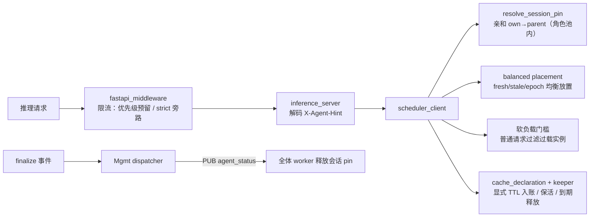

# Agent Hint 会话亲和与调度

## 特性介绍

Agent Hint 特性让 Coordinator 识别 Agent 框架通过 `X-Agent-Hint` 请求头下发的会话提示，把同一会话（及其派生子会话）的推理请求粘滞到同一实例以复用 KV Cache、为并发新建会话做负载均衡放置、为高优先级请求提供准入预留，并在会话结束（finalize）时释放亲和绑定与缓存保留声明。

**收益**：

- 多轮对话、多 Agent 协作场景下同一会话/父子会话复用同一实例的 KV Cache，减少重复 prefill，降低 TTFT；
- 并发新建会话 burst 按“钉扎会话数 + 在途负载 + 单调计数”摊匀落点，避免请求在少数实例上聚集被粘滞放大；
- 服务过载时，高优先级请求仍能穿透限流预留、豁免软负载门槛，保障关键链路；
- 会话生命周期（running/tool/pause/suspend/finalize）可上报并驱动亲和 pin 的释放，长连接场景不再依赖 LRU 兜底。

该功能具有以下特点：

- 默认关闭：全部新行为由环境变量/配置段门控，不开启时基线调度行为零变化。
- 客户端依赖：需在 Agent 框架（harness）侧安装并启用对应 agent-hint 插件发送 `X-Agent-Hint`；Motor 侧不主动探测。
- 兼容性：畸形 hint 只记录 WARN 并丢弃，通常不会因 hint 解析失败而中断推理请求。
- 无额外依赖，可与其他特性共存；引擎侧不下发 hint，本特性只作用于 Coordinator 调度。

### 工作原理



1. **入口解码**：Coordinator 从 `X-Agent-Hint`（base64url JSON）解码会话、优先级、状态等提示；该头是 spec 字段的唯一合法通道。
2. **亲和解析**：按 `(role, session_id)` 查询亲和表，命中则回到原实例；自身无 pin 时按角色池内父会话 pin 传播；epoch 变更（上下文重写）会使旧 pin 失效。
3. **新建放置**：`fresh/stale/epoch` 决策可选择均衡放置，按钉扎会话数、在途负载、进程内单调计数三元组选择实例，决策时即提交 pin。
4. **优先级准入**：限流器按 `priority_reserve_ratio` 预留额度，普通请求消费下限为预留值，高优先级请求可穿透；调度侧 `priority_load_threshold` 过滤过载实例，过滤后无可用实例时回退原实例列表，不影响请求正常调度。
5. **生命周期**：`/agent-status` 带外事件驱动会话状态机；`finalize` 通过本地释放 + PUB 广播释放全体 worker 的该会话 pin；显式 `cache_control.ttl_s` 声明到期后释放 pin 并触碰保活。

`X-Agent-Hint` 请求头（base64url 编码 JSON，可省略填充）常用字段：

| 字段 | 说明 |
| --- | --- |
| `session.session_id` | 会话标识（稳定），用于亲和与父会话传播。 |
| `session.parent_session_id` | 父会话标识，子 agent 复用父会话实例。 |
| `session.epoch` | 上下文版本（重写/压缩时递增），变更使旧 pin 失效。 |
| `priority.level` / `priority.reason` | 软优先级等级与原因，进入 `prio=` / `reason=` 审计日志。 |
| `strict_priority.level` | 硬优先级；仅在 `X-Strict-Priority-Token` 校验通过后生效。 |
| `cache_control.ttl_s` | 显式保留声明（秒，钳制 [60, 3600]），进入亲和生命周期。 |
| `agent_status.state` | 会话状态：`running`/`tool`/`pause`/`suspend`/`finalize`。 |

### 核心功能

| 功能 | 说明 |
| --- | --- |
| 会话亲和 | 键为 `(role, session_id)`，P/D 角色池互相隔离；epoch 失效感知（仅当存储与请求的 epoch 均存在且不一致时才失效，不带 epoch 的客户端不受影响）；父会话 pin 传播避免子会话重复 prefill。 |
| 均衡放置 | `fresh/stale/epoch` 决策按（钉扎会话数，在途负载，单调计数）字典序选实例；`MOTOR_SESSION_AFFINITY_PLACEMENT=balanced` 开启。 |
| 共享亲和表 | `MOTOR_SESSION_AFFINITY_SHARED=1` 时亲和表落 `/dev/shm`，多 worker 进程、重启后仍可见。 |
| 优先级准入 | 限流预留 `rate_limit_config.priority_reserve_ratio` + 调度软负载门槛 `scheduler_config.priority_load_threshold`，`priority_admission_level` 为分界等级。 |
| strict 信任门 | `X-Strict-Priority-Token` 命中 `strict_priority_config.tokens` 才可信；可信请求全局旁路限流、完全豁免软负载门槛。 |
| agent_status 通道 | `POST /agent-status` 上报、`GET /agent-status?session_id=` 查询；finalize 释放会话亲和 pin。 |
| cache_control 生命周期 | 仅显式 TTL 声明入账；到期条件释放、未到期触碰保活；`finalize` 协同不二次释放。 |

### 约束与限制

| 维度 | 说明 |
| --- | --- |
| 硬件 | 无额外硬件限制，已验证适配以下产品：<ul><li>Atlas 800I A2 推理服务器</li><li>Atlas 800I A3 超节点服务器</li><li>Ascend 950PR&amp;DT 系列产品</li></ul> |
| 部署场景 | 作用在 Coordinator 推理面；PD 分离、PD 混部、Coordinator 独立部署均可用。 |
| 引擎 | 与推理引擎类型无关；本阶段 hint 只影响调度与亲和，不下发引擎、不改变引擎 KV 驱逐策略。 |
| 特性互斥 | 无，可在既有基线上增量开启。 |
| 软件依赖 | 无额外依赖。`MOTOR_SESSION_AFFINITY_SHARED=1` 依赖容器内 `/dev/shm` 可写。 |
| 客户端依赖 | 需在 Agent 框架（harness）侧安装并启用对应 agent-hint 插件（DSH/LangChain/Hermes/Pi/Dify，见[对接 Agent 框架](#对接-agent-框架harness-插件)）。 |
| 其他限制 | <ul><li>环境变量在 Coordinator 进程启动时读取，修改后需重启 Coordinator 生效。</li><li>`X-Agent-Hint` 仅支持请求头通道（请求体 `agent_hint` 为冻结的 legacy 通道，spec 字段不进入 body）。</li><li>`cache_control` 生命周期交付的是 **affinity TTL**（路由表与 pin 生命周期），不是引擎 KV 驻留保证：pin 存在时 KV 仍可能被引擎驱逐，pin 删除后 KV 也可能仍驻留。</li><li>ZMQ PUB 事件不排队，worker 未就绪时可能漏收 finalize，残留 pin 由 epoch/stale/LRU 兜底。</li><li>畸形 hint / 畸形 `/agent-status` 字段只 WARN + 丢弃（HTTP 200 + `applied=false`），不会使请求失败。</li></ul> |

## 特性使用

### 环境准备

- 已使用 MindIE Motor 完成基础推理服务部署，服务运行正常，参考 [服务部署](../deployment/README.md)。
- 所有开关通过 Coordinator 的环境变量与 `user_config.json` 配置。K8s/Helm 场景将环境变量写入 `env.json` 的 `motor_coordinator_env`（ConfigMap `user-config` 内或 Helm `envConfig`）；Docker 场景写入 `env.json` 后由 deployer 注入。
- 修改环境变量后需重启 Coordinator；`user_config.json` 中的新增配置段均有默认值，热更新行为见各小节说明。
- 使用共享亲和表（`MOTOR_SESSION_AFFINITY_SHARED=1`）时，确认 Coordinator 容器内 `/dev/shm` 可写（默认可用）。
- 已在 Agent 框架（harness）侧安装并启用对应的 agent-hint 插件（见[对接 Agent 框架](#对接-agent-框架harness-插件)），否则请求不会携带 `X-Agent-Hint` 与会话状态信号。

### 对接 Agent 框架（harness 插件）

Motor 侧只提供消费端能力：解析 `X-Agent-Hint` 请求头、接收 `/agent-status` 带外事件。**hint 信号由 Agent 框架（harness）侧的 agent-hint 插件产生**——插件在主线模型请求上按请求注入 `X-Agent-Hint`（base64url 编码 JSON，含会话标识、优先级、缓存保留声明等），并可选通过带外通道上报会话生命周期事件到 `/agent-status`。插件只增加一个 HTTP 请求头、不改动请求体与系统提示（不改变模型可见负载），也不修改 harness 源码。

未安装插件时，请求不带任何 hint，Motor 按基线调度处理（`aff=none`、无优先级与缓存声明），行为与默认配置一致。各 harness 对应的插件如下：

| Agent 框架 | 插件仓库 | 说明 |
| --- | --- | --- |
| DSH（DeepSeek Harness） | <https://github.com/evan7ang/dsh-agent-hints> | 注册独立 provider 路由 `deepseek-hint`，无需修改 harness 源码 |
| LangChain | <https://github.com/evan7ang/langchain-agent-hints> | `AgentMiddleware` 中间件（含状态事件上报），PyPI 可安装 |
| Hermes | <https://github.com/dachaimahogany/hermes-agent-hint> | `llm_request` 中间件，默认关闭；要求 Hermes ≥ 0.21.6 |
| Pi | <https://github.com/Eric1481/pi-agenthint> | `pi install npm:pi-agenthint`；需 Node.js ≥ 22.19、Pi 1.1.0 |
| Dify | <https://github.com/tree-zby/agent-hints> | Dify 平台的 OpenAI 兼容模型 provider 插件 |

> 同一 harness 不要同时启用多个 agent-hint 生产者：它们会争用同一个 `X-Agent-Hint` 头，个别插件（如 Pi）与内置实现共存时会拒绝覆盖。以上为社区/harness 侧插件，非 Ascend 官方组件。

### 使用场景

- **多轮 / 多 Agent 会话粘滞**：同一会话多次调用、父子 agent 协作，期望复用实例侧 KV Cache，减少重复 prefill。
- **并发新建会话 burst**：短时间内大量新会话到达，常规策略无记忆导致落点倾斜，期望摊匀到各实例。
- **过载下优先级准入**：服务接近容量上限时，期望关键请求可穿透预留额度、避开过载实例。
- **会话生命周期管理**：Agent 框架希望会话结束时立即释放缓存亲和，而不是等待 LRU 自然淘汰。

### 使用样例

以下开关可独立启用，按需组合。`user_config.json` 新增段均为可选、有默认值，未配置时保持关闭。

1. 开启会话亲和（默认放置策略）。

   在 `env.json` 的 `motor_coordinator_env` 中增加：

   ```json
   {
     "motor_coordinator_env": {
       "MOTOR_SESSION_AFFINITY": "1"
     }
   }
   ```

   环境变量说明：

   | 环境变量 | 含义 | 默认 |
   | --- | --- | --- |
   | `MOTOR_SESSION_AFFINITY` | 会话亲和总开关。 | 关 |
   | `MOTOR_SESSION_AFFINITY_MAX` | 亲和表容量（LRU 上限）。 | 65536 |
   | `MOTOR_SESSION_AFFINITY_SHARED` | 亲和表落 `/dev/shm`（跨 worker/重启可见）。 | 关 |
   | `MOTOR_SESSION_AFFINITY_SHM_KEY` | 共享表键（多 Coordinator 共享同一 `/dev/shm` 时区分）。 | `default` |
   | `MOTOR_SESSION_AFFINITY_PLACEMENT` | fresh 放置策略：`policy`（默认）或 `balanced`。 | `policy` |

   重启 Coordinator 使配置生效，两种方式如下所示：

   - K8s 部署场景：删除 Coordinator Pod 触发重建。

     ```bash
     kubectl delete pod <coordinator-pod> -n <namespace>
     ```

     - `coordinator-pod`：Coordinator 的 Pod 名称。
     - `namespace`：Coordinator Pod 所在的命名空间。

   - Docker 部署场景：重启 Coordinator 容器。

     ```bash
     docker restart <coordinator-container>
     ```

     - `coordinator-container`：Coordinator 容器名称或容器 ID。

2. 开启均衡放置与共享表（推荐）。

   多 worker 进程部署建议同时开启共享表，否则各 worker 只能看到自己记录的 pin：

   ```json
   {
     "motor_coordinator_env": {
       "MOTOR_SESSION_AFFINITY": "1",
       "MOTOR_SESSION_AFFINITY_SHARED": "1",
       "MOTOR_SESSION_AFFINITY_PLACEMENT": "balanced"
     }
   }
   ```

3. 开启优先级准入（软优先级）。

   「软优先级」指客户端通过 `X-Agent-Hint` 的 `priority.level` 声明的提示性优先级（无需鉴权），用于穿透限流预留额度、豁免调度软负载门槛。

   在 `user_config.json` 的 `motor_coordinator_config` 中配置限流预留与调度软负载门槛：

   ```json
   {
     "motor_coordinator_config": {
       "rate_limit_config": {
         "enable_rate_limit": true,
         "max_requests": 1000,
         "window_size": 60,
         "priority_reserve_ratio": 0.2
       },
       "scheduler_config": {
         "priority_load_threshold": 8192,
         "priority_admission_level": 3
       }
     }
   }
   ```

   | 配置项 | 类型 | 默认值 | 说明 |
   | --- | --- | --- | --- |
   | `rate_limit_config.priority_reserve_ratio` | float | `0.0` | 预留比例，取值 [0, 0.9]，`0` 关闭；普通请求消费下限为预留额度，`priority >= priority_admission_level` 的请求可穿透。 |
   | `scheduler_config.priority_load_threshold` | int | `0` | 端点负载评分门槛，`0` 关闭；普通请求过滤“评分 ≥ 门槛”的实例，过滤后为空则回退原列表（不会因此拒绝请求）。 |
   | `scheduler_config.priority_admission_level` | int | `3` | 高优先级分界，限流与调度共用的唯一配置源。 |

   客户端通过 `X-Agent-Hint` 的 `priority.level` 声明等级。`priority_reserve_ratio` 支持热更新（`max_requests`/`window_size`/`priority_reserve_ratio` 均可运行时重载）。

4. 开启 strict_priority 信任门（硬优先级）。

   「硬优先级」指受信任的 `strict_priority`：请求需携带与 `strict_priority_config.tokens` 匹配的 `X-Strict-Priority-Token`，校验通过后全局旁路限流并完全豁免软负载门槛。

   配置信任门如下：

   ```json
   {
     "motor_coordinator_config": {
       "strict_priority_config": {
         "enabled": true,
         "tokens": ["<your-control-plane-token>"]
       }
     }
   }
   ```

   | 配置项 | 类型 | 默认值 | 说明 |
   | --- | --- | --- | --- |
   | `strict_priority_config.enabled` | bool | `false` | 信任门开关；开启时 `tokens` 必须非空，否则启动校验报错。 |
   | `strict_priority_config.tokens` | list[str] | `[]` | 可信 token 列表（bootstrap 静态凭据）。 |

   客户端请求同时携带 `X-Agent-Hint: {"strict_priority": {"level": 3}}` 与 `X-Strict-Priority-Token: <token>`。校验通过后该请求全局旁路限流（不消耗令牌、不受限流拒绝）、完全豁免软负载门槛；未通过则入口剥离 `strict_priority`（置空 + WARN），不会出现“未鉴权但被消费”的路径。

5. 开启 agent_status 带外通道。

   ```json
   {
     "motor_coordinator_config": {
       "agent_status_config": {
         "enabled": true,
         "session_ttl_s": 3600,
         "max_sessions": 65536,
         "require_infer_auth": false
       }
     }
   }
   ```

   | 配置项 | 类型 | 默认值 | 说明 |
   | --- | --- | --- | --- |
   | `agent_status_config.enabled` | bool | `false` | 是否注册 `/agent-status` 端点并启用状态机（**启动时生效**，不支持热更新）。 |
   | `agent_status_config.session_ttl_s` | int | `3600` | 会话记录 TTL（秒，>0），可热更新。 |
   | `agent_status_config.max_sessions` | int | `65536` | 状态机有界容量（>0），可热更新。 |
   | `agent_status_config.require_infer_auth` | bool | `false` | `true` 时 `/agent-status` 从 API-key 与限流 skip 集移除，继承推理面双门。 |

   开启后推理面新增：

   - `POST /agent-status`：上报会话状态事件 `{"session": {"session_id": "s-1"}, "agent_status": {"state": "running"}}`；
   - `GET /agent-status?session_id=s-1`：查询当前状态记录。

   `finalize` 状态会释放该会话的亲和 pin（本地即时生效 + PUB 广播至全体 worker）。

6. 开启 cache_control 声明生命周期。

   ```json
   {
     "motor_coordinator_env": {
       "MOTOR_CACHE_CONTROL_LIFECYCLE": "1",
       "MOTOR_CACHE_CONTROL_SWEEP_INTERVAL_S": "5"
     }
   }
   ```

   | 环境变量 | 含义 | 默认 |
   | --- | --- | --- |
   | `MOTOR_CACHE_CONTROL_LIFECYCLE` | 声明生命周期总开关。 | 关 |
   | `MOTOR_CACHE_CONTROL_MAX` | 声明表容量。 | 65536 |
   | `MOTOR_CACHE_CONTROL_TTL_MAX_S` | TTL 上限钳制（秒）。 | 3600 |
   | `MOTOR_CACHE_CONTROL_SWEEP_INTERVAL_S` | keeper 周期（秒，下限 1s）。 | 5 |

   仅当客户端**显式**携带 `cache_control.ttl_s`（或 legacy `ttl`）时声明才入账；声明到期释放 pin，未到期由 keeper 触碰保活。

7. 客户端请求示例。

   `X-Agent-Hint` 为 base64url 编码的 JSON 对象（可省略 `=` 填充）。可用如下命令生成：

   ```bash
   HINT=$(python3 - <<'PY'
   import base64, json
   payload = {
       "session": {"session_id": "s-1001", "parent_session_id": "s-1000", "epoch": 1},
       "priority": {"level": 3, "reason": "critical_path"},
       "cache_control": {"type": "pin", "ttl_s": 600}
   }
   print(base64.urlsafe_b64encode(json.dumps(payload).encode()).decode().rstrip("="))
   PY
   )
   ```

   携带 hint 发起推理：

   ```bash
   curl http://<coordinator_ip>:<port>/v1/chat/completions \
     -H "Content-Type: application/json" \
     -H "X-Agent-Hint: ${HINT}" \
     -d '{
         "model": "<model_name>",
         "messages": [{"role": "user", "content": "你好"}],
         "max_tokens": 64,
         "temperature": 0
     }'
   ```

   使用硬优先级时追加请求头：

   ```bash
   -H "X-Strict-Priority-Token: <your-control-plane-token>"
   ```

### 验证特性

1. **查看调度日志**：会话亲和与优先级信息追加在 `scheduled` 行：

   ```bash
   kubectl logs -n <namespace> <coordinator-pod> | grep "scheduled role="
   ```

   关注新增字段：

   ```text
   ... prio=<level> aff=<hit|parent|fresh|stale|epoch|none|-> reason=<...> sp=<level>
   ```

   - 同一 `session_id` 第二次请求应出现 `aff=hit`（子会话复用父实例为 `aff=parent`）；
   - 新建会话（`fresh`）在均衡放置下应出现 affinity INFO 行 `placement=balanced`；
   - 携带 hint 的请求应能看到 `prio=` / `reason=` 回填；可信硬优先级请求 `sp=` 非空。

2. **验证会话粘滞**：对同一 `session_id` 连续发送两次请求，两次应调度到相同 `instance=`（`aff=hit`）。

3. **验证 finalize 释放**：先让会话命中 `aff=hit`，再上报 finalize：

   ```bash
   curl http://<coordinator_ip>:<port>/agent-status \
     -H "Content-Type: application/json" \
     -d '{"session": {"session_id": "s-1001"}, "agent_status": {"state": "finalize"}}'
   ```

   预期返回 HTTP 200 且 `applied=true`；随后同 `session_id` 请求应回到 `aff=fresh`。查询状态：

   ```bash
   curl "http://<coordinator_ip>:<port>/agent-status?session_id=s-1001"
   ```

4. **验证优先级预留**：开启预留后，把普通流量打到接近 `max_requests`，普通请求开始返回 HTTP 429，而带 `priority.level >= priority_admission_level` 的请求仍返回 200。

5. **验证共享表可跨 worker**：开启 `MOTOR_SESSION_AFFINITY_SHARED=1` 后，多 worker 部署下同一会话在不同 worker 命中应保持一致（日志 `aff=hit`）。若亲和表降级为进程内，日志会提示 `shared session affinity table unavailable ... falling back to in-process table`。

## 调优建议

| 场景 | 关键参数 | 建议取值 | 说明 |
| --- | --- | --- | --- |
| 多轮会话复用优先 | `MOTOR_SESSION_AFFINITY` + `MOTOR_SESSION_AFFINITY_SHARED` | 均开启 | 共享表保证多 worker/重启后粘性，否则单 worker 内才能命中。 |
| 并发新会话多、避免落点倾斜 | `MOTOR_SESSION_AFFINITY_PLACEMENT` | `balanced` | 按钉扎会话数 + 在途负载摊匀；已在用 `policy` 时切换后观察 `aff=fresh` 分布。 |
| 过载保护关键链路 | `priority_reserve_ratio` + `priority_admission_level` | 预留 0.1–0.3 | 预留越大，普通请求可用额度越小，需结合总容量评估。 |
| 调度侧避让过载实例 | `priority_load_threshold` | 结合实例容量设置（如 8192） | 过小会频繁过滤导致回落原列表，过大则门槛失效。 |
| 长会话缓存保活 | `cache_control.ttl_s` + `MOTOR_CACHE_CONTROL_SWEEP_INTERVAL_S` | TTL 按会话活跃间隔，sweep 5s | TTL 越大 pin 保留越久，占用亲和表容量。 |
| 会话密集、状态记录多 | `agent_status_config.max_sessions` + `session_ttl_s` | 按会话并发量与时长设置 | 有界 LRU，超限淘汰最旧记录。 |

> 以上取值基于通用经验，实际最优值取决于模型、实例规模与流量特征，建议在预生产环境压测后确定。

## 常见问题

### 请求未携带 `X-Agent-Hint`（日志 `aff=none`、无优先级）

**问题描述**

Agent 框架已接入，但 `scheduled` 日志中 `aff` 恒为 `none`、`prio=` 为空，看不到优先级或缓存声明。

**原因分析**

hint 信号由 Agent 框架（harness）侧的 agent-hint 插件产生；若未安装或未启用插件，请求不会携带 `X-Agent-Hint`，Motor 按基线调度处理。

**解决步骤**

1. 按[对接 Agent 框架](#对接-agent-框架harness-插件)在对应 harness 侧安装并启用 agent-hint 插件（DSH/LangChain/Hermes/Pi/Dify）。
2. 确认插件仅对主线模型请求注入 `X-Agent-Hint`（辅助调用如上下文压缩、标题生成不注入属正常）。
3. 查看/抓包确认请求头携带 `X-Agent-Hint`；若同时启用了多个生产者，关闭多余插件避免争用同一请求头。

### 开启后亲和完全没有生效（日志无 `aff=` 变化）

**问题描述**

设置 `MOTOR_SESSION_AFFINITY=1` 后，`scheduled` 日志的 `aff=` 仍固定为 `-` / `none`。

**原因分析**

环境变量在 Coordinator 启动时读取，未重启不生效；或环境变量写入了错误的段（应写到 `motor_coordinator_env`）。

**解决步骤**

1. 确认 `env.json` 中 `motor_coordinator_env` 含 `MOTOR_SESSION_AFFINITY`。
2. 重启 Coordinator（K8s 删除 Pod 或触发滚动重启）。
3. 确认请求携带了 `session_id`（`X-Agent-Hint` 或 legacy `agent_hint`），否则 `aff=none`。

### 多 worker 部署下同会话经常不命中

**问题描述**

同一 `session_id` 只有部分请求命中，`aff=hit` 不稳定。

**原因分析**

未开启共享表时，每个推理 Worker 进程各自持有进程内亲和表，只能看到自己记录的 pin。

**解决步骤**

1. 设置 `MOTOR_SESSION_AFFINITY_SHARED=1` 并重启 Coordinator。
2. 确认容器内 `/dev/shm` 可写；若日志出现 `shared session affinity table unavailable ... falling back to in-process table`，检查 `/dev/shm` 挂载与权限。

### `MOTOR_SESSION_AFFINITY_SHARED=1` 启动后回退进程内表

**问题描述**

日志出现 `session affinity shm reset ...` 或 `shared session affinity table unavailable`。

**原因分析**

`/dev/shm` 不可写、旧版本残留的布局文件被判定为过期，或导入共享表模块失败。

**解决步骤**

1. 检查 `/dev/shm` 是否可写：`ls -ld /dev/shm`。
2. `session affinity shm reset` 为布局升级/残留清理的正常告警，新表会重建；若反复出现需排查多实例是否共用同一 `MOTOR_SESSION_AFFINITY_SHM_KEY`。

### 配置了 `priority_reserve_ratio` 但高优先级请求仍被 429

**问题描述**

开启预留后，高优先级请求仍被限流拒绝。

**原因分析**

请求的 `priority.level` 未达到 `scheduler_config.priority_admission_level`；或请求体携带的 `priority` 不被识别（优先级仅从 `X-Agent-Hint` 头部解析，请求体不读）。

**解决步骤**

1. 确认 `X-Agent-Hint` 的 `priority.level` ≥ `priority_admission_level`。
2. 需要无条件穿透时，改用 strict 信任门（步骤 4）并携带正确的 `X-Strict-Priority-Token`。
3. 确认 `rate_limit_config.enable_rate_limit=true` 且预留比例已热更新生效（观察日志 `priority_reserve=`）。

### 硬优先级被剥离

**问题描述**

日志出现 `strict_priority` 被置空 / WARN，请求未走旁路。

**原因分析**

`strict_priority_config.enabled=false`、`tokens` 为空，或 `X-Strict-Priority-Token` 不匹配。

**解决步骤**

1. 确认 `strict_priority_config.enabled=true` 且 `tokens` 非空（否则启动校验报错）。
2. 确认请求头 `X-Strict-Priority-Token` 与配置完全一致（大小写、空白）。
3. 热更新轮转 token 后旧 token 立即失效，需同步更新客户端。

### `/agent-status` 返回 404 或 400

**问题描述**

调用 `/agent-status` 报 404 或 400。

**原因分析**

`agent_status_config.enabled=false` 时端点不注册（404）；缺失 `session_id` / `agent_status`、非 JSON、或非 UTF-8 body 属结构性错误（400）。

**解决步骤**

1. 设置 `agent_status_config.enabled=true` 并重启 Coordinator。
2. 请求体需为合法 JSON 对象，且同时包含 `session.session_id` 与 `agent_status`。
3. 字段级畸形（如非法 `state`）会返回 HTTP 200 + `applied=false` + WARN，属预期行为，不会失败。

### `cache_control` 声明没有保活 / 提前释放

**问题描述**

设置了 `ttl_s`，但 pin 仍按 LRU 被淘汰，或声明到期后亲和消失。

**原因分析**

本特性交付的是 **affinity TTL**，只维护路由表 LRU 与 pin 生命周期，不改变引擎侧 KV 的驱逐策略；`ttl_s` 明确钳制在 [60, 3600]，超出范围按边界取值。

**解决步骤**

1. 确认客户端显式携带了 `cache_control.ttl_s`（未携带不入账，按默认 LRU 行为）。
2. 将 TTL 设在 [60, 3600] 区间；如需更大值，调整 `MOTOR_CACHE_CONTROL_TTL_MAX_S`。
3. 需要真正的 KV 驻留/置换控制时，等待引擎侧块级 retain/offload/prefetch 能力（当前为后续能力）。

> 详细设计见 [Agent Hint 设计文档](../../design/agent_hint.md)，测试与验证记录见 [Agent Hint 验证记录](../../design/agent_hint_verification.md)。
