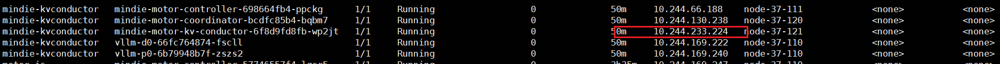
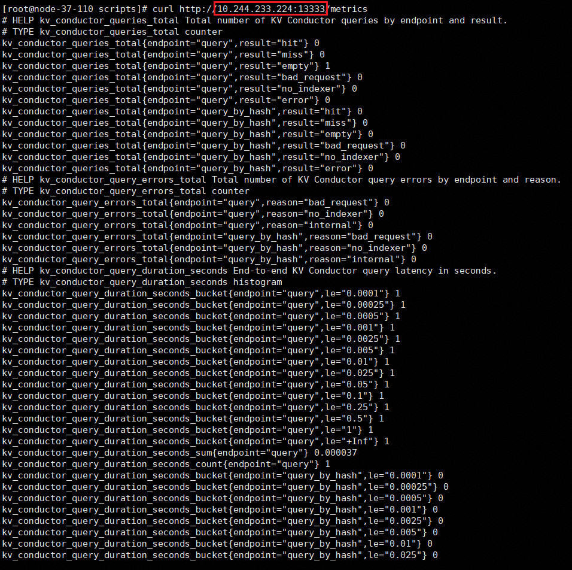

# 调度与 KV Conductor 可观测性

本文说明如何查看 KV Conductor 的查询、阶段耗时、索引与事件序列号指标，以及 Coordinator 的调度选点、缓存未命中归因和原生请求全生命周期对账指标。开启亲和调度的部署步骤按 [KV Cache 亲和性调度](../inference_scheduling/kvcache_affinity.md) 执行，通用指标接口说明参见 [指标接口](../../api/metrics_interfaces.md)。

本功能无需额外开启配置开关，服务拉起后指标自动生效。

## 指标入口与来源分类

监控指标分布在 KV Conductor 与 Coordinator 两个端点：

| 组件 | 接口路径 | 默认端口 | 访问方式 |
| --- | --- | --- | --- |
| KV Conductor | `GET /metrics` | `13333`（`kv_conductor_config.http_server_port`） | K8s 集群内访问 `<kv_conductor_pod_ip>:13333` 或 `kv-conductor:13333` |
| Coordinator | `GET /metrics`（默认 `type=full`） | 容器内 `1027` / K8s NodePort 默认 `31017` | 集群外访问 `<node_ip>:<coordinator_obs_node_port>`，集群内访问 `<coordinator_pod_ip>:1027` |

指标数据涉及的组件来源分类如下：

| 来源标识 | 角色与数据提供方式 |
| --- | --- |
| `kv_conductor` | KV Conductor 进程原生统计（查询请求、分段计时、内存前缀树与多级索引快照） |
| `motor` | Coordinator 进程原生统计（ASGI 入口拦截、调度选点、CAS 资源分配、路由重试、共享内存跨 Worker 汇聚） |
| `vllm` | 推理引擎（vLLM 等）通过 ZMQ 发布 HBM KV 块事件（`zmq_engine` / `replay`），并在推理响应 `usage.prompt_tokens_details.cached_tokens` 中返回实际复用 token 数 |
| `mooncake` / `memcache` | KV 池化存储组件通过 ZMQ 发布 CPU/Disk 池化确认与淘汰事件（`zmq_pool`），并在缓存加载异常时由引擎侧上报错误信号 |

## 新增指标含义、计算方式与来源说明

### 1. KV Conductor 指标（`:13333/metrics`）

| 原始指标名 | 中文名 | 含义 | 计算方式 | 来源 |
| --- | --- | --- | --- | --- |
| `kv_conductor_queries_total{endpoint,result}` | 查询请求总数 | 按接口（`query` / `query_by_hash`）与结果（`hit` / `miss` / `empty` / `bad_request` / `no_indexer` / `error`）分类的查询累计次数，用于观测查询流量与整体命中情况 | 每次收到查询请求并在对应分支返回时，对应 `(endpoint, result)` 原子计数器 `+1`；其中任意存储层命中块数 `> 0` 记为 `hit`，索引非空但命中为 `0` 记为 `miss`，索引为空记为 `empty` | `kv_conductor` |
| `kv_conductor_query_errors_total{endpoint,reason}` | 查询错误总数 | 按接口与错误原因（`bad_request` / `no_indexer` / `internal`）分类的失败查询累计次数 | 请求参数反序列化失败、目标模型未注册索引器或内部执行异常时，对应原子计数器 `+1` | `kv_conductor` |
| `kv_conductor_query_duration_seconds{endpoint}` | 查询端到端耗时 | 单次查询从进入 HTTP 处理函数到返回响应的总耗时分布（直方图） | `t_end - t_start`（秒），落入 `[0.0001, 0.00025, ..., 1.0, +Inf]` 固定桶并累加 `_sum` 与 `_count` | `kv_conductor` |
| `kv_conductor_query_stage_duration_seconds{endpoint,stage}` | 查询分阶段耗时 | 将单次查询拆分为哈希计算（`hash`）、索引匹配（`match`）、结果构造（`build`）三段的耗时直方图，用于定位查询瓶颈 | 各阶段独立计时 `Δt_stage`（秒）：`hash` 为 Token 计算块哈希耗时，`match` 为遍历 HBM/CPU/Disk 索引树耗时，`build` 为组装返回结构耗时 | `kv_conductor` |
| `kv_conductor_registered_workers` | 已注册 Worker 数 | 当前在 KV Conductor 注册表中的推理实例 DP 端点与存储池端点总数 | 抓取 `/metrics` 时读取注册表快照 `workers.len()` | `kv_conductor`（由 `motor` 注册） |
| `kv_conductor_effective_workers` | 有效 Worker 数 | 当前在索引树中实际持有可用 KV 块或处于活跃状态的 Worker 数量 | 遍历各模型索引快照，对当前持有有效索引块的 `worker_id` 去重计数 | `kv_conductor`、`vllm`、`mooncake` / `memcache` |
| `kv_conductor_index_entries` | 索引实例条目数 | 当前维护的 `(model, tenant)` 独立索引器实例总数 | 抓取 `/metrics` 时统计活跃索引器映射表条目数 | `kv_conductor` |
| `kv_conductor_index_blocks{tier}` | 分层索引块数 | 各存储层（`hbm` / `cpu` / `disk` / `total`）当前在索引中维护的 KV 块数量 | 抓取 `/metrics` 时在 `spawn_blocking` 中汇总各层索引块数；`total = hbm + cpu + disk` | `kv_conductor`（事件源自 `vllm`、`mooncake` / `memcache`） |
| `kv_conductor_index_offload_cache_entries{kind}` | 二阶段池化缓存条目数 | CPU/Disk 二阶段匹配缓存中的条目数，`kind` 取值 `offload`（引擎已卸载待确认）、`content`（内容映射）、`pending_pool`（池端已到达待关联） | 抓取 `/metrics` 时直接读取三类二阶段缓存容器的当前长度 | `kv_conductor`、`vllm`、`mooncake` / `memcache` |
| `kv_conductor_index_valid` | 索引有效性标志 | 标识当前 KV Conductor 是否持有至少一个非空有效索引（`1` 有效，`0` 空或未就绪） | 当 `kv_conductor_index_entries > 0` 且 `kv_conductor_index_blocks{tier="total"} > 0` 时为 `1`，否则为 `0` | `kv_conductor` |
| `kv_conductor_events_total{source,status}` | KV 事件处理总数 | 各事件源（`http` / `zmq_engine` / `zmq_pool` / `replay`）处于不同处理状态（`received` / `applied` / `parse_error` / `apply_error` / `dropped`）的事件累计数 | 事件到达、解析、写入索引或因块大小不匹配丢弃时，按 `(source, status)` 原子累加 | 统计在 `kv_conductor`；事件源：`vllm`（`zmq_engine`/`replay`）、`mooncake`/`memcache`（`zmq_pool`） |
| `kv_conductor_event_batches_total{source,status}` | KV 事件批次总数 | 各事件源处理的事件批次（batch）累计次数，`status` 为 `applied` 或 `error` | 每处理完一帧 ZMQ 消息或一次 HTTP `/events` 批量上报，对应计数器 `+1` | `kv_conductor`、`vllm`、`mooncake` / `memcache` |
| `kv_conductor_zmq_reconnects_total{source}` | ZMQ 订阅重连总数 | KV Conductor 订阅引擎（`zmq_engine`）或存储池（`zmq_pool`）事件流发生断连重连的累计次数 | ZMQ Subscriber 捕获连接断开或接收异常并重新建立连接时 `+1` | `kv_conductor`、`vllm`、`mooncake` / `memcache` |
| `kv_conductor_event_seq_anomalies_total{source,kind}` | 事件序列号异常总数 | 带序列号的事件源（`zmq_engine` / `zmq_pool` / `replay`）出现的缺口（`gap`）、重复（`duplicate`）、乱序（`out_of_order`）异常次数 | 对比当前消息序列号 `seq` 与同一发布端上一条序列号 `last_seq`：`seq > last_seq + 1` 记 `gap`；`seq == last_seq` 记 `duplicate`；`seq < last_seq` 记 `out_of_order` | `kv_conductor`（校验 `vllm`、`mooncake` / `memcache` 事件流） |
| `kv_conductor_event_seq_gap_messages_total{source}` | 序列号缺口缺失消息数 | 根据序列号跳跃幅度估算的累計丢失事件消息数量 | 每次检测到 `gap`（`seq > last_seq + 1`）时，累加 `seq - last_seq - 1` | `kv_conductor`、`vllm`、`mooncake` / `memcache` |
| `kv_conductor_tier_queries_total{tier,result}` | 分层查询命中/未命中次数 | 各存储层（`hbm` / `cpu` / `disk` / `any`）在查询中命中（`hit`）或未命中（`miss`）的累计查询次数 | 单次查询中若候选节点在该层匹配的块数 `> 0` 则该层 `result="hit"` 加 `1`，否则 `result="miss"` 加 `1`；任一层命中则 `tier="any"` 记 `hit` | `kv_conductor` |
| `kv_conductor_tier_hit_rate{tier}` | 分层查询命中率 | 各存储层（`hbm` / `cpu` / `disk` / `any`）自启动以来的累计查询命中率，取值 `[0, 1]` | `hit_total(tier) / (hit_total(tier) + miss_total(tier))`；分母为 `0` 时输出 `0` | `kv_conductor` |
| `kv_conductor_predicted_hit_blocks_total{tier}` | 分层预计命中块总数 | 查询在各存储层（`hbm` / `cpu` / `disk` / `any`）预测可复用的最大前缀块数累计值 | 单次查询取最佳候选节点在各层的匹配块数 `best_blocks(tier)` 累加到对应层计数器 | `kv_conductor` |
| `kv_conductor_predicted_hit_tokens_total{tier}` | 分层预计命中 Token 总数 | 查询在各存储层预测可复用的 Token 累计数量 | 单次查询按 `best_blocks(tier) × block_size` 计算预计命中 Token 数并累加 | `kv_conductor` |
| `kv_conductor_query_tokens_total` | 查询 Prompt Token 总数 | 所有有效查询请求传入的 Prompt Token 累计总数 | 每次 `/query` 按请求 `token_ids.len()` 累加，`/query_by_hash` 按 `block_hashes.len() × block_size` 累加 | `kv_conductor`（请求由 `motor` 传入） |
| `kv_conductor_predicted_token_coverage_ratio` | 累计预计 Token 覆盖率 | 所有查询中预计可被 KV 缓存覆盖的 Token 占总查询 Token 的比例，取值 `[0, 1]` | `kv_conductor_predicted_hit_tokens_total{tier="any"} / kv_conductor_query_tokens_total` | `kv_conductor` |
| `kv_conductor_predicted_token_coverage_ratio_dist` | 单次查询预计覆盖率分布 | 单次查询预计命中 Token 覆盖率的直方图分布 | 单次查询计算 `min(1.0, predicted_any_tokens / query_tokens)`，落入 `[0, 0.1, 0.25, 0.5, 0.75, 0.9, 1.0, +Inf]` 桶 | `kv_conductor` |

### 2. Coordinator 调度与缓存命中归因指标（`:31017/metrics`）

| 原始指标名 | 中文名 | 含义 | 计算方式 | 来源 |
| --- | --- | --- | --- | --- |
| `motor:scheduler_select_total{role,policy,result}` | 调度选点总数 | 按角色（`prefill`/`decode`/`hybrid`/`encode`）、策略（`kv_cache_affinity`/`load_balance`/`round_robin`/`session_affinity`）和结果（`ok`/`empty`/`error`）分类的选点次数 | 每次选点完成时写入当前 Worker 共享内存槽位，Observability 进程对全部 Worker 求和 | `motor` |
| `motor:scheduler_select_duration_seconds{role}` | 调度选点耗时 | 各角色执行一次选点（含查询 KV Conductor 与评分排序）的耗时直方图 | `t_select_end - t_select_start`（秒），跨所有 Inference Worker 合并直方图桶、`_sum` 与 `_count` | `motor` |
| `motor:scheduler_allocate_total{role,result}` | 资源分配总数 | 选点后执行负载 CAS 分配的累计次数，`result` 取值 `ok`（一次成功）、`retry`（并发冲突重选重试）、`failed`（分配失败） | 每次 CAS 分配返回或抛异常时按角色与结果累加，跨 Worker 求和 | `motor` |
| `motor:scheduler_allocate_duration_seconds{role}` | 资源分配耗时 | 各角色执行工作负载分配的耗时直方图 | `t_alloc_end - t_alloc_start`（秒），跨 Worker 合并直方图桶 | `motor` |
| `motor:scheduler_degradation_total{role,reason}` | 调度降级总数 | 调度器从首选策略或拓扑回退到次选方案的累计次数（`kv_conductor_unavailable`、`kv_hit_rate_below_threshold`、`load_balance_to_round_robin`、`plugin_fallback`、`session_affinity_fallback`、`pd_to_hybrid`、`pd_to_decode_colocation`） | 触发降级分支时按 `(role, reason)` 计数器 `+1`，跨 Worker 求和 | `motor` |
| `motor:scheduler_degradation_duration_seconds{role}` | 调度降级耗时 | 经历调度降级的选点过程总耗时直方图 | 发生降级的选点请求记录其选点耗时 `Δt`（秒），跨 Worker 合并直方图桶 | `motor` |
| `motor:kv_cache_miss_attribution_total{reason}` | KV 缓存命中与未命中归因总数 | 每次亲和调度请求最终是否用上缓存及其根因分类：`lb_abandoned`（负载均衡主动放弃）、`index_stale`（索引过期）、`prediction_mismatch`（预测失准）、`cache_load_failed`（缓存加载失败）、`actual_recompute`（实际重算）、`unknown`（未知）、`hit`（命中符合预期） | 单请求幂等判定一次：① 候选最高命中 `best_matched > selected_matched` 且未完全命中 $\rightarrow$ `lb_abandoned`；② 转发/流式报错匹配缓存加载失败信号 $\rightarrow$ `cache_load_failed`；③ 引擎响应无 `usage.prompt_tokens_details.cached_tokens` $\rightarrow$ `unknown`；④ `predicted > 0` 且 `actual == 0` $\rightarrow$ `index_stale`；⑤ `predicted > 0` 且 `0 < actual < predicted` $\rightarrow$ `prediction_mismatch`；⑥ `predicted == 0` 且 `prompt_tokens - actual > 0` $\rightarrow$ `actual_recompute`；⑦ 其余 $\rightarrow$ `hit` | `motor` 联合 `kv_conductor`（预测值）、`vllm`（实际 `cached_tokens`）、`mooncake` / `memcache`（加载失败信号） |
| `motor:kv_cache_predicted_cached_tokens_total` | 预测缓存命中 Token 总数 | Coordinator 最终选中节点预计可复用的 KV 缓存 Token 累计总数 | 每次亲和选点采纳结果时累加选中节点的 `selected_matched_tokens`，跨 Worker 求和 | `motor`、`kv_conductor` |
| `motor:kv_cache_actual_cached_tokens_total` | 实际缓存命中 Token 总数 | 推理引擎实际复用的 Prefix/KV 缓存 Token 累计总数 | 从引擎响应 `usage.prompt_tokens_details.cached_tokens` 提取并累加（未返回时不累加），跨 Worker 求和 | `vllm`（由 `motor` 汇总） |
| `motor:kv_cache_actual_recompute_tokens_total` | 实际重算 Token 总数 | 推理引擎未命中缓存、实际执行 Prefill 重算的 Prompt Token 累计总数 | 当引擎返回 `prompt_tokens` 与 `cached_tokens` 时，按 `max(0, prompt_tokens - cached_tokens)` 累加，跨 Worker 求和 | `vllm`（由 `motor` 计算汇总） |
| `motor:kv_conductor_query_timeouts_total` | KV Conductor 查询超时总数 | Coordinator 调用 KV Conductor `/query` 触发客户端超时（默认 3 秒）的累计次数 | `ConductorApiClient.query` 捕获 `requests.exceptions.Timeout` 时 `+1`，跨 Worker 求和 | `motor`、`kv_conductor` |

### 3. Coordinator 原生请求生命周期与对账指标（`:31017/metrics`）

| 原始指标名 | 中文名 | 含义 | 计算方式 | 来源 |
| --- | --- | --- | --- | --- |
| `motor:coordinator_requests_received_total` | 接收请求总数 | Coordinator 推理入口接收到的外部 HTTP 推理请求累计总数 | 请求进入最外层 `RequestLifecycleMiddleware` 时立即 `+1`，跨 Worker 求和 | `motor` |
| `motor:coordinator_requests_admitted_total` | 接纳请求总数 | 通过限流、鉴权和请求体校验，正式进入路由调度（`handle_request`）的请求累计总数 | 请求进入 `handle_request` 时调用 `mark_admitted()` 加 `1`，跨 Worker 求和 | `motor` |
| `motor:coordinator_requests_rejected_total{reason}` | 拒绝请求总数 | 在进入引擎转发前被 Coordinator 拒绝的请求累计数，按原因（`rate_limited`/`body_too_large`/`unauthorized`/`invalid_request`/`unavailable`/`other`）分类 | 请求未标记 `admitted` 即返回 HTTP $\ge 400$ 时，按状态码（`429`$\rightarrow$`rate_limited`、`413`$\rightarrow$`body_too_large`、`401/403`$\rightarrow$`unauthorized`、`400/422`$\rightarrow$`invalid_request`、`503`$\rightarrow$`unavailable`、其余$\rightarrow$`other`）累加 | `motor` |
| `motor:coordinator_requests_completed_total` | 完成终态请求总数 | 已结束生命周期（无论成功、失败、超时、取消或断连）的外部请求累计总数 | 单请求在最外层中间件 `finally` 中幂等执行一次 `finish()` 时 `+1`，恒等于各 `terminal_total` 之和 | `motor` |
| `motor:coordinator_requests_in_flight` | 当前总在途请求数 | 当前正在 Coordinator 内处理、尚未进入终态的实时请求数 | 请求进入时 `+1`，`finish()` 时 `-1`；任意时刻满足 `received_total = completed_total + in_flight` | `motor` |
| `motor:coordinator_requests_queued` | 当前排队请求数 | 已接纳但尚未向后端推理引擎发出第一次转发的实时请求数 | `mark_admitted()` 时 `+1`，首次调用 `mark_executing()` 或直接进入 `finish()` 时 `-1` | `motor` |
| `motor:coordinator_requests_executing` | 当前执行中请求数 | 已向后端推理引擎发起转发、正在等待响应或流式输出中的实时请求数 | 首次 `mark_executing()` 时 `+1`，请求进入 `finish()` 时 `-1` | `motor` |
| `motor:coordinator_request_receive_rate` | 请求接收速率 | Coordinator 每秒接收外部请求的实时速率（requests/s） | 相邻两次 `/metrics` 采样间计算 `max(0, (received_now - received_prev) / (t_now - t_prev))` | `motor` |
| `motor:coordinator_request_admit_rate` | 请求接纳速率 | Coordinator 每秒接纳请求进入路由的实时速率（requests/s） | 相邻两次采样间计算 `max(0, (admitted_now - admitted_prev) / (t_now - t_prev))` | `motor` |
| `motor:coordinator_request_reject_rate` | 请求拒绝速率 | Coordinator 每秒拒绝外部请求的实时速率（requests/s） | 相邻两次采样间对全部拒绝原因求和后计算 `max(0, (rejected_now - rejected_prev) / (t_now - t_prev))` | `motor` |
| `motor:coordinator_request_complete_rate` | 请求完成速率 | Coordinator 每秒进入终态的请求实时速率（requests/s） | 相邻两次采样间计算 `max(0, (completed_now - completed_prev) / (t_now - t_prev))` | `motor` |
| `motor:coordinator_requests_terminal_total{outcome}` | 请求终态分类总数 | 按最终结果分类的完成请求累计数：`success`（成功）、`failed`（失败）、`timeout`（超时）、`cancelled`（取消）、`client_disconnect`（客户端断连） | `finish()` 时根据路由终态标志与 HTTP 状态码单次判定落账；所有 `outcome` 累加值恒等于 `motor:coordinator_requests_completed_total` | `motor` |
| `motor:coordinator_request_queue_duration_seconds` | 请求排队耗时 | 请求从被 Coordinator 接纳（`admitted`）到首次向引擎发起转发（`executing`）的排队与选点耗时直方图 | `t_first_dispatch - t_admitted`（秒），跨 Worker 合并直方图桶 | `motor` |
| `motor:coordinator_request_duration_seconds` | 请求端到端耗时 | 请求从进入 Coordinator 到进入终态（含流式输出完成）的全生命周期耗时直方图 | `t_finish - t_ingress`（秒），跨 Worker 合并直方图桶 | `motor` |
| `motor:coordinator_request_attempts_total{router}` | 内部转发尝试总数 | 路由器（`unified_pd` / `pd_hybrid`）向引擎发起Attempt尝试的累计次数（含首次尝试与重试尝试） | 每次进入路由 attempt 循环时对应 `router` 计数器 `+1`，跨 Worker 求和 | `motor` |
| `motor:coordinator_request_retries_total{router,reason}` | 内部重试总数 | 请求在首次尝试失败后发起内部重试的累计次数，按路由器与原因（`timeout`/`cancelled`/`upstream_error`/`hybrid_fallback`/`other`）分类 | 触发重试分支（`attempt > 0` 或 PD 分离回退混部）时按 `(router, reason)` 累加 | `motor` |
| `motor:coordinator_request_retry_recovered_total{router}` | 重试恢复成功总数 | 经历至少一次内部重试后最终成功完成推理的请求累计数 | 请求曾触发重试（`retry_count > 0`）且最终成功返回时，对应 `router` 计数器 `+1` | `motor` |
| `motor:coordinator_request_retry_duration_seconds{router}` | 内部重试耗时 | 从首次触发重试到重试结束（恢复成功或重试耗尽失败）的耗时直方图 | `t_retry_done - t_retry_start`（秒），跨 Worker 合并直方图桶 | `motor` |
| `motor:coordinator_resource_release_total{role,result}` | 资源释放总数 | 请求结束或异常清理时向调度器释放工作负载（Token / 连接槽位）的累计次数，按角色与结果（`success`/`failed`/`timeout`）分类 | 每次调用 `update_workload` 释放资源或执行残留回收时，按返回结果或异常类型累加 | `motor` |
| `motor:coordinator_resource_release_retries_total{role}` | 资源释放重试总数 | 常规释放未完成而进入异步队列重试或残留账本兜底回收（reclaim）的累计次数 | 投递异步释放重试队列或触发 `_reclaim_residual_workloads` 时按角色 `+1` | `motor` |
| `motor:coordinator_resource_release_duration_seconds{role}` | 资源释放耗时 | 单次资源释放 RPC 调用的耗时直方图 | `t_release_end - t_release_start`（秒），跨 Worker 合并直方图桶 | `motor` |

## 查看与验证步骤

以下命令在 K8s 管理节点执行。假定服务部署在命名空间 `mindie-kvconductor`，推理 NodePort 为 `30501`，Coordinator 可观测 NodePort 为 `30502`。

1. 查询 KV Conductor 的 Pod IP，并拉取 `:13333/metrics`。

    ```bash
    CONDUCTOR_IP=$(kubectl get pod -n mindie-kvconductor -l app=mindie-motor-kv-conductor -o jsonpath='{.items[0].status.podIP}')
    curl -fsS "http://${CONDUCTOR_IP}:13333/metrics"
    ```

2. 连续发送两次具有相同长前缀（token 数不少于一个 `block_size`，默认 `128`）的推理请求，验证 KV Conductor 命中计数增长。

    ```bash
    curl -fsS "http://${CONDUCTOR_IP}:13333/metrics" | grep -E 'kv_conductor_(queries_total|tier_queries_total|predicted_hit_tokens_total)'
    ```

    第一次请求建立缓存索引，第二次相同前缀请求的 `kv_conductor_queries_total{endpoint="query",result="hit"}`、`kv_conductor_tier_queries_total{tier="hbm",result="hit"}` 和 `kv_conductor_predicted_hit_tokens_total{tier="hbm"}` 会相应增加。

3. 拉取 Coordinator 可观测端口 `/metrics`，查看选点、分配、降级与缓存命中归因指标。

    ```bash
    curl -fsS "http://<node_ip>:30502/metrics" | grep -E '^motor:(scheduler_|kv_cache_|kv_conductor_)'
    ```

4. 拉取 Coordinator 可观测端口 `/metrics`，查看请求生命周期指标并核对在途对账恒等式。

    ```bash
    curl -fsS "http://<node_ip>:30502/metrics" | grep -E '^motor:coordinator_(requests_|request_|resource_release_)'
    ```

    同一统计窗口内满足：

    ```text
    motor:coordinator_requests_received_total
      = motor:coordinator_requests_completed_total + motor:coordinator_requests_in_flight
    ```

    所有请求处理完毕后，`motor:coordinator_requests_in_flight`、`motor:coordinator_requests_queued` 和 `motor:coordinator_requests_executing` 均回落为 `0`。

## 结果示例

以下截图来自 `mindie-kvconductor` 命名空间的一次部署。五类 Pod 均处于 `1/1 Running`，其中 `mindie-motor-kv-conductor` 的 Pod IP 为 `10.244.233.224`。



在管理节点访问 `curl http://10.244.233.224:13333/metrics`，返回 KV Conductor 的查询计数、错误计数和耗时直方图：



连续发送两条相同长前缀请求（`prompt_tokens=1537`，`block_size=128`）后，KV Conductor 命中计数与 Coordinator 观测口指标核对结果如下：

```text
before  query_hit=0  hbm_hit=0  predicted_hbm_tokens=0
HTTP 200 in 9.214187s (scene=kv_conductor, model=qwen, port=30501)
HTTP 200 in 3.630435s (scene=kv_conductor, model=qwen, port=30501)
after   query_hit=1  hbm_hit=1  predicted_hbm_tokens=1536  empty=9  error=0
PASS query hit 0 -> 1
PASS hbm hit 0 -> 1
PASS predicted hbm tokens 0 -> 1536
PASS motor:scheduler_select_total
PASS motor:scheduler_select_duration_seconds
PASS motor:scheduler_allocate_total
PASS motor:scheduler_allocate_duration_seconds
PASS motor:scheduler_degradation_total
PASS motor:kv_cache_miss_attribution_total
PASS motor:kv_cache_predicted_cached_tokens_total
PASS motor:kv_conductor_query_timeouts_total
```

## 使用限制

- `kv-conductor` Service 默认类型为 `ClusterIP`，不分配北向 NodePort，需在 Kubernetes 集群内通过 Pod IP 或 Service 域名访问 `:13333/metrics`。
- 未启用 `kv_cache_affinity` 时不会部署 KV Conductor，此时仅 Coordinator 观测口（默认 NodePort `31017`）对外提供调度与请求生命周期指标。
- Coordinator 新增的 `motor:scheduler_*`、`motor:kv_cache_*`、`motor:kv_conductor_query_timeouts_total` 和 `motor:coordinator_*` 指标仅随 `type=full`（默认）和 `type=motor` 视图返回，`instance`、`role`、`dp`、`node` 视图不包含这些全局序列。
- 缓存未命中归因依赖引擎在响应 `usage.prompt_tokens_details.cached_tokens` 中返回实际缓存命中 token 数；若所用引擎或接口未返回该字段，归因计数器固定记入 `reason="unknown"`，不做估算。
