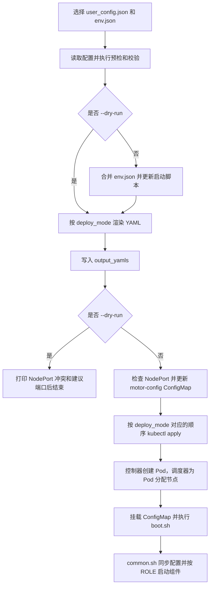

# Deployer部署工具

本目录包含 PD disaggregation 服务的部署脚本与配置模板，用于在集群中部署 Controller、Coordinator、Engine 等组件。

## 使用说明

本目录提供部署所需的脚本与示例配置。正式部署前，请按[部署入口](#部署入口)中对应环境的指南完成环境准备与配置。其他部署方案见[部署方式说明](../../docs/zh/user_guide/deployment/README.md)。

Ascend 950PR&950DT系列产品的 RoCE 现场改法见 **[950系列服务器跨超节点场景memcache池化后端服务部署指导](../../docs/zh/user_guide/features/inference_scheduling/kv_cache_store/memcache_950.md)**。按文件清单改部署副本，不直接合入主干。

## 部署入口

入口命令在 `examples/deployer/` 目录执行，文件路径相对于仓库根目录。执行前请按对应指南准备配置，并补齐指南中要求的参数。

| 运行环境 | 入口 | 文件路径 | 部署指南 |
|----------|------|----------|----------|
| Kubernetes | `python3 deploy.py` | [`examples/deployer/deploy.py`](deploy.py) | [Kubernetes PD 分离服务部署](../../docs/zh/user_guide/deployment/k8s/pd_disaggregation_deployment.md) |
| Docker | `python3 docker_deploy.py` | [`examples/deployer/docker_deploy.py`](docker_deploy.py) | [Docker 多容器 PD 分离服务部署](../../docs/zh/user_guide/deployment/docker/host/pd_disaggregation_deployment.md) |
| Slurm + Apptainer | `python3 slurm_deploy.py start` | [`examples/deployer/slurm_deploy.py`](slurm_deploy.py) | [Slurm 服务部署](../../docs/zh/user_guide/deployment/slurm/service_deployment.md) |

## Kubernetes 部署流程

本节说明 `deploy.py` 如何读取配置、生成并应用 YAML，以及 Kubernetes 如何创建 Pod 并启动 Motor 组件。
本节的示例命令均需先从源码仓库根目录进入 `examples/deployer/`：

```bash
cd examples/deployer
```

### 输入、模板和 ConfigMap

运行 `deploy.py` 前，请按[部署入口](#部署入口)中的 Kubernetes 指南准备镜像、权重、节点标签和设备插件，
并创建与 `motor_deploy_config.job_id` 同名的 namespace；脚本不会自动创建 namespace。

1. 选择与模型、引擎及硬件匹配的配置目录。`deploy.py` 通过 `--config_dir` 查找
   `user_config.json` 和 `env.json`；显式指定的 `--config`、`--env` 分别覆盖目录中的对应路径。
   不指定目录时，两个文件路径需要成对提供。
2. `deploy.py` 读取 `user_config.json`，执行安全预检和配置校验。
   默认安全预检要求开启 `motor_deploy_config.tls_config.infer_tls_config.enable_tls`，
   并配置 `motor_coordinator_config.mgmt_api_key_config` 的 `enable_api_key` 和 `api_key_file`。
   字段见 [配置参数说明](../../docs/zh/user_guide/configuration/config_reference.md)，
   管理鉴权行为见 [管理接口](../../docs/zh/user_guide/api/management_interfaces.md)。
   `--dry-run`、`--update_config` 和 `--update_instance_num` 也会执行这项检查。
   隔离测试环境中需要沿用现有配置时，可按[部署前安全预检](../../docs/zh/user_guide/deployment/k8s/README.md#deployment-security-precheck)在原命令末尾追加 `--skip-check`。
3. 非 `--dry-run` 部署时，`lib/utils.py` 的 `set_env_to_shell()` 读取 `env.json`，将公共环境段
   `motor_common_env` 与各组件环境段合并（同名变量以组件值为准），写入
   `startup/common.sh` 和 `startup/roles/*.sh` 中的 `set_*_env` 函数。
   这一步会修改本地启动脚本，建议在单独的部署副本中运行。
4. `deploy.py` 根据 `motor_deploy_config.deploy_mode` 选择 `lib/generator/` 中的生成器，
   以 `yaml_template/` 中的模板为基础填入 `user_config.json` 的配置，生成 YAML 并写入 `output_yamls/`。
   `env.json` 中的宿主 IPC 等开关也会影响生成的 PodSpec，因此两个配置文件需要一起准备。
5. 检查生成资源的 NodePort 冲突后，创建或更新 namespace 内的 `motor-config` ConfigMap，
   再依次应用本次生成的 YAML。ConfigMap 包含本次部署使用的 `user_config.json`、启动脚本、
   探针与 preStop 等文件，角色脚本按文件名扁平化存放。`env.json` 不放入 ConfigMap，
   也不通过 `envFrom` 导入；其中的环境变量已在第 3 步写入启动脚本。

`deploy.py` 先用 `kubectl create configmap ... --dry-run=client -o yaml` 生成 ConfigMap 定义，
再通过 `kubectl apply -f -` 创建或更新，不会生成单独的 `motor-config.yaml` 文件。
本次实际使用的用户配置另存为 `output_yamls/.motor_config_user_config.json`，其中补入了解析后的
`deploy_mode`；原始 `user_config.json` 不会被修改。

下图展示正常部署和 `--dry-run` 预览的流程；`--update_config` 与 `--update_instance_num` 的用法见[其他操作](#其他操作)。



### deploy_mode 与 YAML 应用顺序

配套 RBG 实现合入后，`deploy_mode` 支持以下四种值；省略时默认为 `infer_service_set`。
使用 `rbg` 前需确认代码、模板及部署 RBAC 已配套集成，不能只修改配置中的模式名称。
所有输出文件均位于 `output_yamls/`，模板与生成路径由 `lib/constant.py`、`lib/utils.py:get_deploy_paths()` 定义。
建议始终通过 `deploy.py` 部署，由它创建 ConfigMap 并按下表顺序应用 YAML：

| deploy_mode | 模板与生成资源 | 正常部署的实际应用顺序 |
|-------------|----------------|------------------------|
| `multi_deployment` | `controller_template.yaml` → `mindie_motor_controller.yaml`；`coordinator_template.yaml` → `mindie_motor_coordinator.yaml`；`engine_template.yaml` → 每个 E/P/D 或 E/U 实例一份引擎 YAML；按条件生成存储及 KV 等独立 YAML | `motor-config` → Controller → Coordinator → E 实例 → P、D 实例（或 U 实例）→ 可选存储 PVC → 可选 KV Store → 可选 KV Conductor → 可选 MF Store |
| `infer_service_set` | `infer_service_template.yaml` → `infer_service.yaml`，包含 Controller、Coordinator、引擎及可选 KV 角色；按需另生成 `mindie_motor_storage_pvc.yaml` | `motor-config` → `infer_service.yaml` → 可选存储 PVC；需预先安装支持 `InferServiceSet` 的 CRD 和控制器 |
| `single_container` | `single_container_template.yaml` → `mindie_motor_single_container.yaml`；动态 PVC 作为额外 YAML document 追加在同一文件中 | `motor-config` → `mindie_motor_single_container.yaml`；多个组件在同一容器中启动，不为各组件单独生成 YAML |
| `rbg` | `rbg_template.yaml` → `RoleBasedGroup`（roles: controller、coordinator、prefill、decode、encode、union、kv-store、kv-conductor、mf-store），另生成业务 Service、运行时 SA/RBAC 与 `motor-config` | 运行时 SA/RBAC → `motor-config` → 按需 PVC → 业务 Service → CoordinatedPolicy → RoleBasedGroup → 各角色 ScalingAdapter 绑定后提交 HPA（启用 HPA 时）；需预先安装 RBG v0.8.0 控制器及配套 CRD（`workloads.x-k8s.io/v1alpha2`） |

引擎文件名形如 `vllm_p0.yaml`、`vllm_d0.yaml`，索引从 `0` 开始；可选 Encode 实例用
`_e0.yaml`，PD 混部 Union 实例用 `_u0.yaml`。文件名前缀根据引擎选择：vLLM 为 `vllm`，
SGLang 为 `sglang`，MindIE LLM 为 `mindie-server`。实例数为零时不生成对应实例文件。

`multi_deployment` 的可选文件包括：

- `mindie_motor_storage_pvc.yaml`：配置了需要动态创建的 PVC 时生成；使用 NFS、hostPath，
  或通过 `claim_name` 引用已有 PVC 时不生成。
- `mindie_motor_kv_store.yaml`：启用 KV Store 且需要创建独立 Store Pod 时生成；
  复用其他 namespace 中已有的 Store，或使用 `yuanrong` 后端时不生成。
- `mindie_motor_kv_conductor.yaml`：`kv_conductor_config.http_server_port` 非零时生成。
- `mindie_motor_mf_store.yaml`：Prefill/Union 配置使用 SGLang 引擎时生成。

表中顺序是**资源提交顺序，不是组件就绪顺序**。RBG 启用 HPA 时会等待 Adapter 绑定和 `scale`
初始化；其他资源的提交不逐一等待对应 Pod 就绪。`multi_deployment` 的动态 PVC 排在 Controller、Coordinator 和引擎实例之后，但在
KV Store、KV Conductor、MF Store 之前；`infer_service_set` 的动态 PVC 排在
`infer_service.yaml` 之后。因此依赖该 PVC 的 Pod 可能先处于 Pending，直到 PVC 完成绑定。
若存储必须提前就绪，请在部署前准备好；引用的已有 PVC 必须位于 `job_id` 对应的 namespace。

`output_yamls/` 可能残留上次部署或其他模式的文件。不要用 `kubectl apply -f output_yamls/`
代替 `deploy.py`：这样不会更新 `motor-config` ConfigMap，还可能应用旧文件。

### RBG（RoleBasedGroup）模式

本节以 RBG 适配代码、模板、云原生示例及部署 RBAC 已配套合入，且 deployer 镜像包含对应实现为前提。
Motor、RBG 和 Ascend Volcano 的分析基线见 [RBG 详细说明](lib/rbg/README.md)；所用分支未集成时，
应先准备配套源码和镜像，不能仅增加 `deploy_mode: rbg`。

`deploy_mode` 设为 `rbg` 时，`deploy.py` 使用 `yaml_template/rbg_template.yaml` 渲染一个
`workloads.x-k8s.io/v1alpha2` 的 `RoleBasedGroup`，角色固定为 controller、coordinator、encode、
prefill、decode、union、kv-store、kv-conductor、mf-store；未启用的角色保留在模板中、副本数为 0。

`motor_deploy_config.rbg_config` 的主要字段：

| 字段 | 说明 |
|------|------|
| `name` | RBG 名称，用作 Pod 名前缀、RBG 原生 headless Service（`s-{name}-{role}`）前缀，以及 `rbg.workloads.x-k8s.io/group-name` 标签值；缺省等于 `logical_service_name` |
| `logical_service_name` | 业务 Service 名称中缀，缺省 `vllm`；业务 Service 名为 `{模板名}-{logical_service_name}-0-{role}`（`mf-store` 例外，保留模板名） |
| `gang_scheduling` | 是否启用组调度，首次部署缺省 `true`；启用时 `scheduler_name` 必须为 `volcano` |
| `scheduler_name` | Pod 模板的 `schedulerName`，首次部署缺省 `volcano` |
| `restart_policy_by_role` | 按引擎角色指定重启策略；通常默认 `RecreateRoleInstanceOnPodRestart`，满足 DP 降级条件的 Decode/Union 默认 `None`，此时显式配置也只能为 `None` |
| `coordinated_policy` | 自定义跨角色协调策略；首次省略时生成默认的 `engine-scaling`，配置方式见 [RBG 详细说明](lib/rbg/README.md#协调策略) |

六个顶层字段的完整 JSON 示例、类型、默认值和更新方式见
[完整 rbg_config 示例](lib/rbg/README.md#完整-rbg_config-示例)。`scheduling_queue` 位于
`motor_deploy_config`，HPA 的 `scaling_policy` 位于 `user_config.json` 顶层，均不放入 `rbg_config`。

实例数与副本的对应关系：`p_instances_num`、`d_instances_num`、`e_instances_num`、`hybrid_instances_num`
对应 `spec.roles[].replicas`；`single_p_instance_pod_num`、`single_d_instance_pod_num`、
`single_e_instance_pod_num`、`single_hybrid_instance_pod_num` 对应每个实例的 Pod 数。
默认引擎模板写入 `customComponentsPattern.components[0].size`；使用 `leaderWorkerPattern` 时
写入其 `size`，该值包含 leader。

RBG 产物写入 `output_yamls/<namespace>/<rbg_name>/`，包含 `prerequisites.yaml`、`services.yaml`、
`policy.yaml`、`rbg.yaml` 和 `hpas.yaml`；本次未提交的 Policy/HPA 对应文件可以为空。

前置条件：

Volcano 和 RBG v0.8.0 控制器需在部署 Motor 前单独安装，安装命令、版本要求和验证方法见
[RBG 前置组件安装](lib/rbg/README.md#前置组件安装)。以下命令从 Motor 源码根目录执行，
`RBG_SOURCE_DIR` 使用尚未存在的绝对目录，安装过程不切换当前目录：

```bash
# Volcano：按 MindCluster Volcano 安装指导准备软件包和镜像，然后执行
kubectl apply -f volcano-v{version}.yaml

# RBG v0.8.0
RBG_SOURCE_DIR=/tmp/rbg-v0.8.0
git clone --branch v0.8.0 --single-branch https://github.com/sgl-project/rbg.git "$RBG_SOURCE_DIR"
helm upgrade --install rbgs "$RBG_SOURCE_DIR/deploy/helm/rbgs" \
  --create-namespace --namespace rbgs-system \
  --set controller.features.gangScheduling.schedulerName=volcano --wait
```

更完整的 Volcano 安装包准备、单机 `useClusterInfoManager=false` 配置和验证命令见上述链接。

- 已安装并运行 RBG v0.8.0 控制器及配套 CRD；部署流程检查的 `rolebasedgroups`、`coordinatedpolicies`、
  `roleinstancesets`、`roleinstances`、`rolebasedgroupscalingadapters` 均需提供 `v1alpha2` 版本。
- 默认启用组调度，需安装 Volcano，并将 **RBG 控制器**配置为 `--scheduler-name=volcano`；
  RBG Helm 配置为 `controller.features.gangScheduling.schedulerName=volcano`，其默认值为 `scheduler-plugins`。
  Motor 的 `rbg_config.scheduler_name` 也需为 `volcano`。
- 部署账号需完整具备 RBG、CoordinatedPolicy、Adapter、HPA 及运行时资源权限；
  应检查与 deployer 镜像配套的实际 RBAC，不能假定所用分支已包含规则，也不能仅补一项 `list`，
  详见 [部署账号 RBAC](lib/rbg/README.md#部署账号-rbac)。
- RBG 的实例联动重建由 `restartPolicy` 实现。`ras_monitor` 仍通过旧 `delete.sh` 删除并重新部署整套服务，
  不具备 RBG 专用清理流程的数据 PVC 保留语义，不推荐作为 RBG 的实例恢复入口；`kubectl delete pod`
  只补建单个 Pod，也不能替代整实例重建，详见
  [ras_monitor 说明](../features/fault_tolerance/ras_monitor/readme.md)。

以下部署命令从 Motor 源码根目录开始，先进入 `examples/deployer/`。将 `CONFIG_DIR` 替换为包含已配置好的
`user_config.json` 和 `env.json` 的目录，`NAMESPACE` 与其中的 `job_id` 保持一致：

```bash
cd examples/deployer
CONFIG_DIR=/path/to/rbg-config
NAMESPACE=mindie

# 部署或重新提交配置
python3 deploy.py --config_dir "$CONFIG_DIR"

# 仅更新白名单内的运行配置，不主动重启 Pod
python3 deploy.py --config_dir "$CONFIG_DIR" --update_config

# 手动扩缩容：只允许修改实例数
python3 deploy.py --config_dir "$CONFIG_DIR" --update_instance_num

# 清理 RBG：命令行必须带 MOTOR_DEPLOY_MODE=rbg；也可通过 TUI 删除
MOTOR_DEPLOY_MODE=rbg bash ../cloud_native_deploy/cleanup.sh "$NAMESPACE"
```

执行前须完成[安全预检配置](#安全预检)。`--skip-check` 仅限隔离的本地或测试环境验证，
生产环境不得使用，也不应保存在生产 Helm values 或 Job 参数中。

`--update_config` 仅合入[白名单](lib/update_config_whitelist.py)字段；支持热加载的配置在容器同步和
进程监听后生效，非白名单变更会被忽略并记录警告。该命令不更新 `env.json`、启动脚本或 Pod 模板。

配置顶层 `scaling_policy` 后，通过正常部署入口启用 HPA；更新时省略该字段通常保留线上 HPA，
显式设置 `"scaling_policy": {}` 后重新提交配置可关闭受管 HPA 和对应 Adapter。
角色仍受 HPA/Adapter 管理时不能用 `--update_instance_num` 手动扩缩容。HPA 调整的是完整实例数，
不改变每实例 Pod 数。启停流程与 P/D HPA 策略更新命令见 [RBG 扩缩容说明](lib/rbg/README.md#扩缩容)。

清理流程先处理 HPA，再删除 RBG 并等待其后代退出，随后清理业务 Service、协调策略、运行时权限和
`motor-config`；保留数据 PVC 和外部资源。命令行执行 `cleanup.sh` 时必须设置
`MOTOR_DEPLOY_MODE=rbg`，否则会走旧的非 RBG 清理流程。直接执行旧 `delete.sh` 不具有相同的清理语义。

限制：

- 当前 Motor RBG 适配器拒绝 `huawei.com/schedule_policy: *-sp`，关闭组调度也会被拒绝；
  这不代表 MindCluster 不支持 A3/A5 超节点调度。
- 默认组调度不支持带硬件调度注解的活动角色使用不同的 `(sp-block, huawei.com/schedule_policy)` 组合。
  DeepSeek-V4.1-Flash A3/A5 的 P/D 均为单 Pod，`sp-block` 分别为 `16/16`、`8/8`，默认组调度下
  硬件策略一致；其他典配（例如 DeepSeek-V3.1 A3 的 P=1、D=2，`sp-block` 为 `16/32`）可能不一致。
  A3 的 `sp-block` 定义逻辑超节点块，A5 默认的 `chip8-node8` 是节点内互联策略；
  P/D 注解一致不能证明组级硬件策略已经生效。若需 P/D 位于同一指定超节点，可以用相同的真实
  成员标签限制 `prefill_node_selector` / `decode_node_selector`，但静态选择不能补齐调度接入。
  规格与源码依据见 [调度规格限制](lib/rbg/README.md#调度规格限制)。
- `motor_deploy_config.scheduling_queue` 会写入 RBG v0.8.0 读取的组队列注解
  `rbg.workloads.x-k8s.io/group-gang-scheduling-volcano-queue`，启用组调度时控制 RBG 组级 PodGroup 的队列。
  使用前仍需确认目标 Volcano 队列存在，且 `scheduler_name` 为 `volcano`；该字段不允许在线修改。
- 同一 namespace 只部署一套 RBG（运行时 ConfigMap 固定为 `motor-config`）。
- 不支持 P2D；显式设置 `enable_scale_p2d=true` 会报错，省略或关闭时落实为 `false`。
- 不支持容器快照；设置 `motor_container_snapshot_config.enable_snapshot=true` 会报错。
- 修改镜像、环境变量或支持更新的 Pod 模板字段，应通过正常部署入口重新提交，相关角色可能滚动更新。
  修改组调度、调度器、`scheduling_queue`，或活动引擎角色的实例形态、每实例 Pod 数及重启策略，
  需要先清理原部署，再按新配置部署；这些变更不能通过两个更新参数完成。

A2/A3/A5 的 `user_config.json` 修改位置、现有典配数值及生成器自动处理的硬件字段，见
[硬件配置调整](lib/rbg/README.md#a2a3a5-配置调整)。DeepSeek-V4.1-Flash A3 的 P/D `sp-block` 一致（`16/16`），
只说明不会触发 Motor 的 P/D 策略不一致校验；仍需核实组级 NPU 识别和硬件注解传递。
A2 多 Pod 实例还存在 RBG v0.8.0 组成员计数限制；A3 Prefill 必须先修正
[MultiConnector 层级](lib/rbg/README.md#a3-deepseek-v41-flash-的-multiconnector-检查)，不能仅改部署模式就视为可用。
A5 DeepSeek-V4.1-Flash 应使用 `model_configs/vllm/models/deepseek_v4.1_flash/A5/` 的完整典配：
`Ascend950`、P/D 各 1 实例、每实例 1 Pod、每 Pod 8 NPU，P/D 的 DP×TP×PP 均为 8×1×1，
KV 为 memcache inprocess，P/D 的 `HCCL_OP_EXPANSION_MODE` 均为 `CCU_SCHED`。
完整引擎、量化、KV 端口及环境参数见 [A5 部署参数](lib/rbg/README.md#a5-deepseek-v41-flash-部署参数)，
不能只修改 A3 示例的 `hardware_type`。资源提交后还需按
[部署后验收](lib/rbg/README.md#部署后验收)确认工作负载就绪和实际推理成功。

### 安全预检

生产环境应先在 `user_config.json` 中配置推理 TLS 和管理面 API Key，再执行部署或扩缩容，保留安全预检：

- `motor_deploy_config.tls_config.infer_tls_config.enable_tls` 设为 `true`，并配置相应证书及挂载。
- `motor_coordinator_config.mgmt_api_key_config.enable_api_key` 设为 `true`，
  `api_key_file` 指向容器内可读取的密钥文件。密钥内容不直接写入 JSON。
- 部署与扩缩容参数中不携带 `--skip-check`；Helm 的 `jobs.deploy.args` / `jobs.scale.args`
  默认均为 `[]`。如曾在 values 或 Job 中保存该参数，生产部署前应移除。

以上字段由 [`deploy.py` 的 `is_security_configured`](deploy.py) 检查；
证书与密钥配置见[配置参数说明](../../docs/zh/user_guide/configuration/config_reference.md)和
[管理接口鉴权](../../docs/zh/user_guide/api/management_interfaces.md)。
`--skip-check` 仅用于隔离的本地或测试环境验证，跳过预检不会开启 TLS 或鉴权，生产环境不得使用。

### YAML 如何影响 Pod 创建

`deploy.py` 不直接创建 Pod，而是提交 Deployment、Service、RBAC、InferServiceSet 或 RoleBasedGroup
等资源，再由控制器创建 Pod。Deployment 的副本由 Kubernetes 内置控制器维护，InferServiceSet 的各角色
由对应的自定义控制器管理；RBG 使用 `RoleBasedGroup → RoleInstanceSet → RoleInstance → Pod` 管理角色与实例。

- `job_id` 决定 namespace；镜像、组件调度标签、附加 labels/annotations 等由生成器填入资源模板。
- `multi_deployment` 的 `p_instances_num` / `d_instances_num` 决定实例 YAML 数量，
  `single_p_instance_pod_num` / `single_d_instance_pod_num` 决定每个实例的 Pod 副本数，
  `p_pod_npu_num` / `d_pod_npu_num` 决定单 Pod 的 NPU 资源请求和限制。
  InferServiceSet 中角色的 `replicas` 对应实例数，角色下工作负载的 `spec.replicas` 对应每实例 Pod 数。
- Pod 模板注入 `ROLE`、`JOB_NAME`、组件服务域名等环境变量，并通过 downward API 获得
  `POD_IP`、`HOST_IP`；这些变量与 `env.json` 写入启动脚本的环境函数共同构成容器的运行环境。
- `weight_mount_path` 更新权重卷及挂载路径；可选存储配置增加 NFS、hostPath 或 PVC，
  `dshm_size` 调整 `/dev/shm`，`MOTOR_ENABLE_IPC_HOST` 的行为见「配置文件说明」中的 `env.json` 小节。
- 普通主容器通过卷把 `motor-config` 挂载到 `/mnt/configmap`，并执行
  `/bin/bash -c "source /mnt/configmap/boot.sh;"`。Render sidecar 的启动命令由生成器单独设置，
  不执行 `boot.sh`。

### Pod 内的组件启动和健康检查

1. `startup/boot.sh` 先加载 `common.sh`，再根据 `ROLE` 加载对应角色脚本。
   ConfigMap 中的脚本已扁平化，因此容器内加载的是同一目录下的 `controller.sh`、`engine.sh` 等文件，
   而非源码中的 `roles/engine.sh` 路径。
2. `common.sh` 设置公共环境，并将 ConfigMap 的 `user_config.json` 同步到可写的
   `CONFIG_PATH`（模板默认 `/usr/local/Ascend/pyMotor/conf`），并设置 `USER_CONFIG_PATH`。
   之后默认每 10 秒同步一次；配置文件同步不代表所有字段都支持热更新。
3. 角色脚本设置组件环境并启动服务：`controller.sh` 启动 `motor.controller.main`，
   `coordinator.sh` 启动 `motor.coordinator.main`；`engine.sh` 为 Encode/Prefill/Decode/Union
   准备环境后启动 `motor.node_manager.main`，由 NodeManager 管理实际引擎进程。
   因此 Engine Pod 进入 Running 不代表 vLLM/SGLang 已加载权重并可以提供服务。
4. `single_container` 由 `all_combine_in_single_container.sh` 在同一容器内启动并监督多个组件子进程；
   任一受监督的主要子进程退出时，脚本会清理其余子进程，因此各组件的生命周期相互绑定，不能按独立 Pod 理解。

Controller/Coordinator 模板声明了 startup、readiness、liveness 探针，调用
`probe/probe.sh` 与 `probe/probe.py` 检查对应健康接口。单容器模板的三类探针检查
Controller 和 Coordinator。当前 Engine 模板未声明这三类探针，因此不能仅凭 Engine Pod 处于 Running
判断引擎可用。

Engine 和单容器模板还配置了 preStop hook，执行 `prestop/prestop.sh`：先通过
`prestop.py` 请求 NodeManager 暂停服务，并尽量等待引擎中的请求处理完毕，再发送终止信号；整个过程受
Pod 的 `terminationGracePeriodSeconds` 限制，不保证所有在途请求都能完成。

### 生成预览、实际部署与检查

完成前置配置后，可先预览 YAML，再执行实际部署。两条命令均会执行[部署前安全预检](../../docs/zh/user_guide/deployment/k8s/README.md#deployment-security-precheck)。

```bash
python3 deploy.py --config_dir ../../model_configs/vllm --dry-run
python3 deploy.py --config_dir ../../model_configs/vllm
```

`--dry-run` 仅对正常部署生效：它会生成或覆盖本地 YAML，但跳过启动脚本改写、
ConfigMap 更新和工作负载 apply，也不显示启动进度。生成 YAML 时还可能查询
集群节点标签、可复用的 KV Store 和 NodePort 占用情况，因此并非完全离线的检查。
**不要将它与 `--update_config` 或 `--update_instance_num` 组合使用来预演更新**：
这两个操作会先于正常部署执行，即使加上 `--dry-run` 也可能修改集群。

部署后，将 `NAMESPACE` 设为实际配置中的 `job_id`，再从 Pod 列表选择名称并填入 `POD_NAME`：

```bash
NAMESPACE=mindie-motor
kubectl get pods -n "$NAMESPACE" -o wide
kubectl get svc -n "$NAMESPACE"
kubectl get configmap motor-config -n "$NAMESPACE"
POD_NAME=your-pod-name
kubectl describe pod "$POD_NAME" -n "$NAMESPACE"
kubectl logs "$POD_NAME" -n "$NAMESPACE" --all-containers=true --tail=100
```

Pending 时先查看调度事件、节点标签、NPU 资源与 PVC；容器未启动时检查镜像和挂载；
Running 但服务不可用时检查组件日志、探针和 NodeManager/引擎状态。
使用 `--nostep` 可关闭部署后的进度监控，不影响资源创建；`single_container` 模式本身不显示该进度监控。

如需阅读实现，可从以下文件入手：[deploy.py](deploy.py)、[配置路径解析](lib/config_validator.py)、
[模板与环境脚本处理](lib/utils.py)、[ConfigMap 与 kubectl 调用](lib/generator/k8s_utils.py)、
[ConfigMap 资产清单](lib/prepare_utils.py)、[Pod 启动入口](startup/boot.sh)。

## deploy.py使用方法

### 参数说明

MindIE Motor服务部署参数说明如下所示：

| 参数 | 简写 | 说明 |
|------|------|------|
| `--config_dir` | `--dir` | 默认从此目录读取 `user_config.json` 和 `env.json`；显式传入的配置文件路径优先。 |
| `--user_config_path` | `--config` | 覆盖用户配置路径；不提供 `--config_dir` 时需同时指定 `--env`。 |
| `--env_config_path` | `--env` | 覆盖环境配置路径；不提供 `--config_dir` 时需同时指定 `--config`。 |
| `--update_config` | - | 仅更新 ConfigMap，不重新部署。 |
| `--update_instance_num` | - | 根据配置扩缩容实例数量。 |
| `--dry-run` | - | 仅生成 YAML，不执行 `kubectl apply`；不应与 `--update_config`、`--update_instance_num` 组合使用，否则更新操作仍会执行。 |
| `--auto_log_collect` | - | 部署完成后自动启动日志采集。 |
| `--nostep` | - | 部署完成后不显示服务启动进度条。 |
| `--skip-check` | - | 仅在隔离测试环境跳过[部署前安全预检](../../docs/zh/user_guide/deployment/k8s/README.md#deployment-security-precheck)，并沿用现有配置。 |

Motor 配置文件自动生成参数：

| 参数 | 简写 | 说明 |
|------|------|------|
| `--mode` | - | `deploy`（默认）部署服务；`general_config` 从 vLLM 部署脚本生成 Motor 配置文件。 |
| `--deploy-scenario` | - | `general_config` 必填：`hybrid` 或 `separate`。 |
| `--hardware-type` | - | `general_config` 必填：`A2`、`A3` 或 `A5`。 |
| `--weight-path` | - | `general_config` 可选：权重挂载路径。 |
| `--image-name` | - | `general_config` 可选：镜像名称。 |

### 使用方式

#### 方式零：交互式 TUI 模式

```bash
python3 deploy.py
```

在交互式终端中不带参数运行 `deploy.py`，会进入终端界面（TUI）：

| 操作 | 按键 | 说明 |
|------|------|------|
| 部署服务 | `R` | 输入配置目录路径，执行部署。 |
| 显示启动进度 | `P` | 打开或关闭内嵌进度条，实时查看各 Engine Pod 启动状态。 |
| 日志采集 | `L` | 启动或重启日志采集。 |
| 更新配置 | `U` | 更新集群 ConfigMap。 |
| 删除服务 | `D` | 输入 namespace 并确认后删除所有服务。 |
| 退出 | `Q` | 退出 TUI。 |

**交互方式：**

- `↑` `↓` 或 vim 风格 `j` `k` 导航菜单
- `Enter` 选中当前高亮项
- 也可直接按菜单项的字母键（`[R]` `[P]` `[L]` `[U]` `[D]` `[Q]`）快速触发

> 已部署状态下，进度监控（`P`）会自动发现 Running 的 vLLM Pod，通过尾随 `kubectl logs` 解析启动日志，在菜单下方绘制每个 Pod 的实时进度条，并展示 Pod 就绪状态（`kubectl get pods`）。

方式一至方式三均会执行[部署前安全预检](../../docs/zh/user_guide/deployment/k8s/README.md#deployment-security-precheck)。仅在隔离测试环境需要沿用现有配置时，可在相应命令末尾追加 `--skip-check`。

#### 方式一：指定配置目录（推荐）

```bash
python3 deploy.py --config_dir ../../model_configs/vllm
```

程序会自动从指定目录下读取 `user_config.json` 和 `env.json`。

#### 方式二：单独指定配置文件

```bash
python3 deploy.py --config ../../model_configs/vllm/user_config.json --env ../../model_configs/vllm/env.json
```

#### 方式三：混合使用

```bash
python3 deploy.py --config_dir ../../model_configs/vllm --config /path/to/custom_user_config.json --env /path/to/custom_env.json
```

`--config` 和 `--env` 各自覆盖对应的文件路径；只提供其中一个时，另一个仍从 `--config_dir` 读取。

#### 方式四：从 vLLM 部署脚本生成 Motor 配置

按 [Motor 配置自动生成指南](../../model_configs/vllm/models/README.md)准备 vLLM 部署脚本后，执行以下命令生成配置（以 A2 PD 分离为例）：

```bash
python3 deploy.py --mode general_config --deploy-scenario separate --hardware-type A2
```

`--mode general_config` 将 `user_config.json` 和 `env.json` 写入 `config_tool/output_config/`，不部署服务。
生成后，按方式一至方式三指定这些文件进行部署。Kubernetes 资源的组织方式由 `user_config.json` 中的
`motor_deploy_config.deploy_mode` 决定，与 `--mode` 无关。

### 其他操作

下面的配置更新和实例扩缩容命令均会执行[部署前安全预检](../../docs/zh/user_guide/deployment/k8s/README.md#deployment-security-precheck)。

#### 更新配置

```bash
python3 deploy.py --config_dir ../../model_configs/vllm --update_config
```

仅更新集群中的 ConfigMap，不重新部署服务。

#### 扩缩容实例

```bash
python3 deploy.py --config_dir ../../model_configs/vllm --update_instance_num
```

根据 `user_config.json` 中的 `p_instances_num` 和 `d_instances_num` 进行实例扩缩容。

## 清理与卸载

进入 `examples/deployer/` 目录执行清理。脚本以当前目录为基准，读取 `output_yamls/` 下的部署清单，并就地修改 `startup/` 下的启动脚本，移除部署时注入的补丁区和环境设置函数。

### 执行前检查

- 确认 `kubectl` context 指向目标集群，并核对本次会读取的每份 YAML。按 namespace 清理时也要核对 `output_yamls/` 根目录的旧清单。
- 清单声明的 `metadata.namespace` 决定命名空间作用域资源的实际删除范围。清单缺少该字段时，`kubectl` 使用当前 context 的 namespace。集群级资源按清单删除，包括其中声明的 `kind: Namespace` 对象。
- 共用 namespace 时，核对目标服务的清单和 Pod 标签后，选择单服务清理。按 namespace 清理可能强制删除其他服务处于终止状态的 Pod。
- 按 namespace 清理前，用 `pgrep -af log_monitor` 检查进程命令行。若其他 namespace 的名称带有相同前缀，先核对 `log_monitor:<namespace>` 会匹配的进程。

### 清理命令

- 清理单个服务时，指定 namespace 和服务名。

  ```bash
  bash ./delete.sh mindie-motor service1
  ```

- 清理部署独占的 namespace 时，只指定 namespace。

  ```bash
  bash ./delete.sh mindie-motor
  ```

### 清理流程

1. 检查当前 `kubectl` context 中是否存在目标 namespace，单服务模式还检查 `output_yamls/<namespace>/<service_name>/` 是否存在，任一检查失败时退出。
2. 逐份执行 `kubectl delete -f`。单服务模式读取该服务目录顶层的 `*.yaml`。按 namespace 清理会递归读取 `output_yamls/<namespace>/` 下的 `*.yaml`，也会读取 `output_yamls/` 根目录中的旧版 `*.yaml`。清单文件保留在本地。
3. 最多轮询 30 次，每次等待 1 秒，随后强制删除仍有 `metadata.deletionTimestamp` 的选中 Pod。单服务模式使用 `motor.mindie.io/service=<service_name>` 标签筛选。按 namespace 清理会检查该 namespace 中的全部 Pod。
4. 单服务模式删除 `motor-config-<service_name>`。按 namespace 清理删除该 namespace 中的 `motor-config` 及 `motor-config-service<N>`，其中 `N` 是无前导零的正整数。
5. 两种模式都会回滚当前目录 `startup/` 中部署注入的补丁区和环境设置函数。共用这份启动脚本的其他服务如需重新部署，请在清理前保存所需配置。
6. 按 namespace 清理会停止命令行匹配 `log_monitor:<namespace>` 的本地进程。单服务清理保留该日志采集进程。

## 配置文件说明

配置文件位于仓库根目录的 `model_configs/` 下，根据引擎类型和模型选择对应的配置。
该目录不随 `examples/` 放入发布镜像；使用镜像中的 deployer 时，请从源码仓库获取典配，
将所选配置目录挂载到容器，并通过 `--config_dir` 指定其实际路径。

```text
model_configs/
├── vllm/                    # vLLM 引擎配置
│   ├── user_config.json     # 快速启动用户配置
│   ├── env.json             # 快速启动环境变量配置
│   └── models/              # 特定模型配置
│       └── deepseek_v3.1/
│           └── A2/
│               ├── user_config.json
│               └── env.json
└── ...
```

### user_config.json

包含服务部署配置，主要字段：

- `motor_deploy_config`: 部署相关配置（实例数、镜像、部署模式等）
- `motor_controller_config`: Controller 组件配置
- `motor_coordinator_config`: Coordinator 组件配置
- `motor_engine_prefill_config`: Prefill 引擎配置
- `motor_engine_decode_config`: Decode 引擎配置
- `kv_cache_store_config`: KV 缓存池配置

`motor_deploy_config` 支持按组件配置调度标签和 Coordinator 对外端口。

| 字段 | 说明 |
|------|------|
| `coordinator_infer_node_port` | Coordinator 推理 Service 的 NodePort。缺省时保留模板中的 `nodePort`（当前模板默认 `31015`）；配置 `"-"` 时由 Kubernetes 自动分配；也可配置具体端口数字。 |
| `coordinator_obs_node_port` | Coordinator 可观测性 / metrics Service 的 NodePort。缺省时保留模板中的 `nodePort`（当前模板默认 `31017`）；配置 `"-"` 时由 Kubernetes 自动分配；也可配置具体端口数字。 |
| `controller_observability_node_port` | Controller 可观测性 Service 的 NodePort。缺省时保留模板中的 `nodePort`（当前模板默认 `31027`）；配置 `"-"` 时由 Kubernetes 自动分配；也可配置具体端口数字。 |
| `controller_node_selector` | Controller Pod 的自定义 `nodeSelector`。 |
| `coordinator_node_selector` | Coordinator Pod 的自定义 `nodeSelector`。 |
| `encode_node_selector` | Encode Pod 的自定义 `nodeSelector`。 |
| `prefill_node_selector` | Prefill Pod 的自定义 `nodeSelector`。 |
| `decode_node_selector` | Decode Pod 的自定义 `nodeSelector`。 |
| `kv_pool_node_selector` | KV Pool Pod 的自定义 `nodeSelector`。 |
| `kv_conductor_node_selector` | KV Conductor Pod 的自定义 `nodeSelector`。 |

Node selector 字段均为 JSON 对象。自定义标签会与 deployer 根据 `hardware_type` 生成的硬件标签合并，例如：

```json
{
  "motor_deploy_config": {
    "coordinator_infer_node_port": "-",
    "coordinator_obs_node_port": 31017,
    "controller_observability_node_port": 31027,
    "controller_node_selector": {"label1": "value1"},
    "coordinator_node_selector": {"label1": "value1"},
    "encode_node_selector": {"label1": "value1"},
    "prefill_node_selector": {"label1": "value1"},
    "decode_node_selector": {"label1": "value1"},
    "kv_pool_node_selector": {"label1": "value1"},
    "kv_conductor_node_selector": {"label1": "value1"}
  }
}
```

这些组件级字段适用于 `multi_deployment` 和 `infer_service_set` 等组件分别运行在不同 Pod 的部署模式。`single_container` 模式下所有组件共享一个 Pod，因此不应用独立的组件级 node selector。

#### NodePort 冲突检测

`deploy.py` 在 `kubectl apply` 前会检查生成 YAML 中的 NodePort 是否已被集群占用。若冲突，交互提示（每个冲突端口一次）：

- `y`：自动分配空闲 NodePort，并回写本次 `output_yamls`
- `<port>`：使用你输入的端口号（需在建议范围内且未被占用）
- `N`：保持冲突端口（与无此检测特性时相同），并打印修复指引；同时写入 coordinator/controller showlog 告警文件

非 TTY（脚本/CI）场景按 `N` 处理。建议 NodePort 范围：`30000-32767`。

在交互式 TUI（不带参数运行 `deploy.py`）里部署时，同样的提示显示在 TUI 状态行，由 TUI 直接读取按键，无需离开界面；`Esc` 或直接回车与 `N` 等价，`Ctrl-C` 中止本次部署并回到 TUI 菜单。

同一 namespace 下由本服务自己占用的端口不算冲突，因此重复部署与 `--update_instance_num` 扩缩容不会被误判。InferServiceSet 模式下 CRD 会把 Service 重命名为 `{service_name}-{InferServiceSet 名}-{索引}-{role}`，该命名同样识别为本服务自有端口。

说明：交互 remap 只修改本次部署使用的 `output_yamls`，**不会**自动回写 `user_config.json`。若需要把新端口持久化到配置里，请手动同步修改 `motor_deploy_config` 中对应的 `*_node_port` 字段。

### vLLM Render Sidecar 配置

vLLM Render 通过 `user_config.json` 中的 `motor_coordinator_config.render_config` 进行配置：

```json
{
  "motor_coordinator_config": {
    "render_config": {
      "enable": true,
      "enable_token_only_decode": false,
      "endpoint": {
        "host": "127.0.0.1",
        "port": 8100
      },
      "timeout_ms": 5000,
      "image_name": ""
    }
  }
}
```

Deployer 会将 Render Sidecar 添加到 Coordinator Pod，并从当前 vLLM Engine 配置读取模型信息。`image_name`指定独立 CPU 镜像；省略时复用服务镜像、只读挂载 Ascend 驱动库且不申请 NPU。
`enable_token_only_decode`默认为 `false`，此时 Render 仍负责分词，流式与非流式 Decode 均使用原生 OpenAI 响应；设置为 `true` 后两者均改用 token-only decode + Derender，非流式要求 vLLM ≥ 0.24，流式要求 vLLM ≥ 0.27。
`endpoint` 和 `timeout_ms`有默认值，无特殊需求无需配置。未配置 `render_config.enable` 时，vLLM 部署若 Prefill 调度使用 `kv_cache_affinity`，Motor 默认启用 Render，以复用同一份 prompt token ID；显式配置 `enable` 后以该值为准，设为 `false` 可关闭 Render。

vLLM Render 支持配置 `launch_args`，如启用多个 render worker thread 以及 Hermes Tool Call parser 时：

```json
{
  "render_config": {
    "enable": true,
    "launch_args": {
      "renderer_num_workers": 4,
      "enable_auto_tool_choice": true,
      "tool_call_parser": "hermes"
    }
  }
}
```

`renderer_num_workers` 未配置时，Deployer 默认传 `4`。Deployer 会从 Engine 配置继承与 Render 兼容的参数：Tokenizer 和 Chat Template 等 Prompt 参数要求 P/D 一致，Tool Call 和 Reasoning 等响应解析参数跟随 Decode，`max_model_len` 跟随 Union/Prefill；`render_config.launch_args` 中的同名参数优先。Tool Call 或 Reasoning 非流式要求 vLLM ≥ 0.25，流式要求 vLLM ≥ 0.30，否则可能出现精度异常或响应字段解析错误。其他高阶参数及对应取值可参考 vLLM 官方社区，按需配置。

其他说明：

- vLLM 0.30+ 对 token-only Generate 新增了 `--enable-scale-out` 门禁；开启 Render 后 Motor 会在支持时为 P/D/Union 引擎自动开启，无需手动配置。
- vLLM 0.30 的 streaming Derender 在高并发场景可能造成 TPOT 劣化，部署前应结合实际并发和输出长度进行性能测试。该限制仅影响 `enable_token_only_decode=true` 的流式请求。
- 请求级 Render 超时或接口不支持时回退本地 tokenizer；请求校验错误（400/422，以及带结构化错误响应的 404）和 Derender 失败直接返回客户端。Docker 场景下 Render 创建失败则不建主容器，主容器创建失败则删除 Render；`--start` 重启 Render 兄弟容器，Coordinator 退出则停止 Render。Render 退出后 Coordinator 继续运行。

数据混淆权重可通过 `motor_coordinator_config.token_obfuscation_config.enable=true` 开启 token 混淆。
`vocab_size` 与 `token_white_list` 都没有内置默认值：`vocab_size` 未配置时由 Coordinator 从被服务权重目录的
`config.json` 自动读取（多模态取 `text_config.vocab_size`，可用 `model_path` 指定目录），显式配置优先；
`token_white_list` 必须按离线权重混淆参数显式配置（Qwen3-32B /
Qwen3-VL 验证权重使用的 37 个白名单 token 见 [数据混淆推理（PMCC）](../../docs/zh/user_guide/features/maintenance_testing_security/data_obfuscation.md)，也可从混淆权重目录的
`obf_config.json` 中抄录）；`seed_content` 默认留空，开启时必须通过受控配置显式注入。
Seed 可用于还原词表置换，必须与混淆权重同权限保管，禁止提交到代码仓库或写入日志。
该功能要求 `render_config.enable=true` 且 `render_config.enable_token_only_decode=true`。开启后支持流式和非流式 vLLM Render token-only 链路；Render、混淆或 token-only endpoint 失败时请求直接失败，不回退原生 OpenAI 路径。

多模态数据混淆权重还可通过 `motor_coordinator_config.token_obfuscation_config.image_config.enable=true`
开启图像混淆：Coordinator 在 Render 返回后，对 `features.kwargs_data` 中每个模态的张量载荷调用 SDK 的
`image_render_obf`，将混淆后的绑定重新编码后转发给引擎（与 token 混淆共用 `seed_content`，要求 render 已开启）。
几何参数（`patch_size` / `merge_size` / `longest_edge` / `shortest_edge` / `temporal_patch_size`）**可不配置**：
未配置时 Coordinator 从被服务权重目录的 `preprocessor_config.json` 自动读取（目录取自
`motor_engine_*_config.engine_config.model`，也可用 `image_config.model_path` 显式指定）；显式配置的值优先。
这些值与权重混淆时使用的不一致会导致 SDK 只告警并原样返回（即请求未混淆），因此修改权重来源后需确认日志中
无 `pixel_values D=... != expected ...` 告警。注意：`vocab_size` 与 `token_white_list` 仍需显式配置
（模型目录中无记录）。SDK 报错或返回格式不符时请求失败（fail closed）；
图像混淆不依赖客户端图片是内联 base64 还是远程 URL（Render 已统一取回并张量化）。

### env.json

`motor_common_env.MOTOR_ENABLE_IPC_HOST` 控制 Docker 和 Kubernetes 引擎容器是否使用宿主 IPC，默认 `0`。
支持 `0`/`1`、`false`/`true` 及其字符串形式。部署脚本直接读取所选 `env.json`，
无需在宿主机 shell 中 export。例如，使用 Docker 或 Kubernetes 部署 DeepSeek-V4.1-Flash A3 时需要设置：

```json
{
  "motor_common_env": {
    "MOTOR_ENABLE_IPC_HOST": 1
  }
}
```

将 `MOTOR_ENABLE_IPC_HOST` 合并到现有 `motor_common_env` 中，保留其他环境变量。

- Docker：创建引擎容器或单容器时添加 `--ipc=host`，替代 `--shm-size`，此时 `dshm_size` 不生效。
  设置为 `0` 或省略时保留原有共享内存配置。已有容器需重新创建；`--start` 不改变容器 IPC 模式。
- Slurm：当前 Apptainer 启动方式默认共享宿主 IPC 和 `/dev/shm`，无需配置此开关。
  Slurm 部署脚本不读取此开关来调整容器启动参数。
- Kubernetes：为引擎 Pod 设置 `hostIPC: true`，移除原有 `dshm` 卷及 `/dev/shm` 的
  `volumeMount`，不添加显式 `hostPath`，由容器运行时提供宿主 `/dev/shm`，此时 `dshm_size` 不生效。
  支持普通多 Deployment、InferServiceSet 和单容器部署。独立的控制面 Pod 不受影响；
  单容器部署中整个 Pod 使用宿主 IPC。设置为 `0` 或省略时保留模板默认配置。
  修改开关后需重新部署以更新 Pod 模板，不能仅用 `--update_config` 热更新进程配置。

参考：[DeepSeek-V4.1-Flash 官方典配](https://docs.vllm.ai/projects/vllm-ascend-cn/zh-cn/latest/tutorials/models/DeepSeek-V4.1-Flash.html)、
[Apptainer instance start 参数](https://apptainer.org/docs/user/latest/cli/apptainer_instance_start.html)、
[Kubernetes PodSpec hostIPC](https://kubernetes.io/docs/reference/kubernetes-api/core/pod-v1/#PodSpec)。

包含环境变量配置，主要字段：

- `motor_common_env`: 公共环境变量
- `motor_controller_env`: Controller 环境变量
- `motor_coordinator_env`: Coordinator 环境变量
- `motor_engine_prefill_env`: Prefill 引擎环境变量
- `motor_engine_decode_env`: Decode 引擎环境变量

## 参考示例

如需具体模型的拉起与配置示例，可参考仓库中的 **model_configs/** 目录：

👉 **[model_configs 目录](../../model_configs)**

该目录下提供多种场景的参考配置与脚本，便于按实际模型进行部署与调优。

## Motor 自动管理的 vLLM 原生参数

以下 vLLM 原生 CLI 参数由 MindIE Motor 在注册、组装、拉起过程中自动推导和注入，**无需在 `engine_config` 中手动指定**：

| 参数 | 自动管理方式 |
|------|-------------|
| `data-parallel-address` | Controller 根据组装结果确定 master DP 节点 IP，通过 `StartCmdMsg.master_dp_ip` 传给 Node Manager；vLLM Adapter 生成原生参数。 |
| `data-parallel-rank` | 由 Endpoint ID 决定，Node Manager 的 vLLM Adapter 直接生成原生参数。 |
| `node-rank` | Controller 按 Node Manager 注册先后顺序分配（先注册 = 主节点 rank 0），通过 `StartCmdMsg.node_rank` 传给 vLLM Adapter。 |
| `master-addr` | vLLM Adapter 检测到跨节点 PCP/PP 模式（`nnodes > 1` 且 `master-port` 存在）时，自动将 `master-dp-ip` 作为 `--master-addr` 注入原生 vLLM 命令。 |
| `headless` | vLLM Adapter 在跨节点 PCP/PP 模式下，对 `node-rank != 0` 的从节点自动追加 `--headless`。 |

>[!NOTE] 说明
>跨节点 PCP/PP 场景下，用户仅需在 `engine_config` 中配置 `nnodes` 和 `master-port`，其余参数由 Motor 自动处理。当前不支持同一实例内 `data_parallel_size > 1` 且 `nnodes > 1`。

CLI 参数与 `engine_config` 键名的完整映射关系详见 [vLLM 原生配置适配器](../../motor/node_manager/core/services/native_engine/backends/vllm/config.py) 中的 `VLLMConfig`。
