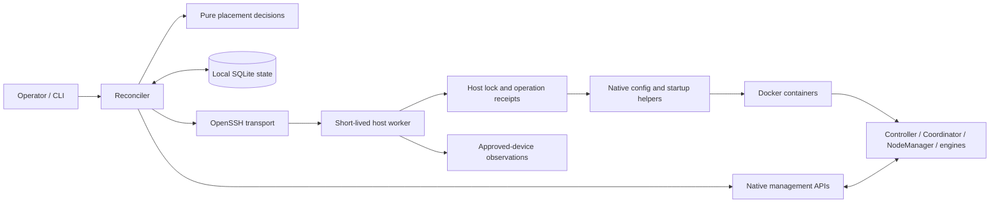
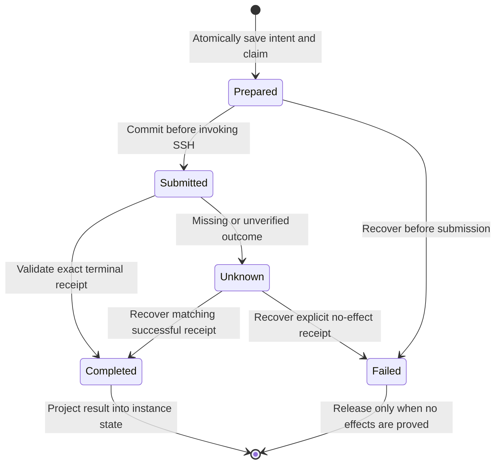

<!--
Copyright (c) 2026 ZhengDeL. All rights reserved.
MindIE is licensed under Mulan PSL v2.
You can use this software according to the terms and conditions of the Mulan PSL v2.
You may obtain a copy of Mulan PSL v2 at:
        http://license.coscl.org.cn/MulanPSL2
THIS SOFTWARE IS PROVIDED ON AN "AS IS" BASIS, WITHOUT WARRANTIES OF ANY KIND,
EITHER EXPRESS OR IMPLIED, INCLUDING BUT NOT LIMITED TO NON-INFRINGEMENT,
MERCHANTABILITY OR FIT FOR A PARTICULAR PURPOSE.
See the Mulan PSL v2 for more details.
-->

# Docker orchestration design

This example adds a central desired-state loop around the native Docker deployer. It places complete
single-host Prefill/Decode or Union instances into operator-approved candidate slots. Motor retains
instance assembly, engine supervision and inference request routing; the example manages host containers.
The supported scope and operating commands are in the [README](README.md).

## Components and ownership



| Module | Responsibility |
| --- | --- |
| `docker_cluster.py` | CLI commands, process lifetime and bounded wait loops |
| `config.py` | Validate orchestration input; preserve arbitrary native JSON fields |
| `controller.py` | Observe, reconcile receipts, check readiness, scale and retire instances |
| `planner.py` | Propose actions from snapshots; never reserve resources or execute commands |
| `state.py` | Single-writer lock, desired counts, operations, resource claims and instance records |
| `executor.py` | Bounded SSH requests, response binding and uncertain-outcome reporting |
| `native.py` | Host lock, native preparation, final admission, exact-container lifecycle and receipts |
| `observations.py` | Explicitly enabled, bounded physical-device mapping and read-only NPU sampling |
| `management.py` | Native readiness, routing membership, pause/resume, drain and request metrics |

The controller has no new host listener. Workers run only for individual SSH requests. A managed native
Coordinator/Controller container is recorded separately from engine slots; an external control plane is
never stopped by this example. A successful Docker command does not establish Motor readiness.

## Durable operations and uncertain transport



Operation phase and instance readiness are separate. A completed deployment operation creates a `starting`
instance; native management views and observed owned containers must subsequently establish `ready`.
Claims remain held through starting, unready, draining and uncertain execution. Expiry does not free them.

```mermaid
sequenceDiagram
    participant C as Controller
    participant S as SQLite
    participant W as SSH worker
    participant D as Docker
    C->>S: Commit operation intent and complete resource claim
    C->>S: Commit submitted
    C->>W: Execute operation ID, generation and expected identities
    W->>W: Acquire host lock; persist intent; repeat admission
    W->>D: Create or mutate exact owned container
    W->>W: Persist operation receipt
    W--xC: SSH response lost
    C->>S: Record unknown; retain resource claim
    C->>W: Query the same operation receipt
    W-->>C: Return persisted bound result or unresolved outcome
    C->>S: Save verified receipt; repair instance projection
```

The same operation ID cannot be reused for different intent. Receipts are bound to the specification,
slot, generation, host and Docker identities, and exact container IDs. After a crash between receipt and
instance commits, reconciliation projects only the claim's current operation result; it does not replay
historical creation results over a newer lifecycle operation. A failed command is not proof of no effects.

## Resource correctness

- Slots are complete device groups on one host, not fragments of a cross-host instance. Alternative slots
  may overlap; simultaneously held claims may not overlap physical devices or complete native port sets.
- Planning uses fresh observations. Atomic claim creation prevents conflicting selections in this state
  directory; the host worker repeats admission under a host-wide lock immediately before Docker effects.
- Admission checks physical mapping, health, a known empty process set, measured zero utilization,
  positive free HBM, container declarations and ports. Missing or stale evidence blocks admission.
  A conservative HBM lower bound is not a model memory-capacity guarantee.
- Ownership labels supplement exact container IDs and host identities. Lifecycle operations do not select
  containers by display name. A new deployment generation cannot silently reuse an unresolved claim.
- Scale-in stops and removes the confirmed owned container before releasing its claim. Explicitly proved
  creation with no effects can release an unused claim; unknown operations cannot release capacity.

## Drain, recovery and concurrency limits

Drain first records `draining`, invokes native NodeManager pause, verifies exclusion from Coordinator
routing through a count-consistent complete instance view.
Paused jobs may be absent from native views. After an acknowledged pause, absence establishes routing
exclusion only; it never proves container termination or permits releasing a resource claim.
Every returned engine metric target must show zero running and waiting requests across a grace period.
Missing evidence or timeout refuses removal and attempts resume. An interrupted drain remains
durable and requires explicit reconciliation. This is a bounded observed quiescence check, not a guarantee
of preserved sessions, KV state or requests admitted through an independent bypass path.

In P/D mode, a selected Decode resource can remain absent from the engine queue while its Prefill leg runs.
A completed Prefill request can leave KV data needed by the subsequent Decode leg. The native pause API and
engine queue gauges do not expose an atomic per-instance barrier covering those dependencies. P/D manual
scale-in and `stop` therefore require an externally quiesced ingress and confirmation that active requests
and KV transfers have completed. A grace interval cannot establish that maintenance precondition.
The adapter does not replace Motor's request protocol to manufacture such a barrier.

An in-flight Union SSE acceptance check establishes only the exercised routing and streaming path.
It does not establish a universal lossless scale-in guarantee across all concurrent admission races.

Confirmed abnormal terminal exits may restart within retry limits and after fresh resource admission.
A running container with an unreachable API, an unreachable host or an ordinary external stop does not
trigger automatic replacement. SSH failure does not prove that an old instance stopped. This example
does not implement fencing, partition-safe migration or control-plane high availability. Operators must
reserve devices against other Docker users and schedulers; local locks do not control those actors.

One controller owns the SQLite directory for its entire write session. Stop continuous `run` before
mutating manual commands; its shutdown leaves models running. Keep state on durable local storage and
retain host receipts. Read-only `plan` and `status` do not initialize a missing database. Autoscaling is
enabled only in `run`, uses stable native request-metric samples and cooldowns, and cannot wake from zero.
`autoscaling.scale_in` is optional: its default is enabled for Union and disabled for P/D. Enabled P/D
autoscaling rejects an explicit `scale_in:true`; it can still expand. Union can set `scale_in:false` to
disable automatic reduction. The default is resolved at use time without adding an omitted field to the
stored specification, preserving the digest of existing disabled-autoscaling configurations.

## Extension boundaries

Keep planning pure, transport effects in the executor/worker, and native HTTP semantics in management.
New hardware, instance layouts or metrics require explicit validation and acceptance for their evidence
and failure cases. Protocol changes must preserve operation binding, unknown-outcome recovery and existing
claims. Multi-controller coordination, distributed instances and fencing need separate designs rather
than weakening these guards. Preserve the native configuration as the source of engine behavior.
